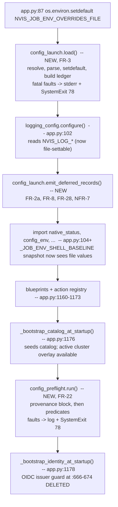

# PLC Feature Brief — launch-configuration

| Field | Value |
|---|---|
| Status | Draft, not canonical PLC evidence. Requirements **revision 2** (approved, milestone recorded 2026-09-03T17:14:36Z); design draft **revision 3**, 2026-09-03. Design not yet reviewed. |
| Revision | r3 — design sections authored (`## Design Delta`, `## Test Implications`, `## Security And PLC Implications`, `## Design Traceability`) plus decision 8, resolving Open Question 4. Requirements text unchanged in r3; six requirements gaps are **reported** under *Requirements gaps found while designing*, not fixed. r2 was the feature-lead rulings on the TOML parser (decision 6) and the tracked/gitignored file split (decision 7). See *Document Change Log*. |
| Generated by | `plc-requirements-authoring`, then `plc-design-authoring` |
| Workspace ID | single-repo |
| Work products root | `.plc/briefs` |
| Repo | `nvis-rack-status` |
| Repo URL | ssh://gitlab-master.nvidia.com:12051/nvis/nvis-rack-status.git |
| Branch | `feat/auth-identity` |
| Base commit | 2766c04a387d280436400d43f17572021c31c6b8 |
| Feature/task request | A launch-time configuration file (`greenlight.toml`) the application reads itself, plus a required-setting preflight that refuses to start when a setting that cannot be safely assumed is missing or invalid |
| Feature lead | Rafael M. Koike |
| Feature brief path | `.plc/briefs/launch-configuration-brief.md` |
| Test plan path | *(not yet authored)* |
| Template used | bundled `feature_brief.md` (no team template found — see Advisory Notes) |
| SRD source used | `.plc/requirements/SWE-PLC-L1-002-BasicPLC-SRD-NVIS-RACK-STATUS.md` |
| Style exemplars | `.plc/briefs/auth-oidc-provider-brief.md`, `.plc/briefs/auth-identity-brief.md` |
| Jira Ticket | [NVRACKSTAT-59](https://jirasw.nvidia.com/browse/NVRACKSTAT-59) |
| Output mode | concise |

> **Requirement numbering is per-brief**, as in every prior brief in `.plc/briefs/`. `identity FR-n`,
> `oidc FR-n` and `authz FR-n` name requirements in the Phase 2, 2.5 and 3 briefs.
>
> **Naming.** The product is **NVIS Greenlight** (formerly NVIS Rack Status). "Greenlight" on second
> reference. Environment-variable names keep their `RACK_*` / `NVIS_*` spellings — renaming 238 read
> sites is not in this feature.

## Purpose

**Greenlight cannot read a configuration file.** `rack-config.env` sits at the repo root and looks
like the answer, but it is consumed only by Docker: `Dockerfile:52` copies it, `docker-compose.yml:41`
loads it as `env_file`, `build-docker.sh:225` passes it as `--env-file`, and
`deploy/nscale-tx.override.consolidated.yml:65` overrides it. The only mentions inside `backend/` are
a docstring in `backend/core.py:48` and a comment in `backend/tests/test_app_version.py:14` — prose,
not code. So `./start.sh`, a bare `python backend/app.py`, and `bin/run-local-auth.sh` all launch
with **no configuration file at all**, and every setting has to arrive as an exported shell variable.

**The consequence is a class of failure no health check catches.** Measured 2026-09-03, before
`2766c04`: with `RACK_WEB_OIDC_ENABLED=1` and no `RACK_WEB_OIDC_ISSUER`, the app booted normally,
`GET /login` returned 200, and `bin/verify-deploy.sh` passed — then every sign-in raised
`OIDCConfigError` (`backend/identity/oidc.py:83`) from the mint path. A deployment green by every
gate in which nobody can log in. `2766c04` added a startup guard for that one setting
(`backend/app.py:652-674`). **This feature generalises that guard into a mechanism** and gives the
five customer deployments a file to configure instead of a shell history.

It is not the only instance. `RACK_WEB_TLS_CERT` set without `RACK_WEB_TLS_KEY` produces two
*different* wrong outcomes: under the dev server `backend/app.py:1192-1193` logs an error and
**serves plain HTTP**, while the container entrypoint's `${RACK_WEB_TLS_CERT:+--certfile … --keyfile
${RACK_WEB_TLS_KEY}}` (`Dockerfile:91`) hands gunicorn an empty `--keyfile`. One deployment silently
downgrades the transport; the other crashes. Neither is a preflight.

This is a draft working artifact. It does not replace canonical SRD, STP, TAVA, nSpect or
release-gate evidence.

## The decisive design fact

**238 environment reads across 70 non-test backend modules** (`os.environ.get`, `os.environ[…]`,
`os.getenv`; measured 2026-09-03 — see Advisory Notes, this corrects the 266/75 figure in the
request). Citizen 5's layered accessor `_eget` (`backend/config_env.py:895`) has ~120 call sites, so
roughly *half* of all configuration reads bypass the ladder entirely.

A configuration file that fed only `_eget` would therefore be invisible to the other half —
"works on one code path, not another", discovered by a customer. The file must instead **materialize
into `os.environ`**, which needs zero changes at those 238 sites and delivers the lead's precedence
("start from config but be able to be overwritten by launch settings") for free, because a real
environment variable is already present when the loader runs.

There is direct precedent: `_apply_catalog_active_to_environ()` in `app.py`, registered through
`config_env.set_materialize_hook()` (`backend/config_env.py:72`), does exactly this for the active
catalog overlay.

**The file populates the process-env rung. It does not become a new rung.** Citizen 5's ladder is
unchanged (`backend/config_env.py:16`, `:895-920`):

```
cluster "high" overlay > job_env_overrides.json > os.environ > platform "low" overlay > default
                                                  ^^^^^^^^^^
                                        greenlight.toml lands here, by setdefault
```

## Assumptions

1. **The runtime interpreter is Python 3.10, and TOML parsing does not depend on that changing.**
   **Revised in r2.** `Dockerfile:26` is `ubuntu:22.04` and `:34` installs `python3`; the feature
   lead confirmed empirically on 2026-09-03 that `docker run --rm ubuntu:22.04` plus
   `apt-get install python3` yields **Python 3.10.12**, in which `import tomllib` raises
   `ModuleNotFoundError`. `README.md:358` states the floor as "Python 3.10 or newer", which stays
   true. Decision 6 resolves this with a conditional import over the `tomli` backport rather than an
   interpreter bump, so FR-4a now requires *parsing to work on the shipped interpreter* rather than a
   version floor. Local dev and all three CI jobs are `python:3.12-slim`
   (`.gitlab-ci.yml:61,109,144`), which is why AC-4a must assert against the **built image**: the CI
   interpreter passes either way, and that is the only place the divergence is observable.
2. **`tomllib` is used here today, and that usage is broken in every container.** **Revised in r2.**
   `backend/catalog/npi_import.py:41` imports `tomllib` at **module level** and `:94` parses the 40+
   tracked `.toml` records under `backend/catalog/npi_seed/tools/`. On Python 3.10 that import
   raises, and the two call sites swallow it differently: `catalog/seed.py:630-635` — reached at
   every boot via `app.py:597` — catches `except Exception` and logs at `_logger.debug`, while
   `catalog/api.py:268-273` is unguarded, so `POST /api/catalog/npi-tools/import` returns a 500.
   So this is not a precedent that `tomllib` works; it is a **pre-existing latent defect** that
   authoring this brief uncovered. FR-4b and FR-4c bring it into scope at the lead's direction.
3. **Secrets do not go in this file.** **Revised in r2.** Under decision 7 the real `greenlight.toml`
   is **gitignored**, so the argument is no longer "a secret here reaches git history". It is that
   the file is a plain-text, world-readable-by-default artifact that gets copied — into a bug report,
   a `docker cp`, a `scp` to a colleague, a support bundle — and none of those copies inherit the
   `.gitignore`. `.gitignore:48-63` already excludes identity stores, `**/*.key`, `**/*.pem` and
   `var/secrets/`. Secret-bearing settings stay in `var/cache/job_env_overrides.json`
   (permission-restricted, per `config_env.py:170,206,218`).
4. **`http://localhost:PORT` is a legitimate value.** Operators reach several deployments through
   SSH tunnels; `identity/oidc.py:94` already encodes this exception for the issuer.
5. **One file, one deployment, and it never enters shared git history.** Five customer deployments
   (Mayo Clinic, Nscale TX, Nscale NC, Firmus MEL01, Boston Markley —
   `.cursor/rules/cluster-deployments.mdc`) each carry their own `greenlight.toml`; the file is not
   multi-cluster. Per-cluster identity remains citizen 3's job. **Reinforced in r2:** decision 7
   gitignores the real file precisely because tracking per-deployment values in a repo five
   customers share *is* the cluster-mixing hazard that rule exists to prevent.
6. **A settings registry exists to validate against.** `config_env.JOB_ENV_UI_DEFINITIONS` declares
   keys with a `section` and a `description` (`backend/config_env.py:83+`). It does not cover all
   238 reads, which is why FR-8 warns rather than refuses on an undeclared key.

## Decisions taken by the feature lead, 2026-09-03

Recorded with what each one costs. Not to be re-litigated.

| # | Decision | Rationale | Consequence accepted |
|---|---|---|---|
| 1 | **TOML, named `greenlight.toml`, at the repo root.** PyYAML rejected. | **Rationale corrected in r2.** Typed scalars (bool/int/array arrive typed, so FR-12..FR-14 render a known type rather than guess at a string); one unambiguous grammar, with none of YAML's implicit-typing surprises; no `yaml.load` footgun to get wrong; and 40+ `.toml` records already parsed in-tree (`backend/catalog/npi_seed/tools/`, via `catalog/npi_import.py:94`). | **The original rationale — "no new dependency" — was false and is withdrawn.** `pyyaml>=6.0,<7` is already a runtime dependency (`backend/requirements.txt:4`, imported at `backend/workflow_engine.py:33` and `backend/api/openapi_spec.py:67`), so that argument never distinguished the two formats. TOML in fact costs *one* new dependency, the `tomli` backport — see decision 6. The decision stands on the grounds above. |
| 2 | **The file is the baseline; real environment variables override it.** | Lead: *"start from config but be able to be overwritten by launch settings."* A one-off `RACK_STATUS_DEMO=1 ./start.sh` must still win. | The precedence is delivered by `setdefault`, which means it is **invisible after the fact** — an `os.environ` entry carries no origin. That is what forces the provenance requirements (FR-23..FR-26). |
| 3 | **A missing or invalid required setting refuses startup, reporting every problem at once.** | An operator fixing five settings one restart at a time is miserable; on a container each cycle is a rebuild-and-recreate. | A deployment that is *currently* running with a latent misconfiguration will refuse to come up after upgrade. That is the intended trade — the alternative is `2766c04`'s failure repeated across five sites. |
| 4 | **Two files with distinct jobs, deliberately.** `greenlight.toml` is application configuration; a small env file keeps the six settings Docker interpolates. | Docker resolves `docker-compose.yml:40,43,45,46,48` at container-**create** time, before Python exists. A TOML file the app parses cannot supply them. | Two files an operator must understand. A generator (TOML → env) was considered and **rejected**: a second source of truth that drifts, and drift here means the published port disagrees with the configured one. |
| 5 | **Product naming is "NVIS Greenlight"**, Greenlight on second reference. | Formerly NVIS Rack Status. | Variable names, module names and the repo keep `rack`/`nvis` spellings. |
| 6 | **Add the `tomli` backport as a runtime dependency behind a conditional import.** Base-image bump and YAML both rejected. *(r2, resolves Open Question 7.)* | `tomli` is the upstream backport of the same module by the same author, pure-Python, dependency-free, and ships `py3-none-any` — no compiler, which is what makes it installable at an air-gapped site (the `srp` precedent, `requirements.txt`). The conditional import means the code is written once against `tomllib` and the backport is invisible above the import line, so it costs nothing to delete when the interpreter eventually moves. | One new runtime dependency where the draft claimed none, and a two-line import idiom every TOML reader in the tree must use rather than a bare `import tomllib` — FR-4, FR-4a, FR-4b. Rejected alternatives and why: bumping `ubuntu:22.04` changes the runtime for *every* dependency at once for the sake of one parser; a deadsnakes/PPA interpreter adds an apt source to an air-gapped image; and returning to YAML would give up decision 1's typed scalars. |
| 7 | **Ship a tracked `greenlight.toml.example`; keep the real `greenlight.toml` gitignored.** *(r2, resolves Open Question 5.)* | Five customer deployments share this repo and this branch (`cluster-deployments.mdc`). A tracked file holding real per-deployment values is the cluster-mixing hazard that rule exists to prevent — one site's issuer or head-node address arriving in another site's checkout, invisibly, through a `git pull`. | **The absent-file path becomes the normal case, not an edge case.** On a fresh clone there is no `greenlight.toml` at all, so FR-2 and FR-2a stop being a compatibility concession and become the first-run experience — which *raises* their importance. NFR-3's argument also has to change: it can no longer rest on protecting git history (see assumption 3). And the example file becomes a documentation artifact that can rot against the registry, which FR-1b constrains but does not fully solve. |
| 8 | **Provenance surfaces as a startup log block.** Not an API endpoint, and not the Settings view. *(r3, resolves Open Question 4.)* | An endpoint for a diagnostic would drag the product's whole governance apparatus behind it: an entry in the action vocabulary (**268** `@action(` declarations across non-test `backend/`, measured 2026-09-03 — see *Corrections*, item 7), a resource resolver, a `@throttle` declaration and a policy grant, plus the auth gate and an audit record per read. That is disproportionate to "tell me where this value came from", and each obligation is a place the feature can be got wrong. A log record carries none of them. | **A log block is not queryable after the fact.** An operator debugging a stale value must *have* the startup log — and on a deployment whose `NVIS_LOG_SINKS` excludes `file` (`logging_config.py:119`), `docker logs` is the only copy and it does not survive a container recreate. Accepted deliberately: the design's answer is to make the block **greppable and stable** (design decision DD-6) rather than to add a query surface. The per-key ledger `config_launch` keeps is exactly the data an endpoint would render, so this is a deferral rather than a dead end. |

## The six Compose-interpolated settings (decision 4)

Verified at `docker-compose.yml`:

| Setting | Line | What Docker does with it |
|---|---|---|
| `RACK_WEB_BIND_ADDR` | 40 | published-port host binding |
| `RACK_WEB_PORT` | 40 | published-port number |
| `RACK_SSH_HOST` | 43 | passed into the container's environment |
| `RACK_WEB_TLS_CERT` | 45 | passed in; also drives `--certfile` at `Dockerfile:91` |
| `RACK_WEB_TLS_KEY` | 46 | passed in; also drives `--keyfile` at `Dockerfile:91` |
| `RACK_SSH_KEY_PATH` | 48 | bind-mount source path |

`RACK_SSH_HOST`, `RACK_WEB_TLS_CERT` and `RACK_WEB_TLS_KEY` are read by the app *as well*, so they
may legitimately appear in `greenlight.toml` — the file value simply cannot influence what Compose
publishes or mounts. FR-28 makes that visible rather than surprising.

## Initial required-setting set (FR-21)

"Required" is **conditional**, which is why FR-16 specifies predicates rather than a static list.

| Setting | Required when | Evidence | What happens today |
|---|---|---|---|
| `RACK_WEB_OIDC_ISSUER` | `RACK_WEB_OIDC_ENABLED` is truthy | `identity/oidc.py:63-89`; `app.py:652-674`; `docs/ENVIRONMENT.md:146` | since `2766c04`, startup refuses — this feature moves the check into the mechanism (FR-20) |
| `RACK_WEB_TLS_KEY` | `RACK_WEB_TLS_CERT` is non-empty | `app.py:1190-1193`; `Dockerfile:91`; `docs/ENVIRONMENT.md:229` | dev server logs an error and **serves plain HTTP**; gunicorn gets an empty `--keyfile`. A silent transport downgrade on one path and a crash on the other |
| `RACK_SSH_HOST` | the resolved control connection is SSH | `transport/factory.py:36,130`; `transport/ssh.py:82`; `host_exec.py:463` | first cluster command fails with *"No SSH host is configured"*. Note `DEFAULT_EXEC_MODE = "ssh"` (`factory.py:36`), so this is the **default** shape, and `RACK_EXEC_MODE` is deprecated (`factory.py:45-55`) — the predicate must key off the resolved connection, not that variable |
| `RACK_NODE_SSH_USER` | `RACK_DIRECT_NODE_SSH` is truthy | `docs/ENVIRONMENT.md:633` | **ASSUMPTION — needs the lead's ruling.** The doc says "required in practice … which defaults to `root`", i.e. it has a default and is therefore arguably not required. See Open Question 2 |

**Deliberately excluded:** the `RACK_SLURM_*` binary paths, which `docs/ENVIRONMENT.md:405` calls
required with `RACK_SLURM_SKIP_MODULE_LOAD=1` *"when the binaries are not on the non-login shell's
`PATH`"*. That predicate depends on a **remote** host's `PATH`, so a local startup preflight cannot
evaluate it without an SSH round trip at boot. Recorded as a non-goal rather than omitted.

**Not candidates, checked:** `RACK_WEB_AUTH_TOKEN` and `RACK_WEB_AUTH_MODE` are gone
(`backend/web_auth.py:126`), removed by identity FR-18.

## Proposed Functional Requirements

\<content authored by agent, review thoroughly and remove after human review\>

Agentic PLC version: unknown; Skill: plc-requirements-authoring; LLM: unknown; Timestamp: 2026-09-03T16:41:29Z; Input ref: NVRACKSTAT-59

### File discovery, absence and ordering

| ID | Requirement | Type | Source | Notes |
|---|---|---|---|---|
| FR-1 | The Greenlight configuration loader shall read launch configuration from a TOML file named `greenlight.toml` resolved relative to `REPO_ROOT`. | Functional | decisions 1, 7 | **Repo root, not `var/`.** `/app/var` is masked by the `rack-data` named volume, which Docker seeds from the image only while the volume is empty (`local-dev.mdc`), so a file placed there on an existing deployment is invisible. A repo-root file can be bind-mounted, which is the shape that works on both a fresh `docker run` and a live OVA. **Changed in r2:** decision 7 makes the file deployment-local, so it arrives by bind mount or by being written on the host rather than through a `COPY` line — unlike `rack-config.env`, which `Dockerfile:52` does copy in. FR-1f keeps it that way |
| FR-1a | Where the environment variable `NVIS_GREENLIGHT_CONFIG` names a path, the Greenlight configuration loader shall read that path in place of the repo-root `greenlight.toml`. | Functional | precedent: `NVIS_CATALOG_FILE`, `NVIS_IDENTITY_FILE`, `RACK_VALIDATION_ACTIVITIES_FILE` | Boston already selects a catalog by env var (`cluster-deployments.mdc`), and the test suite needs a way to point at a fixture without writing to the repo root. Without this, NFR-4's tests would have to mutate the tree |
| FR-1b | The NVIS Greenlight repository shall contain a tracked file `greenlight.toml.example` that documents every setting the Greenlight settings registry declares. | Usability | decision 7 | **New in r2.** With the real file gitignored, the example is the *only* discoverable statement of what may be configured — an operator cloning the repo has nothing else to copy. Tying it to the registry rather than to a hand-kept list is what stops it rotting as keys are added, which is the cost decision 7 accepted |
| FR-1c | The NVIS Greenlight repository shall exclude `greenlight.toml` from version control while retaining `greenlight.toml.example`. | Security | decision 7 | **New in r2.** `.gitignore` has no `*.toml` rule today — line 139 is a *negation*, `!.plc/waivers.toml` — so the real file is tracked by default and an operator's first `git status` invites them to commit it. The exclusion must be paired with an explicit un-ignore or literal-name entry for the example, or the pattern eats both |
| FR-1d | Where the Greenlight configuration loader resolves a path ending in `.example`, the Greenlight configuration loader shall read no configuration from that path. | Functional | decision 7 | **New in r2.** The failure this prevents is quiet and plausible: an operator copies the example to enable a setting, mistypes the destination, and the loader happily applies a file of placeholder values — a deployment configured with `https://rack.example.com` as its issuer, which is worse than one configured with nothing |
| FR-1e | The NVIS Greenlight repository shall exclude from `greenlight.toml.example` every credential value and every hostname belonging to a named customer deployment. | Security | decision 7 | **New in r2** (split from FR-1b, which carried two obligations). The example is the one tracked half of the split, so it is the half that reaches all five sites — a real issuer, head-node address or rack prefix left in it is exactly the cluster-mixing leak decision 7 exists to prevent, arriving through the single file that *is* shared. Checkable placeholders (`https://rack.example.com`, `10.0.0.1`) are the standard; "looks generic" is not |
| FR-1f | The NVIS Greenlight runtime image shall contain no `greenlight.toml` file. | Security | decision 7 | **New in r2.** The gitignore rule alone does not achieve this: `Dockerfile` uses explicit per-path `COPY` lines and `.dockerignore` has no rule for the file, so `COPY greenlight.toml ./` — the shape `rack-config.env` already uses at `Dockerfile:52` — would bake one deployment's values into an image, which is the mixing hazard decision 7 avoided in git reappearing in a registry. It would also make the file un-editable without a rebuild, and per `local-dev.mdc` a baked file under a bind-mounted path is invisible anyway. Both a missing `COPY` line and a `.dockerignore` entry satisfy this; the entry is the one that cannot be undone by accident |
| FR-2 | If no configuration file exists at the resolved path, then the NVIS Greenlight application shall complete startup with no key materialized from a file. | Functional | **the normal case on a fresh checkout (decision 7); the state every deployment is in today** | **Elevated in r2.** Under decision 7 the real file is gitignored, so absence is not a legacy edge case to be tolerated — it is what every clone, every CI job and every first run looks like, permanently. Absence therefore cannot become a hard error under any future revision, and the requirement's importance goes *up*, not down: all five deployments have no such file today, so a version that requires it is a simultaneous outage at every site |
| FR-2a | If no configuration file exists at the resolved path, then the Greenlight configuration loader shall emit one informational log record naming the path it looked for. | Telemetry | consequence of FR-2 | "the file is being ignored" and "the file is at the wrong path" are indistinguishable otherwise, and the second is the likelier operator error. **Weight increased in r2:** with the file gitignored, "I copied the example and nothing changed" becomes the common first-run question, and this record is the only thing that answers it |
| FR-3 | The Greenlight configuration loader shall complete before the NVIS Greenlight application executes any startup bootstrap. | Functional | consequence of the 238-read fact | `app.py` runs `_bootstrap_identity_at_startup()` at import (`app.py:1178`) and that function reads `os.environ` directly (`identity/oidc.py:70,81`). A loader that runs after it configures nothing that matters |
| FR-22 | The Greenlight required-setting preflight shall run after the configuration loader completes and before the NVIS Greenlight application executes any startup bootstrap. | Functional | consequence of FR-3 | A preflight before materialization would report file-supplied settings as missing — the mechanism would fail on exactly the file it exists to support |

### Parsing and malformed input

| ID | Requirement | Type | Source | Notes |
|---|---|---|---|---|
| FR-4 | The Greenlight configuration loader shall parse the configuration file with the standard-library `tomllib` module where the running interpreter provides it, and with the `tomli` backport otherwise. | Platform | decisions 1, 6 | **Semantics changed in r2** — was "with the Python standard-library `tomllib` module", which is unsatisfiable on the shipped interpreter (assumption 1). The idiom is `try: import tomllib` / `except ModuleNotFoundError: import tomli as tomllib`, so all parsing code below the import line is written against one name and the backport is invisible — and deletable, unchanged, when the runtime interpreter eventually reaches 3.11. `ModuleNotFoundError` specifically, not `ImportError`: a broader catch would swallow a *broken* `tomllib` and silently fall back, which is the class of bug FR-4c exists to stop |
| FR-4a | The NVIS Greenlight runtime image shall provide a TOML parsing module importable by the Greenlight configuration loader on the Python interpreter that image ships. | Platform | **assumption 1; decision 6** | **Semantics changed in r2** — was "shall provide a Python interpreter of version 3.11 or later", which decision 6 rejected. The obligation is now on the *capability*, not the version, so it is satisfied by pinning `tomli` in `backend/requirements.txt` and is not invalidated by a future base-image bump. The version floor in `README.md:358` stays at 3.10. **This is still the highest-risk row in the brief**, because the three trees disagree: local dev and all three CI jobs are `python:3.12-slim` (`.gitlab-ci.yml:61,109,144`) and satisfy it accidentally, while the image is the only tree where it can fail — the `local-vs-ci-tree.mdc` divergence with the image as a third tree |
| FR-4b | The NVIS Greenlight application shall import `tomllib` through the conditional-import form of FR-4 at every site in the repository that imports it. | Platform | decision 6; **pre-existing defect, see below** | **New in r2, and it is a bug fix rather than new scope.** `backend/catalog/npi_import.py:41` imports `tomllib` at module level, so on the container's Python 3.10 it raises. `catalog/seed.py:630-635` — reached at every boot through `app.py:597` — catches `except Exception` and logs only at `_logger.debug`, which means **NPI catalog import has been non-functional in every container deployment with no visible trace**; `catalog/api.py:268` is unguarded, so `POST /api/catalog/npi-tools/import` returns a 500. Discovered while authoring this brief, not invented by the feature; the lead scoped it in because decision 6's idiom fixes it in one line and because leaving one module on a bare `import tomllib` guarantees the next reader copies the broken form |
| FR-4c | If importing the NPI catalog importer fails, then the NVIS Greenlight application shall emit one log record at warning level or above naming the module and the import error. | Telemetry | consequence of FR-4b | **New in r2.** Fixing the import is not enough — the *reason* it went unnoticed for the life of the deployment is `_logger.debug` (`catalog/seed.py:634`), a level nothing in production emits. Startup must still complete: the NPI catalog is additive reference data, so refusing to boot over it would be the wrong failure direction, and that behaviour is unchanged. What changes is that the next such failure is visible in `docker logs` on the first restart instead of never |
| FR-5 | If the configuration file exists and does not parse as valid TOML, then the NVIS Greenlight application shall terminate startup with a non-zero exit status. | Functional | decision 3 | **Fail closed.** The alternative — ignore the file and continue — starts a deployment with none of its configuration applied, which is the `2766c04` failure with a wider blast radius. `catalog/npi_import.py:95` deliberately *skips* an unparseable record; that is right for an additive reference mirror and wrong for the file that decides how the process runs |
| FR-5a | If the configuration file does not parse as valid TOML, then the Greenlight configuration loader shall emit one diagnostic naming the file path and the line and column reported by `tomllib`. | Telemetry | consequence of FR-5 | `TOMLDecodeError` carries the position; discarding it makes the operator bisect the file by hand |
| FR-6 | If the configuration file exists and cannot be opened for reading, then the NVIS Greenlight application shall terminate startup with a diagnostic that distinguishes an unreadable file from an absent file. | Functional | consequence of FR-2 | Because absence is legal (FR-2), a permission error that silently followed the absent path would present as "my settings are being ignored" with nothing in the log naming the cause |

### Key mapping and file shape

| ID | Requirement | Type | Source | Notes |
|---|---|---|---|---|
| FR-7 | The Greenlight configuration loader shall treat each leaf key in the configuration file as the exact name of an environment variable. | Interface | consequence of the setdefault design | No translation layer. A lowercase-to-uppercase or dotted-to-underscore mapping is a second naming grammar that would disagree with `docs/ENVIRONMENT.md` and with all 238 read sites |
| FR-7a | The Greenlight configuration loader shall use a TOML table name for grouping only, without concatenating that table name into the environment-variable name. | Interface | `config_env.JOB_ENV_UI_DEFINITIONS`' `section` field (`config_env.py:85`) | Lets the file's tables mirror the Settings UI sections an operator already sees, at no cost in key names. See Open Question 1 |
| FR-8 | If a leaf key in the configuration file is not declared in the Greenlight settings registry, then the Greenlight configuration loader shall emit one warning record naming that key. | Telemetry | usability | A typo that silently does nothing is the worst outcome of a config file — the operator restarts, sees no change, and blames the feature |
| FR-8a | If a leaf key in the configuration file is not declared in the Greenlight settings registry, then the NVIS Greenlight application shall complete startup. | Functional | assumption 6 | Warn, do not refuse: the registry covers a subset of the 238 reads, so refusing on an undeclared key would make legitimate knobs unsettable and would put the file's usefulness behind a registry-completion project |

### Materialization into `os.environ`

| ID | Requirement | Type | Source | Notes |
|---|---|---|---|---|
| FR-9 | The Greenlight configuration loader shall materialize a configured key into `os.environ` only where `os.environ` does not already contain that key. | Functional | decision 2 | This one line *is* the precedence rule. It also means the loader needs no knowledge of the ladder and no changes at the 238 read sites |
| FR-10 | While a key is already present in `os.environ`, the Greenlight configuration loader shall leave that key's existing value unchanged. | Functional | decision 2 | **Including an empty string.** `_eget` returns `os.environ.get(name)` whenever it `is not None` (`config_env.py:915-917`), so `FOO=` is an explicit empty value that deliberately beats the platform low overlay (`config_env.py:20-21`). An `if not os.environ.get(k)` guard instead of `setdefault` would silently overwrite that intent and break `test_config_precedence.py` |
| FR-11 | The Greenlight configuration loader shall populate the process-environment rung of the citizen-5 configuration ladder without adding a rung to that ladder. | Functional | `core-designs.mdc` citizen 5; `config_env.py:16` | Stated as a requirement because the tempting alternative — a sixth rung between the overrides store and the process env — would change the meaning of `job_env_overrides.json` for every existing setting and invalidate the precedence test that pins the current order |

### TOML type mapping

`os.environ` values are strings; TOML values are typed. The mapping is a requirement, not an
implementation detail, because a reader such as `core.truthy_env` accepts a fixed vocabulary.

| ID | Requirement | Type | Source | Notes |
|---|---|---|---|---|
| FR-12 | The Greenlight configuration loader shall render a TOML boolean value as one of the two strings `core.truthy_env` recognises: `"1"` for true, `"0"` for false. | Interface | `core.truthy_env`; `identity/oidc.py:56` `_TRUTHY` | `"True"` is the Python `str(bool)` default and is **not** in `identity/oidc.py`'s `_TRUTHY` set (`{"1","true","yes","on"}` — lowercased, so `"True"` happens to pass there but not everywhere). Pinning the rendering removes a per-reader coin flip |
| FR-13 | The Greenlight configuration loader shall render a TOML integer value as its base-10 decimal string without digit separators. | Interface | `_eget_int` (`config_env.py:923-935`) | `_eget_int` calls `int(str(raw).strip(), 10)` and falls back to the *default* on `ValueError` — so a badly rendered integer does not error, it silently substitutes a different value |
| FR-14 | The Greenlight configuration loader shall render a TOML array of scalars as its elements joined by a single comma without surrounding whitespace. | Interface | `RACK_WEB_ALLOWED_ORIGINS` (`docs/ENVIRONMENT.md:234`), `VALIDATION_TEST` (`config_env.py:963-965`) | Comma-separated is the established convention for list-valued settings here. Whitespace is specified because several readers split on `,` without stripping |
| FR-15 | If a configured value is a TOML type other than string, boolean, integer, float, or array of scalars, then the NVIS Greenlight application shall terminate startup with a diagnostic naming that key and its TOML type. | Functional | fail-closed, consistent with FR-5 | TOML offers datetimes, nested arrays and arrays of tables. There is no defensible string rendering for those, and inventing one (JSON? ISO 8601?) creates a format only this loader understands |

### Required-setting preflight

| ID | Requirement | Type | Source | Notes |
|---|---|---|---|---|
| FR-16 | The Greenlight required-setting preflight shall evaluate a per-setting predicate to determine whether that setting is required under the current configuration. | Functional | **fact F** | A static required-keys list is wrong for every setting in the table above: the issuer is required only with the provider on, the TLS key only with a cert set. A flat list would refuse to start every deployment that legitimately runs without TLS |
| FR-17 | When the required-setting preflight finds one or more required settings missing or invalid, the Greenlight required-setting preflight shall report every such setting in one diagnostic. | Functional | decision 3 | **Report-all, not fail-first.** On a container each restart is a recreate; five settings found one at a time is five cycles. Verified by AC-17 with three simultaneous faults, because a report-all implementation and a fail-first one are indistinguishable with only one |
| FR-18 | If the required-setting preflight reports at least one missing or invalid required setting, then the NVIS Greenlight application shall terminate startup with a non-zero exit status. | Functional | decision 3; `2766c04` | Non-zero is the observable that matters: it is what makes `docker compose up -d` fail and `bin/verify-deploy.sh` exit non-zero. Logging and continuing reproduces the green-but-unusable deployment exactly |
| FR-19 | The Greenlight required-setting preflight shall state, for each reported setting, the setting name, the condition that made it required, and one example of a valid value. | Usability | `identity/oidc.py:83-89` as the model | That existing message is the standard to hold: it names the variable, cites OIDC Discovery §4.3, gives `https://rack.example.com`, and says why it cannot be derived. Three fields turn a puzzle into a one-line fix — and AC-19 asserts all three, because a message with only the name would pass a laxer criterion |
| FR-20 | The Greenlight required-setting preflight shall be the only startup mechanism in the NVIS Greenlight application that validates whether a required setting is present. | System (Non-Functional) | `core-designs.mdc` — one citizen per concern | `app.py:652-674` is a hand-rolled guard for one setting. Leaving it beside the preflight gives two mechanisms that will disagree about ordering, message format and exit behaviour. The issuer's *validation rules* stay in `identity/oidc.py:73-110` where they belong; what moves is the decision to check at startup |
| FR-21 | The Greenlight required-setting preflight shall evaluate the predicates listed in the *Initial required-setting set* table of this brief. | Functional | evidence per row in that table | Enumerated in the table so the set is reviewable and each row carries its own evidence. A row without file:line evidence is not in the set |

### Provenance and diagnosability

| ID | Requirement | Type | Source | Notes |
|---|---|---|---|---|
| FR-23 | The Greenlight configuration loader shall record, for every key it materializes, the absolute path of the file that key's value came from. | Telemetry | **the cost of decision 2** | After `setdefault`, a file-supplied value is byte-identical to an exported one — `os.environ` carries no origin. Without a record, "where did this value come from?" is unanswerable, and the honest answer today would be "read the file, then guess whether something overrode it" |
| FR-24 | The Greenlight configuration loader shall record, for every configured key it declines to materialize, that the key was already present in the process environment. | Telemetry | consequence of FR-9 | This is the more common confusion: the operator edits the file, nothing changes, and the reason is a stale `export` in the deployment's shell or an `environment:` entry in the Compose override |
| FR-25 | When an operator requests configuration provenance, the NVIS Greenlight application shall report for each setting the rung of the citizen-5 ladder its effective value came from. | Telemetry | `config_env.py:16`; FR-23, FR-24 | The whole ladder, not just the file: a value can come from the cluster high overlay, `job_env_overrides.json`, the process env, the file, the platform low overlay or a default, and the operator's question does not distinguish them. Surface is a design choice — see Open Question 4 |
| FR-26 | The Greenlight configuration loader shall omit the value of any setting the Greenlight settings registry marks as secret from every provenance record it emits. | Security | assumption 3; `config_env.py:170,206,218,726` | The registry already flags password-bearing keys. Provenance is a diagnostic surface, and a diagnostic that prints `NVSWITCH_ADMIN_PASSWORD=…` is a new disclosure path opened by an observability feature |

### Relationship to the Compose-interpolated settings

| ID | Requirement | Type | Source | Notes |
|---|---|---|---|---|
| FR-27 | Where none of the six Compose-interpolated settings appears in the configuration file, the NVIS Greenlight application shall complete startup. | Backward Compatibility | decision 4 | The file must never become mandatory for the six. They are supplied by the env file at container-create time, and a deployment that has not migrated them must be unaffected |
| FR-28 | If the configuration file sets `RACK_WEB_BIND_ADDR`, `RACK_WEB_PORT` or `RACK_SSH_KEY_PATH`, then the Greenlight configuration loader shall emit one warning record stating that the value cannot affect container port publication or bind mounts. | Telemetry | decision 4; `docker-compose.yml:40,48` | Scoped to the three the app does **not** read. Setting `RACK_WEB_PORT` in the file and finding the published port unchanged is a genuinely confusing hour, because the value *is* in the environment and *is* wrong. `RACK_SSH_HOST`, `RACK_WEB_TLS_CERT` and `RACK_WEB_TLS_KEY` are excluded from this warning: the app reads all three, so setting them in the file is correct and only the Compose-side effect is unavailable |

## Proposed Non-Functional Requirements

\<content authored by agent, review thoroughly and remove after human review\>

Agentic PLC version: unknown; Skill: plc-requirements-authoring; LLM: unknown; Timestamp: 2026-09-03T16:41:29Z; Input ref: NVRACKSTAT-59

| ID | Requirement | Type | Source | Notes |
|---|---|---|---|---|
| NFR-1 | The Greenlight configuration loader shall add no more than 50 ms at the 95th percentile to process startup, measured over 20 sequential starts with a 100-key configuration file on a developer workstation. | KPI | sized like identity NFR-2 | Sample size, measurement points and environment stated, following the pattern identity NFR-2a established — a p95 on a shared CI runner is meaningless and that test skips there. 50 ms is generous for one file read; the budget exists so a future "validate every key against the registry over SSH" cannot land silently |
| NFR-2 | The Greenlight configuration loader shall introduce no runtime dependency that requires compilation, ships platform-specific wheels, or has transitive dependencies of its own. | Platform | decisions 1, 6; REQ-37 air-gapped | **Restated in r2 — "stdlib only" is no longer accurate and the old wording is withdrawn.** Decision 6 adds `tomli`, which satisfies this as restated: it is pure Python, dependency-free, ships `py3-none-any`, and is the upstream backport of the very stdlib module it stands in for, by the same author — so it is closer to a polyfill than a third-party parser. That property is what matters at an air-gapped site, which installs from the image and cannot build a wheel; it is the same test the `srp` pin is justified against in `backend/requirements.txt`. The withdrawn claim also mis-scored the decision: PyYAML is *already* a dependency (`requirements.txt:4`), so "no new dependency" never favoured TOML. TOML is chosen for typed scalars, the absence of a `yaml.load` footgun, and 40+ `.toml` records already parsed in-tree |
| NFR-3 | If a key the Greenlight settings registry marks as secret appears in the configuration file, then the NVIS Greenlight application shall terminate startup with a diagnostic naming that key without printing its value. | Security | assumption 3; decision 7 | **Argument restated in r2; the requirement is unchanged.** It previously rested on the file being git-tracked, so a secret in it would be pushed to `gitlab-master`. Decision 7 gitignores the file and that argument is gone — but the requirement is not, because git was never the only way plain-text credentials escape. The file is world-readable by default, lives at a predictable path, and is exactly what gets copied into a bug report, a `docker cp`, an `scp` to a colleague or a support bundle, **none of which inherit `.gitignore`**. Refusing at startup is what stops the file becoming the place credentials live, and the precedent is real: identity FR-18's note records `RACK_WEB_AUTH_TOKEN=nvis1234!` sitting in a committed deployment override. Note the direction of the change — gitignoring removes a *reviewer* from the path, so the automated refusal is now the only control, not the second one |
| NFR-4 | Where no configuration file is present, the Greenlight backend test suite shall pass unchanged. | Automatability | `local-vs-ci-tree.mdc`; decision 7 | CI starts from a fresh clone of tracked files in a slim image. A suite that needs the file — or that behaves differently with a developer's local copy present — is the same divergence class as `static/spa/`, and `universal_parser.py`'s 52.8%-vs-48.1% coverage shows it can differ by *degree* rather than pass/fail. Verify with `bin/check-tracked-tree.sh --with-tests`. **Sharpened in r2:** decision 7 makes `greenlight.toml` untracked *by design*, so it is now a guaranteed member of that hazard class — every developer will have one and no CI job ever will, which is the exact shape of the `static/spa/` divergence rather than an analogy to it |
| NFR-4a | The Greenlight backend test suite shall set every environment variable a test depends on explicitly, independently of any configuration file. | Automatability | consequence of NFR-4 | Otherwise a developer's `greenlight.toml` becomes ambient test input, and a test passes locally for a reason CI does not have |
| NFR-5 | The Greenlight configuration loader shall leave `os.environ` in the same state when invoked twice in one process as when invoked once. | System (Non-Functional) | `setdefault` semantics; `config_env.set_materialize_hook` precedent | Idempotency is not free by inspection: the materialize path for `job_env_overrides` **strips Settings-managed keys before re-applying** (`config_env.py:27-29,763`), so a second pass over a shared code path could legitimately clear a key the first pass set. Also what makes a test fixture able to reload the file |
| NFR-6 | While the required-setting preflight is evaluating predicates, the Greenlight required-setting preflight shall issue no network request. | Other Non-Functional | `RACK_SLURM_*` exclusion above | A preflight that SSHes to the head node to check a remote `PATH` turns every startup into a network dependency and every unreachable head node into a boot failure. This requirement is why the `RACK_SLURM_*` predicate is a non-goal rather than a to-do |
| NFR-7 | When the configuration loader completes, the NVIS Greenlight application shall emit one log record stating the resolved file path, the count of keys materialized, and the count of keys declined. | Telemetry | operational | One line an operator can find in `docker logs` answers "did it read my file at all", which is the first question. FR-23..FR-25 answer the per-key follow-up |
| NFR-8 | Where no configuration file is present, the NVIS Greenlight application shall resolve every setting to the value it resolves today. | Backward Compatibility | FR-2; five live deployments | The upgrade must be a no-op at every site until someone writes a file. Verified by running `test_config_precedence.py` unchanged, which is the stronger assertion: *identical*, not *similar* |
| NFR-9 | The Greenlight configuration loader shall meet the 50% per-file coverage floor in every source file this feature adds. | System (Non-Functional) | REQ-45; identity NFR-9 | Enforced by `bin/check-coverage-floor.py`. Measure in a tracked-only tree, per `local-vs-ci-tree.mdc` §3 |

## Acceptance Criteria

\<content authored by agent, review thoroughly and remove after human review\>

Agentic PLC version: unknown; Skill: plc-requirements-authoring; LLM: unknown; Timestamp: 2026-09-03T16:41:29Z; Input ref: NVRACKSTAT-59

Every requirement above has at least one criterion.

| ID | Req | Criterion | Method | Verification idea |
|---|---|---|---|---|
| AC-1 | FR-1 | With `greenlight.toml` at the repo root setting one key, that key's value is readable from `os.environ` after startup; with the identical file at `var/greenlight.toml`, it is not. | automated test | the negative half is the point — it pins the location against the `rack-data` volume-masking hazard |
| AC-1a | FR-1a | With `NVIS_GREENLIGHT_CONFIG` pointing at a fixture, the fixture's keys are applied and a repo-root `greenlight.toml` present at the same time is not read. | automated test | asserts *in place of*, not *in addition to* |
| AC-1b | FR-1b | `greenlight.toml.example` is tracked by git, parses as TOML, and its key set covers every key the settings registry declares. | automated test | **New in r2.** Derived from the registry at test time, not from a fixture copy, so adding a registry key without documenting it fails |
| AC-1c | FR-1c | `git check-ignore greenlight.toml` exits 0 and `git check-ignore greenlight.toml.example` exits non-zero, and `git ls-files greenlight.toml` returns nothing. | automated test | **New in r2.** Both directions, because the obvious `*.toml` rule would satisfy the first assertion and break the second — and `.gitignore:139` shows the tree already needs a negation to keep one `.toml` tracked |
| AC-1d | FR-1d | With `NVIS_GREENLIGHT_CONFIG` pointing at a file whose name ends `.example`, no key from that file reaches `os.environ` and startup completes. | automated test | **New in r2.** Refusing to *read* it, not refusing to boot — a mistyped copy target should leave the deployment unconfigured, not down |
| AC-1e | FR-1e | No value in `greenlight.toml.example` matches a credential pattern or any of the five deployments' known host and rack prefixes from `cluster-deployments.mdc`. | automated test | **New in r2.** Pattern-matched, not eyeballed. Gitignoring the real file removed a reviewer from the path, so this check is now the only control on what the shared half of the split contains |
| AC-1f | FR-1f | With a `greenlight.toml` present in the build context, the built image contains no `/app/greenlight.toml`. | automated test in CI, run against the built image | **New in r2.** The file must be present in the context for the test to mean anything — asserting absence when nothing could have been copied passes trivially |
| AC-2 | FR-2, NFR-8 | With no configuration file anywhere, the app starts, serves a request, and `backend/tests/test_config_precedence.py` passes unmodified. | automated test | "passes unmodified" is the real assertion: absent must mean *identical*, not *similar*. **Reweighted in r2:** with the real file gitignored this is the fresh-clone path, so it is a first-run criterion rather than a legacy-compatibility one |
| AC-2a | FR-2a | With no configuration file, exactly one informational record is emitted and it contains the absolute path searched. | automated test | caplog; assert count is 1 so the message cannot become per-key noise |
| AC-3 | FR-3 | A configuration-file value for `RACK_WEB_OIDC_ENABLED` is observed by `identity.oidc.enabled()` during `_bootstrap_identity_at_startup`, not after it. | automated test | the ordering failure is invisible otherwise: the value is correct by the time any test reads it, and wrong only during boot |
| AC-4 | FR-4 | With `tomllib` made unimportable in the running interpreter, the loader still parses a valid configuration file via `tomli`; with `tomllib` importable, `tomli` is not imported. | automated test | **Revised in r2.** Both branches of the conditional import are exercised on one interpreter by masking `tomllib` in `sys.modules` — otherwise the 3.10 branch is dead code in every tree that runs the suite, which is exactly how the `npi_import` defect survived |
| AC-4a | FR-4a | Inside the **built runtime image**, `python3 -c "import tomllib"` or the loader's conditional-import form resolves to a working parser, and parsing a fixture `greenlight.toml` in that image yields the expected keys. | automated test in CI, run against the built image | **Revised in r2, insight retained.** It asserts parsing works rather than a version number, but it must still run **against the image, not the CI job's interpreter** — the CI job is `python:3.12-slim` and would pass regardless. That is the only place the divergence is observable, and asserting it anywhere else is how this defect ships |
| AC-4b | FR-4b | No module in `backend/` imports `tomllib` without the conditional fallback, and with `tomllib` masked, `backend.catalog.npi_import` imports successfully and `import_npi_catalog` returns a non-empty summary for the tracked `npi_seed` records. | automated test | **New in r2.** The repository-wide half stops a new bare `import tomllib` reintroducing the defect; the masked-import half proves the *fix*, not just the idiom — a conditional import that still fails to parse would pass a grep-shaped check |
| AC-4c | FR-4c | With the NPI importer forced to fail on import, exactly one record at `WARNING` or above is emitted naming the module and the error, startup completes, and no such record appears at `DEBUG` only. | automated test | **New in r2.** The last clause is the actual defect: the code already logs, at a level nothing in production emits (`catalog/seed.py:634`), so a criterion asserting only "a record is emitted" would pass on today's broken behaviour |
| AC-4d | NFR-2 | Every distribution this feature adds to `backend/requirements.txt` resolves to a `py3-none-any` wheel, declares no `Requires-Dist`, and installs no compiled extension module. | automated test in CI | **New in r2** (NFR-2's criterion, which AC-4 previously carried before the restatement). Asserted from installed metadata rather than from a name allow-list, so it also holds for whatever the next dependency is. This is the property that decides whether an air-gapped site can install it, per REQ-37 |
| AC-5 | FR-5 | A `greenlight.toml` containing `key = ` (unterminated value) causes startup to exit non-zero, and no key from that file reaches `os.environ`. | automated test | second clause forbids partial application |
| AC-5a | FR-5a | The malformed-file diagnostic contains the file path and the line and column from `tomllib.TOMLDecodeError`. | automated test | three named fields, asserted separately |
| AC-6 | FR-6 | A `greenlight.toml` with mode `0000` causes startup to exit non-zero with a diagnostic distinguishable from the absent-file message. | automated test | skip where the test runs as root, which can read it regardless |
| AC-7 | FR-7 | A key spelled `RACK_STATUS_DEMO` in the file appears in `os.environ` under exactly that name, and lowercase or dotted spellings of it are not translated into it. | automated test | both directions — a helpful normaliser is the failure mode |
| AC-7a | FR-7a | A key inside `[dashboard]` appears in `os.environ` as the bare key, with no `DASHBOARD_` prefix and no `dashboard.` name. | automated test | |
| AC-8 | FR-8 | A key not in the settings registry produces exactly one warning naming that key. | automated test | |
| AC-8a | FR-8a | Startup completes and serves a request with an undeclared key present in the file. | automated test | warn-not-refuse; a laxer criterion would pass on the refusing implementation |
| AC-9 | FR-9 | A key absent from `os.environ` takes the file's value; the same key exported before startup keeps the exported value. | automated test | the precedence rule, both directions |
| AC-10 | FR-10 | With `FOO=` (empty string) exported and `FOO = "x"` in the file, `os.environ["FOO"]` is `""` after startup, and `_eget("FOO")` returns `""` rather than a low-overlay value. | automated test | **the criterion most likely to be got wrong**: `setdefault` passes, an `if not os.environ.get(k)` guard fails, and only the second clause detects the ladder consequence |
| AC-11 | FR-11 | With a cluster high overlay, a `job_env_overrides.json` entry, and a file value all naming one key, `_eget` returns the high-overlay value; with only the overrides entry and the file value, it returns the overrides value. | automated test | asserts the file sits at the process-env rung and nowhere else |
| AC-12 | FR-12 | `x = true` yields `"1"` and `x = false` yields `"0"`, and `core.truthy_env` agrees with the boolean in both cases. | automated test | second clause is what makes the rendering meaningful rather than arbitrary |
| AC-13 | FR-13 | `n = 5000` yields `"5000"`, and `_eget_int("n", 7)` returns 5000 rather than the default 7. | automated test | the default-substitution failure is silent: `_eget_int` swallows `ValueError` |
| AC-14 | FR-14 | `a = ["x", "y"]` yields exactly `"x,y"`. | automated test | byte-exact, no spaces |
| AC-15 | FR-15 | A file containing a TOML datetime, a nested array, and an array of tables each cause startup to exit non-zero with a diagnostic naming the key and its type. | automated test, parametrised | three types, three cases |
| AC-16 | FR-16 | With the OIDC provider disabled and no issuer set, the preflight reports no problem; with it enabled, the preflight reports the issuer missing. | automated test | the predicate, both ways — a static required-list implementation fails the first half |
| AC-17 | FR-17 | With the provider enabled and no issuer, a TLS cert set with no key, and an SSH control connection with no host, one startup attempt reports all three settings. | automated test | **three simultaneous faults, because report-all and fail-first are indistinguishable with one** |
| AC-18 | FR-18 | A startup with one missing required setting exits non-zero, and `bin/verify-deploy.sh` against that deployment exits non-zero. | automated test plus demonstration | the second half is the requirement's actual purpose: the gate that passed on 2026-09-03 must now fail |
| AC-19 | FR-19 | For each reported setting the diagnostic contains the setting name, a phrase naming the condition that made it required, and a syntactically valid example value. | automated test | three assertions per reported setting; the example is parsed or pattern-matched, not merely present |
| AC-20 | FR-20 | `backend/app.py` contains no startup-time required-setting check outside the preflight, and removing the preflight causes the OIDC-issuer startup refusal to stop working. | automated test | a structural guard read through `inspect.getsource` rather than by grepping a named file, per `backend-api.mdc`; the mutation half proves the preflight is the live path and not a second one beside the old |
| AC-21 | FR-21 | Every row of the *Initial required-setting set* table has a predicate registered in the preflight, and a predicate registered with no table row fails the test. | automated test | both directions, so the table cannot silently drift from the code |
| AC-22 | FR-22 | A required setting supplied only by the configuration file does not cause a preflight failure. | automated test | the ordering bug this requirement prevents: preflight-before-load would refuse the very file it exists to support |
| AC-23 | FR-23 | For a key materialized from the file, the provenance record names the absolute path of that file. | automated test | |
| AC-24 | FR-24 | For a key present in the file and already exported, the provenance record states that the process environment supplied it. | automated test | |
| AC-25 | FR-25 | For one key set at each rung — cluster high overlay, overrides store, process env, configuration file, platform low overlay, default — the provenance report names the correct rung for all six. | automated test | six cases; a report that only distinguishes "file" from "not file" fails |
| AC-26 | FR-26, NFR-3 | For every registry key marked secret, its value appears in no provenance record and in no log record emitted by the loader. | automated test | asserted per key from the registry, not for a hand-picked example, so a newly added secret key is covered automatically |
| AC-26a | NFR-3 | A configuration file containing a registry-marked secret key causes startup to exit non-zero with a diagnostic that names the key and does not contain the value. | automated test | both halves: named, and not printed |
| AC-27 | FR-27 | With none of the six Compose-interpolated settings in the file and none exported, startup completes. | automated test | |
| AC-28 | FR-28 | `RACK_WEB_PORT` in the file produces one warning about container port publication; `RACK_SSH_HOST` in the file produces no such warning. | automated test | the negative half keeps the warning from becoming noise on the three settings the app legitimately reads |
| AC-29 | NFR-1 | Measured p95 startup overhead over 20 sequential starts with a 100-key file is within 50 ms of a recorded no-file baseline. | measured, recorded in the evidence log | **recorded** baseline — a budget compared against a figure measured in the same run cannot detect a regression (the `oidc AC-23` lesson) |
| AC-30 | NFR-4, NFR-4a | `bin/check-tracked-tree.sh --with-tests` passes, and the suite passes again with a 50-key `greenlight.toml` present in the tree. | automated test | both trees, because the hazard is *either* direction: needing the file, or being changed by it. **In r2 the second half is no longer hypothetical** — the file is untracked, so the "developer has one, CI does not" tree pair is the permanent steady state |
| AC-31 | NFR-5 | Invoking the loader twice in one process leaves `os.environ` byte-identical to invoking it once. | automated test | full-dict comparison, not per-key spot checks — the `job_env_overrides` strip-then-reapply path is what makes this non-obvious |
| AC-32 | NFR-6 | Under a preflight run with every predicate evaluated, no socket is opened. | automated test | patch `socket.socket` and assert zero constructions; keeps the head node out of the boot path |
| AC-33 | NFR-7 | Startup emits exactly one loader-summary record containing the resolved path, the materialized count, and the declined count. | automated test | three fields; count of 1 |
| AC-34 | NFR-9 | `bin/check-coverage-floor.py` reports every file added by this feature at or above 50%, measured in a tracked-only tree. | automated test in CI | tracked-only, per `local-vs-ci-tree.mdc` §3 — a working-tree number moved 13 files by up to 3.0 points |

## Open Questions

Genuinely unresolved from the repository; each needs the feature lead's judgment. **Two of the seven
were ruled on in r2 and are struck through in place, with their original numbers kept so the
decisions table, the requirements and the change log keep pointing at the same thing.** Questions 1,
2, 3, 4 and 6 remain open and none of them blocks design authoring.

1. **Does the file use TOML tables, and if so whose sections?** FR-7a permits tables as pure
   grouping. The natural section names are `config_env.JOB_ENV_UI_DEFINITIONS`' own `section`
   values (`dashboard`, and others), which would make the file mirror the Settings UI. The
   alternative is a flat file with no tables at all, which is simpler and has no mapping to keep in
   step. Recommendation: flat is permitted, tables are permitted, and the shipped example file uses
   the registry's sections.
2. **Is `RACK_NODE_SSH_USER` genuinely required with `RACK_DIRECT_NODE_SSH`?**
   `docs/ENVIRONMENT.md:633` says "required in practice … which defaults to `root`". A setting with
   a default is not missing, so this row may not belong in FR-21's set. It is the only row in that
   table without an unambiguous code-level failure, and it is marked as an assumption there.
3. **Should the preflight validate *values*, or only presence?** `identity/oidc.py:90-110` already
   rejects a non-HTTPS scheme, a missing host, and a query or fragment on the issuer. FR-16 says
   "missing or invalid" and FR-20 leaves the validation rules where they are, so the preflight
   invokes an existing validator per setting. Whether every required setting needs such a validator
   at this stage, or only the issuer, is a scoping call.
4. ~~**Where does provenance surface?**~~ **RESOLVED 2026-09-03 by decision 8:** a startup log
   block. Not an endpoint (the action-vocabulary, resource-resolver, throttle, policy-grant and
   audit obligations are disproportionate to a diagnostic) and not the Settings view. The
   not-queryable-later cost was accepted rather than dismissed, and design decision DD-6 answers it
   by pinning a greppable, stable block format. Numbering kept for traceability. **FR-25's EARS
   trigger no longer matches the ruled surface** — see design gap RG-4.
5. ~~**Does `greenlight.toml` ship as a tracked example, or only as documentation?**~~
   **RESOLVED 2026-09-03 by decision 7:** tracked `greenlight.toml.example`, gitignored
   `greenlight.toml`. Both consequences the question raised were accepted rather than dismissed —
   FR-2's absent-file path is now permanent and is treated as *raised* in importance, not lowered
   (it is the fresh-clone case), and NFR-3's argument is restated on the untracked file and its
   copies rather than on git history (assumption 3). Numbering kept for traceability.
6. **Which of the five deployments migrates first, and does its `rack-config.env` shrink to six
   keys?** Decision 4 defines the split but not the migration. A deployment carrying the same key in
   both files is exactly the drift decision 4 rejected a generator to avoid.
7. ~~**Does FR-4a change the base image, the installed interpreter, or the supported floor?**~~
   **RESOLVED 2026-09-03 by decision 6:** none of the three. The `tomli` backport behind a
   conditional import, with `README.md:358`'s 3.10 floor left standing. The lead confirmed the
   underlying finding empirically (`ubuntu:22.04` + `apt-get install python3` → Python 3.10.12,
   `import tomllib` raises `ModuleNotFoundError`). **Implementation is no longer blocked.** The
   ruling also brought a pre-existing defect into scope — FR-4b, FR-4c. Numbering kept for
   traceability.

## Design Delta

\<content authored by agent, review thoroughly and remove after human review\>

Agentic PLC version: unknown; Skill: plc-design-authoring; LLM: unknown; Timestamp: 2026-09-03T17:40:00Z; Input ref: NVRACKSTAT-59

*(This block covers the four design-owned sections authored in this run: `## Design Delta`,
`## Test Implications`, `## Security And PLC Implications` and `## Design Traceability`.)*

**Sources Used.** Template: bundled
`.agents/skills/plc-design-authoring/assets/design-sections.md` — preflight found no team SADD
template under `.plc/templates/`, `plc/templates/`, `plc/docs/`, `docs/` or the repo root (the same
result the requirements run recorded). Design documents consulted: **no project SADD/SDD exists**;
the accessible design artifacts are the prior feature briefs `.plc/briefs/auth-identity-brief.md`
(§ *Design Delta*) and `.plc/briefs/auth-oidc-provider-brief.md` (§ *Design Delta*), used as the
style reference. External design-system references: none — no Confluence, Drive, SharePoint or
Perforce design URL appears in `README.md`, `AGENTS.md`, `CLAUDE.md` or `docs/`. Repository rules
consulted as normative design constraints: `.cursor/rules/core-designs.mdc` (citizens 0 and 5, the
deployment invariants), `identity-auth-traps.mdc` (traps 1, 2, 7), `backend-api.mdc`,
`local-vs-ci-tree.mdc`, `local-dev.mdc`. Every `file:line` below was read at commit `aec5755` on
2026-09-03.

**Style matched:** the two exemplar briefs — decisions as `### Decision …` prose recording what was
rejected and what the choice costs if inverted; a `### Components` module/owns table; a
`### What this changes in existing citizens` section; `### Design open questions`. No diagram
convention exists in either exemplar (both are diagram-free); one Mermaid block is added below
because startup **order** is the load-bearing property of this design and a list of line numbers
reads worse than a diagram. **Template deviation:** the exemplars have no `Test Implications`,
`Security And PLC Implications` or `Traceability` headings; the skill requires all three, so they
are appended after the exemplar-shaped delta rather than folded into it.

### DD-1 — the loader is a citizen-5 module, and it must not import `config_env`

Citizen 5 owns configuration resolution, so the file loader belongs to `config_env`'s family, not
beside it. But it cannot live *in* `config_env.py`, and the reason is mechanical rather than
stylistic.

`config_env.py:737` snapshots the process environment **at import**:

```
_JOB_ENV_SHELL_BASELINE: dict[str, str | None] = {k: os.environ.get(k) for k in _JOB_ENV_ALLOWED_KEYS}
```

That snapshot is what `_materialize_job_env_overrides_into_os_environ` restores from when a
Settings-managed key has no override (`config_env.py:769-773`): `base is not None` → re-assign,
otherwise **`os.environ.pop(k, None)`**. So a key the file materialized *after* `config_env` was
imported is absent from the baseline and gets **deleted** on the next materialization.

This is not latent. `_bootstrap_nvftp_sync_at_startup()` calls `_job_env_overrides_load()`
(`app.py:708`), and on a deployment with no overrides file that takes the `OSError` branch
(`config_env.py:857-876`) and materializes `{}` — popping every allowed key not in the baseline.
A file-supplied `VALIDATION_TEST` or `NVIS_RACK_ID` would therefore be **silently removed during
startup itself**, before the first request, on exactly the deployments that have never opened the
Settings screen.

Hence two hard rules, both testable:

1. **The loader runs before the first first-party import**, so the baseline snapshot already
   contains the file's values (and clearing a Settings override then correctly falls back to the
   file, which is the behaviour an operator expects).
2. **`config_launch` imports no `config_*` module.** Importing `config_env` from the loader would
   trigger that snapshot at loader-import time, i.e. before `load()` had run — reintroducing the
   defect through the loader's own import statement. `config_preflight` may import `config_env`
   freely; it runs ~1,000 lines later.

**Rejected: a sixth rung in `_eget`.** FR-11 already forbids it, and the measurement in *The
decisive design fact* is why — 238 direct reads across 70 non-test modules bypass `_eget`
(re-measured 2026-09-03, exact), so a rung would configure roughly half the product and silently
skip the other half. **Rejected: a `backend/config/` package** replacing `config_env.py`. That is a
rename of citizen 5 in the same change as a new feature, and `test_config_precedence.py` /
`test_config_materialize_hook.py` / `test_job_env_missing_file.py` all pin the current module path.

### Components

| ID | Module | Owns | Requirements |
|---|---|---|---|
| DC-1 | `backend/toml_compat.py` *(new)* | The **one** conditional import in the tree: `try: import tomllib / except ModuleNotFoundError: import tomli as tomllib`, re-exporting `load`, `loads` and `TOMLDecodeError`. Nothing else in `backend/` imports `tomllib` or `tomli`. | FR-4, FR-4a, FR-4b |
| DC-2 | `backend/config_registry.py` *(new)* | The settings registry: a frozen `Setting` record (`name`, `toml_type`, `secret`, `ui_managed`, `example`, `required_when`, `validate`, `section`, `description`), the `SETTINGS` dict, `register()`, `declared()`, `is_secret()`. Imports `logging_config` for `SENSITIVE_NAME_PATTERN` only. | FR-8, FR-8a, FR-16, FR-21, FR-26, NFR-3 |
| DC-3 | `backend/config_launch.py` *(new)* | The loader: path resolution (`NVIS_GREENLIGHT_CONFIG` → repo-root `greenlight.toml`, `.example` refusal), parse via DC-1, TOML→string rendering, `os.environ.setdefault` materialization, the per-key **provenance ledger**, deferred log records, and the fail-closed exits. Idempotent. | FR-1, FR-1a, FR-1d, FR-2, FR-2a, FR-3, FR-5, FR-5a, FR-6, FR-7, FR-7a, FR-8, FR-8a, FR-9, FR-10, FR-11, FR-12, FR-13, FR-14, FR-15, FR-23, FR-24, FR-27, FR-28, NFR-1, NFR-5, NFR-7, NFR-8 |
| DC-4 | `backend/config_preflight.py` *(new)* | The required-setting predicates from the *Initial required-setting set* table, report-all fault collection, the three-field diagnostic, `SystemExit`; and — as its first act — emission of the provenance block. Asserts DC-3 ran. | FR-16, FR-17, FR-18, FR-19, FR-20, FR-21, FR-22, FR-25, FR-26, NFR-6 |
| DC-5 | `bin/gen-greenlight-example.py` *(new)* | Renders `greenlight.toml.example` from DC-2. The example is a generated artifact, not a hand-kept list. | FR-1b, FR-1e |
| DC-6 | `backend/app.py` *(changed, 3 statements)* | Wiring only: `config_launch.load()` before the first first-party import, `config_launch.emit_deferred_records()` after `logging_config.configure()`, `config_preflight.run()` between the catalog and identity bootstraps. **The one-off OIDC issuer guard at `app.py:666-674` is deleted.** | FR-3, FR-20, FR-22 |
| DC-7 | `backend/catalog/npi_import.py`, `catalog/seed.py`, `catalog/api.py` *(changed)* | `npi_import.py:41`'s module-level `import tomllib` becomes `from toml_compat import load, TOMLDecodeError`; `seed.py:635`'s `_logger.debug` becomes a `warning` naming the module and the error. | FR-4b, FR-4c |
| DC-8 | `backend/requirements.txt`, `.gitignore`, `.dockerignore`, `Dockerfile` *(changed)* | `tomli` pin; the two ignore rules; the absence of a `COPY greenlight.toml`. | FR-1c, FR-1f, FR-4a, NFR-2 |
| DC-9 | `docs/ENVIRONMENT.md` *(changed)* | Documents `greenlight.toml`, `NVIS_GREENLIGHT_CONFIG` and the file-vs-env precedence; remains the prose reference, with one enforced coverage edge from DC-2. | FR-1b |

Naming note: `backend/nvlink_preflight.py` already exists and is a *cluster* preflight (NVLink cable
topology). `config_preflight` is unambiguous by prefix, and the `config_*` prefix is what marks
these three modules as citizen 5's rather than a new family.

### DD-2 — one TOML import site, not one idiom per site

FR-4b requires every `tomllib` importer to use the conditional form. Two ways to satisfy it: repeat
the two-line idiom at each site, or have exactly one site and forbid the rest.

**One site.** DC-1 is ~10 lines and every consumer writes `from toml_compat import load`. This
matters for three reasons that the repeated-idiom version does not get:

- **The check becomes exact.** AC-4b's repository-wide half is then a structural assertion — no
  module outside `toml_compat.py` names `tomllib` or `tomli` — rather than a pattern-match for the
  *shape* of a correct idiom, which a subtly wrong copy would pass.
- **The fallback branch is exercised once, in one test.** A conditional import is two paths and
  every tree that runs the suite takes only one; that asymmetry is precisely how the
  `npi_import.py:41` defect survived. One masked-import test (AC-4) covers the branch for the whole
  tree instead of once per site.
- **It is deletable in one commit** when the runtime interpreter reaches 3.11 — the whole point of
  decision 6's "invisible above the import line".

`ModuleNotFoundError`, not `ImportError`, exactly as FR-4 specifies: a broader catch would swallow a
*present but broken* `tomllib` and fall back silently, which is the failure class FR-4c exists to
end.

**Cost if inverted:** an extra module in `backend/` for ten lines of import, and one more name a
reader has to know. Against that, `.dockerignore` must not gain a `*.toml` rule — see DD-8.

### DD-3 — where the loader runs, and why logging is the exception that shapes it

`app.py` already has the precedent and states it in a comment at `app.py:95-99`:
`logging_config.configure()` runs at **`app.py:102`**, "before any other first-party import, because
every one of them obtains a module logger at import time". The loader needs the same slot, for the
stronger reason in DD-1. But the two cannot both be first.

- Loader **after** `configure()`: its records log normally — and `greenlight.toml` can never set
  `NVIS_LOG_LEVEL`, `NVIS_LOG_SINKS` or `NVIS_LOG_FILE`, because `configure()` has already read
  them (`logging_config.py:118-127`). Log level is the single most likely first entry in anybody's
  config file, and "I set it and nothing happened" is exactly the FR-8-class confusion this feature
  exists to remove.
- Loader **before** `configure()`: the file configures logging, but the loader's own records land
  on `logging.lastResort` at WARNING, so FR-2a's informational record and NFR-7's summary are
  discarded — the two records whose job is to answer "did it read my file at all".

**Chosen: loader first, records deferred.** `load()` appends `(level, msg, args)` tuples to an
in-memory list; `emit_deferred_records()` replays them through the module logger immediately after
`configure()`. Three lines in the composition root, and the file gets to configure logging.

**The fail-closed paths do not defer.** FR-5, FR-5a, FR-6, FR-15 and NFR-3 terminate startup before
`configure()` has run, so they write to `sys.stderr` directly and then raise `SystemExit`. That is
not a workaround: stderr is captured by the container runtime regardless of `NVIS_LOG_SINKS`, so a
refusal is visible even on a deployment that has configured logging to a file the operator cannot
reach. Exit code **78** (`EX_CONFIG`, the code `bin/scripts` already uses for a refused
credential), noting that under gunicorn the worker-boot failure surfaces as gunicorn's own non-zero
code and not as 78 — so AC-18 should assert *non-zero*, not the specific value.

#### Startup sequence



Rendering pending: no Mermaid renderer is available in this session. Render locally with
`mmdc -i <block> -o docs/img/launch-config-startup.png` if an image is wanted; the source stays
here regardless, because the source is what gets edited.

**The preflight sits after the catalog bootstrap, which FR-22 does not literally allow** — see
gap **RG-1**. The reason is concrete: `RACK_SSH_HOST` can be supplied by the active `Cluster`
record (citizen 3), and on a first boot `_bootstrap_catalog_at_startup()` is what *creates* the
default project (`seed.migrate`, `app.py:597`). A preflight before that would report `RACK_SSH_HOST`
missing on every fresh deployment — a refusal caused by the preflight's own placement, which is
worse than the defect it prevents.

### DD-4 — the settings registry: a `Setting` record, and two of its fields are security decisions

The repo already contains this shape and it should be reused rather than reinvented:
`logging_config.py:84-115` defines a frozen `Setting(name, default, parse)` dataclass with
`register_setting()` and a module-level `SETTINGS` dict, explicitly designed for other modules to
register into ("`backend/audit` registers its own settings here when it loads",
`logging_config.py:107-109`).

DC-2 is that pattern with the four fields this feature needs:

| Field | Purpose | Requirement |
|---|---|---|
| `name` | the exact environment-variable name — no translation layer at all | FR-7, FR-7a |
| `toml_type` | the accepted TOML type, which selects the renderer (DD-5) | FR-12, FR-13, FR-14, FR-15 |
| `secret` | tri-state: `True`, `False`, or `None` = derive from `logging_config.SENSITIVE_NAME_PATTERN` | FR-26, NFR-3 |
| `ui_managed` | whether `job_env_overrides.json` may carry it, i.e. whether the Settings screen outranks the file | FR-11, and see below |
| `required_when` | a zero-argument predicate over the *resolved* environment; `None` means never required | FR-16, FR-21 |
| `validate` | optional per-setting validator, defaulting to the setting's existing one | FR-16, Open Question 3 |
| `example`, `section`, `description` | what DC-5 renders and what DC-9's coverage check reads | FR-1b, FR-1e |

**`secret` is tri-state deliberately, and the pattern alone is not sufficient.**
`SENSITIVE_NAME_PATTERN` (`logging_config.py:68`) matches `PASSWORD|SECRET|TOKEN|API_KEY|CREDENTIAL`.
It correctly catches all six credential-bearing keys in the current registry
(`RACK_SUDO_PASSWORD`, `RACK_NVSW_ADMIN_PASSWORD`, `RACK_NVSW_BMC_PASSWORD`,
`RACK_PROMETHEUS_BASIC_AUTH_PASSWORD`, `NGC_API_KEY`, `NVLMAPPER_PASSWORD`) **and one that is not a
secret at all**: `RACK_PROJECT_TOKEN` is the NVFTP *folder name* (`config_env.py:116-123`). Under
NFR-3 a purely pattern-derived predicate would therefore refuse startup on a file that legitimately
sets it. So the pattern is the **default**, an explicit `secret=False` is the escape hatch, and an
explicit `secret=True` covers a credential whose name the pattern misses. Reported as gap **RG-3**,
because NFR-3 says "marks as secret" and the marking now has a derived component.

**`ui_managed` records an existing security decision instead of leaving it in a comment.**
`RACK_WEB_ALLOWED_ORIGINS` is "deliberately **not** settable from Settings, since widening it is a
privilege change" (`docs/ENVIRONMENT.md:234`), and `logging_config`'s eleven settings bypass `_eget`
for the same reason (`logging_config.py:20-23`: an authenticated operator must not be able to lower
the log level or empty the sensitive-key list). Today that distinction lives in prose; a field makes
it assertable.

**Rejected: extending `JOB_ENV_UI_DEFINITIONS` in place.** Its entries are `dict[str, str]` and are
serialized to the Settings UI; adding callables (`required_when`, `validate`) breaks that contract.
DC-2 instead *registers* every `JOB_ENV_UI_DEFINITIONS` entry as a `Setting` with
`ui_managed=True`, so the existing declarations stay the single source for the ~130 UI keys and the
new registry is a strict superset that also covers deploy-time keys (`RACK_WEB_OIDC_*`,
`RACK_WEB_TLS_*`, `NVIS_LOG_*`, `RACK_SSH_*`).

**Rejected: refactoring `logging_config`'s registry into DC-2 now.** It would be the right end
state and it is *not* this feature: those settings deliberately do not go through `_eget`, and their
defaults are pinned by another brief's AC-25. Two `Setting` classes is a real cost and is recorded
as design open question **C** rather than hidden.

### DD-5 — the TOML → environment type mapping

`os.environ` holds strings; TOML values are typed; and the readers accept fixed vocabularies
(`core.truthy_env` at `core.py:45-56` accepts `1|true|yes|on`; `_eget_int` at `config_env.py:923-935`
**swallows `ValueError` and substitutes the default**, so a badly rendered integer is a silently
different value, not an error). One renderer per type, in DC-3:

| TOML type | Rendered as | Note |
|---|---|---|
| string | verbatim, unstripped | FR-7. Not stripped: `FOO = " "` is the operator's value, and `_eget` already distinguishes empty from unset |
| boolean | `"1"` / `"0"` | FR-12. `str(bool)` gives `"True"`, which is outside `core.truthy_env`'s vocabulary in the general case |
| integer | `str(int)`, base-10, no separators | FR-13. TOML permits `1_000`; the rendering must not |
| float | `repr(float)` | FR-15 admits floats and no current setting is one. `repr` round-trips exactly; the cost is that `0.00001` renders as `1e-05`, which a shell reader may not parse. Flagged in open question **B** |
| array of scalars | elements rendered by the rules above, joined by `","`, no whitespace | FR-14. `[true, false]` → `"1,0"`, so the boolean rule composes |
| table | grouping only; the table name is never concatenated into the key | FR-7a |
| datetime, nested array, array of tables | **refused**, naming the key and the TOML type | FR-15 |

Two cases the requirements do not cover and the design refuses, both reported as gaps:

- **The same leaf key in two tables.** `[a] X = 1` with `[b] X = 2` is valid TOML and FR-7a makes
  both mean `X`. Refused, naming the key and both tables — the alternative is that last-table-wins
  decides a setting by file order. Gap **RG-2**.
- **`NVIS_GREENLIGHT_CONFIG` set inside the file.** It cannot take effect; the file has already
  been chosen. Warned, in the same class as FR-28. Gap **RG-6**.

Validation happens on the **whole parsed document before any key is materialized**, so a file with
one bad value applies nothing — AC-5's second clause generalized to every fail-closed path.

### DD-6 — provenance is a greppable startup block that never prints a value

Decision 8 rules the surface; this is the format, and one property does most of the work.

```
NVIS-CONFIG file=/app/greenlight.toml materialized=7 declined=2 undeclared=1
NVIS-CONFIG RACK_STATUS_DEMO           rung=file       source=/app/greenlight.toml
NVIS-CONFIG RACK_WEB_OIDC_ENABLED      rung=env        note=file-value-declined
NVIS-CONFIG RACK_WEB_OIDC_ISSUER       rung=cluster    source=cluster:NscaleTX-GB300
NVIS-CONFIG NVIS_LOG_LEVEL             rung=default
NVIS-CONFIG RACK_NVSW_ADMIN_PASSWORD   rung=overrides  secret=1
NVIS-CONFIG end settings=5 rungs=cluster,overrides,env,file,platform,default
```

- **The block prints the rung, never the value.** That is what satisfies FR-26 and NFR-3
  *structurally* rather than by filtering: a diagnostic with no value column cannot leak one, so
  there is no redaction to get wrong and no new key to remember to mark. `RedactionFilter`
  (`logging_config.py:154-188`) remains attached to every handler as a second layer.
  **Cost, stated plainly:** an operator who wants the effective value must read `greenlight.toml`
  or the Settings screen. The rung is what answers "why is this stale", which is the question
  decision 2's `setdefault` made unanswerable.
- **One fixed leading token, `NVIS-CONFIG`.** `docker logs … | grep NVIS-CONFIG` returns the whole
  block under either formatter, because in JSON mode the token is inside `message`
  (`logging_config.py:206-215`). One line per setting, so
  `grep NVIS-CONFIG | grep RACK_WEB_OIDC_ISSUER` is a one-command answer.
- **`rung=` is a closed vocabulary** — `cluster | overrides | env | file | platform | default` —
  mirroring `config_env.py:16` and `:895-920` term for term. AC-25 asserts all six, so a report that
  only distinguishes "file" from "not file" fails.
- **A terminating `end` line with a count**, so a truncated block is detectable rather than being
  read as a short one.
- **Scope is bounded, not "every setting".** The block covers every key present in the file plus
  every key in FR-21's required set — O(file size), not O(registry). `NVIS_CONFIG_PROVENANCE_ALL=1`
  (a declared setting) prints all of DC-2. Cost: without that flag, "where did
  `RACK_STATUS_BACKGROUND_INTERVAL_SEC` come from" is not answered by the block.

Emitted by DC-4 rather than DC-3, because the rung can only be determined once the catalog overlay
is resolvable — the block is a `_eget`-era view, while DC-3's ledger is only the file's half.

### DD-7 — the preflight is a predicate table, reports every fault, and absorbs the OIDC guard

`run()` walks DC-2 for settings with a `required_when`, evaluates each predicate against the
**resolved** environment, collects `Fault(name, condition, example)` records, and — if the list is
non-empty — logs one multi-line diagnostic and raises `SystemExit`. Report-all is the loop shape
(`for … : faults.append(...)` then one check), not an early `return`, which is what AC-17's
three-simultaneous-fault criterion pins.

The initial predicates, one per row of the *Initial required-setting set* table:

| Setting | `required_when` | `validate` | Network? |
|---|---|---|---|
| `RACK_WEB_OIDC_ISSUER` | `identity.oidc.enabled()` (`oidc.py:63`) | `identity.oidc.issuer_url()`, catching `OIDCConfigError` (`oidc.py:73-110`) | no |
| `RACK_WEB_TLS_KEY` | resolved `RACK_WEB_TLS_CERT` is non-empty | path exists and is readable | no |
| `RACK_SSH_HOST` | `factory.TransportConfig.from_env(_subprocess_env()).exec_mode == "ssh"` (`factory.py:101-117`) | non-empty `control.host` | **no** — `from_env` is pure env parsing; it constructs no socket |
| `RACK_NODE_SSH_USER` | *not registered* — Open Question 2 is unresolved and `docs/ENVIRONMENT.md:633` says it defaults to `root`, so a predicate would refuse a working deployment | — | — |

**NFR-6 is satisfied by construction, not by care.** Every predicate above is a pure function of the
resolved environment; the one that looks like it needs the network (`RACK_SSH_HOST`) uses
`TransportConfig.from_env`, which parses and returns. AC-32's "patch `socket.socket`, assert zero
constructions" is then a real assertion rather than a formality, and it is what stops a future
predicate reaching for `host_exec._probe_reachable()` (`host_exec.py:459`) — which *does* open a
connection and would turn every boot into a network dependency.

**FR-19's three fields come from `oidc.py:83-89` unchanged.** That message already names the
variable, cites OIDC Discovery §4.3, explains why the value cannot be derived from a `Host` header,
and gives `https://rack.example.com`. The `Fault` record carries `(name, condition, example)` and
the renderer composes them, so the existing message is reused as that setting's text rather than
paraphrased.

**Migration of the one-off guard (FR-20), as one commit, not two mechanisms:**

1. **`app.py:666-674`** — the `try: issuer = identity_oidc.issuer_url()` /
   `except OIDCConfigError: _logger.critical(...); raise` block, inside the
   `if identity_oidc.enabled():` branch that opens at `:652` — is **deleted**, along with the
   commentary at `:653-665` that argues for raising, whose argument is now the preflight's. The
   adjacent `_logger.info("identity: OIDC provider enabled, issuer %s", issuer)` at `:675` moves
   into the preflight's success path, which is where the resolved issuer is now known.
2. `identity/oidc.py` is **not touched.** The validation rules stay where they belong; what moves is
   only the decision to check at startup.
3. `identity_keys.key_set().ensure()` (`app.py:677-688`) **stays** in the identity bootstrap. It is
   not a required-*setting* check — it is a resource creation whose failure is deliberately logged
   rather than raised (`app.py:680-688`), a different failure direction that the preflight must not
   absorb.
4. AC-20's mutation half is what proves the result: with DC-4's call removed, the OIDC-issuer
   startup refusal must stop working. Two mechanisms would both pass a presence check; only the
   mutation distinguishes "the preflight is the live path" from "the preflight is beside the old
   one".

### DD-8 — the registry is the authority; the example is generated and the doc is checked

FR-1b creates a real hazard: `greenlight.toml.example`, `docs/ENVIRONMENT.md` and DC-2 all describe
the same settings, and three descriptions drift. The design gives them **one authority and two
enforced edges**, rather than three peers.

- **DC-2 is the authority for existence.** A setting exists because it is registered.
- **`greenlight.toml.example` is a rendering, not a document.** `bin/gen-greenlight-example.py`
  (DC-5) emits it from DC-2 — `section` becomes the TOML table (Open Question 1's recommendation),
  `description` becomes the comment, `example` becomes the value. AC-1b then compares the tracked
  file against a fresh render, so adding a registry key without regenerating fails CI. Same shape
  as `test_route_parity.py`'s snapshot, and the same reviewed-diff property.
  **Every line is emitted commented out**, so a copied example is inert — an independent guard on
  the FR-1d hazard (a mistyped copy target applying `https://rack.example.com` as a live issuer)
  that does not depend on the destination filename.
  Secret-marked settings are emitted **as a comment naming the key with no value slot**, so the
  example cannot teach the practice NFR-3 refuses.
- **`docs/ENVIRONMENT.md` stays hand-written, with one checked edge.** Its 905 lines carry defaults,
  effects and cross-references no registry can generate. The enforceable property is
  **registry → doc**: every name DC-2 declares appears as a backticked token somewhere in the doc.
  The converse is *not* enforced and the reason is worth recording — the doc deliberately
  catalogues `bin/scripts/` shell variables that will never be registry settings, so a
  bidirectional check would either fail permanently or need an exception list that becomes the
  fourth source of truth.

This is citizen 10's rule applied to documentation: one dataset, several renderers, never a second
generator.

**The two ignore rules must name the file literally, not `*.toml`.** `.gitignore` needs
`greenlight.toml` plus `!greenlight.toml.example` (the tree already carries the negation idiom at
`.gitignore:139`, `!.plc/waivers.toml`). `.dockerignore` needs the literal name too — a `*.toml`
rule there would strip the **44** tracked records under `backend/catalog/npi_seed/tools/` out of the
image and kill NPI catalog import, which is the *same* defect FR-4b is fixing, reintroduced by its
own guard. `Dockerfile:52`'s `COPY rack-config.env ./` is the shape FR-1f forbids for this file;
FR-1f is satisfied by the `.dockerignore` entry rather than by the absence of a `COPY` line, because
an entry cannot be undone by somebody adding a line.

### How this avoids the materialize hook's silent-omission failure mode

`config_env.set_materialize_hook` needed `test_config_materialize_hook.py` purely to assert a wire,
because dropping the registration raised nothing: `_materialize_hook` stayed `None`, the
`callable()` guard skipped it, and the overlay simply stopped being re-applied — wrong values on
some clusters and an error on none (`config_env.py:26-33`; the test file says so in its docstring).

The lesson from `identity-auth-traps.mdc` trap 1 applies: **give the omission an observable effect
instead of adding a test around an unobservable one.** DC-6 has three statements; each omission is
loud on its own terms, and the wiring test is a second layer rather than the only one.

| Omitted statement | What happens | Why it is not silent |
|---|---|---|
| `config_launch.load()` | `config_preflight.run()` finds `config_launch.load_result() is None` and raises `SystemExit` naming the missing call | Fail-closed, and the same direction as `tokens.verify` refusing until `revocation.install()` registers (`app.py:615-621`, FR-6a). A total refusal is the correct failure for a mechanism the deployment's configuration depends on |
| `config_launch.emit_deferred_records()` | DC-4 finds a non-empty pending list, emits it itself, and logs one warning that the replay point was skipped | Self-healing *and* self-naming. This is the only one of the three whose omission changes no behaviour, which is exactly why it must not merely be tested for |
| `config_preflight.run()` | The FR-20 refusal stops working — the `2766c04` defect returns | An observable behaviour regression, caught by AC-20's mutation half. Contrast the materialize hook, whose omission changed nothing any test could see |

`backend/tests/test_launch_config_wiring.py` then asserts placement by AST, modelled directly on
`test_identity_startup_wiring.py`. One thing to know while writing it: that file's
`test_it_runs_after_the_catalog` (`test_identity_startup_wiring.py:86-99`) collects only
module-level `ast.Name` calls filtered on the `_bootstrap_` prefix, so it will **not** see
`config_preflight.run()` — an `ast.Attribute` call. The new test must do its own collection (the
existing `_calls_in` helper at `:51-65` already resolves dotted names and is the shape to reuse).
Stated because "the existing ordering test covers it" is the plausible wrong assumption here.

### What this changes in existing citizens

- **Configuration (citizen 5)** gains a file at the process-env rung and a settings registry. The
  ladder itself is unchanged (FR-11); `test_config_precedence.py` must pass **unmodified**, which is
  the assertion NFR-8 actually rests on.
- **API modules (citizen 0)** are untouched. Decision 8 means this feature adds **no endpoint**, so
  no new action, no new resource type, no new throttle declaration and no new auth-bypass entry.
  `app.py` gains three statements and loses the `app.py:666-674` guard together with the
  fourteen lines of commentary that justify it (`:653-665`), whose argument moves to the preflight.
  It defines no route either way, so `test_app_is_a_composition_root.py` is unaffected.
- **Catalog / Project-Cluster (citizens 2, 3)** are unchanged in shape, but the preflight now
  *depends* on the catalog having been seeded — which is the ordering constraint in DD-3 and the
  reason for gap RG-1.
- **Connection / transport (citizen 1)** is read, never called: `TransportConfig.from_env` is used
  as a pure predicate helper. No transport is composed during preflight (NFR-6).
- **Auth (citizen 11)** is unchanged. The provenance block is a log record, not a route, so it
  inherits no gate and needs none.
- **`docs/ENVIRONMENT.md` and `README.md:358`** need edits: the former for DC-9, the latter left
  alone deliberately (the 3.10 floor stands, per decision 6).
- **`.cursor/rules/core-designs.mdc` citizen 5 needs one paragraph** when this lands, naming
  `greenlight.toml` and the three `config_*` modules — otherwise the next reader extends
  `config_env.py` and rediscovers DD-1's import-order defect the hard way. Same obligation the
  identity brief took on for its own citizen.

### Design open questions

- **A. Does `config_preflight.run()` belong in `app.py` or in a WSGI-level hook?** Module-level in
  `app.py` refuses at import, which is what makes gunicorn fail and `verify-deploy.sh` exit non-zero
  (FR-18's actual purpose). A `before_first_request` hook would refuse per worker and later.
  Leaning module-level; recorded because it is the choice that decides *what* non-zero means.
- **B. Float rendering.** `repr()` round-trips but emits `1e-05`. No setting is float-typed today,
  so the rule is untested by anything real. Alternatives: refuse floats outright (narrowing FR-15),
  or `format(v, "f")` and accept the precision loss.
- **C. Two `Setting` classes.** DC-2 and `logging_config.py:84` are the same idea. Converging them
  is right and is not this feature (DD-4). Left as debt, named here so it is inherited rather than
  rediscovered.
- **D. Should the loader warn on a group/world-readable `greenlight.toml`?** Assumption 3's whole
  argument is that the file gets copied, so mode `0644` is a real exposure. No requirement covers
  it, and adding the behaviour without one is gold-plating — so it is a question, not a component.
- **E. Which deployment migrates first** (the brief's Open Question 6) shapes nothing in the design
  but decides whether DC-9's doc edit ships with a migration note.

### Requirements gaps found while designing

Reported, **not fixed** — requirements are approved and the FR/NFR/AC text is untouched by this run.

| ID | Requirement | Gap | Suggested resolution |
|---|---|---|---|
| RG-1 | FR-22 | "before the NVIS Greenlight application executes any startup bootstrap" is **unsatisfiable together with FR-16/FR-21**. The `RACK_SSH_HOST` predicate must see the active cluster's high overlay, and `_bootstrap_catalog_at_startup()` (`app.py:1176`) is what creates the default project on a first boot (`seed.migrate`, `app.py:597`). Preflight-before-catalog refuses every fresh deployment | Reword to "after the configuration loader and the catalog bootstrap, and before any bootstrap that consumes a required setting". FR-3's wording is fine as it stands — the *loader* genuinely does precede everything |
| RG-2 | FR-7a | No requirement covers **the same leaf key in two tables**. `[a] X = 1` / `[b] X = 2` is valid TOML and FR-7a makes both mean `X`, so file order silently decides a setting | Add an unwanted-behaviour FR: refuse startup naming the key and both tables. The design already does this; it needs an ID and an AC |
| RG-3 | NFR-3, FR-26 | "a key the registry **marks** as secret" reads as an explicit flag. A purely explicit flag drifts (a new credential key added without it is loadable and printable); a purely derived predicate refuses `RACK_PROJECT_TOKEN`, which matches `SENSITIVE_NAME_PATTERN` on `TOKEN` but is an NVFTP **folder name** (`config_env.py:116-123`) | Say the marking is a name-pattern default with an explicit per-setting override, and add an AC for the false-positive direction — otherwise the first implementation refuses a legitimate setting |
| RG-4 | FR-25 | Phrased as event-driven — "**When an operator requests** configuration provenance" — but decision 8 rules the surface to be an unconditional startup log block. Nothing is requested | Restate as ubiquitous: "The application shall emit, at startup, a provenance record naming the rung …". AC-25's six-rung assertion needs no change |
| RG-5 | FR-4c | Correctly scopes the fix to the NPI importer, but the *cause* of the invisibility — `except Exception:` plus `_logger.debug` — is a pattern with **other instances** (`config_env.py:781`, `:908`, `:949`, `app.py:568`, `:573`) | Out of scope for this feature and correctly so. Worth a separate item: a swallow that logs below `INFO` is indistinguishable from no swallow at all |
| RG-6 | FR-28 | Enumerates three keys whose file value cannot take effect. **`NVIS_GREENLIGHT_CONFIG` is a fourth** — the file has already been chosen when it is parsed — and the same is now true of `NVIS_LOG_*` only if DD-3's ordering is ever inverted | Either broaden FR-28 to "any key whose file value cannot take effect, including the loader's own path variable", or add a row |

## Test Implications

Unit tests per design component. Every automated criterion in `## Acceptance Criteria` lands in one
of these files; the two CI-image criteria and the one measurement do not.

| Test file | Covers | Criteria / requirements |
|---|---|---|
| `backend/tests/test_toml_compat.py` | DC-1. Both branches on one interpreter by masking `tomllib` in `sys.modules`; and the repository-wide structural assertion that no module outside `toml_compat.py` names `tomllib` or `tomli` (AST, not grep, so it follows a moved import) | AC-4, AC-4b (first half); FR-4, FR-4b |
| `backend/tests/test_config_registry.py` | DC-2. `is_secret()` in **both** directions — every pattern-matching name is secret unless explicitly overridden, and `RACK_PROJECT_TOKEN` is not; every `JOB_ENV_UI_DEFINITIONS` key is registered with `ui_managed=True`; every *Initial required-setting set* row has a predicate and no predicate lacks a row | AC-8, AC-21, AC-26; FR-8, FR-16, FR-21, FR-26 |
| `backend/tests/test_config_launch.py` | DC-3 discovery, parsing and rendering: repo-root vs `var/`, `NVIS_GREENLIGHT_CONFIG` *in place of*, the `.example` refusal, malformed TOML with line and column, mode `0000` distinguishable from absent, exact-name mapping both ways, table grouping, undeclared-key warning, the six type rows, the two refusals from DD-5, single-record absent-file log, one summary record with three fields, double-invocation byte-identity | AC-1, AC-1a, AC-1d, AC-2a, AC-5, AC-5a, AC-6, AC-7, AC-7a, AC-8, AC-8a, AC-12, AC-13, AC-14, AC-15, AC-31, AC-33 |
| `backend/tests/test_config_launch_precedence.py` | The ladder half, kept separate because it must be read next to `test_config_precedence.py`: `setdefault` both directions, the empty-string case (`FOO=` beats the file **and** `_eget("FOO")` returns `""`), and the four-way high-overlay / overrides / env / file resolution | AC-9, AC-10, AC-11; FR-9, FR-10, FR-11 |
| `backend/tests/test_config_launch_baseline.py` | DD-1's defect, directly: with the loader run before `import config_env`, a file-supplied Settings-managed key **survives** `_materialize_job_env_overrides_into_os_environ({})`; with it run after, the key is popped. The second half is the regression guard — without it, an innocent-looking import added to `config_launch` reintroduces the defect and nothing fails | FR-9, FR-10, NFR-8 |
| `backend/tests/test_config_preflight.py` | DC-4. The OIDC predicate both ways; **three simultaneous faults reported in one attempt**; non-zero exit; the three fields per fault with the example parsed rather than merely present; a required setting supplied only by the file passes; `socket.socket` patched with zero constructions | AC-16, AC-17, AC-18 (first half), AC-19, AC-22, AC-32 |
| `backend/tests/test_config_provenance.py` | DD-6. One key set at each of the six rungs, correct rung named for all six; the `NVIS-CONFIG` prefix and the `end` line; and — per key marked secret in DC-2, enumerated from the registry rather than hand-picked — its value in no record the loader or the preflight emits | AC-23, AC-24, AC-25, AC-26, AC-26a |
| `backend/tests/test_launch_config_wiring.py` | DC-6, by AST: all three statements present at module level, in order, `load()` before the first first-party import, `config_preflight.run()` between `_bootstrap_catalog_at_startup` and `_bootstrap_identity_at_startup`; **no required-setting check remains in `app.py` outside the preflight**, read through `inspect.getsource` rather than by grepping a named file; and the mutation half — removing the preflight call stops the OIDC refusal working | AC-3, AC-20; FR-3, FR-20, FR-22 |
| `backend/tests/test_greenlight_example.py` | DC-5. The tracked example equals a fresh render from DC-2; it parses as TOML; every line is commented; no value matches a credential pattern or any of the five deployments' host/rack prefixes from `cluster-deployments.mdc`; `git check-ignore` both directions and `git ls-files greenlight.toml` empty | AC-1b, AC-1c, AC-1e |
| `backend/tests/test_npi_import_toml.py` | DC-7. With `tomllib` masked, `backend.catalog.npi_import` imports and `import_npi_catalog` returns a non-empty summary over the 44 tracked `npi_seed/tools/*.toml` records; a forced import failure emits exactly one record at `WARNING` or above naming module and error, startup still completes, and a `DEBUG`-only record does **not** satisfy it | AC-4b (second half), AC-4c |
| `backend/tests/test_environment_doc_coverage.py` | DC-9's one enforced edge: every DC-2 name appears as a backticked token in `docs/ENVIRONMENT.md`. Deliberately one-directional — see DD-8 | FR-1b |
| `backend/tests/test_config_launch_perf.py` | NFR-1. p95 over 20 sequential `load()` calls with a 100-key fixture, against a baseline **recorded** in `.plc/briefs/launch-configuration-evidence.jsonl`. Skipped on a shared CI runner, following identity NFR-2a | AC-29 |

Not unit-testable, and how each is verified instead:

- **AC-1f, AC-4a** — asserted **against the built image**, in CI, with a `greenlight.toml`
  deliberately present in the build context. Both are unobservable in any tree the suite runs in:
  local dev and all three Python jobs are `python:3.12-slim` (`.gitlab-ci.yml:61,109,144`) while the
  runtime is `ubuntu:22.04` → 3.10 (`Dockerfile:26,34`). This is `local-vs-ci-tree.mdc` with the
  image as a third tree, and it is the only place FR-4a can fail.
- **AC-4d** — CI job reading installed wheel metadata for every distribution this feature adds:
  `py3-none-any`, no `Requires-Dist`, no compiled extension. From metadata, not a name allow-list.
- **AC-18, second half** — demonstration: `bin/verify-deploy.sh` against a deployment with one
  required setting missing must exit non-zero. The container refuses to come up, which is what
  `verify-deploy.sh` already checks; no change to that script is expected, and if one turns out to
  be needed, that is a finding.
- **AC-30, AC-34** — `bin/check-tracked-tree.sh --with-tests` in a tracked-only tree, then again
  with a 50-key `greenlight.toml` present; `bin/check-coverage-floor.py` for NFR-9, measured in a
  tracked-only tree per `local-vs-ci-tree.mdc` §3.
- **AC-2, second clause** — `test_config_precedence.py` passes **unmodified**. Structural, and the
  strongest single statement of NFR-8: absent must mean *identical*, not *similar*.

## Security And PLC Implications

**The secret boundary is structural in two places, not procedural.** NFR-3 refuses startup when a
registry-secret key appears in the file, and the check runs on the **parsed key set before any
materialization**, so a secret-bearing file never reaches `os.environ` at all — no partial
application, and nothing to unwind. FR-26 is then satisfied by DD-6's format having **no value
column**: a diagnostic that cannot print a value cannot leak one. `RedactionFilter`
(`logging_config.py:154-188`) stays attached to every handler as defence in depth. Both diagnostics
name the key and never the value; the tests enumerate secret keys **from the registry** (AC-26), so
a newly added credential is covered without anybody remembering to extend a fixture.

**Secure settings by default.** The generated example ships every line commented out and emits no
value slot at all for a secret-marked setting, so the shipped artifact cannot teach the practice
NFR-3 refuses. The absent-file path is a complete no-op (FR-2, NFR-8) — the fresh-clone and
first-run state under decision 7 — so nothing this feature adds changes behaviour until an operator
writes a file. Both ignore rules name the file literally rather than by glob (DD-8), because the
glob form silently breaks a different subsystem.

**Refusals are fail-closed and their direction is deliberate.** Malformed TOML, an unreadable file,
an unrenderable type, a secret key, a duplicate leaf key and any missing required setting all
terminate startup; the NPI-catalog import failure does **not** (FR-4c), because that catalog is
additive reference data and refusing to boot over it is the wrong direction. `identity-auth-traps.mdc`
trap 7 is the rule being followed: a fail-closed control must not be "fixed" by defaulting to
permissive, and DC-4's assertion that DC-3 ran is that shape.

**Privilege boundary: the loader reads its own settings from `os.environ` directly, never through
`_eget`.** DD-1 forces this mechanically, and it is also the right security answer, on the precedent
`logging_config.py:20-23` states explicitly — an authenticated dashboard operator must not be able
to redirect a sink or lower a log level at runtime. Applied here, letting `job_env_overrides.json`
choose `NVIS_GREENLIGHT_CONFIG` would let a Settings save redirect the process's entire
configuration to an operator-chosen file. `ui_managed=False` records that boundary as data.

**Attack surface added: none reachable over the network.** Decision 8 means no endpoint, so no
action-vocabulary entry, no resource type, no throttle declaration, no policy grant and no
auth-bypass change. The only new inputs are a local file read at startup by the process owner and
one environment variable. The realistic threats are therefore local: a hostile `greenlight.toml`
(bounded — every value becomes a string in `os.environ`, and the file is only as trusted as the
account that can write the repo root, which can already edit `backend/*.py`), and disclosure of the
file itself, which assumption 3 and NFR-3 address by refusing to let credentials live there.

**Threat model:** not authored here. Run `plc-threat-modeling` for an advisory `## Threat Model`
section (STRIDE, in SecNemo's TAVA schema); the authoritative TAVA comes from nvsec-tava / SecNemo /
the Microsoft Threat Modeling Tool. **PLC status:** this is an L1 design draft supporting design
authoring. It claims no PLC approval and is not canonical SADD, STP or nSpect evidence.

## Design Traceability

Requirement → design component → test. `DC-*` and `DD-*` are defined in `## Design Delta`.

| Requirement | Design component(s) | Design decision | Test |
|---|---|---|---|
| FR-1, FR-1a, FR-1d | DC-3 (`config_launch._resolve_path`) | DD-1 | `test_config_launch.py` (AC-1, AC-1a, AC-1d) |
| FR-1b, FR-1e | DC-5, DC-2, DC-9 | DD-8 | `test_greenlight_example.py`, `test_environment_doc_coverage.py` |
| FR-1c, FR-1f | DC-8 (`.gitignore`, `.dockerignore`) | DD-8 | `test_greenlight_example.py` (AC-1c); CI image job (AC-1f) |
| FR-2, FR-2a | DC-3 (absent-file path, deferred record) | DD-3 | `test_config_launch.py` (AC-2a); `test_config_precedence.py` unmodified (AC-2) |
| FR-3 | DC-6 (call site above the first first-party import) | DD-1, DD-3 | `test_launch_config_wiring.py` (AC-3), `test_config_launch_baseline.py` |
| FR-4, FR-4b | DC-1 (`toml_compat`), DC-7 | DD-2 | `test_toml_compat.py` (AC-4, AC-4b), `test_npi_import_toml.py` |
| FR-4a | DC-1, DC-8 (`tomli` pin) | DD-2 | CI image job (AC-4a); CI metadata job (AC-4d for NFR-2) |
| FR-4c | DC-7 (`seed.py:635` → `warning`) | DD-2 | `test_npi_import_toml.py` (AC-4c) |
| FR-5, FR-5a, FR-6 | DC-3 (fail-closed parse/open, stderr + exit 78) | DD-3 | `test_config_launch.py` (AC-5, AC-5a, AC-6) |
| FR-7, FR-7a | DC-3 (leaf-key mapping), DC-2 (`name`) | DD-4, DD-5 | `test_config_launch.py` (AC-7, AC-7a) |
| FR-8, FR-8a | DC-2 (`declared()`), DC-3 (warn, continue) | DD-4 | `test_config_launch.py` (AC-8, AC-8a), `test_config_registry.py` |
| FR-9, FR-10, FR-11 | DC-3 (`os.environ.setdefault`) | DD-1 | `test_config_launch_precedence.py` (AC-9, AC-10, AC-11), `test_config_launch_baseline.py` |
| FR-12, FR-13, FR-14, FR-15 | DC-3 (renderers), DC-2 (`toml_type`) | DD-5 | `test_config_launch.py` (AC-12..AC-15) |
| FR-16, FR-21 | DC-2 (`required_when`, `validate`), DC-4 | DD-4, DD-7 | `test_config_preflight.py` (AC-16), `test_config_registry.py` (AC-21) |
| FR-17, FR-18, FR-19 | DC-4 (`Fault` collection, renderer, `SystemExit`) | DD-7 | `test_config_preflight.py` (AC-17, AC-18, AC-19) |
| FR-20 | DC-6 (guard deleted), DC-4 (predicate adopts `oidc.issuer_url`) | DD-7 | `test_launch_config_wiring.py` (AC-20, incl. mutation half) |
| FR-22 | DC-6 (placement), DC-4 (asserts DC-3 ran) | DD-3 — **and see gap RG-1** | `test_config_preflight.py` (AC-22), `test_launch_config_wiring.py` |
| FR-23, FR-24 | DC-3 (provenance ledger) | DD-6 | `test_config_provenance.py` (AC-23, AC-24) |
| FR-25 | DC-4 (block emission) | DD-6 — **and see gap RG-4** | `test_config_provenance.py` (AC-25) |
| FR-26 | DC-2 (`is_secret`), DD-6's no-value-column format | DD-4, DD-6 | `test_config_provenance.py` (AC-26) |
| FR-27 | DC-3 (no key is mandatory) | DD-8 | `test_config_launch.py` (AC-27) |
| FR-28 | DC-3 (Compose-key warning, three keys only) | DD-5 | `test_config_launch.py` (AC-28) |
| NFR-1 | DC-3 (one `stat`, one read, one parse, single-pass ledger) | DD-6 | `test_config_launch_perf.py` (AC-29) |
| NFR-2 | DC-8 (`tomli` pin) | DD-2 | CI metadata job (AC-4d) |
| NFR-3 | DC-2 (`secret`), DC-3 (pre-materialization refusal) | DD-4 — **and see gap RG-3** | `test_config_provenance.py` (AC-26a) |
| NFR-4, NFR-4a | DC-3 (absent-file no-op); test-suite convention | DD-8 | `bin/check-tracked-tree.sh --with-tests` (AC-30) |
| NFR-5 | DC-3 (idempotent `load()`) | DD-1 | `test_config_launch.py` (AC-31) |
| NFR-6 | DC-4 (pure predicates; `TransportConfig.from_env`) | DD-7 | `test_config_preflight.py` (AC-32) |
| NFR-7 | DC-3 (one summary record, three fields) | DD-3 | `test_config_launch.py` (AC-33) |
| NFR-8 | DC-3 (absent = no-op) | DD-1, DD-8 | `test_config_precedence.py` unmodified (AC-2) |
| NFR-9 | DC-1..DC-5 (all new source files) | — | `bin/check-coverage-floor.py` (AC-34) |

**Backward coverage.** Every component above traces to at least one requirement. Two design
elements are *not* requirement-derived and are named rather than smuggled in: DC-5's
comment-everything-out rendering (an independent guard on FR-1d's hazard, defensible as
implementation of FR-1b) and the `ui_managed` field (records an existing security decision from
`docs/ENVIRONMENT.md:234` and `logging_config.py:20-23`; it constrains no new behaviour). The
group/world-readable-file warning was **deliberately left out** as a component and recorded as
design open question **D**, because no requirement covers it.

## Divergence and Non-Goals

- **The six Compose-interpolated settings are out of scope for the TOML file** (decision 4).
  Docker resolves them before Python exists. They stay in a small env file, and FR-28 warns rather
  than pretends.
- **A generator that emits the env file from the TOML is rejected**, not deferred. Two sources of
  truth for the published port drift, and the drift is silent.
- **No API endpoint is added** (decision 8, design DD-6). Provenance is a startup log block, so
  this feature contributes no action to the 268-declaration vocabulary, no resource type, no
  throttle declaration and no auth-bypass entry. A provenance endpoint is a deferral, not a
  rejection — DC-3's ledger is the data one would render.
- **A configuration UI is out of scope.** The dashboard Settings surface already writes
  `var/cache/job_env_overrides.json`, which sits *above* the process env in the ladder
  (`config_env.py:16`) and therefore above this file. Editing `greenlight.toml` from the browser
  would put the baseline and its override on the same screen with no way to show which wins.
- **Secret storage is out of scope**, and NFR-3 makes it a refusal rather than a gap. Secrets stay
  in the permission-restricted overrides store and in `var/secrets/`.
- **An interpreter or base-image change is out of scope** (decision 6). `ubuntu:22.04` and the
  3.10 floor in `README.md:358` stand; the `tomli` backport carries the gap. Changing the runtime
  for every dependency at once, for the sake of one parser, is a larger and separately-justified
  piece of work.
- **A `greenlight.toml` with real values never enters version control** (decision 7, FR-1c). Only
  `greenlight.toml.example` is tracked, and FR-1b constrains what may appear in it.
- **The NPI-catalog import fix is scoped in but is not this feature's purpose** (FR-4b, FR-4c). It
  is a pre-existing defect found while authoring — `tomllib` imported at module level on a 3.10
  runtime, its failure debug-logged — brought in because decision 6's idiom fixes it in one line.
  Anything further about the NPI catalog's content or behaviour is out of scope.
- **The `RACK_SLURM_*` conditional requirement is not implemented.** Its predicate depends on a
  remote host's `PATH` (`docs/ENVIRONMENT.md:405`) and NFR-6 forbids a network call during
  preflight.
- **No renaming of environment variables.** `RACK_*` and `NVIS_*` spellings are unchanged; 238 read
  sites and `docs/ENVIRONMENT.md` depend on them.
- **The file does not become a new rung in citizen 5's ladder** (FR-11), and the existing precedence
  order is unchanged.
- **Requirement phrasing diverges from the exemplar briefs.** `auth-oidc-provider-brief.md` and
  `auth-identity-brief.md` write requirements as free-form `shall` statements
  ("Tokens shall be signed with…"). This skill mandates the strict EARS profile, which requires the
  core form `the <system> shall <response>`. Table shape, ID conventions, the Source/Notes columns
  and the rationale-and-cost habit follow the exemplars; sentence form follows EARS. Noted so a
  reviewer comparing the three does not read it as inconsistency.

## Advisory Notes

### Sources Used

- **Template:** bundled `feature_brief.md` (`.agents/skills/plc-requirements-authoring/assets/`).
  Preflight found no team template under `.plc/templates/`, `plc/templates/`, `plc/docs/`, `docs/`
  or the repo root.
- **SRD/requirements documents consulted:**
  `.plc/requirements/SWE-PLC-L1-002-BasicPLC-SRD-NVIS-RACK-STATUS.md` (the canonical local SRD,
  `REQ-*` convention); prior briefs `.plc/briefs/auth-identity-brief.md`,
  `auth-oidc-provider-brief.md`, `auth-authorization-brief.md`, `auth-audit-logging-brief.md`.
- **External requirement-system references:** none. No `Jama`, `jama.nvidia.com` or `jamacloud.com`
  reference exists in `README.md`, `CLAUDE.md`, `AGENTS.md` or `docs/`. Requirement IDs are therefore
  **local to this brief** (`FR-n` / `NFR-n` / `AC-n`), matching every prior brief in `.plc/briefs/`.
  No `PENDING-JAMA-*` or `DRAFT-` prefixes are used.
- **Repository rules honoured:** `core-designs.mdc` (citizen 5 configuration resolution, citizen 0
  API modules, the deployment invariants), `local-vs-ci-tree.mdc` (NFR-4, AC-30, AC-34, and the
  image-as-third-tree finding behind FR-4a), `local-dev.mdc` (the `/app/var` named-volume masking
  behind FR-1), `cluster-deployments.mdc` (assumption 5), `identity-auth-traps.mdc` §6 (why the
  issuer cannot be derived from `Host`).
- **Code evidence:** every `file:line` citation in the requirements half of this brief was read at
  commit `2766c04` on 2026-09-03; every citation added by the design half was read at `aec5755` the
  same day.

### Sources Used — design (r3)

- **Template:** bundled `.agents/skills/plc-design-authoring/assets/design-sections.md`. Design
  preflight repeated the requirements run's search (`.plc/templates/`, `plc/templates/`,
  `plc/docs/`, `docs/`, repo root at depth 1 for `*SADD*`/`*SDD*`/`*design*` in `.md`/`.pdf`) and
  found **no team SADD template and no project SADD/SDD document**.
- **Design documents consulted:** the two exemplar briefs' own design sections —
  `.plc/briefs/auth-identity-brief.md:345-636` and `.plc/briefs/auth-oidc-provider-brief.md:285-450`
  — used for structure and density.
- **External design-system references:** none found. No Confluence, Google Drive, SharePoint or
  Perforce design URL appears in `README.md`, `AGENTS.md`, `CLAUDE.md` or `docs/`.
- **Skip reason for source:** n/a — nothing was referenced and inaccessible. **But note the
  consequence:** with no canonical SADD in the repository, the clash/fit check that
  `plc-design-validation` would normally run against a design document can only be run against the
  **codebase**. Every design claim above is therefore grounded in `file:line` evidence rather than
  in an existing design record.
- **Rules treated as normative design constraints:** `core-designs.mdc` (citizen 5 owns
  configuration resolution — DD-1; citizen 0 keeps `app.py` a composition root — DC-6),
  `identity-auth-traps.mdc` (trap 1 on fixing the value rather than widening the margin — DD-2,
  DD-6; trap 2 on read paths that write; trap 7 on fail-closed controls — DC-4),
  `local-vs-ci-tree.mdc` (the image as a third tree — AC-1f, AC-4a), `backend-api.mdc` (module
  placement, and the structural-guard-by-`inspect.getsource` rule — AC-20), `local-dev.mdc`
  (`/app/var` volume masking — FR-1).

### Source Skip Reason

n/a — the local SRD was located and the prior briefs were loaded. No external requirement system is
referenced anywhere in the repository.

### Style matched

Style matched the exemplar briefs `auth-oidc-provider-brief.md` and `auth-identity-brief.md`:
metadata header table; `## Purpose` opening with the measured defect; `## Assumptions` as a numbered
list; FR/NFR as `| ID | Requirement | Type | Source | Notes |` tables with the Notes column carrying
*why the requirement exists and what it costs if inverted*; AC as
`| ID | Req | Criterion | Method | Verification idea |`; a decisions table recording the accepted
cost; explicit open questions and non-goals. Deviation: those briefs use `| ID | Requirement | Source
| Notes |` without a Type column — the bundled template requires a PLC requirement type per row, so
Type is added. Sentence form follows the mandatory EARS profile rather than the exemplars' free-form
`shall` statements; see *Divergence and Non-Goals*.

### Corrections to the stated established facts

Reported because the request asked to be told. Each was checked at `2766c04` on 2026-09-03.
**In r2 the feature lead accepted all six and ruled on the two that had consequences** (corrections
2 and 3, via decisions 6 and 7). The corrected figures are used throughout the brief body — the
238-read count in *The decisive design fact* and the naming note, and `backend/identity/oidc.py:83`
in *Purpose* — so the brief is self-consistent with these corrections rather than merely footnoting
them.

1. **Fact B's count is high. ACCEPTED; the brief uses the corrected figure.** Stated: "266
   environment reads across 75 non-test backend modules".
   Measured: **238 occurrences on 235 lines across 70 modules**
   (`grep -rho --include="*.py" -E "os\.environ\.get|os\.environ\[|os\.getenv" backend/ --exclude-dir=tests`).
   **269** is the count of all `os.environ` occurrences including writes, `setdefault` and `pop` —
   most likely the source of 266. `rack_web/` contributes zero. The argument is unaffected: 238
   direct reads against `_eget`'s ~120 call sites still means roughly half of configuration reads
   bypass the ladder.
2. **Decision 1's "no new dependency" is not a differentiator. ACCEPTED and WITHDRAWN in r2.**
   `pyyaml>=6.0,<7` is already a runtime dependency (`backend/requirements.txt:4`) and is imported at
   `backend/workflow_engine.py:33`, `backend/api/openapi_spec.py:67`. PyYAML would have added nothing
   either, so the claim never separated the two formats — and TOML turns out to cost *more* than
   PyYAML here, per correction 3. Decision 1's rationale is restated on the grounds that do hold:
   typed scalars, no `yaml.load` footgun, and 40+ `.toml` records already parsed in-tree. NFR-2 is
   restated to match.
3. **`tomllib` is not available on the shipped runtime. ACCEPTED and RULED ON in r2 (decision 6).**
   `Dockerfile:26` is `ubuntu:22.04` and `:34` installs `python3` (3.10 on jammy); `tomllib` needs
   3.11. `README.md:358` states the floor as "Python 3.10 or newer". All three CI Python jobs are
   `python:3.12-slim` (`.gitlab-ci.yml:61,109,144`), so a `tomllib` `ModuleNotFoundError` would pass
   every test and fail only in the container. The lead reproduced this independently:
   `docker run --rm ubuntu:22.04` + `apt-get install python3` → **Python 3.10.12**, `import tomllib`
   raises. Resolved by the `tomli` backport behind a conditional import (FR-4, FR-4a, AC-4, AC-4a),
   not by an interpreter bump; implementation is no longer blocked.
3a. **The `tomllib` precedent in this repo is itself broken — a pre-existing defect, found while
   authoring.** Originally recorded as a mitigation for correction 3; it is the opposite.
   `backend/catalog/npi_import.py:41` imports `tomllib` at **module level**, so on the container's
   3.10 it raises. `catalog/seed.py:630-635` — reached at every boot via `app.py:597` — catches
   `except Exception` and logs at `_logger.debug`, so **NPI catalog import has been silently
   non-functional in every container deployment**, invisibly; and `catalog/api.py:268` is unguarded,
   so `POST /api/catalog/npi-tools/import` returns a 500 there. Scoped into this feature by the lead
   in r2 as FR-4b (apply the conditional import everywhere) and FR-4c (make the failure visible
   rather than debug-logged). Recorded explicitly as **pre-existing, not scope invented by this
   feature**.
4. **Fact E cites the wrong module. ACCEPTED; the brief cites the corrected location.**
   `OIDCConfigError` is defined and raised in `backend/identity/oidc.py:59,83,96,101,103`, not in
   `backend/identity/tokens.py`. The raiser is `oidc.issuer_url()` at **`oidc.py:83`**; `mint()`,
   which `2766c04`'s commit message names, is the *call site*. *Purpose* above cites `oidc.py:83`
   accordingly. Everything else in fact E is confirmed verbatim, including the measured
   green-boot/200/verify-deploy-pass sequence and the `app.py:652-674` guard.
5. **Fact F's `RACK_EXEC_MODE` framing is stale.** `RACK_EXEC_MODE` is **deprecated**
   (`backend/transport/factory.py:45-55`; `backend/host_exec.py:32`) and `DEFAULT_EXEC_MODE = "ssh"`
   (`factory.py:36`), so "`RACK_SSH_HOST` matters only when `RACK_EXEC_MODE=ssh`" both names a
   deprecated knob and understates the case — SSH is the default. The predicate in FR-21 keys off
   the *resolved* control connection instead.
6. **One candidate required setting does not exist.** `RACK_WEB_AUTH_TOKEN` and `RACK_WEB_AUTH_MODE`
   were removed by identity FR-18 (`backend/web_auth.py:126`), so the obvious
   "token required when auth mode is token" predicate has no subject. Checked so it is not
   reintroduced from memory.

**Added in r3, from re-verifying the facts supplied to the design run.** Everything material was
confirmed; three citations are off by a line or a count and are corrected here so the design's own
evidence is exact. **Nothing below changes a decision.**

7. **The action-vocabulary count is low.** Decision 8's rationale was given as "242 declared
   actions". Measured 2026-09-03 at `aec5755`: **268** occurrences of `@action(` across non-test
   `backend/` (`grep -rho --include="*.py" "@action(" backend/ --exclude-dir=tests | wc -l`). The
   argument is strengthened, not weakened — the endpoint obligation is larger than stated — so
   decision 8 stands and its rationale cell uses 268.
8. **`_logger.debug` in the NPI swallow is at `catalog/seed.py:635`, not `:634`.** Line 634 is the
   `except Exception:` itself. The range the brief cites elsewhere (`seed.py:630-635`) is right; the
   single-line citation was one high. `npi_import.py:41` and `catalog/api.py:268` are both **exact**.
9. **`app.py:652` is the `if identity_oidc.enabled():` line, not the start of the guard.**
   `_bootstrap_identity_at_startup` is defined at `app.py:613`; the one-off `RACK_WEB_OIDC_ISSUER`
   guard the design deletes is `app.py:666-674` inside the `enabled()` branch that opens at `:652`.
   The brief's own `app.py:652-674` range is the accurate citation and the design uses it.
10. **Re-confirmed exactly, at `aec5755`:** 238 environment reads across 70 non-test `backend/`
    modules; `_eget` at `config_env.py:895`; `set_materialize_hook` at `:72`;
    `Dockerfile:26` = `FROM ubuntu:22.04`, `:34` = `python3`, `:52` = `COPY rack-config.env ./`;
    `.dockerignore` has 21 lines and **no** rule matching `greenlight.toml` or `*.toml`;
    `.gitignore:139` = `!.plc/waivers.toml`; all three Python CI jobs are `python:3.12-slim`
    (`.gitlab-ci.yml:61,109,144`); `docs/ENVIRONMENT.md` is 905 lines and its cited rows (`:146`,
    `:229`, `:234`, `:405`, `:633`) all read as quoted.
11. **One stated fact needs a caveat rather than a correction.** "A test (`test_config_materialize_hook.py`)
    exists purely to assert that wire" is true, and so is the identity precedent — but
    `test_identity_startup_wiring.py` does **not** assert the OIDC-issuer refusal. Its ordering test
    (`:86-99`) collects only module-level `ast.Name` calls prefixed `_bootstrap_`. So no existing
    test would catch a dropped preflight call; that is why the design gives the omission an
    observable consequence (AC-20's mutation half) **and** a new AST wiring test, rather than
    relying on an existing one.

Facts A, C, D, G and H were confirmed as stated. Fact A gains two mentions the statement did not
list, both prose rather than code: `bin/scripts/lib/nvswitch_creds.inc.sh:34` (an operator hint) and
`backend/tests/test_app_version.py:14` (a docstring). Fact D is exact — `docker-compose.yml` lines
40, 43, 45, 46 and 48, six settings.

### Assumptions and Unresolved Questions

The six assumptions are listed under `## Assumptions`; the seven questions under `## Open Questions`,
of which **two (5 and 7) were ruled on in r2** and are struck through in place with their numbers
kept. **Nothing now blocks implementation** — Open Question 7 was the one blocker and decision 6
resolves it. Assumptions 1, 2, 3 and 5 were revised in r2 to match the rulings; assumption 1 is no
longer an interpreter-version claim and assumption 2 now records a defect rather than a precedent.
The five remaining questions (1, 2, 3, 4, 6) refine rather than block: file table structure, whether
`RACK_NODE_SSH_USER` belongs in FR-21's set, whether the preflight validates values as well as
presence, where provenance surfaces, and which deployment migrates first. The `RACK_NODE_SSH_USER`
row of the *Initial required-setting set* table remains explicitly marked as an assumption pending
the lead's ruling (Open Question 2).

### Requirement Types Marked Not Applicable

- **Safety:** n/a — no safety-critical or physical-harm behaviour. Startup refusal protects
  availability, not persons or equipment.
- **Legal and Standards:** n/a — no legal or regulatory obligation attaches to a launch
  configuration file. The one standards reference (OIDC Discovery 1.0 §4.3) is inherited from
  `oidc FR-5` and is not restated here.
- **Virtualization:** n/a — no emulation, simulation or hypervisor behaviour. The container is a
  deployment platform, covered by FR-4a as a Platform requirement.
- All other types are represented: Functional, System (Non-Functional), Interface, KPI, Platform,
  Security, Telemetry, Backward Compatibility, Automatability, Usability, Other Non-Functional.

### Named actors (EARS system names)

Every requirement names one of these, per the mandatory EARS core form `the <system> shall
<response>`:

| Name | Is |
|---|---|
| the NVIS Greenlight application | the running process, i.e. whatever `app:app` is served by |
| the Greenlight configuration loader | the new component that reads and materializes `greenlight.toml` |
| the Greenlight required-setting preflight | the new component that evaluates required-setting predicates |
| the NVIS Greenlight runtime image | the container image built from `Dockerfile` (FR-1f, FR-4a only) |
| the NVIS Greenlight repository | the git working tree and its tracked contents (FR-1b, FR-1c, FR-1e only) |
| the Greenlight backend test suite | `backend/tests/` under pytest (NFR-4, NFR-4a only) |

### Design Verification Loop Result (r3)

**Loop outcome: `converged`. Iterations used: 2. Effective iteration bound: 3 (the skill default;
not overridden by the author).**

- **Traceability verification: DEVIATION — the `plc-design-traceability-verifier` subagent was not
  run independently.** This authoring run is itself a subagent and is instructed not to spawn
  further subagents, so the TR1-TR6 rubric was applied locally in a separate pass
  (`"tool":"local-fallback"` in skill terms). **Treat this as weaker evidence than an independent
  reader**, exactly as the requirements run recorded for its own testability pass. Worth re-running
  when a verifier mechanism is available.
- **Iteration 1 findings, all fixed above:**
  1. **TR1 — four requirements had no design component.** FR-27 (no Compose key is mandatory),
     NFR-4a (the suite sets its own env), NFR-8 (absent = identical) and NFR-9 (coverage floor) were
     covered by prose but appeared in no row. Each now has a traceability row with a named component
     and a named verification.
  2. **TR4 — three components had no unit test.** DC-5 (the example generator), DC-8 (the ignore
     rules and the pin) and DC-9 (the doc edge) were drafted with no test named.
     `test_greenlight_example.py` and `test_environment_doc_coverage.py` were added, and DC-8's two
     image-level criteria were stated as CI jobs rather than left implicit.
  3. **TR3 — one component was orphaned and is now removed.** A "refuse a world-readable
     `greenlight.toml`" check traced to no requirement; it is gold-plating and moved to design open
     question **D**. Two further non-requirement-derived elements are kept and named explicitly
     under *Backward coverage* rather than left to be discovered.
  4. **TR6 — one dangling link.** An early draft traced the provenance block to "FR-25/FR-26 and
     the Settings view", a surface decision 8 rejected. Corrected to the log block only.
- **Iteration 2: PASS.** All 51 requirements (41 FR, 10 NFR) map to at least one design component;
  all 9 components have unit-test traceability or a stated non-unit verification; each of the 49
  acceptance criteria has a design element that satisfies it; no orphan components remain.
- **Advisory findings surfaced and not "fixed", deliberately:** the six **requirements gaps**
  (RG-1..RG-6). Four of them (RG-1, RG-2, RG-3, RG-4) are cases where the design as drafted does
  something the approved requirement text does not literally authorize, and RG-1 is the material
  one — FR-22's literal ordering is unsatisfiable together with FR-16/FR-21. Requirements were
  approved before this run and were **not** edited; the gaps are reported for the feature lead.
- **Telemetry: not emitted.** The skill's preflight and per-verifier events publish through
  `scripts/aplc.sh`, which does not exist in this repo, and no `aplc` binary is on `PATH` —
  unchanged from the requirements run.
- **PLC L1 design-area coverage:** all nine areas are covered. *Proposed Design* → DD-1..DD-8 and
  *Components*; *Interface Architecture* → DD-5 (the TOML↔`os.environ` data conversion, the only
  new interface) and DD-6 (the log-block contract); *System KPIs* → NFR-1's row in
  `## Design Traceability` plus `test_config_launch_perf.py`; *Security Design* and *Secure Settings
  by Default* → `## Security And PLC Implications`; *Debugging & Troubleshooting* and *Logging and
  Instrumentation* → DD-3 and DD-6; *Operational Considerations* → DD-3 (failure direction, exit
  codes), DD-8 (image/git artifacts) and *What this changes in existing citizens*; *Unit Test
  Traceability* → `## Test Implications`.

### Verification Loop Result

**Loop outcome: `converged`. Iterations used: 2 in r1, 2 more in r2.** One deviation, stated below
rather than glossed.

- **EARS verification (deterministic): PASS, re-run for r2.** Ran
  `python3 .agents/skills/plc-requirements-authoring/scripts/ears_verifier.py verify-brief --brief
  .plc/briefs/launch-configuration-brief.md`.
  - *r1 iteration 1:* 44 requirements, **32 compliant, 12 non-compliant**, exit 1. Every failure was
    the same cause — a core reading `NVIS Greenlight shall …` rather than `the <system> shall …`,
    which the strict profile requires. *r1 iteration 2*, after introducing *the NVIS Greenlight
    application* as the named actor: **44 of 44 compliant**, exit 0.
  - *r2 iteration 1:* 49 requirements, **48 compliant, 1 non-compliant**, exit 1. The single failure
    was FR-1b — *"Expected exactly one 'shall'; found 2."* The requirement as first written bundled
    "shall contain an example documenting every registry setting" with "shall contain no credential
    or customer hostname", which are two obligations one implementation can satisfy by halves. Split
    into **FR-1b** (documentation completeness, Usability) and **FR-1e** (content safety, Security),
    each with its own criterion.
  - *r2 iteration 2:* **51 of 51 compliant**, exit 0, `status: PASS`, patterns 29 ubiquitous /
    12 unwanted-behaviour / 5 optional-feature / 3 event-driven / 2 state-driven.
- **Advisory warnings, accepted not fixed (10; 7 from r1, 3 added in r2):** FR-4, FR-4c, FR-5a,
  FR-15, FR-19, FR-22, FR-28, FR-1e, NFR-2 and NFR-7 each trip *"the response may contain multiple
  obligations"* because the response names several fields of **one** obligation — a diagnostic that
  must carry path plus line plus column, a report that must carry name plus condition plus example,
  a dependency property that is a single conjunctive test. Splitting each into one requirement per
  field would let an implementation satisfy the fields separately, which is the opposite of the
  intent. Each is instead verified field-by-field by its acceptance criterion (AC-4, AC-4c, AC-4d,
  AC-5a, AC-15, AC-19, AC-33). Note FR-4a's r1 warning is gone: the restated capability form is
  atomic in a way the old version-floor-plus-import form was not.
- **Traceability check: PASS, re-run for r2.** 51 requirements (41 FR, 10 NFR), 49 acceptance
  criteria; every requirement ID has at least one criterion, every criterion references a
  requirement that exists, no duplicate requirement or AC IDs. The r2 run initially found **NFR-2
  uncovered** — restating it broke the shared AC-4 that had carried both FR-4 and NFR-2, so the
  dependency-property assertion was added back as AC-4d.
- **Testability verification (subagent): DEVIATION — not run independently.** This authoring run is
  itself a subagent and is instructed not to spawn further subagents, so the T1-T10 rubric was
  applied locally in a separate pass (`"tool":"local-fallback"` in skill terms). **Treat this as
  weaker evidence than a second reader**, exactly as `auth-oidc-provider-brief.md` records for its
  own self-review. Worth re-running when a verifier subagent is available.
- **Set-level review:** applied locally against the PLC L1 review checklist in the same pass.
- **Telemetry: not emitted.** The skill's preflight and per-verifier events publish through
  `scripts/aplc.sh`, which does not exist in this repo, and no `aplc` binary is on `PATH`.

**Findings from the local testability pass, all applied above:**

1. **FR-17 was verifiable by an implementation that fails on the first problem.** A single-fault
   criterion passes on both report-all and fail-first. AC-17 now uses three simultaneous faults.
2. **FR-10 originally said "including an empty-string value" in the requirement sentence**, which
   made the requirement carry two obligations. The empty-string case moved into the Notes column and
   into AC-10's second clause, where it is asserted against `_eget`'s documented asymmetry.
3. **FR-4a began as an assumption, not a requirement.** An assumption cannot fail a build; a
   deployment-blocking interpreter gap must. Promoted to a Platform requirement with AC-4a explicitly
   run against the *built image* rather than the CI interpreter, since the CI interpreter would pass
   regardless — which is the whole shape of the defect.
4. **AC-20 originally grepped `backend/app.py` for a forbidden pattern.** `backend-api.mdc` records
   that a structural guard bound to a named file silently stops checking once the code moves. Rewritten
   to read source through `inspect.getsource`, with a mutation half proving the preflight is the live
   path.
5. **AC-29 compared the startup budget against a baseline measured in the same run**, which always
   passes. Now compares against a recorded baseline, following `oidc AC-23`.
6. **Nothing verified FR-28's negative half.** A warning on all six Compose settings would have
   passed the original criterion while being wrong for the three the app legitimately reads. AC-28
   now asserts both.
7. **NFR-4 first read "a tracked-only CI checkout shall still start"**, which is an unbounded claim
   about a tree rather than an observable. Restated as the suite passing unchanged with the file
   absent, plus NFR-4a for the converse (a developer's file must not become ambient test input) —
   because `local-vs-ci-tree.mdc` §3 shows the hazard can be a matter of degree, not pass/fail.

**Findings from the r2 pass, all applied above:**

8. **FR-1b bundled two obligations** and was the one EARS failure in r2; split into FR-1b and FR-1e
   (see above). The split matters beyond notation: "documents every setting" and "leaks nothing" are
   satisfied by different work and can regress independently.
9. **AC-4a would have kept asserting a version number** the ruling abandoned. Rewritten to assert
   that parsing *works*, while keeping the r1 insight verbatim — it must run against the **built
   image**, because the CI interpreter is `python:3.12-slim` and passes either way.
10. **AC-4 as written could not exercise the 3.10 branch.** A conditional import is two paths and
    every tree that runs the suite takes only one, which is precisely how the `npi_import` defect
    survived unnoticed. AC-4 and AC-4b now mask `tomllib` so the fallback is executed rather than
    assumed.
11. **AC-4c needed a negative clause.** `catalog/seed.py:634` already logs the failure — at
    `DEBUG`. A criterion asserting only "a record is emitted" would pass on today's broken
    behaviour, so AC-4c asserts the level and asserts that a debug-only record does not satisfy it.
12. **Restating NFR-2 silently orphaned its criterion.** AC-4 had covered FR-4 and NFR-2 together;
    rewriting AC-4 for the conditional import dropped the dependency-property half, and the
    traceability check caught it. Added as AC-4d, asserted from installed wheel metadata rather
    than a package-name allow-list.
13. **FR-1c is not satisfied by the obvious `.gitignore` rule.** A `*.toml` pattern would ignore
    `greenlight.toml.example` too, and `.gitignore:139` already shows this tree needing a negation
    (`!.plc/waivers.toml`) to keep one `.toml` tracked. AC-1c therefore asserts both directions.
14. **Nothing stopped the example file being read as configuration.** Copying the example is the
    documented first step, and a mistyped destination would leave the loader applying placeholder
    values — an issuer of `https://rack.example.com`, which is worse than no issuer because the
    preflight would find it present and valid. Added FR-1d and AC-1d.
15. **Gitignoring the file does not keep it out of the image.** `Dockerfile` uses explicit per-path
    `COPY` lines and `.dockerignore` has no rule for `greenlight.toml`, so the mixing hazard
    decision 7 removed from git could reappear in a registry the moment somebody adds
    `COPY greenlight.toml ./` beside the `rack-config.env` line at `Dockerfile:52`. Added FR-1f and
    AC-1f, the latter asserted with a `greenlight.toml` deliberately present in the build context —
    otherwise the test passes for the wrong reason.

### Template Mapping Notes

The bundled template was used, with the exemplar briefs' section ordering. Mapping of Agentic PLC
required fields to the sections used here: *functional requirements* →
`## Proposed Functional Requirements` (four subsections plus the *Initial required-setting set*
table, which FR-21 references normatively); *non-functional requirements* →
`## Proposed Non-Functional Requirements`; *acceptance criteria* → `## Acceptance Criteria`;
*Sources Used* and *Advisory Notes* → `## Advisory Notes`; metadata header → the table at the top.
Two sections beyond the template, both following the exemplars: `## Decisions taken by the feature
lead, 2026-09-03` and `## Divergence and Non-Goals`. The template's `## Workspace Repo Map` is
omitted: this is single-repo mode (`agentic_plc/workspace.json` is absent; `.plc/profile.json` is
present as advisory metadata only).

**Design half (r3).** The bundled `design-sections.md` contract was used, with the exemplar briefs'
naming and internal shape. Mapping of the bundled template's required sections to the headings used
here: *Proposed Design Delta* → `## Design Delta` (named as the exemplars do, and structured as they
do — `### DD-n` decisions recording the rejected option and the cost if inverted, a `### Components`
table, `### What this changes in existing citizens`, `### Design open questions`); *Test
Implications* → `## Test Implications`; *Security And PLC Implications* →
`## Security And PLC Implications`; *Traceability* → `## Design Traceability` (named "Design" to
distinguish it from the requirement↔AC traceability the requirements run already performed, and
because `plc-traceability-matrix` writes a separate `-traceability.md` artifact). *Sources Used* is
the lead paragraph of `## Design Delta`, and *Advisory Notes* extend the existing section rather than
duplicating the heading. **Deviation from the exemplars, stated for a reviewer comparing the three:**
neither exemplar has `Test Implications`, `Security And PLC Implications` or a traceability section
— their design deltas end at non-goals — so those three are appended after the exemplar-shaped
delta. One further addition with no template slot: `### Requirements gaps found while designing`,
which exists because requirements were approved before this run and the gaps must be reported rather
than silently designed around.

### PLC Status

This draft supports PLC L1 requirements authoring. It is **not** PLC approval and claims none.

## Document Change Log

| Timestamp | Section changed | Change summary | Provenance | Human decision | Reviewed by | Acceptance reference |
|---|---|---|---|---|---|---|
| 2026-09-03T17:40:00Z | Status/Revision header; decisions table (new row 8); Open Question 4; **new** `## Design Delta`, `## Test Implications`, `## Security And PLC Implications`, `## Design Traceability`; Divergence and Non-Goals; Advisory Notes (design Sources Used, corrections 7-11, Design Verification Loop Result, Template Mapping Notes); Next Actions | **Revision 3 — design authoring. Requirements text (FR/NFR/AC) is unchanged.** Records *decision 8* (resolves OQ4): provenance surfaces as a startup log block, not an endpoint — rationale is the 268-declaration action vocabulary and its resource/throttle/policy/audit obligations, with the not-queryable-later cost accepted and answered by a pinned greppable format. Authored eight design decisions (**DD-1..DD-8**) and nine components (**DC-1..DC-9**): `toml_compat.py` as the single conditional-import site, `config_registry.py` as the settings registry (modelled on `logging_config.py:84-115`, with `secret` tri-state over `SENSITIVE_NAME_PATTERN` and `ui_managed` recording an existing privilege boundary), `config_launch.py` as the loader, `config_preflight.py` as the report-all required-setting preflight, `bin/gen-greenlight-example.py` as the example *generator*, plus the `app.py` wiring (three statements added, the `app.py:666-674` OIDC guard deleted) and the `catalog/` + packaging changes. The load-bearing finding is **DD-1**: the loader must run before the first first-party import and must not import `config_env`, because `config_env.py:737` snapshots `os.environ` at import and `:768-773` **pops** any Settings-managed key absent from that snapshot — reached at every boot through `app.py:709`, so a file value would be deleted during startup itself. Also resolves the loader-vs-`logging_config.configure()` ordering by deferring the loader's records (DD-3), so `greenlight.toml` can set `NVIS_LOG_*`. Twelve unit-test files named plus the three non-unit verifications. **Six requirements gaps reported, not fixed (RG-1..RG-6)** — RG-1 is material: FR-22's literal "before any startup bootstrap" is unsatisfiable together with FR-16/FR-21. Five factual corrections to the design run's input facts (corrections 7-11), none of which changes a decision. | Agentic PLC version: unknown; Skill: plc-design-authoring; LLM: unknown; Timestamp: 2026-09-03T17:40:00Z; Input ref: NVRACKSTAT-59 | Human decision: pending | \<dev\> | none |
| 2026-09-03T17:06:00Z | Status/Revision header; assumptions 1, 2, 3, 5; decisions table; FR-1, FR-2, FR-2a, FR-4, FR-4a; NFR-2, NFR-3, NFR-4; AC-1, AC-2, AC-4, AC-4a, AC-30; Open Questions 5 and 7; Divergence and Non-Goals; Corrections; Named actors; Verification Loop Result | **Revision 2 — feature-lead rulings on two open questions.** *Decision 6* (resolves OQ7): TOML parsing moves to a conditional import over the pinned `tomli` backport instead of an interpreter bump — FR-4 and FR-4a change semantics (FR-4a no longer demands Python ≥ 3.11; it requires parsing to work on the interpreter the image ships), NFR-2 is restated from "stdlib only" to a no-compilation/no-transitive-dependency property, and decision 1's "no new dependency" rationale is withdrawn as factually wrong. Added **FR-4b** and **FR-4c** covering a pre-existing latent defect found while authoring — `catalog/npi_import.py:41` imports `tomllib` at module level and `catalog/seed.py:630-635` debug-logs the failure, so NPI catalog import has been silently non-functional in every container deployment. *Decision 7* (resolves OQ5): tracked `greenlight.toml.example`, gitignored `greenlight.toml` — added **FR-1b** (example documents every registry setting), **FR-1c** (`.gitignore` excludes the real file, retains the example), **FR-1d** (a `.example` path is never read as configuration), **FR-1e** (no credential or customer hostname in the example) and **FR-1f** (no `greenlight.toml` in the runtime image); elevated FR-2/FR-2a to the normal fresh-clone path; and restated NFR-3's argument on the operator's untracked file and its copies rather than on git history. New criteria **AC-1b, AC-1c, AC-1d, AC-1e, AC-1f, AC-4b, AC-4c, AC-4d**. Carried the r1 factual corrections into the body: 238 direct environment reads across 70 non-test backend modules, and `OIDCConfigError` raised at `backend/identity/oidc.py:83` with `mint()` as the call site. Now 41 FR, 10 NFR, 49 AC; EARS 51/51 PASS. | Agentic PLC version: unknown; Skill: plc-requirements-authoring; LLM: unknown; Timestamp: 2026-09-03T17:06:00Z; Input ref: NVRACKSTAT-59 | Human decision: feature lead ruled on Open Questions 5 and 7 (decisions 6 and 7), 2026-09-03 | \<dev\> | none |
| 2026-09-03T16:41:29Z | whole document (initial authoring) | Authored the launch-configuration requirements brief: 34 functional and 10 non-functional requirements with 41 acceptance criteria, covering `greenlight.toml` discovery and precedence, `tomllib` parsing and fail-closed malformed handling, `setdefault` materialization into `os.environ` and its relationship to citizen 5's ladder, TOML-to-string type mapping, the conditional report-all required-setting preflight, provenance, and the boundary with the six Compose-interpolated settings. Records the five feature-lead decisions, seven open questions, the non-goals, and six corrections to the stated established facts — of which the `tomllib`-on-Python-3.10 runtime gap (FR-4a) is implementation-blocking. | Agentic PLC version: unknown; Skill: plc-requirements-authoring; LLM: unknown; Timestamp: 2026-09-03T16:41:29Z; Input ref: NVRACKSTAT-59 | Human decision: pending | \<dev\> | none |
| 2026-09-03T17:14:36Z | Requirements milestone snapshot | Requirements milestone snapshot. Versions: feature-brief = 0.2 (sha256&#58;4bb33534ea0e, git&#58;aec5755b7f45). <!-- aplc-milestone-snapshot:v1 attempt=ms_6be8410f2473d144724c4bab payload=eyJhdHRlbXB0X2lkIjoibXNfNmJlODQxMGYyNDczZDE0NDcyNGM0YmFiIiwiaGlzdG9yeV9kb2N1bWVudCI6Ii5wbGMvYnJpZWZzL2xhdW5jaC1jb25maWd1cmF0aW9uLWJyaWVmLm1kIiwibWFuaWZlc3Rfc2hhMjU2IjoiOGEzMjFjMjU0YmVmZTUwYjM5NmJiMmU0YWE4ZDkyMTI4ZWRlMDA4NjA1NTVlZGViMWZiNDY0YjkzMjUzOWQyMCIsIm1pbGVzdG9uZSI6InJlcXVpcmVtZW50cyIsIm9jY3VycmVuY2VfaWQiOiJyZXF1aXJlbWVudHM6cmVxdWlyZW1lbnRzLXNsaWNlLXNoYTI1Njo0YmIzMzUzNGVhMGViZWJhODgxYjU1ZjFiZmU3OWUxNThhZDc5N2ZhNDFiMDA4ZTJiMmEyMzMzYzlkMDljOWVhOmFlXzc3ZGNlNDkxY2MxOWRjMGQwNDZlMzVhZGM3NWY3YzI5IiwicmVjb3JkZWRfYXQiOiIyMDI2LTA5LTAzVDE3OjE0OjM2WiIsInJlY29yZGVyX3ZlcnNpb24iOiJ2MS4xMy4wIiwicmVxdWlyZWRfcHJpb3JfbWlsZXN0b25lcyI6W10sInNjaGVtYV92ZXJzaW9uIjoicGxjLW1pbGVzdG9uZS1zbmFwc2hvdC92MSIsInNvdXJjZV9za2lsbCI6InBsYy12LW1vZGVsIiwidHJpZ2dlciI6eyJkZWNpc2lvbiI6ImFjY2VwdGVkIiwicmVmZXJlbmNlIjoicGxjLXYtbW9kZWwvc3RlcC00IiwidHlwZSI6IndvcmtmbG93LWNvbnNlbnQifSwid29ya19wcm9kdWN0cyI6W3siY29udGVudF9zaGEyNTYiOiI0YmIzMzUzNGVhMGViZWJhODgxYjU1ZjFiZmU3OWUxNThhZDc5N2ZhNDFiMDA4ZTJiMmEyMzMzYzlkMDljOWVhIiwibG9naWNhbF92ZXJzaW9uIjoiMC4yIiwibmFtZSI6ImZlYXR1cmUtYnJpZWYiLCJwYXRoIjoiLnBsYy9icmllZnMvbGF1bmNoLWNvbmZpZ3VyYXRpb24tYnJpZWYubWQiLCJzb3VyY2VfcmV2aXNpb24iOnsicmV2aXNpb24iOiJhZWM1NzU1YjdmNDVhZWM2MjYzMDdmZDk1YzEyYmU2ODNlODNiMGZhIiwic2NtIjoiZ2l0In0sInZlcnNpb25fc291cmNlIjoiZXhwbGljaXQifV19 --> | Agentic PLC version&#58; v1.13.0; Skill&#58; plc-v-model; LLM&#58; unknown; Timestamp&#58; 2026-09-03T17&#58;14&#58;36Z; Input ref&#58; plc-v-model/step-4; Trigger: workflow-consent | accepted | not provided | plc-v-model/step-4 |

## Next Actions

1. **Rule on the six reported requirements gaps (RG-1..RG-6) before implementation.** Only **RG-1**
   gates: FR-22's literal "before any startup bootstrap" cannot hold together with FR-16/FR-21,
   because the `RACK_SSH_HOST` predicate needs the active cluster's overlay and the catalog
   bootstrap is what creates the default project on a first boot. The design places the preflight
   after the catalog bootstrap and before the identity one; that needs the lead's assent or a
   reworded FR-22. RG-2 (duplicate leaf key across tables) and RG-3 (the `RACK_PROJECT_TOKEN`
   secret-pattern false positive) each want one new requirement and one criterion. RG-4 is
   editorial. **Requirements were not edited by the design run.**
2. **Get the design reviewed before implementing** — this is a recommendation, not a gate.
   Likely reviewers, by what they would actually catch: the **feature lead** for decision 8's
   accepted cost and DD-1's ordering; the **functional lead** for the three-statement `app.py`
   wiring and the deletion of the `app.py:666-674` guard; **QA** for the twelve named test files
   and the three non-unit verifications; **security** for NFR-3/FR-26, the secret tri-state (RG-3)
   and the fact that decision 7 removed a code reviewer from the example-file path; **SRE /
   operations** for the fail-closed refusal — a deployment currently running with a latent
   misconfiguration will refuse to come up after upgrade, which is decision 3's intended trade and
   the one an operator feels first.
3. Rule on Open Questions 1, 2, 3 and 6 when convenient, plus design open questions **A**-**E**.
   Question 2 (`RACK_NODE_SSH_USER`) is the one with a design consequence today: the design does
   **not** register a predicate for it, so leaving it unresolved means FR-21's set has three rows,
   not four, and AC-21 will assert three.
4. Re-run the independent verifiers when a subagent mechanism is available — the requirements
   testability pass (r1, r2) and the design traceability pass (r3) were both self-reviews.
5. **Land FR-4b/FR-4c early, independently of the rest.** The NPI-catalog import has been dead in
   every container deployment; `toml_compat.py` plus the two edits in `catalog/` is a small change
   and does not need the loader to exist first. It is also the cheapest way to prove DD-2's
   masked-import test shape before the loader depends on it.
6. Then run **`plc-test-plan-authoring`** against this brief, and offer **`plc-design-validation`**
   (it was not run in r3 — see below). Optionally run `plc-threat-modeling` for an advisory
   `## Threat Model` section; the design's attack surface is local-only, which should make it short.
7. On acceptance, copy the requirements into
   `.plc/requirements/SWE-PLC-L1-002-BasicPLC-SRD-NVIS-RACK-STATUS.md` under its `REQ-*` convention.

**Design validation was not run in r3.** `plc-design-validation` is available in the repo's skill
set but this run had no standing authorization to chain it, and the run is a subagent that does not
spawn further subagents. Recommend it as the immediate next step against this brief as the SADD
source; it is the check that would catch design-area gaps and design-vs-code drift, neither of which
the Step 6 traceability loop gates.
