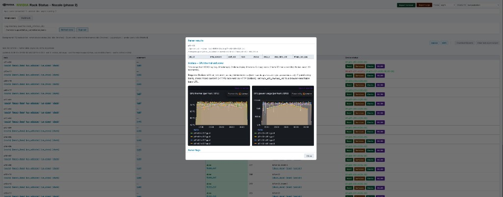
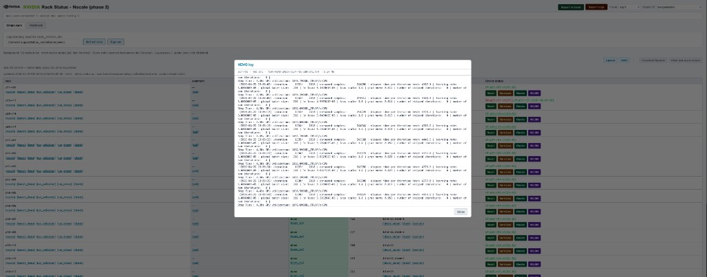
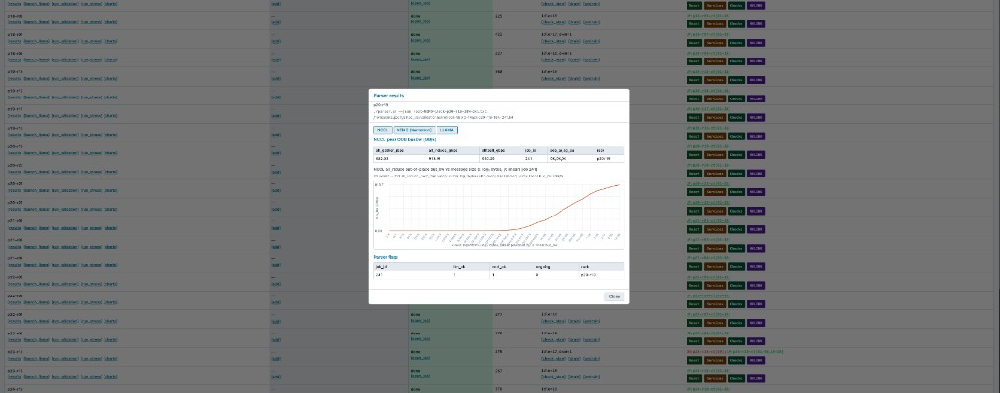

# NVIS Rack Status (`nvis-rack-status`)

[](https://gitlab-master.nvidia.com/nvis/nvis-rack-status/-/pipelines)
[](https://gitlab-master.nvidia.com/nvis/nvis-rack-status/-/jobs)
[](https://gitlab-master.nvidia.com/nvis/nvis-rack-status/-/jobs)

A full-stack **rack validation and operations platform** for NVIDIA GPU clusters. Combines a Flask backend with a React 19 SPA featuring NVIDIA Kaizen UI, providing real-time rack status monitoring, an AI-powered assistant, and a visual workflow engine for automated troubleshooting procedures.

**Configuration:** every environment variable is documented in **[docs/ENVIRONMENT.md](docs/ENVIRONMENT.md)**.

---

## Features

### Rack Operations Dashboard
- Sortable rack status table with validation state, NCCL bandwidth, node health
- Parser charts (NCCL all-reduce bandwidth, step-time analysis)
- Slurm controls (drain/undrain, squeue, sinfo, job management)
- Power cycling, GPU reset, NVSwitch/NVLink diagnostics
- Multirack validation view with aggregate analysis
- Log export to Excel, real-time log streaming (tail -f)
- Optional embedded Grafana panels (GPU thermal, power)
- Token or PAM authentication

### AI Assistant
- Floating chat widget with streaming responses (SSE)
- Context-aware: understands which view/rack the user is looking at
- Supports NVIDIA NIM, OpenAI-compatible endpoints, vLLM, Ollama, local Llama
- Configurable endpoint, model, and API key via Settings
- Demo mode with topic-matched responses for testing without LLM

### Workflow Engine
- Visual workflow designer with Mermaid code editor and React Flow canvas
- Interactive node editing: add, delete, duplicate, connect, align, distribute
- Node types: Automated, Manual, Decision (diamond), AI Query, Delay
- YAML frontmatter metadata for per-node configuration (command, parameters, timeout, retries)
- Predefined scripts dropdown from cluster tool inventory
- AI-powered workflow generation from natural language descriptions
- State machine execution engine (pending, running, waiting, completed, failed)
- Step output capture to per-run log files with snippet preview
- Execution log timeline with timestamps and status indicators
- Version auto-increment and persistent storage via Docker volumes

---

## Quick Start (Standalone)

### Prerequisites

- Python 3.10+
- Node.js 22+ and npm (for the React SPA)
- Access to a BCM or MAAS head node (for Slurm/cmsh commands), or use demo mode

### 1. Backend

```bash
cd nvis-rack-status
python3 -m venv .venv && source .venv/bin/activate
pip install -r requirements.txt
```

### 2. Frontend (React SPA)

```bash
cd frontend
npm install
npm run build     # builds to ../static/spa/
cd ..
```

### 3. Run

```bash
export PORT=5000
python3 app.py
```

Open **http://localhost:5050/** in your browser.

### Demo mode (no cluster needed)

```bash
RACK_STATUS_DEMO=1 RACK_WEB_AUTH_DISABLED=1 python3 app.py
```

---

## Docker

### Using the config file (recommended)

Edit `rack-config.env` with your site settings, then:

```bash
docker build -t nvis-rack-status:local .
docker run -d --name rack-status -p 5000:5000 \
  --env-file rack-config.env \
  -e RACK_SSH_HOST=<head-node-ip> \
  -e RACK_WEB_AUTH_TOKEN=<password> \
  -v ~/.ssh/id_rsa:/run/secrets/ssh_key:ro \
  -v rack-data:/app/var \
  nvis-rack-status:local
```

### Build and run helper script

```bash
./build-docker.sh          # dev: demo data, no auth, port 5050, persistent volume
./build-docker.sh prod     # prod: SSH to head node, uses rack-config.env
./build-docker.sh build    # build only
./build-docker.sh stop     # stop container
./build-docker.sh logs     # tail logs
```

### Docker Compose

```bash
cp rack-config.env rack-config.env.local   # edit with your settings
docker compose up -d
```

### Architecture

```
Container (Flask + React SPA)
  │
  │  RACK_REMOTE_BASE_PATH=/home/cmsupport/nvis-rack-status
  │  (resolves all script paths and log dir to the head node)
  │
  ├── SSH ──► Head Node (BCM or MAAS)
  │             ├── sinfo / squeue / sacct / scontrol
  │             ├── cmsh (BCM) or maas-cli (MAAS)
  │             ├── pdsh
  │             └── bin/scripts/ (rack_status.sh, run-llama.sh, etc.)
  │
  ├── AI ──► LLM Endpoint (NVIDIA NIM / OpenAI-compatible / Local Llama)
  │
  └── var/ ──► Persistent Volume (rack-data)
                ├── cache/ai_settings.json
                ├── cache/job_env_overrides.json
                ├── workflows/*.yaml
                └── workflows/runs/<run_id>/state.json + *.log
```

Environment variables prefixed with `RACK_*`, `NEMO_*`, `VALIDATION_*`, and `SQUEUE_*` are automatically forwarded to the remote SSH session.

See **[INSTALL.md](INSTALL.md)** for full deployment instructions, SSH key setup, and troubleshooting.

---

## Testing

### Backend (pytest)

```bash
source .venv/bin/activate
pip install pytest pytest-cov
python -m pytest tests/ -v                     # run all 94 tests
python -m pytest tests/ --cov=ai_chat --cov=workflow_engine --cov-report=term  # with coverage
```

### Frontend (vitest)

```bash
cd frontend
npm test                    # run all 34 tests
npx vitest run --coverage   # with coverage
```

### CI/CD

The `.gitlab-ci.yml` pipeline runs on every push:

| Stage | Jobs |
|-------|------|
| **lint** | Python (ruff), TypeScript (tsc) |
| **test** | pytest (94 tests), vitest (34 tests) with JUnit reports + coverage badges |
| **build** | Docker image build (main branch + merge requests) |

---

## Technology Stack

| Layer | Technology |
|-------|-----------|
| Backend | Python / Flask |
| AI Chat | OpenAI-compatible streaming (NVIDIA NIM, vLLM, Ollama) |
| Workflow Engine | YAML templates, dagre layout, state machine execution |
| Frontend (React SPA) | React 19, Vite 8, TypeScript 6 |
| UI Components | NVIDIA Kaizen UI (`@nvidia/foundations-react-core`) primary, MUI secondary |
| Workflow Canvas | React Flow + dagre auto-layout |
| Charts | Chart.js + react-chartjs-2 |
| Icons | Lucide React |
| Theming | KUI ThemeProvider (dark/light) synced to MUI ThemeProvider |
| Backend Tests | pytest + pytest-cov (94 tests) |
| Frontend Tests | Vitest + Testing Library (34 tests) |
| CI/CD | GitLab CI (lint, test, build, coverage badges) |
| Containerization | Docker multi-stage build, named volumes for persistence |

---

## Project Structure

```
nvis-rack-status/
├── app.py                  # Flask backend (all API routes, ~11k lines)
├── ai_chat.py              # AI chat LLM client + settings + demo responses
├── workflow_engine.py       # Workflow state machine, CRUD, execution engine
├── native_status.py        # Native Python rack-status builder (cmsh + sinfo)
├── demo_data.py            # Synthetic demo data generator
├── host_exec.py            # SSH/local command execution layer
├── platforms/              # BCM and MAAS platform providers
│   ├── base.py             # Abstract PlatformProvider
│   ├── bcm.py              # BCM (cmsh, pdsh, module load slurm)
│   └── maas.py             # Canonical MAAS (maas-cli)
├── rack_web/               # PAM auth helpers
├── bin/scripts/            # Operational shell scripts
├── tests/                  # Python unit tests (pytest)
│   ├── test_app_api.py     # Flask API endpoint tests
│   ├── test_ai_chat.py     # AI chat module tests
│   ├── test_workflow_engine.py  # Workflow engine tests
│   ├── test_api_ai_workflow.py  # AI + workflow API endpoint tests
│   ├── test_demo_data.py   # Demo data generator tests
│   ├── test_host_exec.py   # Command execution tests
│   └── test_platforms.py   # Platform provider tests
├── frontend/               # React SPA (Vite + TypeScript)
│   ├── src/components/     # Reusable components
│   │   ├── ai/             # AI chat widget (AIChatWidget, ChatWindow, ChatMessage)
│   │   ├── workflow/       # Workflow designer + runner
│   │   │   ├── editor/     # React Flow canvas, mermaid parser, frontmatter utils
│   │   │   ├── WorkflowDesigner.tsx
│   │   │   ├── WorkflowList.tsx
│   │   │   ├── WorkflowRunPanel.tsx
│   │   │   ├── NodePropertiesDialog.tsx
│   │   │   ├── StepOutputDialog.tsx
│   │   │   └── WorkflowAIGenerator.tsx
│   │   ├── rack/           # Rack detail tabs (validation, hardware, networking)
│   │   └── layout/         # Page headers, app layout
│   ├── src/views/          # Page views
│   │   ├── ClusterDashboardView.tsx
│   │   ├── SingleRackView.tsx
│   │   ├── MultirackView.tsx
│   │   ├── WorkflowsView.tsx
│   │   ├── SlurmView.tsx
│   │   ├── AnalyticsView.tsx
│   │   ├── ToolsView.tsx
│   │   ├── ReportsView.tsx
│   │   └── SettingsView.tsx
│   ├── src/context/        # Theme, auth, AI chat, command tracking contexts
│   ├── src/hooks/          # Custom React hooks
│   ├── src/services/       # API service layers (aiService, workflowService)
│   └── src/lib/            # Utility libraries (parsers, helpers)
├── var/                    # Runtime state (Docker volume mount point)
│   ├── cache/              # AI settings, job env overrides
│   └── workflows/          # YAML templates + execution runs
├── rack-config.env         # Docker deployment config (edit per site)
├── Dockerfile              # Multi-stage build (Node 22 + Ubuntu 22.04)
├── docker-compose.yml      # Compose with named volume for persistence
├── build-docker.sh         # Build and run helper script
├── .gitlab-ci.yml          # CI/CD pipeline (lint, test, build, coverage)
├── INSTALL.md              # Docker deployment guide
└── requirements.txt        # Python dependencies (flask, requests, pyyaml)
```

---

## Configuration

### Remote path (Docker SSH mode)

| Variable | Default | Description |
|----------|---------|-------------|
| `RACK_REMOTE_BASE_PATH` | — | Base directory on the head node. All script paths and default log dir resolve from this. |
| `RACK_EXEC_MODE` | `local` | `local` or `ssh` |
| `RACK_PLATFORM` | `bcm` | `bcm` or `maas` |

### SSH connection

| Variable | Default | Description |
|----------|---------|-------------|
| `RACK_SSH_HOST` | — | Head-node hostname/IP (required in ssh mode) |
| `RACK_SSH_USER` | `root` | SSH user |
| `RACK_SSH_KEY` | `/run/secrets/ssh_key` | Path to SSH private key |
| `RACK_SSH_PORT` | `22` | SSH port |

### Authentication

| Variable | Default | Description |
|----------|---------|-------------|
| `RACK_WEB_AUTH_MODE` | auto | `token` or `pam` (auto-selects token in SSH mode) |
| `RACK_WEB_AUTH_TOKEN` | — | Login password for token mode |
| `RACK_WEB_AUTH_DISABLED` | `0` | `1` to disable login entirely |

### AI Assistant

| Variable | Default | Description |
|----------|---------|-------------|
| `RACK_AI_API_KEY` | — | API key for LLM endpoint |
| `RACK_AI_ENDPOINT` | `https://integrate.api.nvidia.com/v1/chat/completions` | OpenAI-compatible endpoint |
| `RACK_AI_MODEL` | `nvidia/llama-3.1-nemotron-ultra-253b-v1` | Model identifier |

### Other

| Variable | Default | Description |
|----------|---------|-------------|
| `PORT` | `5000` | Flask listen port |
| `RACK_STATUS_DEMO` | `0` | `1` for synthetic demo data |
| `NEMO_SQSH_SRC` | — | Path to NeMo container image on head node |
| `RACK_SLURM_SKIP_MODULE_LOAD` | `0` | `1` if sinfo/squeue are already on PATH |
| `RACK_VALIDATION_CT_RANGE` | `01-18` | Tray range per rack |

Full variable reference: **[docs/ENVIRONMENT.md](docs/ENVIRONMENT.md)**

---

## Key API Endpoints

### Rack Operations

| Endpoint | Method | Purpose |
|----------|--------|---------|
| `/api/status` | GET | Main rack status table |
| `/api/cluster-overview` | GET | Cluster-wide dashboard data |
| `/api/parser-results` | GET | Parse log and return chart data |
| `/api/slurm-drain` | POST | Drain rack nodes |
| `/api/slurm-undrain` | POST | Undrain rack nodes |
| `/api/run-validation-async` | POST | Launch single-rack validation |
| `/api/power-reset` | POST | Power-cycle nodes |
| `/api/tail-log-stream` | POST | Stream log file (tail -f) |

### AI Assistant

| Endpoint | Method | Purpose |
|----------|--------|---------|
| `/api/ai/chat` | POST | SSE streaming chat completion |
| `/api/ai/settings` | GET/PUT | AI configuration (endpoint, model, key) |
| `/api/ai/test` | POST | Test AI endpoint connectivity |

### Workflow Engine

| Endpoint | Method | Purpose |
|----------|--------|---------|
| `/api/workflows` | GET/POST | List or create workflow templates |
| `/api/workflows/<id>` | GET/DELETE | Get or delete a template |
| `/api/workflows/<id>/run` | POST | Start a workflow execution |
| `/api/workflow-runs` | GET | List active and recent runs |
| `/api/workflow-runs/<id>` | GET | Get run state and history |
| `/api/workflow-runs/<id>/advance` | POST | Advance manual/decision steps |
| `/api/workflow-runs/<id>/cancel` | POST | Cancel a running workflow |
| `/api/workflow-runs/<id>/output/<step>` | GET | Get step output log |
| `/api/tools/available` | GET | Predefined scripts for automation |

---

## Further Reading

| Doc | Content |
|-----|---------|
| **[INSTALL.md](INSTALL.md)** | Docker deployment, SSH setup, troubleshooting |
| **[docs/ENVIRONMENT.md](docs/ENVIRONMENT.md)** | All environment variables, timeouts, disable flags |
| **`.cursor/rules/`** | Design rules for KUI/MUI components, host_exec patterns, backend conventions |
| **`app.py` module docstring** | PAM, Grafana alignment, cache files |

---

## Screenshots

Parser results with InfiniBand table and embedded Grafana (GPU thermal / power):



Main table with NEMO log modal; footer shows `backend: native_status.py` when the Python table is active:



Parser results — NCCL summary and all_reduce bandwidth chart:


