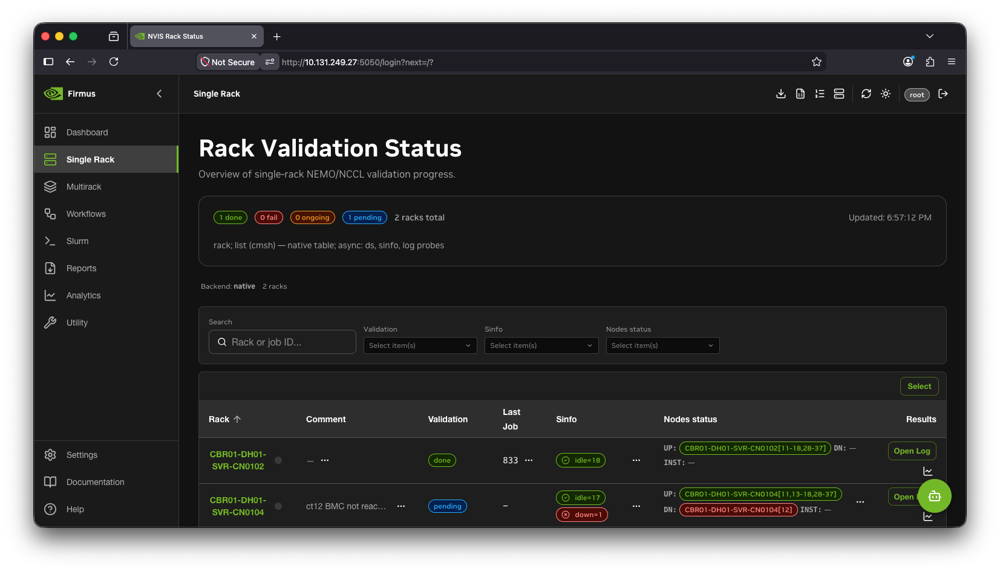
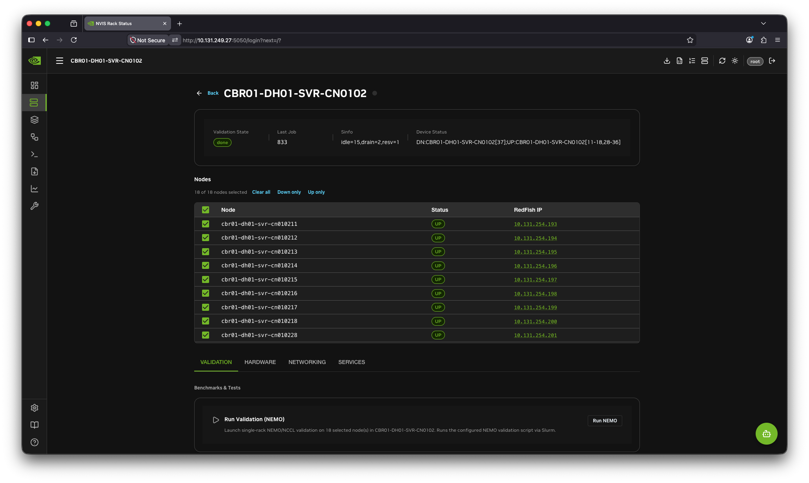
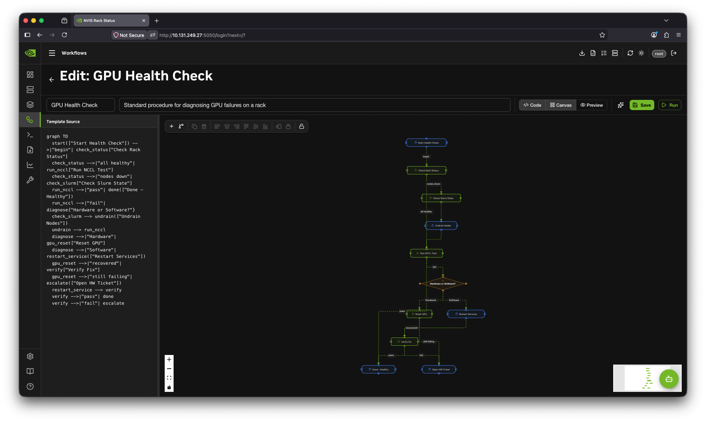
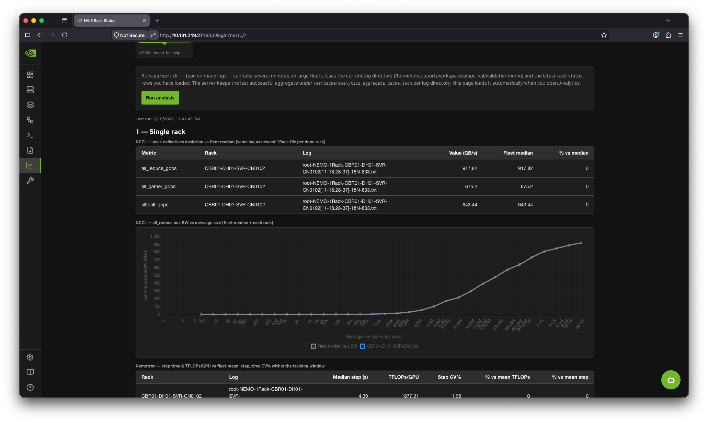
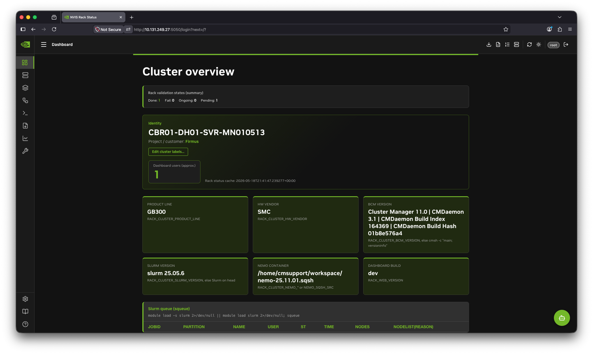

# NVIS Rack Status (`nvis-rack-status`)

[](https://gitlab-master.nvidia.com/nvis-ova/nvis-ova-rack-status/-/pipelines)
[](https://gitlab-master.nvidia.com/nvis-ova/nvis-ova-rack-status/-/jobs)
[](https://gitlab-master.nvidia.com/nvis-ova/nvis-ova-rack-status/-/jobs)

NVIS Rack Status is a full-stack validation, observability, and operations platform for NVIDIA GPU clusters. It combines a Flask API, a React 19 single-page application, PythonCM/direct-execution and fallback scheduler providers, audited validation recipes, and durable run history.

This README is the engineering and operator entry point. For step-by-step use of every current UI surface, validation, audit, report, and troubleshooting path, see the [Rack Status operator and administrator guide](docs/RACKSTATUS_USER_GUIDE.md). The complete environment-variable reference is [docs/ENVIRONMENT.md](docs/ENVIRONMENT.md), and the deeper execution and result-pipeline designs are linked under [Further reading](#further-reading).

> **Operational safety:** the UI can submit workloads, cancel jobs, power-cycle equipment, and drain or resume managed nodes. Use production authentication, review exact targets before launch, keep `var/` persistent, and never treat a missing probe as proof that a node is healthy.

## Contents

- [Release-candidate capability status](#release-candidate-capability-status)
- [Architecture](#architecture)
- [Operator surfaces](#operator-surfaces)
- [Feature guide](#feature-guide)
- [Validation recipe catalog](#validation-recipe-catalog)
- [Quick start](#quick-start)
- [Production deployment and permanence](#production-deployment-and-permanence)
- [Configuration](#configuration)
- [Operator runbooks](#operator-runbooks)
- [API guide](#api-guide)
- [Durable state, backup, and recovery](#durable-state-backup-and-recovery)
- [Testing and release qualification](#testing-and-release-qualification)
- [GitLab contribution and release workflow](#gitlab-contribution-and-release-workflow)
- [Troubleshooting](#troubleshooting)
- [Project layout](#project-layout)
- [Further reading](#further-reading)
- [Screenshots](#screenshots)

## Release-candidate capability status

The table below is an implementation inventory of the current source, shipped workflow definitions, deployment checks, and regression tests. It distinguishes implemented behavior from explicitly parked work.

| Capability | Status | Implementation / operator surface |
|---|---|---|
| Native Python rack status and node-level view | Implemented | `backend/native_status.py`; **Compute → Racks** and **Compute → Nodes**. The status builder waits for all per-log workers before committing its snapshot, so a completed test is not left `pending` because a worker finished after the summary was cached. |
| Live scheduler and cluster-manager inventory | Implemented | PythonCM/direct scheduler and platform providers plus `backend/host_exec.py`; **Compute → Cluster overview**, **Racks**, **Nodes**, and **Scheduler**. |
| Exact-node, multi-node-per-rack, and multi-rack selection | Implemented | Node selector, validation target resolution, preset prepare gate, workflow `resolve` step, and exact PythonCM-managed compute-node targeting. |
| CUDA 13.3+ / NCCL 2.31.2 validation | Implemented | Direct-host preset `nccl-2.31.2`; runtime gates use `ncclGetVersion` and require `/dev/infiniband`. |
| Llama 3.1 405B FP8 validation | Implemented and invariantly pinned | Exactly 256 GB300 nodes / 1,024 GPUs, 50 steps, TP4/PP8/CP1/VP4, MBS1, GBS6144, NeMo 26.04.01 + NCCL 2.30.7, NVLS disabled. Scale, steps, image, and profile overrides are rejected. |
| GPT-OSS CPU-only microbenchmark | Implemented | One independently attributable scheduler task per exact selected node, up to 256 nodes. It is not presented as a GPU training validation. |
| NVIDIA DGXC Exemplar `system_info` | Implemented | Validates the installed recipe against tag `v26.06.01`, runs once per selected node, and preserves per-node output. |
| NeMo and MNUberGEMM containers | Implemented with honest version pins | NeMo `26.04.01`; MNUberGEMM `26.03-v1.17`. The catalog intentionally does not claim a nonexistent MNUberGEMM `26.04.1` image. |
| Shared NFS and node-local container execution | Implemented | Preset launch dialog and `run-validation-preset.sh`; local cache is fixed to `/tmp/containers`. |
| Allocation-scoped rsync staging | Implemented | Size and SHA-256 verification, `flock`, resumable `rsync --append-verify`, atomic promotion, optional container IB/runtime preflight. |
| Hardware Deep Audit | Implemented | Rack **Hardware** tab, **Results** button, workflow `hardware-deep-audit`, structured per-node output, and Post Run Node Report. |
| NVLink / Network Deep Audit | Implemented | Rack **Networking** tab, **Results** button, workflow `nvlink-network-deep-audit`, forced data-path probe, and Post Run Node Report. |
| Post Run Node Report punchcard | Implemented | **Analytics & Benchmarks → Post Run Node Report**; run participation, attributed failures, repeat flag, trend, current scheduler reason, audit launch, and full SPA history. |
| Optional legacy punchcard baseline | Implemented as an input only | Google Sheets values may seed historical counts/flags. Rack Status' durable node issue store remains the operational record for new findings; the Sheets token is server-only. |
| Generated report archive | Implemented | Completed CSV/JSON/PDF reports persist under `var/reports` and appear under **Reports**, even if the operator leaves Analytics while generation is running. |
| Metrics rack monikers | Implemented | Raw metrics labels such as `WH1G1` remain query keys but display as `g01`; short labels are normalized and naturally sorted. |
| Native metrics and Grafana links | Implemented | Read-only VictoriaMetrics proxy and Chart.js views, plus optional Grafana deep links/embeds. |
| Durable validation activity registry and rack locks | Implemented | Validation history survives restarts; explicit and implicit advisory locks reduce multi-operator collisions. |
| PythonCM direct-execution scheduler | Implemented | Set `RACK_SCHEDULER=pythoncm`. Inventory, active/recent jobs, exact-node execution, cancellation, drain/resume, reasons, logs, workflow steps, and durable activities use the provider. |
| Slurm compatibility fallback | Implemented | Set `RACK_SCHEDULER=slurm` during rollback or phased migration. Existing `/api/slurm-*` URLs and Slurm-shaped response fields remain compatibility contracts for the SPA and integrations. |
| Evidence-attributed failure and drain safety | Implemented | A failed multi-node task does not mark every target failed. Automatic drain requires a structured node failure or node-specific evidence. |
| Clush transport | **Parked** | Not a release-candidate transport. Current fan-out is provider/transport based (`pdsh`, SSH composition, or Slurm fan-out). |

## Architecture

### System view

```text
Operator browser
  └─ React 19 SPA (hash routes, KUI-first components, Chart.js, React Flow)
       └─ /api/* and WebSocket/SSE
            └─ Flask application
                 ├─ catalog: projects, clusters, endpoints, roles, tools
                 ├─ native status + parsers + analytics + reports
                 ├─ workflow state machine + durable run registry
                 ├─ validation preset prepare/launch gate
                 ├─ platform and scheduler providers
                 ├─ node issue and post-run attribution pipeline
                 └─ host_exec / transport composition
                      ├─ local execution, or SSH to a head/login node
                      ├─ BCM cmsh or MAAS inventory
                      ├─ PythonCM/CMDaemon direct execution
                      ├─ configured Slurm CLI fallback
                      └─ scheduler-visible jobs/fan-out on compute nodes

Read-only observability path
  VictoriaMetrics/Prometheus API ──> metrics_query blueprint ──> native SPA charts
  Grafana                         ──> optional deep links or embedded panels

Durable result path
  workload logs + scheduler history + validation registry
       ├─ native status and parser results
       ├─ SQLite results history / optional Parquet lake sink
       ├─ post-run per-node participation and issue history
       ├─ workflow run state and step logs
       └─ generated CSV/JSON/PDF report archive
```

### First-class boundaries

Changes should extend these existing boundaries instead of adding parallel command or state mechanisms:

- **Connection and transport:** `backend/host_exec.py` and `backend/transport/` decide where and how commands run.
- **Catalog:** `backend/catalog/` owns projects, clusters, endpoint roles, platforms, and the tool registry.
- **Platform and scheduler providers:** `backend/platforms/` and `backend/schedulers/` own command vocabulary and binary routing.
- **Workflow engine:** `backend/workflow_engine.py`, `backend/workflow_models.py`, and `var/workflows/` own repeatable procedures and durable execution state.
- **Configuration:** environment resolution and catalog connection settings remain the authoritative inputs; do not hard-code a customer endpoint into generic code.
- **Naming:** `backend/nvis_id_templates.py` and frontend naming helpers distinguish display rack IDs, physical racks, and real compute hostnames.
- **Results pipeline:** log discovery, parsing, stage criteria, validation activities, results history, reports, and the optional lake sink each have separate responsibilities.
- **Durable state and locks:** files under `var/` are volume-backed, bounded where appropriate, and written with locking/atomic replacement.
- **Frontend contexts:** authentication, active cluster, rack commands, locks, AI, theme, and help are shared contexts; page-local copies cause inconsistent behavior.

### Execution modes

| Mode | Use | Command location |
|---|---|---|
| `RACK_STATUS_DEMO=1` | UI development, demonstrations, CI smoke | Synthetic data; no cluster mutation. |
| `RACK_EXEC_MODE=local` | App runs on a host with cluster tools and filesystem access | Commands execute on the app host. |
| `RACK_EXEC_MODE=ssh` | Container/workstation reaches a cluster head node | `host_exec` connects to the configured endpoint, then platform/scheduler commands run there. |

Cluster identity is catalog-driven. Nscale TX is one deployment of this product, not a separate code path. Customer-specific names, credentials, manifests, exclusions, paths, and versions belong in the deployment configuration.

## Operator surfaces

The SPA uses hash routes, so deep links are refresh-safe. Examples below omit the origin, such as `http://localhost:5056`.

| Navigation | Hash route | Purpose |
|---|---|---|
| Cluster overview | `#/compute/overview` | Cluster identity, availability, validation summary, live scheduler state, active users. |
| Nodes | `#/compute/nodes` | Cross-rack node inventory and state. |
| Racks | `#/compute/racks` | Rack status table; select a rack for exact-node actions and validation. |
| Rack detail | `#/compute/racks/<rack-id>` | Node selector plus Validation, Hardware, Networking, and Services tabs. |
| Multirack operations | `#/compute/multirack` | Rack selection, eligibility, campaigns, multi-rack presets, live jobs, logs, and parser results. |
| Scheduler | `#/compute/scheduler` | `squeue`, recent accounting, job detail, output, and guarded cancellation. |
| Ethernet / IB & NVLink / Storage | `#/infrastructure/*` | Infrastructure inventory and fabric/storage operations. |
| Metrics | `#/observability/metrics` | Native VictoriaMetrics charts and rack/node filters. |
| Logs / Events | `#/observability/logs`, `#/observability/events` | Observability log and event surfaces. |
| Operations & Scripts | `#/tools/operations` | Catalog tools and long-running operations. |
| Workflows | `#/tools/workflows` | Workflow templates, designer, runs, state, and step output. |
| Analytics | `#/analytics/overview` | Parsed benchmark history, aggregates, generated cluster reports. |
| Post Run Node Report | `#/analytics/post-run-nodes` | Native punchcard, node history, audit reports, issue annotation, optional drain. |
| Reports | `#/analytics/reports` | Durable generated reports and local bug-report/NVLMapper artifacts. |
| Projects & Clusters | `#/platform/projects` | Catalog project/cluster configuration and active cluster selection. |
| Platform Catalog / Tool Registry | `#/platform/catalog`, `#/platform/tools` | Hardware/platform definitions and registered operational capabilities. |
| API Reference | `#/platform/api` | Browsable OpenAPI description generated from the live route table. |
| Settings | `#/settings` | Operator identity, UI, authentication-adjacent, and AI settings. |

## Feature guide

### Rack and node status

The native status builder joins cluster-manager inventory, scheduler state, validation logs, configured acceptance criteria, and current jobs. Each stage is represented independently:

- **Stage 1:** NCCL acceptance.
- **Stage 2:** NeMo/Nemotron workload acceptance.
- **States:** `done`, `fail`, `ongoing`, or `pending`.

The result pipeline does not equate scheduler `COMPLETED` with validation `PASS`. It separately asks whether the expected evidence exists and whether the configured acceptance criteria were reached. The snapshot builder waits for its bounded per-log analysis workers before it commits cache state, preventing a completed log from being omitted merely because its worker returned late.

The rack detail node selector supports one node, an arbitrary subset, all up nodes, all down nodes, or the whole rack. Actions receive the exact selected set, not a regenerated contiguous tray range. This matters on non-contiguous racks and when known-bad trays must be excluded.

### Exact-node and multi-rack targeting

Target resolution follows these rules:

1. An explicit node array or selected-node target is authoritative.
2. Every node must be a syntactically valid hostname and, when inventory is available, must exist in current PythonCM inventory.
3. The prepare gate queries live scheduler state and rejects missing, unavailable, or configured known-bad nodes.
4. A single-rack workflow preserves its exact selected-node override.
5. A comma-separated multi-rack workflow resolves each rack separately, de-duplicates hostnames, and fans out to the combined exact list.
6. An optional multi-rack campaign manifest can define an approved fixed number of nodes per rack. Stale campaign IDs or nodes outside the manifest fail closed.

The workflow engine runs deep audits as scheduler-visible tasks. PythonCM direct execution targets exact nodes; the Slurm fallback retains allocation/TRES behavior for legacy `.sbatch` workflows.

### Telemetry and metrics

The native metrics view reads VictoriaMetrics through the backend. It does not expose the metrics datastore directly to the browser and validates rack/node/SU label values before building PromQL selectors.

The catalog includes GPU temperature, power, enforced power cap, utilization, framebuffer, clocks, HBM temperature, NVLink bandwidth, scheduler state, BCM inventory, exporter health, and active-alert charts. The frontend derives its rack filter from series actually present in VictoriaMetrics. Therefore:

- A rack missing from the filter is normally an ingestion/label problem, not a static UI allowlist.
- `WH1D1`, `WH1E1`, and `WH1H2` display as `d01`, `e01`, and `h02`; queries still use the raw upstream label.
- Existing short labels are normalized (`g1` becomes `g01`) and naturally sorted.
- `/api/metrics/health` proves upstream reachability and series presence; a systemd service being `active` on a node is not sufficient proof of ingestion.

Rack Status consumes telemetry. Deployment and repair of Alloy, node exporter, cgroup exporter, DCGM exporter, and their WAL/service identity are fleet-management responsibilities outside this repository. A complete acceptance check must validate both node service/listener health and fresh samples at the configured VictoriaMetrics destination.

### Hardware Deep Audit

Launch from a rack's **Hardware** tab after selecting one or more nodes. The **Results** button beside **Start Tests** opens recent runs immediately and polls active work.

The GB300 hardware audit checks:

- expected GPU enumeration;
- GPU temperatures and active hardware thermal slowdown;
- volatile and aggregate uncorrectable ECC;
- GPU fabric `Completed/Success` and pending recovery actions;
- current-boot GPU Xid, fatal/uncorrected PCIe AER or DPC, and EDAC/MCE events;
- `slurmd`, `nvidia-imex`, and, when installed, `CMDaemon` service health;
- `md0` active state and `/raid` mount readiness.

Every node emits a versioned `NVIS_DEEP_AUDIT_JSON` record. Unsupported queries become warnings where appropriate; confirmed failures return a failure result. Default expectations can be tuned with `RACK_AUDIT_EXPECTED_GPUS` and `RACK_AUDIT_MAX_GPU_TEMP_C`.

### NVLink / Network Deep Audit

Launch from a rack's **Networking** tab or from a node in the Post Run Node Report. The audit checks:

- GPU enumeration and GPU fabric completion;
- active `nvidia-imex`;
- physical IB HCA state and carrier;
- expected number of ports and minimum line rate;
- `mlx5_bond_0` carrier when present;
- a full forced-NVLink preflight, or an allocation-local `nvbandwidth` peer-copy test when the legacy runtime is unavailable;
- deltas in `link_downed`, `symbol_error`, `port_rcv_errors`, and `port_xmit_discards` sampled around the forced traffic test.

Cumulative IB counters are not treated as a current failure merely because an old nonzero value exists. The audit fails on a counter increase during the test, which ties the finding to present traffic. Default expectations are controlled by `RACK_AUDIT_EXPECTED_GPUS`, `RACK_AUDIT_EXPECTED_IB_PORTS`, `RACK_AUDIT_EXPECTED_IB_RATE_GBPS`, and `RACK_AUDIT_NVLINK_TIMEOUT`.

### Failure attribution and drain safety

Automatic corrective action is intentionally conservative:

- `pass`: healthy for the checks that ran; no drain.
- `warning`: a non-fatal or unsupported probe; no drain.
- `inconclusive`: missing structured output, transport uncertainty, or unproven ownership; no drain.
- `fail`: structured per-node evidence or an exact scheduler-confirmed node failure; record the issue and attempt an exact-node drain.

A failed 256-node collective is not assigned to all 256 nodes. Post-run attribution requires a node to be named in evidence, a single-node allocation, or a structured audit/operator finding. Control-plane signatures such as CMDaemon mass-down are categorized separately from GPU and network faults.

When a confirmed audit failure is drained, the scheduler reason follows this form:

```text
Drained for <category> deep audit - for validation <run-prefix> due to <exact reason>
```

The result records whether the drain succeeded. A drain failure is surfaced separately; it is never silently presented as remediated.

An operator can also annotate one exact node from the Post Run Node Report and optionally drain it. The API verifies that the node is in current PythonCM inventory, requires a category and reason, and records the scheduler result with the issue.

### Post Run Node Report

The Post Run Node Report is a native SPA view, not a spreadsheet viewer. It joins:

- durable validation activities;
- exact targets recovered from durable scheduler history;
- durable per-node participation snapshots that outlive accounting retention;
- structured hardware/network audit results;
- operator findings;
- current scheduler state and reason;
- an optional imported baseline of legacy punchcard counts/flags.

For each node it shows participation count, failed jobs, attributed failures, distinct failure runs, category, recent trend, repeat flag, current scheduler state/reason, latest hardware status, latest network status, and the complete run/issue history in one view. A node is flagged after attributed failures in at least three distinct runs, rather than three duplicate messages from one failing collective.

The view supports:

- rack and node filtering;
- a forced refresh of scheduler history and PythonCM inventory;
- history, hardware report, and network report sections;
- launch of a hardware or network audit on the selected exact node;
- full workflow output by run and step ID;
- local annotation with category, job ID, evidence, and reason;
- optional exact-node drain after an explicit confirmation.

Invalidated validator runs remain on disk for auditability but are hidden from normal deep-audit and post-run APIs. This allows a known-bad validator result to be retracted without deleting evidence.

### Punchcard baseline configuration

`backend/node_issues.py` can read fixed cell values from Google Sheets API v4 using a server-mounted bearer token. It imports legacy counts and markers (`▲n`, drained, NCCL, maintenance) as a baseline. New Rack Status findings are appended to the local durable store with job/workflow evidence and scheduler action results.

The token must be mounted read-only and must never be exposed through the frontend, committed to Git, copied into an image, or printed in logs. Spreadsheet UI comments are not available through the value API and are not claimed as imported evidence.

### Generated reports

Fleet reports can take minutes. Completed CSV, JSON, or PDF payloads are therefore saved unconditionally, even when the originating browser has navigated away. The Reports view lists them newest first with cluster/node metadata, size, download, and delete controls.

Storage uses one byte-exact payload and one `.meta.json` sidecar per report under `var/reports`. Writes are atomic; a sidecar without a payload is not listed. IDs are generated server-side, formats are allowlisted, filenames are sanitized, and the archive prunes the oldest entries beyond its bounded retention limit (40 by default in the current implementation).

The same Reports view also lists existing node/rack artifacts under the configured bug-report directory, including NVIDIA bug reports, NVLMapper output, and parser Excel exports. These external files are distinct from the generated report archive.

### Workflow engine and result access

Workflow templates are YAML documents in `var/workflows/`. The engine supports automated steps, manual/event steps, decisions, AI queries, delays, explicit resolution, PythonCM/direct and fallback scheduler execution, evaluation, retries, and conditional transitions. State and step logs live under `var/workflows/runs/`.

The visual designer provides a Mermaid source editor and React Flow canvas with bidirectional synchronization. Operators can inspect the current state, execution history, output snippets, and full per-step output. Deep audit cards use the same workflow state machine and output API rather than a separate background-job implementation.

### Rack locks

Locks are advisory coordination, not an authorization boundary:

- active mutating operations create implicit locks;
- operators can explicitly claim a rack for 30 minutes and refresh up to the configured cap;
- browser identity comes from the operator setting and `X-Rack-Operator`;
- the SPA warns when another operator owns a rack and requires an explicit override;
- claims persist in `var/cache/rack_locks.json` with file locking;
- stale active-operation entries and disconnected-browser claims expire according to configuration.

Authorization still comes from web authentication and the remote account's privileges.

### AI assistant

The optional assistant streams context-aware responses over SSE and understands the current view and selected rack. It supports NVIDIA NIM and other OpenAI-compatible endpoints, plus configured local backends. Demo mode provides deterministic topic-matched responses for UI testing without a model endpoint.

## Validation recipe catalog

The browser selects an allowlisted preset and target; it does not submit arbitrary commands, image paths, or version strings. The server resolves a plan, performs live eligibility checks, returns the exact command and immutable plan hash for review, then requires that hash at launch. Any target or option change invalidates the reviewed plan.

| Preset ID | Scope | Runtime / image | Enforced contract |
|---|---|---|---|
| `nccl-2.31.2` | node, rack, multi-rack | Direct host | CUDA 13.3+, NCCL exactly 2.31.2, `/dev/infiniband`, five acceptance rounds through 16 GiB. No container and no staging flags. |
| `llama31-405b-fp8` | multi-rack | NeMo 26.04.01 image with NCCL 2.30.7 | Exactly 256 nodes / 1,024 GPUs and 50 steps; fixed parallelism/batch/FP8 profile; image size and SHA-256 pinned. |
| `gpt-oss-cpu` | node, rack, multi-rack | TensorRT-LLM 1.1.0rc5 image | One independent node job; 1–256 exact nodes; strict output accounting. |
| `exemplar-system-info` | node, rack, multi-rack | NeMo 26.04.01 image | DGXC benchmarking `v26.06.01` recipe integrity, one result per node, IB/container preflight. |
| `nemo-26.04.01` | rack, multi-rack | NeMo 26.04.01 image | 50-step NeMo validation, exact target, four GPUs per node. |
| `mnubergemm-26.03-v1.17` | node, rack | MNUberGEMM 26.03-v1.17 image | Exact target, four GPUs per node, five-minute validation profile. |

### Container staging contract

For shared NFS mode, the source image is size/SHA-verified and, when required, tested inside an allocation for GPU and IB device visibility.

For node-local mode:

1. The destination is fixed to `/tmp/containers/<allowlisted-image>`.
2. A PythonCM task targets the exact managed nodes; the Slurm fallback obtains an exact allocation for legacy workflows.
3. Each node validates the source size and locks its destination with `flock`.
4. A matching local file is SHA-verified and reused, avoiding a cold load.
5. If missing and rsync was approved, the source is copied to `.partial` with `--append-verify`.
6. Size and SHA-256 are checked before atomic rename.
7. Required containers are opened with `/dev/infiniband`, `/sys/class/infiniband`, GPU count, NCCL, and CUDA checks as configured.
8. The workload starts only after staging/preflight completes successfully.

No caller-supplied image path or local directory bypasses the catalog.

## Quick start

### Prerequisites

- Python 3.10 or newer.
- Node.js 22 and npm for SPA development/builds.
- Docker Engine 20.10 or newer for container deployment.
- For live BCM mode: a reachable head/login node, a BCM-matched PythonCM interpreter and client identity, and an account authorized for the requested operations. Slurm commands are required only for the fallback.
- For SSH mode: a dedicated private key mounted read-only into the application.

### Demo or local development

Use `start.sh`; it owns virtual environment setup, dependency checks, optional SPA build, and Flask startup.

```bash
./start.sh
RACK_STATUS_DEMO=1 ./start.sh
BUILD_FRONTEND=0 ./start.sh
```

The default development URL is `http://localhost:5050/`. Unknown paths and `/` resolve to the SPA.

### Local test environment

```bash
python3 -m venv .venv
source .venv/bin/activate
pip install -r backend/requirements.txt

cd frontend
npm ci
npm run build
cd ..

RACK_STATUS_DEMO=1 ./start.sh
```

### SSH mode

Deploy the canonical script tree with the idempotent deploy helper, then start the app with the head-node connection configuration:

```bash
RACK_SSH_HOST=head.example \
RACK_SSH_USER=rackstatus \
RACK_SSH_KEY=/secure/path/rack_status_key \
RACK_KNOWN_HOSTS_PATH=/secure/path/rack_status_known_hosts \
RACK_REMOTE_BASE_PATH=/home/rackstatus/nvis-rack-status \
  bin/deploy-scripts.sh --dry-run

RACK_SSH_HOST=head.example \
RACK_SSH_USER=rackstatus \
RACK_SSH_KEY=/secure/path/rack_status_key \
RACK_KNOWN_HOSTS_PATH=/secure/path/rack_status_known_hosts \
RACK_REMOTE_BASE_PATH=/home/rackstatus/nvis-rack-status \
  bin/deploy-scripts.sh

RACK_EXEC_MODE=ssh \
RACK_PLATFORM=bcm \
RACK_SSH_HOST=head.example \
RACK_SSH_USER=rackstatus \
RACK_SSH_KEY=/secure/path/rack_status_key \
RACK_REMOTE_BASE_PATH=/home/rackstatus/nvis-rack-status \
  ./start.sh
```

Do not deploy individual scripts with ad hoc `scp`. The repository `bin/scripts/` tree is the source of truth, and `bin/deploy-scripts.sh` uses checksum-based rsync while preserving remote-only files unless `--delete` is explicitly requested.

## Production deployment and permanence

### Base Docker deployment

The portable Compose file builds the image, loads `rack-config.env`, mounts the SSH key, and stores `/app/var` in the named `rack-data` volume:

```bash
docker compose up -d --build
```

Or use the helper:

```bash
./build-docker.sh build
./build-docker.sh prod
./build-docker.sh logs
```

See [INSTALL.md](INSTALL.md) for the general Docker and air-gapped installation guide.

### Permanent deployment sequence

Production incidents have shown that source edits alone are not a deployment. Use this sequence:

1. **Check live drift before overwriting anything.** Compare the deployed tree and head-node scripts with the deployment's own base commit.

   ```bash
   NVIS_DEPLOY_SSH=<deployment-host> \
   NVIS_DEPLOY_PATH=/opt/observability/nvis-rack-status-v3 \
   RACK_SSH_HOST=<head-node> \
   RACK_SSH_USER=<user> \
   RACK_REMOTE_BASE_PATH=/home/<user>/nvis-rack-status \
     bin/prod-drift.sh --fetch /tmp/nvis-rack-status-drift
   ```

   Exit `0` means no drift, `1` means harvest changes before deployment, and `2` means the comparison could not be completed.

2. **Commit the source of truth.** Durable product fixes belong in Git, not only in a live container, generated SPA directory, or head-node script copy.

3. **Run focused and full tests.** See [Testing and release qualification](#testing-and-release-qualification).

4. **Build the SPA and image.** `npm run build` also regenerates `help_content.json` through the frontend prebuild hook.

5. **Update production bind mounts when a new module or asset surface is added.** A new backend import is not live merely because `app.py` is mounted.

6. **Recreate, do not merely restart, when image, environment, or mounts changed.**

   ```bash
   docker compose up -d --build --force-recreate rack-status
   ```

7. **Deploy the canonical script tree.**

   ```bash
   RACK_SSH_USER=<non-root-user> RACK_KNOWN_HOSTS_PATH=<pinned-file> \
     bin/deploy-scripts.sh --dry-run <ssh-alias-or-host>
   RACK_SSH_USER=<non-root-user> RACK_KNOWN_HOSTS_PATH=<pinned-file> \
     bin/deploy-scripts.sh <ssh-alias-or-host>
   ```

8. **Run the deployment gate.**

   ```bash
   NVIS_CONTAINER=nvis-rack-status-v3 bin/verify-deploy.sh
   ```

   For a remote deployment, also set `NVIS_DEPLOY_SSH`, `NVIS_DEPLOY_PATH`, and optionally `NVIS_VERIFY_PORT`.

9. **Perform read-only API/UI smoke checks** before any live validation or node mutation.

### Bind-mount invariants

Some site deployments use a large `docker-compose.override.yml` to bind-mount source modules and built SPA assets over an older base image. In that model:

- A new `backend/*.py` file must either be included in a rebuilt image or have a matching read-only bind mount.
- Related modules must move together. For example, `host_exec.py` and `backend/transport/`, or a route and the module it imports, cannot safely be deployed in isolation.
- A new mount requires `docker compose up -d --force-recreate`; `docker restart` does not apply Compose mount or environment changes.
- `static/spa/index.html` and every hashed file it references under `static/spa/assets/` must be from the same frontend build.
- Mounting host SPA assets can hide the image's known-good assets. The deployed tree must contain every file baked into the image, byte-for-byte, though unrelated older hashed chunks are harmless.
- All durable state must remain under the `/app/var` volume or an explicitly persistent override path.

`bin/verify-deploy.sh` enforces the failure modes above: container state, backend imports, stale or missing modules, durable feature routes, mounted SPA parity, asset HTTP resolution, app response, and recent boot/import errors.

### Air-gapped bundle

```bash
./build-docker.sh save
# dist/nvis-rack-status-<version>.tar.gz
# dist/nvis-rack-status-<version>.tar.gz.sha256

sha256sum -c nvis-rack-status-<version>.tar.gz.sha256
./build-docker.sh load nvis-rack-status-<version>.tar.gz
```

Release pipelines also build a Kaniko image tarball, publish it to the GitLab Package Registry, and attach a release asset link when the release token permits it.

## Configuration

Use [docs/ENVIRONMENT.md](docs/ENVIRONMENT.md) as the exhaustive reference. The tables below list the variables most likely to affect correctness or safety.

### Connection, platform, and naming

| Variable | Typical/default | Purpose |
|---|---|---|
| `RACK_STATUS_DEMO` | `0` | Synthetic demo mode when `1`. |
| `RACK_EXEC_MODE` | `local` | `local` or `ssh`. |
| `RACK_PLATFORM` | `bcm` | Current platform provider, normally `bcm` or `maas`. |
| `RACK_SCHEDULER` | `pythoncm` in the packaged examples | `pythoncm` for BCM direct execution; `slurm` for explicit fallback. |
| `RACK_SSH_HOST`, `RACK_SSH_USER`, `RACK_SSH_PORT` | site-specific | Head/login endpoint used in SSH mode. |
| `RACK_SSH_KEY` | `/run/secrets/ssh_key` in portable container deployments | Private key path; mount read-only. |
| `RACK_REMOTE_BASE_PATH` | site-specific | Head-node root containing `bin/scripts` and related assets. |
| `RACK_STATUS_LOG_DIR` | deployment-specific | Validation log directory. |
| `RACK_STATUS_LOG_DIR_ALIASES` | unset | Compatibility path rewrites after log-root moves. |
| `RACK_STATUS_ALLOWED_PREFIXES` | unset | Complete allowlist for readable log/job-output roots. Once set, omitted roots are denied. |
| `NVIS_RACK_ID`, `NVIS_CT_ID`, `NVIS_NVSW_ID` | built-in naming defaults | Regex templates for rack, compute tray, and NVSwitch identities. |
| `RACK_VALIDATION_CT_RANGE` | `01-18` | Default tray ranges; supports non-contiguous site layouts such as `11-18,28-37`. Explicit node selection remains authoritative. |

### PythonCM/direct execution and Slurm fallback

PythonCM must be loaded by the BCM-matched interpreter on the head; it is not
vendored into the web image. See [docs/PYTHONCM_MIGRATION.md](docs/PYTHONCM_MIGRATION.md)
for TLS setup, preflight, acceptance, and rollback.

| Variable | Purpose |
|---|---|
| `NVIS_BCM_PYTHON`, `NVIS_PYTHONCM_PATH` | BCM-matched interpreter and optional PythonCM module override. |
| `NVIS_BCM_HOST`, `NVIS_BCM_PORT` | CMDaemon endpoint. |
| `NVIS_BCM_CERT`, `NVIS_BCM_KEY`, `NVIS_BCM_CA` | Client identity and pinned CA paths on the execution host. |
| `NVIS_BCM_CA_OUT`, `NVIS_BCM_CA_BOOTSTRAP` | Pinned-CA output path and explicit trust-on-first-use opt-in. Bootstrap is disabled by default. |
| `NVIS_BCM_USERNAME`, `NVIS_BCM_PASSWORD_FILE`, `NVIS_BCM_COOKIE_FILE` | Optional head-node credential-file alternatives; secrets never belong in argv or the package. |
| `RACK_PYTHONCM_EXEC_SCRIPT` | Optional override for `nvis_pythoncm_exec.py`. |
| `RACK_PYTHONCM_JOBS_DIR` | Durable task manifests and output on the execution host. |
| `RACK_PYTHONCM_USER` | User for the BCM parallel command runner. |

The following settings apply only to `RACK_SCHEDULER=slurm` and legacy shell
scripts retained during migration.

| Variable | Purpose |
|---|---|
| `RACK_SLURM_MODULE` | Module loaded when Slurm is not already initialized. |
| `RACK_SLURM_SKIP_MODULE_LOAD` | Skip module initialization when true. |
| `RACK_SLURM_CONF` | Export an explicit `slurm.conf` path for non-login shells. |
| `RACK_SLURM_BIN` | Directory prepended by shell launchers. |
| `RACK_SLURM_SBATCH` | Exact `sbatch` executable. |
| `RACK_SLURM_SRUN` | Exact `srun` executable. |
| `RACK_SLURM_SINFO` | Exact `sinfo` executable. |
| `RACK_SLURM_SQUEUE` | Exact `squeue` executable. |
| `RACK_SLURM_SACCT` | Exact `sacct` executable. |
| `RACK_SLURM_SCONTROL` | Exact `scontrol` executable. |
| `RACK_SLURM_SCANCEL` | Exact `scancel` executable. |

Per-binary variables are authoritative for fallback provider calls. Shell launchers also honor `RACK_SLURM_BIN`. Keep both paths aligned to one tested Slurm installation while the fallback remains enabled.

### Validation targeting and recipes

| Variable | Purpose |
|---|---|
| `RACK_VALIDATION_EXCLUDED_NODES` | Comma-separated known-bad nodes rejected by preset prepare. This complements, not replaces, scheduler drain state. |
| `RACK_MULTIRACK_CAMPAIGN_ID` | Optional approved campaign identifier. |
| `RACK_MULTIRACK_CAMPAIGN_MANIFEST` | Local or remote exact-node manifest for the campaign. |
| `RACK_MULTIRACK_CAMPAIGN_NODES_PER_RACK` | Required node count per campaign rack. |
| `RACK_VALIDATION_PRESET_TIMEOUT` | Upper bound for the async preset wrapper. |
| `NEMO_TARGET_STEPS` | Completion threshold used by status parsing; it does not change a preset's pinned step count. |
| `VALIDATION_TEST` | Acceptance tokens evaluated from logs, such as separate NCCL and LLM stages. |
| `RACK_AUDIT_EXPECTED_GPUS` | Expected GPUs per deep-audit node; GB300 default is 4. |
| `RACK_AUDIT_MAX_GPU_TEMP_C` | Hardware audit temperature threshold; default 85 °C. |
| `RACK_AUDIT_EXPECTED_IB_PORTS` | Physical HCA count expected by the network audit; default 4. |
| `RACK_AUDIT_EXPECTED_IB_RATE_GBPS` | Minimum physical HCA rate; default 800 Gb/s. |

### Metrics, history, and reports

| Variable | Default / purpose |
|---|---|
| `RACK_METRICS_URL` | `http://host.docker.internal:8429`; VictoriaMetrics base URL. |
| `RACK_METRICS_TIMEOUT` | `12`; upstream timeout in seconds. |
| `RACK_METRICS_DISABLED` | Disable native metrics blueprint when true. |
| `RACK_RESULTS_DB` | `var/history/results.db`; durable SQLite result history. |
| `RACK_RESULTS_DB_BUSY_MS` | SQLite busy timeout. |
| `RACK_POST_RUN_HISTORY_FILE` | `var/history/post_run_nodes.json`; exact per-node participation snapshots. |
| `RACK_POST_RUN_MAX_EVENTS` | Bounded participation retention; minimum 1,000, default 100,000. |
| `RACK_POST_RUN_REPORT_TTL_SEC` | In-process report cache TTL; default 30 seconds, minimum 5. |
| `RACK_POST_RUN_SACCT_TIMEOUT` | Legacy field name for scheduler-history refresh timeout. |
| `RACK_NODE_ISSUES_FILE` | `var/cache/node_issues.json`; immutable finding history and optional baseline. |
| `NVIS_REPORTS_DIR` | `var/reports`; generated report archive. |
| `RACK_BUG_REPORT_REMOTE_DIR` | External report/artifact inventory root. |
| `RACK_LAKE_URL`, `RACK_LAKE_CLUSTER` | Optional result/action sink and cluster attribution. |
| `RACK_LAKE_CAPTURE` | `actions`, `all`, or `off`; controls API action capture. |

### Optional punchcard baseline

| Variable | Purpose |
|---|---|
| `RACK_PUNCHCARD_TOKEN_FILE` | Server-only bearer token file, normally a read-only secret mount. |
| `RACK_PUNCHCARD_SPREADSHEET_ID` | Source spreadsheet ID. |
| `RACK_PUNCHCARD_RANGE` | Values range, default `Sheet2!A1:Z1000`. |
| `RACK_PUNCHCARD_CACHE_SEC` | Baseline refresh cache, minimum 60 seconds, default 300. |

### Authentication and AI

| Variable | Purpose |
|---|---|
| `RACK_WEB_AUTH_MODE` | Token or PAM authentication; auto mode selects a deployment-appropriate default. |
| `RACK_WEB_AUTH_TOKEN_FILE` | Preferred in-container path to the read-only shared-token secret. |
| `RACK_WEB_AUTH_TOKEN_PATH` | Host-side token file supplied to Compose; never stores the value in container configuration. |
| `RACK_WEB_AUTH_TOKEN` | Legacy compatibility fallback; avoid because container inspectors can read it. |
| `RACK_WEB_AUTH_DISABLED` | Demo/development only. Do not use for an operational deployment. |
| `RACK_WEB_SECRET_KEY` | Stable session-signing key across restarts. |
| `RACK_AI_ENDPOINT`, `RACK_AI_MODEL`, `RACK_AI_API_KEY` | Optional OpenAI-compatible model configuration. |

## Operator runbooks

### Launch a deep audit from the GUI

1. Open **Compute → Racks** and select a rack.
2. Select the exact node subset. **Up only** is useful for a healthy-rack sweep; an individual node is appropriate for RCA validation.
3. Open **Hardware** or **Networking**.
4. Read the test description and click **Start Tests**.
5. Confirm the exact node count and automatic-drain policy.
6. Click **Results** beside the launch control. Active runs refresh every three seconds.
7. Review per-node result, scheduler task ID, exact finding, and scheduler action. Use **Full output** for raw workflow evidence.
8. Confirm final node state in **Scheduler** or the Post Run Node Report.

For a multi-rack audit, launch the same workflow from **Workflows** with a comma-separated `rack` parameter or use the API with an explicit target. The resolve step expands every rack independently before fan-out.

### Launch a deep audit through the API

The example below is intentionally explicit. Substitute real inventory names and use an authenticated session:

```bash
curl -fsS -X POST http://localhost:5050/api/workflows/hardware-deep-audit/run \
  -H 'Content-Type: application/json' \
  -d '{
    "params": {
      "rack": "rack-a",
      "target": "node-a-01,node-a-02"
    }
  }'
```

Poll the returned `run_id`:

```bash
curl -fsS http://localhost:5050/api/workflow-runs/<run-id>
curl -fsS http://localhost:5050/api/workflow-runs/<run-id>/output/audit
curl -fsS http://localhost:5050/api/deep-audits/<run-id>
```

### Prepare and launch a validation preset

Prepare is read-only with respect to workload submission, but it queries live PythonCM inventory and scheduler eligibility:

```bash
request='{
  "preset_id": "exemplar-system-info",
  "scope": "node",
  "nodes": ["node-a-01"],
  "storage": "local",
  "rsync_to_local": true,
  "local_container_dir": "/tmp/containers"
}'

plan=$(curl -fsS -X POST http://localhost:5050/api/validation-presets/prepare \
  -H 'Content-Type: application/json' -d "$request")
printf '%s\n' "$plan" | jq '.plan | {summary,nodes,checks,artifact,command_display,plan_hash}'
```

After operator review, launch with the returned hash. The server recomputes the plan and returns `409` if targets, options, inventory eligibility, campaign, or hash changed:

```bash
hash=$(printf '%s\n' "$plan" | jq -r '.plan.plan_hash')
printf '%s\n' "$request" | jq --arg hash "$hash" '. + {plan_hash:$hash}' \
  | curl -fsS -X POST http://localhost:5050/api/run-validation-preset-async \
      -H 'Content-Type: application/json' --data-binary @-
```

Track the returned application `job_id` with `/api/run-validation-preset-status?job_id=<id>` and the durable `/api/validation-activities` registry. Provider scheduler references appear as they are discovered.

### Refresh and investigate post-run history

```bash
curl -fsS 'http://localhost:5050/api/post-run-node-report?refresh=1' \
  | jq '{summary,errors,updated_at}'

curl -fsS 'http://localhost:5050/api/post-run-node-report?node=node-a-01' \
  | jq '.nodes[0]'
```

A forced refresh joins new activity/accounting evidence into durable history. Accounting or inventory errors are returned explicitly; existing history remains available.

### Mark and optionally drain a node

Use the GUI for normal operations because it presents a confirmation. The corresponding API requires an exact current-inventory node:

```bash
curl -fsS -X POST http://localhost:5050/api/post-run-node-report/mark \
  -H 'Content-Type: application/json' \
  -d '{
    "node": "node-a-01",
    "category": "network",
    "job_id": "123456",
    "reason": "IB link-down counter increased during the forced traffic audit",
    "evidence": "audit run <run-id>",
    "drain": true
  }'
```

Setting `drain` to `false` creates a durable annotation without changing scheduler state.

### Validate telemetry after a reboot or image change

For each node or rack, check both ends of the path:

1. On the node: service state, listener/process health, local exporter endpoint, labels/identity, configured remote write target, and recent service logs.
2. On the metrics system: fresh `up`, node/cgroup metrics, and DCGM series for the exact node and rack labels.
3. In Rack Status: `/api/metrics/health`, `/api/metrics/query`, and the Metrics rack filter.
4. Compare expected PythonCM inventory with distinct reporting host labels; list exact missing nodes.

Do not declare a fleet repaired solely because Alloy or an exporter is `active`. A cloned service `HOSTNAME`, stale WAL replay, wrong remote-write destination, or blocked network path can leave the service healthy while telemetry is mislabeled or absent.

## API guide

The application generates OpenAPI 3.1 from its live Flask route table:

- JSON: `/api/openapi.json`
- YAML: `/api/openapi.yaml`
- Browser: `#/platform/api`

The groups below highlight the release-candidate interfaces; consult the live API reference for the full route/method/schema inventory.

### Status, scheduler, and observability

| Method | Endpoint | Purpose |
|---|---|---|
| GET | `/api/status` | Native rack table and stage summaries. |
| GET | `/api/cluster-overview` | Cluster-wide cached overview. |
| GET | `/api/cluster-overview/live` | Lightweight live scheduler overlay. |
| GET | `/api/cluster-health` | Connection and cluster reachability. |
| POST | `/api/cluster-health/reconnect` | Reset connection state and retry. |
| GET | `/api/slurm-squeue` | Current active jobs; compatibility URL served by the selected provider. |
| GET | `/api/slurm-sacct-recent` | Recent task history; compatibility URL served by the selected provider. |
| GET | `/api/slurm-scontrol-show-job` | Scheduler task detail; compatibility URL. |
| POST | `/api/slurm-scancel` | Guarded provider cancellation; compatibility URL. |
| POST | `/api/slurm-drain` | Drain selected target through the active provider; compatibility URL. |
| POST | `/api/slurm-undrain` | Resume selected target through the active provider; compatibility URL. |
| GET | `/api/metrics/catalog` | Native chart catalog. |
| GET | `/api/metrics/health` | VictoriaMetrics health/series summary. |
| GET | `/api/metrics/chart/<chart-id>` | Chart.js-ready series with rack/node/SU filters. |
| GET | `/api/metrics/query` | Validated instant PromQL proxy. |
| GET | `/api/metrics/query_range` | Validated range PromQL proxy. |
| GET | `/api/fabric-probe` | Classify compute versus storage fabric devices. |

### Validation and workflows

| Method | Endpoint | Purpose |
|---|---|---|
| GET | `/api/validation-presets` | Allowlisted catalog, defaults, scopes, and requirements. |
| POST | `/api/validation-presets/prepare` | Resolve exact nodes, live eligibility, artifacts, checks, command, and plan hash. |
| POST | `/api/run-validation-preset-async` | Launch only with a current reviewed plan hash. |
| GET | `/api/run-validation-preset-status` | Application job status for a preset launch. |
| GET | `/api/validation-activities` | Durable launch registry. |
| GET | `/api/validation-activities/<activity-id>` | Activity tasks, scheduler references, outcome, and evidence. |
| POST | `/api/validation-activities/adopt` | Adopt externally produced validation evidence. |
| GET/POST | `/api/workflows` | List or create/update workflow templates. |
| GET/DELETE | `/api/workflows/<workflow-id>` | Read or delete a template. |
| POST | `/api/workflows/<workflow-id>/run` | Start a workflow. |
| GET | `/api/workflow-runs` | Visible active/recent runs. |
| GET | `/api/workflow-runs/<run-id>` | Full durable run state. |
| POST | `/api/workflow-runs/<run-id>/advance` | Advance a manual or decision step. |
| POST | `/api/workflow-runs/<run-id>/cancel` | Cancel a run. |
| GET | `/api/workflow-runs/<run-id>/output/<step-id>` | Full step log. |

### Deep audits and post-run health

| Method | Endpoint | Purpose |
|---|---|---|
| GET | `/api/deep-audits` | Recent visible hardware/network audit runs; filter by rack/kind. |
| GET | `/api/deep-audits/<run-id>` | Per-node findings and scheduler actions. |
| GET | `/api/node-issues` | Punchcard rollups and full local issue history. |
| POST | `/api/node-issues/sync-punchcard` | Force optional server-side baseline refresh. |
| GET | `/api/post-run-node-report` | Participation, attributed failures, audits, trend, and current scheduler state. |
| POST | `/api/post-run-node-report/mark` | Exact-node annotation and optional drain. |

### History and reports

| Method | Endpoint | Purpose |
|---|---|---|
| GET | `/api/history/runs` | Durable parsed run history. |
| GET | `/api/history/runs/<run-id>` | One run and metrics. |
| GET | `/api/history/metrics` | Available metric names. |
| GET | `/api/history/metric-series` | Metric time series. |
| GET | `/api/history/summary` | Aggregated history summary. |
| GET | `/api/reports/generated` | Durable generated report metadata. |
| GET | `/api/reports/generated/<report-id>` | Download byte-exact report payload. |
| DELETE | `/api/reports/generated/<report-id>` | Delete one archived report. |

## Durable state, backup, and recovery

### State inventory

| Path | Contents | Recovery value |
|---|---|---|
| `var/cache/validation_activities.json` | Durable validation launches, tasks, scheduler refs, outcome. | Reconstructs what was launched even after process restart. |
| `var/cache/rack_locks.json` | Explicit operator claims. | Coordination only; stale entries expire. |
| `var/cache/node_issues.json` | Structured/operator findings and optional baseline. | Node issue evidence and scheduler action audit trail. |
| `var/history/results.db` | Parsed run and metric history. | Analytics/history source. |
| `var/history/post_run_nodes.json` | Exact per-node participation snapshots. | Preserves membership beyond scheduler-history retention. |
| `var/reports/` | Generated report payloads and metadata. | Operator deliverables. |
| `var/workflows/*.yaml` | Workflow templates. | Repeatable procedure definitions. |
| `var/workflows/runs/` | Run state and full step logs. | Execution evidence, deep-audit results, invalidation record. |
| configured validation log directory | NCCL, NeMo, Llama, MNUberGEMM, system-info, and other raw outputs. | Primary workload evidence; may be remote/NFS rather than in `/app/var`. |

### Backup

Stop or quiesce mutations before a filesystem-level copy. For the portable named volume:

```bash
backup_dir=$(mktemp -d)
docker run --rm \
  -v rack-data:/source:ro \
  -v "$backup_dir":/backup \
  alpine sh -c 'cd /source && tar czf /backup/rack-data.tar.gz .'
sha256sum "$backup_dir/rack-data.tar.gz"
```

Also back up:

- the Git commit/tag and deployment configuration without printing secrets;
- the external validation log directory;
- external reports/artifacts if they are outside `var/`;
- campaign manifests and secret mounts through the site's secret-management process.

### Restore

1. Restore code from a reviewed commit or release image.
2. Restore `var/` into the persistent volume with the application stopped.
3. Restore external logs/reports at their configured paths.
4. Apply the correct environment and secret mounts.
5. Recreate the container.
6. Run `bin/verify-deploy.sh`.
7. Perform read-only checks of `/api/status`, `/api/validation-activities`, `/api/post-run-node-report`, `/api/reports/generated`, and `/api/metrics/health`.
8. Confirm no stale workflow thread is assumed to be active merely because its persisted state says `running`; reconcile it through supported APIs/UI.

Do not “recover” by deleting issue history or failed run evidence. If a validator defect produced a false result, invalidate the run and its findings while retaining the record.

## Testing and release qualification

Run tests from the repository root unless a command explicitly changes directory. Do not copy historical test counts into release notes; the suites grow continuously.

### Backend

```bash
source .venv/bin/activate
pip install -r backend/requirements.txt pytest pytest-cov

python -m pytest backend/tests/ -v --tb=short
python -m pytest backend/tests/ \
  --cov=ai_chat --cov=workflow_engine --cov-report=term-missing
ruff check backend/ --exclude tests
bash scripts/check_no_vault_in_git.sh
```

Focused release-candidate regressions:

```bash
python -m pytest -q \
  backend/tests/test_native_status_summary.py \
  backend/tests/test_validation_presets.py \
  backend/tests/test_deep_audit_workflows.py \
  backend/tests/test_workflow_engine.py \
  backend/tests/test_post_run_report.py \
  backend/tests/test_post_run_api.py \
  backend/tests/test_node_issues.py \
  backend/tests/test_slurm_command_routing.py \
  backend/tests/test_slurm_launcher_init.py \
  backend/tests/test_platforms.py \
  backend/tests/test_schedulers.py \
  backend/tests/test_cluster_report.py
```

These tests cover completed-log snapshot timing, exact-node and multi-rack resolution, PythonCM/direct and fallback scheduler execution, optional-argument argv safety, version/scale pins, container staging gates, per-node failure attribution, repeat flags, API registration, configured provider commands, and report persistence.

### Frontend

```bash
cd frontend
npm ci --ignore-scripts
npx tsc -b --noEmit
npm run lint
npx vitest run
npm run build
```

Focused UI/service regressions:

```bash
cd frontend
npx vitest run \
  src/lib/metricsRack.test.ts \
  src/services/generatedReportsService.test.ts \
  src/services/nodeIssuesService.test.ts \
  src/views/ReportsView.test.tsx \
  src/views/PostRunNodeReportView.test.tsx \
  src/components/analytics/IssueHealthOverview.test.tsx \
  src/components/rack/ValidationPresetDialog.test.tsx
```

### Static and deployment sanity

```bash
# Verify every relative Markdown link in README resolves.
python3 - <<'PY'
import pathlib, re
root = pathlib.Path('.')
text = (root / 'README.md').read_text(encoding='utf-8')
missing = []
for target in re.findall(r'\[[^]]+\]\(([^)]+)\)', text):
    if target.startswith(('http://', 'https://', '#')):
        continue
    path = target.split('#', 1)[0]
    if path and not (root / path).exists():
        missing.append(path)
if missing:
    raise SystemExit('missing README links: ' + ', '.join(sorted(set(missing))))
print('README links: OK')
PY

# After a deployment, on the deployment host:
bin/verify-deploy.sh
```

### Live QA policy

Automated tests cannot prove a scheduler, GPU cgroup, IB fabric, or container runtime is healthy. Before release to operators:

1. Choose one healthy, idle, unreasoned node in a non-production QA rack.
2. Run Hardware Deep Audit and wait for terminal state.
3. Confirm the PythonCM task targets the exact node, the output enumerates all expected GPUs, and the node remains available/un-drained on pass. For the Slurm fallback, also verify `AllocTRES`.
4. Run NVLink / Network Deep Audit sequentially.
5. Confirm GPU allocation, active NVLinks/IB ports, forced data-path test, and no counter delta.
6. Verify both runs appear immediately through the rack **Results** control, `/api/deep-audits`, and Post Run Node Report.
7. Force a post-run refresh and verify accounting/inventory errors are empty.
8. Never manufacture a drain to test the UI on production hardware. Use unit/integration fixtures for failure paths.

## GitLab contribution and release workflow

### Contribution flow

1. Start from current `main` and create a focused branch.
2. Before changing deployment-sensitive code, run `bin/prod-drift.sh` against any live environment you intend to update and harvest legitimate live fixes.
3. Make the smallest coherent source change. Keep site-specific configuration out of generic modules.
4. Add regression tests at the boundary that failed: command argv, provider routing, API contract, durable store, or visible UI behavior.
5. Update documentation and `help_content.json` through the normal frontend build when user-facing behavior changes.
6. Run focused tests, then the full backend/frontend checks above.
7. Use conventional commit prefixes such as `feat:`, `fix:`, `test:`, `docs:`, or `chore:` so automated release notes remain useful.
8. Push the branch and open a merge request to `main`. Include operator impact, safety considerations, test evidence, deployment/recreate requirements, and rollback plan.
9. Do not merge with known production drift, a missing mount for a new module, stale SPA assets, or a failing hard CI gate.

### CI pipeline

The GitLab pipeline runs for merge requests and branch pushes:

| Stage | Jobs and gates |
|---|---|
| `lint` | Python `ruff==0.16.0`, secret/vault scan, TypeScript build check, ESLint. |
| `test` | Full pytest with JUnit and selected coverage; full Vitest with JUnit and coverage. |
| `build` | Kaniko image verification on non-main branches/MRs; release image/bundle path on finalization. |
| `ci_toolkit_release` | Shared ci-toolkit release automation, JFrog publication, package/release asset publication. |

The generic Docker verify job is currently allowed to fail, so reviewers must inspect it rather than treating green pipeline status alone as proof of a buildable image.

### Version and release

`version.py` is the release version consumed by the ci-toolkit and air-gapped bundle jobs. The shared release workflow creates/finalizes the release commit and updates release artifacts. On the final release commit:

- the image is built and pushed to the configured JFrog registry;
- `docker-save` uses Kaniko `--tarPath` to create `nvis-rack-status-<version>.tar.gz` and SHA-256 metadata;
- the bundle is uploaded to the GitLab generic Package Registry;
- the pipeline attempts to attach the package URL to the GitLab Release.

Before approving a release, verify that `version.py`, `CHANGELOG.md`, image tag, package path, and GitLab Release all refer to the same version, and that deployment verification was run against the exact built artifact.

### Rollback

1. Preserve current `var/` and external logs.
2. Identify the last verified Git commit or released image.
3. Run the production drift comparison against the deployment base; save any uncommitted live change.
4. Restore the known-good image/source and its matching SPA assets and bind-mount set.
5. Recreate the container.
6. Restore/retain compatible durable state; do not discard evidence merely to make the UI look clean.
7. Run `bin/verify-deploy.sh` and read-only API smoke checks.
8. Re-deploy the matching `bin/scripts/` tree if the rollback crosses script changes.

## Troubleshooting

### Rack status still says pending after a completed run

Check in this order:

1. `/api/validation-activities/<id>` and scheduler history: did the task actually finish?
2. The exact stdout path and allowed-prefix configuration.
3. The stage-specific log filename and evidence tokens.
4. `VALIDATION_TEST` and `NEMO_TARGET_STEPS` versus the recipe actually run.
5. `/api/status` after cache expiry/refresh.
6. Container/tree parity: a stale `native_status.py` can reintroduce the pre-fix worker timing behavior.

See [docs/PARSING_RESULTS_ARCHITECTURE.md](docs/PARSING_RESULTS_ARCHITECTURE.md) for the generation → location → selection → criteria → presentation pipeline.

### Metrics racks are missing or labels look wrong

- Query `/api/metrics/health`.
- Query a known metric grouped by raw `rack` and `Hostname` labels.
- Compare results with current PythonCM inventory.
- Verify fresh samples and remote-write errors at VictoriaMetrics.
- Verify exporter/Alloy service identity after cloning or reboot.
- Remember that the UI displays a moniker but queries with the original upstream rack label.

### Deep audit shows zero GPUs on a healthy node

- Confirm the PythonCM task ran on the exact node and exposed all four GPUs. Under the Slurm fallback, inspect allocation TRES.
- Verify the deployed workflow YAML contains `fanout.gpus_per_node: 4`.
- Verify the running backend contains the matching workflow-engine implementation.
- Recreate the container if the new module/mount/image was not activated.
- Invalidate any known false audit rather than deleting its evidence, and resume a falsely drained node only after independent health confirmation.

### Slurm fallback audit fails with `execve(): 0: No such file or directory`

The `srun` optional arguments must be emitted in equals form:

```text
--kill-on-bad-exit=0 --immediate=60
```

The separated form can make `srun` interpret `0` as the executable. The regression test tokenizes the generated command and proves no standalone `0` appears in executable position.

### Deep audit is inconclusive

Inconclusive is a safety result, not a pass. Check scheduler allocation, prolog output, command transport, sudo policy, deployed script parity, GPU/IB device cgroups, and full workflow step output. The system deliberately does not drain on generic missing output.

### Post Run Node Report returns an API error

- Confirm the running Flask route table contains `/api/post-run-node-report`, `/api/node-issues`, and `/api/deep-audits`.
- Confirm `post_run_report.py`, `node_issues.py`, and their imports exist inside the container.
- Confirm `/app/var` is writable.
- Check active-provider history/inventory errors. Under the fallback, check Slurm binary routing.
- Run `bin/verify-deploy.sh`; it explicitly gates these routes and missing/stale modules.

### Generated report completed but is absent

- Confirm `backend/report_store.py` exists in the running container.
- Confirm `var/reports` or `NVIS_REPORTS_DIR` is writable and persistent.
- Verify the report payload and `.meta.json` sidecar both exist.
- Check whether bounded retention pruned an older entry.
- Use `/api/reports/generated` to separate backend archive issues from frontend rendering issues.

### UI is blank after deployment

Fetch the SPA HTML and verify every referenced hashed JS/CSS asset returns HTTP 200. Rebuild and deploy `static/spa/index.html` with the matching `static/spa/assets/`, recreate the container if mounts changed, then run `bin/verify-deploy.sh`.

### Slurm fallback works interactively but fails from the app

Non-login shells may have a different module environment, `PATH`, or `SLURM_CONF`. Configure the explicit provider variables rather than adding one-off absolute paths in callers. Test `sinfo`, `squeue`, `sacct`, `scontrol`, `sbatch`, `srun`, and `scancel` through the same account and transport used by the application.

## Project layout

```text
nvis-rack-status/
├── backend/
│   ├── app.py                     Flask app and route integration
│   ├── host_exec.py               local/SSH execution facade
│   ├── native_status.py           native rack/status snapshot builder
│   ├── validation_presets.py      audited recipe catalog and option normalization
│   ├── validation_activities.py   durable validation registry and accounting reconciliation
│   ├── workflow_engine.py         workflow execution, scheduler fan-out, issue policy
│   ├── node_issues.py             durable per-node findings and optional baseline import
│   ├── post_run_report.py         allocation-to-node history and attribution
│   ├── report_store.py            generated report archive
│   ├── results_history.py         SQLite run/metric history
│   ├── metrics_query.py           VictoriaMetrics read-only proxy and chart catalog
│   ├── catalog/                   projects, clusters, endpoints, platforms, tools
│   ├── platforms/                 BCM/MAAS platform command providers
│   ├── schedulers/                scheduler provider implementations
│   ├── transport/                 SSH/local/fan-out composition
│   └── tests/                     pytest regression and contract tests
├── bin/
│   ├── deploy-scripts.sh          canonical idempotent head-node script deployment
│   ├── prod-drift.sh              live deployment/head-script drift detection
│   ├── verify-deploy.sh           container/module/route/SPA deployment gate
│   └── scripts/
│       ├── run-validation-preset.sh
│       ├── validation_container_stage.sbatch
│       ├── validation_container_preflight.sbatch
│       ├── hardware_deep_audit.sh
│       ├── nvlink_network_deep_audit.sh
│       ├── llama405b_fp8_1024.sbatch
│       └── ... operational launchers and libraries
├── frontend/
│   ├── src/components/            shared KUI-first components and rack controls
│   ├── src/context/               auth, cluster, commands, locks, AI, help, theme
│   ├── src/lib/                   naming, metrics, targeting, request helpers
│   ├── src/services/              typed API clients
│   ├── src/views/                 route-level SPA views
│   └── scripts/                   build-time help generation
├── static/spa/                    built frontend assets served by Flask
├── var/
│   ├── cache/                     locks, activities, node issues, status caches
│   ├── history/                   SQLite and post-run durable history
│   ├── reports/                   generated report payloads and metadata
│   └── workflows/                 templates, run states, and step logs
├── docs/                          architecture, deployment, MOPs, and runbooks
├── docker-compose.yml             portable Compose deployment
├── docker-compose.override.yml    site deployment override when present
├── Dockerfile                     multi-stage frontend/runtime image
├── start.sh                       supported local launcher
├── build-docker.sh                image/run/air-gap helper
├── rack-config.env                deployment configuration template/current site file
├── version.py                     release version
└── .gitlab-ci.yml                 lint, test, image, and release pipeline
```

## Technology stack

| Layer | Technology |
|---|---|
| Backend | Python, Flask, file-locked JSON stores, SQLite |
| Frontend | React 19, Vite 8, TypeScript 6 |
| UI | NVIDIA Kaizen UI first, MUI for gaps, Lucide icons |
| Visualization | Chart.js, Mermaid, React Flow, dagre |
| Cluster access | local/SSH transport, BCM or MAAS platform provider, PythonCM/direct scheduler with Slurm fallback |
| Validation | Direct scripts plus compatibility batch launchers, container execution, audited presets |
| Observability | VictoriaMetrics/Prometheus API, optional Grafana, optional result lake |
| Testing | pytest/pytest-cov, Vitest/Testing Library, TypeScript, ESLint, Ruff |
| Packaging | multi-stage Docker image, Compose, Kaniko, GitLab Package Registry |

## Further reading

| Document | Content |
|---|---|
| [docs/RACKSTATUS_USER_GUIDE.md](docs/RACKSTATUS_USER_GUIDE.md) | Detailed operator/admin guide for every current route, validation, audit, report, safety rule, and troubleshooting flow. |
| [docs/RELEASE_NOTES_2026-08-13.md](docs/RELEASE_NOTES_2026-08-13.md) | Release-candidate scope, operator-visible changes, deployment notes, and GitLab handoff. |
| [docs/RELEASE_QA_2026-08-13.md](docs/RELEASE_QA_2026-08-13.md) | Feature-by-feature qualification matrix and exact test/live evidence. |
| [INSTALL.md](INSTALL.md) | Docker, SSH keys, air-gapped bundle, and installation troubleshooting. |
| [docs/ENVIRONMENT.md](docs/ENVIRONMENT.md) | Exhaustive environment-variable reference. |
| [docs/EXECUTION_ARCHITECTURE.md](docs/EXECUTION_ARCHITECTURE.md) | Local/SSH execution, endpoint roles, transports, and path resolution. |
| [docs/WORKFLOW_COMPOSITION.md](docs/WORKFLOW_COMPOSITION.md) | Workflow connection, scheduler, evaluation, and capability axes. |
| [docs/PARSING_RESULTS_ARCHITECTURE.md](docs/PARSING_RESULTS_ARCHITECTURE.md) | Validation log generation through durable presentation. |
| [docs/GRAFANA_PROMETHEUS_INTEGRATION.md](docs/GRAFANA_PROMETHEUS_INTEGRATION.md) | Metrics/Grafana topology, labels, and troubleshooting. |
| [docs/MULTIRACK_VALIDATION_LEDGER.md](docs/MULTIRACK_VALIDATION_LEDGER.md) | Durable multi-rack launch ledger and lifecycle. |
| [docs/NCCL_architecture.md](docs/NCCL_architecture.md) | Single-rack versus multi-rack NCCL on GB300 NVL72. |
| [docs/UX_FRAMEWORK.md](docs/UX_FRAMEWORK.md) | Navigation, interaction, and KUI-first UI conventions. |
| [docs/NSCALE_TX_DEPLOYMENT.md](docs/NSCALE_TX_DEPLOYMENT.md) | Nscale TX deployment-specific operations and history; do not apply to another cluster without review. |
| [AGENTS.md](AGENTS.md) | Pointer to the repository's authoritative engineering rules. |

## Screenshots

Single-rack validation table:

<p align="center">
  
</p>

Rack detail — node selection and validation:

<p align="center">
  
</p>

Workflow editor — GPU Health Check:

<p align="center">
  
</p>

Analytics — NCCL deviation and bus bandwidth:

<p align="center">
  
</p>

Cluster overview — identity, scheduler, and validation summary:

<p align="center">
  
</p>
