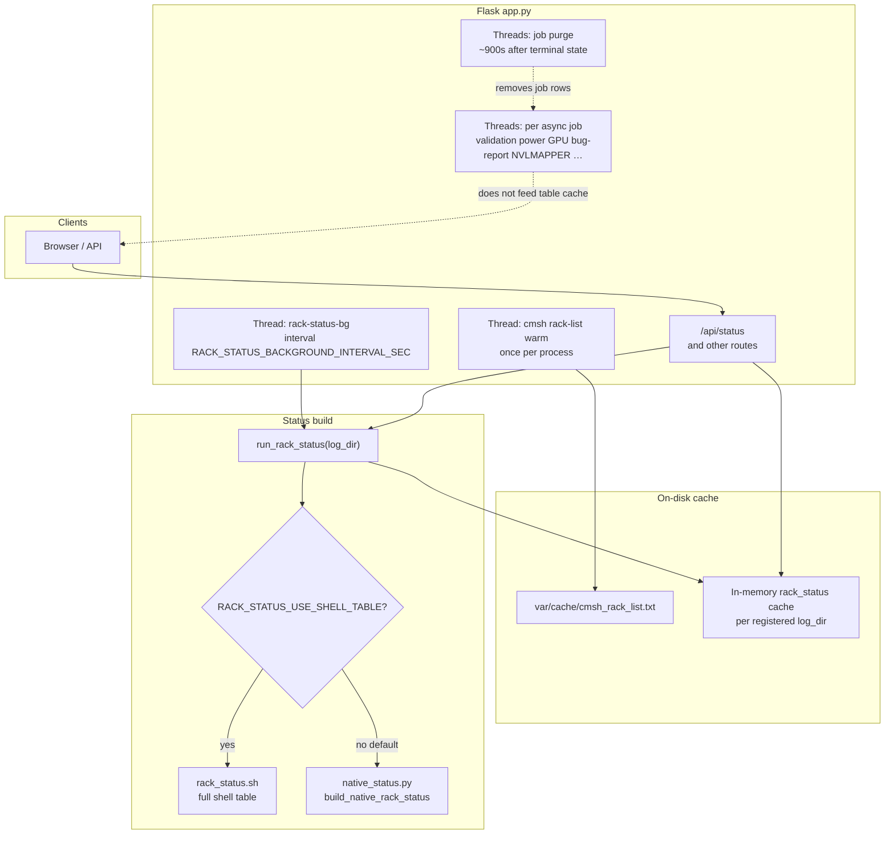
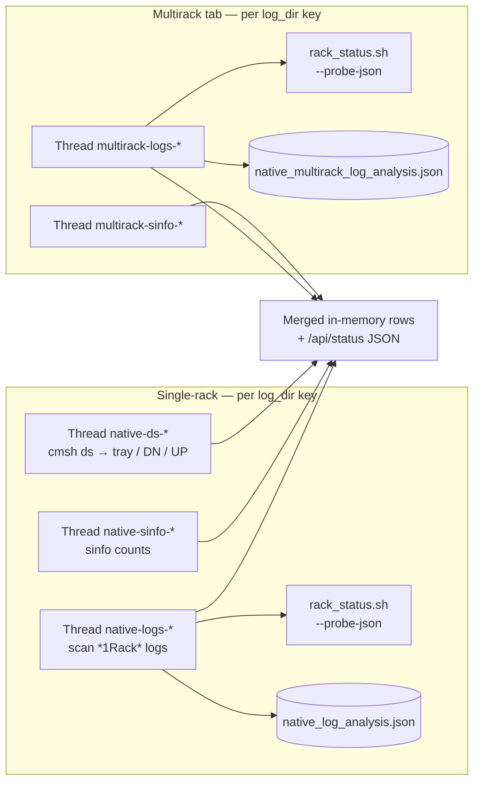

# NVIS Rack Status (`nvis-rack-status`)

Flask dashboard for **rack-level operations and NEMO validation visibility**: a sortable rack table, parser charts, log export, Slurm controls, power and GPU flows, NVSwitch / NVLink tooling, optional Grafana embeds, and optional PAM login.

**Configuration:** every environment variable and credential file pattern is documented in **[docs/ENVIRONMENT.md](docs/ENVIRONMENT.md)** (including **`.nvlmapperrc`**, **`.prometheusrc`**, and Grafana helper env).

---

## Quick start
```bash
cd nvis-rack-status
module load python3
python3 -m venv .venv && source .venv/bin/activate
pip install -r requirements.txt
export PORT=5000   # optional
python3 app.py
```

## Launch with Grafana and custom validation path

### 1. Grafana credentials (`~/.prometheusrc`)

Create **`~/.prometheusrc`** with base-view credentials for the Grafana helper:

```bash
USER=<BASE-VIEW-USER>
PASSWORD=<BASE-VIEW-PASSWORD>
```

### 2. Start Grafana

```bash
cd nvis-rack-status
./bin/scripts/launch-grafana-bright-prometheus.sh
```

### 3. Start the dashboard

Example environment for a named project, custom NEMO image, and validation log root (adjust paths to your site):

```bash
cd nvis-rack-status
# Tests that must pass for “cluster ready” (default: all_reduce,all_to_all,all_gather,nemotron)
export VALIDATION_TEST=nccl_allreduce,llm
export RACK_WEB_PROJECT_NAME="Project NAME"
export NEMO_SQSH_SRC=/home/cmsupport/nemo-25.11.01.sqsh
export RACK_STATUS_LOG_DIR=/home/cmsupport/aihpc_val-main/validation/nemo/
export PORT=5000
module load python3
python3 -m venv .venv && source .venv/bin/activate
pip install -r requirements.txt
python3 app.py
```

**After launch:** open **`http://0.0.0.0:${PORT:-5000}/`**. Use **`RACK_WEB_SECRET_KEY`** for stable sessions; **`RACK_WEB_AUTH_DISABLED=1`** only on trusted networks.

---

## Status backends: native Python vs shell

The rack table is built in one of two ways (toggle with an environment variable):

| Mode | Variable | What runs |
|------|-----------|-----------|
| **Native (default)** | `RACK_STATUS_USE_SHELL_TABLE` **unset or false** | **`native_status.py`** — `cmsh` rack list, async **`cmsh ds`**, **`sinfo`**, and log probes (typically **`rack_status.sh --probe-json`**) merge into in-memory state; `/api/status` returns JSON without parsing the full shell table. |
| **Shell (legacy)** | **`RACK_STATUS_USE_SHELL_TABLE=1`** | **`rack_status.sh`** — full shell pipeline each refresh; output is parsed into the same JSON shape the UI expects. Heavier, but matches older deployments exactly. |

The UI footer includes a **`backend:`** hint (`native_status.py` vs shell table) so operators can confirm which path is live.

---

## Internal daemons and background work

### Overview (`app.py` + `/api/status`)



- **`rack-status-bg`** runs **`run_rack_status`** for each registered **`log_dir`** in series (lock: one heavy status run at a time when combined with foreground refresh).
- **`RACK_STATUS_BACKGROUND_DISABLED=1`** — no background loop; **`/api/status`** runs **`run_rack_status`** when a fresh payload is needed (unless serving only from cache where applicable).
- **`RACK_CMSH_RACK_LIST_CACHE_DISABLED=1`** — skip warming **`cmsh -c "rack; list"`**; subprocesses do not receive **`RACK_CMSH_RACK_LIST_FILE`**.

### Native mode: `native_status.py` worker threads

Each **single-rack** `log_dir` key keeps a **`NativeRackTableState`**: three daemons refresh slices of the table; results merge on the next **`build_native_rack_status`**. The **multirack** tab uses **`MultirackTableState`** (no `cmsh ds` thread — only sinfo + log probes).



| Thread name (pattern) | Where | Role |
|------------------------|-------|------|
| **`native-ds-*`** | Single-rack only | **`cmsh -c "ds"`** → device / tray column. |
| **`native-sinfo-*`** | Single-rack | Slurm **`sinfo`** aggregation for rack cells. |
| **`native-logs-*`** | Single-rack | Log scan + **`probe_fn`** (default **`rack_status.sh --probe-json`**); persists **`var/cache/native_log_analysis.json`**. |
| **`multirack-sinfo-*`** | Multirack | Same sinfo aggregation for multirack rows. |
| **`multirack-logs-*`** | Multirack | Multirack log paths + probes; persists **`var/cache/native_multirack_log_analysis.json`**. |

In **shell table** mode (**`RACK_STATUS_USE_SHELL_TABLE=1`**), the **`native-*`** / **`multirack-*`** threads above are **not** started; **`run_rack_status`** only runs **`rack_status.sh`** (still fed by **`rack-status-bg`** when background refresh is enabled).

---

## Main screen (overview)

- **Log directory** — Root for NEMO logs and **`cwd`** for many scripts (`RACK_STATUS_LOG_DIR`, default `var/logs/` under the app).
- **Refresh / Refresh now** — Polls **`GET /api/status`**; optional background refresh keeps the cache warm (see above).
- **squeue / sinfo** — Toolbar modals; same **`RACK_SLURM_*`** module and binary overrides as drain/undrain.
- **Theme** — Dark, blue, or light.
- **Export to Excel / Export Logs** — Same file-selection rules as before: log root only, `*1Rack*` filtering vs NEMO **`done`** unless **`RACK_LOG_EXPORT_SKIP_NEMO_DONE_FILTER=1`** (see ENVIRONMENT.md).

### Rack table (short)

| Column | Role |
|--------|------|
| **rack** | Id + actions: **`[results]`** (parser modal), **`[run validation]`**, **`[sysinfo]`**, tail/open log links, multirack helpers as configured. Spinner + row highlight for in-flight async work; hover spinner for live output panel. |
| **comment** | Server-side note (`RACK_COMMENTS_FILE`). |
| **validation state** | `done` / `fail` / `ongoing` / `pending` from logs + Slurm heuristics. |
| **last_job** | Slurm job id; **`[cancel_job]`** when allowed → **`POST /api/slurm-scancel`**. |
| **sinfo** | Compact states; **`[drain]`** / **`[undrain]`**. |
| **Device status** | Tray / DN / UP tokens; buttons for power, GPU reset, services, HW check, NMXC / NVLink menu (site-dependent). |

### Parser results dialog

Runs **`./parser.sh --json`** on the best log for the rack: command line, NCCL summary tables, Chart.js series, optional Grafana solo panels (**`RACK_WEB_GRAFANA_*`**). If Grafana iframes are blank in the browser, check mixed-content rules and set a **browser-reachable** Grafana base URL (**`RACK_WEB_GRAFANA_URI`** or host + **`RACK_WEB_GRAFANA_PORT`**).

---

## Bundled scripts

Operational scripts live under **`bin/scripts/`** (paths overridable with **`RACK_*_SCRIPT`** env vars). Prerequisites (Slurm, `pdsh`, `cmsh`, Docker for optional Grafana launcher, etc.) are summarized in **`bin/scripts/README.txt`**.

Large optional binaries (e.g. **`bin/scripts/nvlmapper`**) may be gitignored — copy from your build tree when using NVLMAPPER.

---

## Slurm APIs (dashboard host)

| Endpoint | Purpose |
|----------|---------|
| **`GET /api/slurm-squeue`** | `squeue` → JSON + optional table parse. |
| **`GET /api/slurm-sinfo-r`** | `sinfo -R --long` → JSON + column slicing on `REASON … NODELIST`. |
| **`POST /api/slurm-scancel`** | Cancel a job id (`RACK_SLURM_SCANCEL_DISABLED` to disable). |
| **Drain / undrain** | From UI → `scontrol` on rack CT bracket (`RACK_VALIDATION_CT_RANGE`, **`RACK_SLURM_*`**). |

Full variable list: **[docs/ENVIRONMENT.md](docs/ENVIRONMENT.md)** (Slurm / `native_status.py`: see section 7 there).

---

## Background job APIs

Pattern: **`POST …-async`** returns **`job_id`** → poll **`GET /api/reset-job-status?job_id=…`** (or validation/xrack/llama/stress-specific status URLs where applicable). Completed rows are purged from memory after about **15 minutes** (daemon purge threads).

Examples: **`/api/run-validation-async`**, **`/api/power-on-async`**, **`/api/gpu-reset-async`**, **`/api/services-restart-async`**, **`/api/hw-check-async`**, **`/api/nvswitch-fix-async`**, **`/api/bug-report-async`**, **`/api/nvlmapper-async`**, streaming sysinfo / NVSwitch audit, tail-log streams — see **`app.py`** `@app.route` list or the slide deck **`docs/nvis-rack-status-slides.html`**.

---

## Dependencies

- **Python:** Flask and packages in **`requirements.txt`**.
- **Host:** Scripts’ expectations in **`bin/scripts/README.txt`**; **`scontrol`** / **`module load`** for Slurm UI; **`tail`** / optional **`stdbuf`** for streams.

---

## Further reading

| Doc | Content |
|-----|---------|
| **[docs/ENVIRONMENT.md](docs/ENVIRONMENT.md)** | All **`RACK_*`**, **`RACK_WEB_*`**, **`PORT`**, **`FLASK_DEBUG`**, **`NVLMAPPER_RC`**, **`.prometheusrc`**, parser/Grafana time zones, disable flags, timeouts. |
| **`app.py` module docstring** | Long-form notes on PAM, Grafana time alignment, and cache files. |
| **`docs/nvis-rack-status-slides.html`** | Reveal.js overview (open in a browser). |

---

## Screenshots

Parser results with InfiniBand table and embedded Grafana (GPU thermal / power):


Main table with NEMO log modal; footer shows **`backend: native_status.py`** when the Python table is active:


Parser results — NCCL summary and **all_reduce** bandwidth chart:


