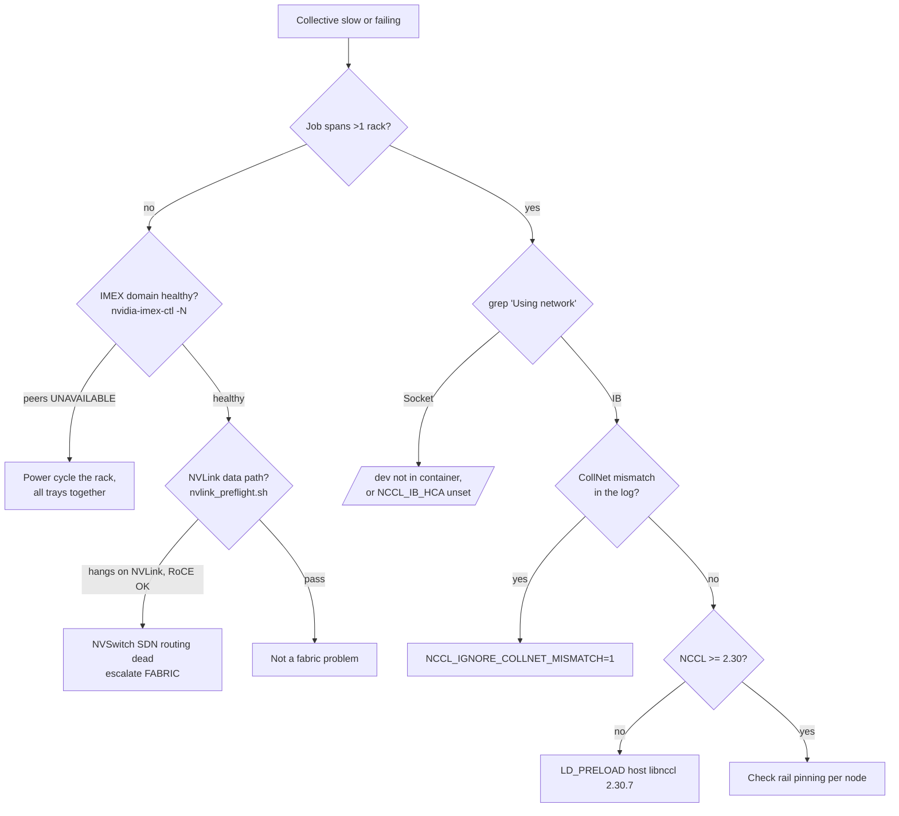

# NCCL on GB300 NVL72 — single-rack vs multi-rack

Why a collective that hits **691 GB/s inside one rack** can collapse to **3.7 GB/s the moment it
spans two**, and what has to be configured differently on each side of that boundary.

Written from measurements on Nscale TX (`ink50-dh01`, GB300 NVL72, 2026-08-07). Companion to
[`NSCALE_TX_DEPLOYMENT.md`](NSCALE_TX_DEPLOYMENT.md) and the `nvlink_preflight.sh` header, which
covers the *diagnosis* side.

---

## 1. The one fact everything follows from

**An NVL72 rack is exactly one NVLink domain: 18 compute trays × 4 GPUs = 72 GPUs.** Inside it,
GPUs talk over NVLink. Outside it, they cannot — NVLink does not leave the rack.

So there are two completely different data paths, chosen by whether your job fits in one rack:

```
                 ┌───────────────── one NVL72 rack = 1 NVLink domain ─────────────────┐
   GPU ──18×NVLink5──► L1 NVSwitch trays (9U) ──► GPU        intra-rack: NVLink / MNNVL
                 └────────────────────────────────────────────────────────────────────┘
                                    │
                        4 × 800G IB rails (mlx5_0..3)          inter-rack: IB / RoCE
                                    │
                              spine switches
                                    │
                 ┌───────────────── another NVL72 rack ──────────────────┐
```

Two consequences that surprise people:

- **There is no direct GPU↔GPU NVLink.** Every GPU's 18 NVLink5 ports go *up* into the rack's L1
  NVSwitch trays, so even a 2-GPU same-node collective routes GPU → NVSwitch → GPU. A wedged
  NVSwitch SDN routing table deadlocks *every* NVLink path while IB keeps working.
- **Single-rack results tell you nothing about your network.** They never touch it.

---

## 2. Physical layout per tray

Measured with `ibv_devinfo -l` and `/sys/class/infiniband/*/ports/1/{state,link_layer,rate}`:

| Device | Link layer | Rate | Role |
|---|---|---|---|
| `mlx5_0` … `mlx5_3` | InfiniBand | 800 Gb/s (4X XDR) | **compute rails** — one per GPU, carries cross-rack collectives |
| `mlx5_bond_0` | Ethernet | 400 Gb/s | storage / converged plane |
| `bond0` (netdev) | Ethernet | — | **OOB / bootstrap only** — NCCL wireup, MPI oob, never bulk data |

`/dev/infiniband/` exposes `uverbs0..4`, `umad0..4`, `rdma_cm`. **A container without `/dev` mounted
sees none of this** — see §6.

The rail count matching the GPU count (4 and 4) is not a coincidence; it is what
`lib/fabric.inc.sh` gates on.

---

## 3. Which transport NCCL picks, and how to prove it

NCCL logs its choice once per rank. This single line is the fastest way to know which world you are
in:

```bash
grep -h "Using network" <rank-log>       # "Using network IB"  or  "Using network Socket"
```

Then the per-channel lines tell you the actual path taken:

```
Channel 00/0 : 54[2] -> 55[3] via P2P/MNNVL     # NVLink, intra-domain
Channel 00/0 : 12[0] -> 40[0] [send] via NET/IB # InfiniBand, cross-rack
Channel 00/0 : 12[0] -> 40[0] [send] via NET/Socket   # TCP — you have a problem
```

On the LLMB/Comms-Perf-Suite path these live in per-rank files, **not** in the sbatch stdout:

```
<experiments>/…/LOG_<ts>_<jid>_gb300_sweep_N<n>/1_1_LOG_all_reduce_…/rank<N>_<host>/
    nccl_debug_file.<host>.<pid>.txt
```

### Reference numbers (all_reduce busbw, 8–16 GiB messages)

| Configuration | busbw | Notes |
|---|---|---|
| 1 rack, 18 nodes, NVLink | **~691 GB/s** | job 128340, h15 |
| 2 racks, 36 nodes, IB | *(expected tens of GB/s)* | not yet measured on this cluster |
| 2 racks, 36 nodes, **TCP fallback** | **3.7 GB/s** | job 131559 — ~185× slow, one 8 GiB all_reduce took 4.5 s |

If a cross-rack number looks like single-digit GB/s, it is on sockets. Do not report it as a
fabric result.

---

## 4. Single-rack: NVLink only, IB deliberately OFF

`nemo-nemotron5h_56b-mbridge-fp8.sh` decides by node count, overridable by `NVIS_NEMO_XRACK`:

```bash
single_rack=1
[ $SLURM_NNODES -gt 18 ] && single_rack=0
[ -n "$NVIS_NEMO_XRACK" ] && single_rack=$([ "$NVIS_NEMO_XRACK" = 1 ] && echo 0 || echo 1)
```

Single-rack branch:

```bash
export UCX_TLS=tcp
export NCCL_IB_DISABLE=1          # <-- IB switched OFF on purpose
export UCX_NET_DEVICES=${ns_nic}  # bond0
```

**`NCCL_IB_DISABLE=1` is correct here, not a bug.** All 72 GPUs are in one NVLink domain, so IB
would only add a slower alternative path. This is also why a broken IB configuration can hide for
weeks: single-rack validation passes at full speed with the network entirely unused.

### IMEX is the control plane for intra-domain CUDA IPC

MNNVL needs `nvidia-imex` running **and agreed across the domain**. Its failure mode is the
misleading part:

```
transport/p2p.cc:281 NCCL WARN Cuda failure 400 'invalid resource handle'
```

That is a CUDA IPC handle rejection during P2P setup, not a compute fault. Check membership, not
just the service:

```bash
systemctl is-active nvidia-imex      # "active" proves nothing on its own
nvidia-imex-ctl -q                   # "READY" also proves nothing on its own
nvidia-imex-ctl -N                   # THIS is the one that matters
```

A healthy tray lists every peer `READY` with a driver version. A broken tray lists **every peer
including itself** as `UNAVAILABLE` with a blank version, while `-q` still cheerfully says `READY`.
Observed on `h08-18`/`h08-28` (2026-08-06): only those two were isolated, but ranks on *other*
trays failed with CUDA 400 while trying to exchange handles with them — so the error surfaces on
healthy nodes and points at the wrong ones.

Recovery: a service restart does **not** clear it. A full power cycle with all 18 trays booting
together does. Boot skew is the trigger — those two trays had booted 4h 48m after their rack-mates.

---

## 5. Multi-rack: IB required, and five things must be right

Cross-rack branch of the same script:

```bash
export UCX_TLS=rc
export UCX_NET_DEVICES="mlx5_0:1,mlx5_1:1,mlx5_2:1,mlx5_3:1"
export NCCL_IB_HCA="=mlx5_0,mlx5_1,mlx5_2,mlx5_3"   # leading '=' = EXACT match, not prefix
export NCCL_SOCKET_IFNAME=bond0                      # bootstrap only
```

| # | Requirement | Why | Failure if missing |
|---|---|---|---|
| 1 | `/dev` mounted into the container | `/dev/infiniband/uverbs*` must be visible | `NET/IB : No device found` → silent TCP fallback |
| 2 | `NCCL_IB_HCA="=mlx5_0,…,mlx5_3"` | pins the 4 compute rails, excludes `mlx5_bond_0` | mixes IB + RoCE NICs → *"Remote IB device is incompatible"* |
| 3 | `NCCL_IGNORE_COLLNET_MISMATCH=1` | HPC-X SHARP plugin predates runtime NCCL, loads the v10 ABI and registers **3 vs 4** CollNet devices across nodes | NCCL 2.30 aborts: *"Detected mixed local CollNet device counts"*, surfacing as the misleading *"bootstrap Message truncated: received 512 bytes instead of 256"* |
| 4 | NCCL **≥ 2.30** | 2.28.9 fails cross-rack bootstrap regardless of env | validated 2026-07-07: 2.30.7 passes (job 203), 2.28.9 fails (job 210) |
| 5 | Per-node rail classification | rail names are per-node facts | pinning one node's list onto a tray missing that rail kills the job (job 65648: `h03-12` has no `mlx5_2`) |

Plus tuning the x-rack path sets: `NCCL_IB_QPS_PER_CONNECTION=2`, `NCCL_RUNTIME_CONNECT=0`,
`NCCL_P2P_NET_CHUNKSIZE=262144`, `NCCL_IB_SL=1`.

### On requirement 3, the alternative

`NCCL_NET_PLUGIN=none` also works — it drops the external plugin for NCCL's built-in IB, losing
SHARP offload. Prefer `NCCL_IGNORE_COLLNET_MISMATCH=1` so cross-rack allreduce keeps in-network
reduction. The real fix is a container HPC-X plugin exporting the v11 ABI.

### On requirement 5, why auto-detect is the default

`lib/fabric.inc.sh` classifies rails per node: ACTIVE ports only → split by `link_layer` → pick the
technology (`NVIS_RDMA_LINK_TECH=ib|roce|auto`) → keep only the **top line rate**, which drops
slower BlueField-3 storage NICs. It exports *nothing* device-specific by default
(`NVIS_FABRIC_PIN_DEVICES=0`) so each rank discovers its own HCAs. Set `NVIS_FABRIC_PIN_DEVICES=1`
only for homogeneous single-node runs.

The batch script must be able to *find* the library — Slurm spools only the batch script, not
`lib/`, so `run-nemo-xrack.sh` exports `NVIS_SCRIPTS_DIR`. Without it the classifier silently
no-ops and falls back to a naive `mlx5_0..3` that mixes IB and RoCE.

### Container NCCL preload

The stock NeMo image ships NCCL 2.28.3, which **segfaults at MNNVL init** even single-node. The
x-rack path bind-mounts the host NCCL and `LD_PRELOAD`s it:

```bash
CONT_MOUNTS="/dev:/dev,${NCCL_PRELOAD_SRC}:/host-nccl"
EXPORT_ARG="ALL,LD_PRELOAD=/host-nccl/libnccl.so.2.30.7"
```

Set `NVIS_NCCL_PRELOAD_DISABLE=1` with the vetted image (`build_vetted_nemo_image.sh`), where
libnccl and nccl-tests are already baked at the vetted version and the preload would shadow them.

---

## 6. Why the LLMB path does not work cross-rack (as of 2026-08-07)

`run_llmb_nemo.sh` / `run_llmb_nccl.sh` drive `llmb-run` → Comms-Perf-Suite. That path is **correct
for single-rack and broken for multi-rack**, for three compounding reasons:

**Its container has no `/dev`.** `llmb_repo/nccl/launch.sh` mounts only the workspace:

```
--container-mounts=./:/nvcomms-perf-workspace          # no /dev:/dev
```

so `/dev/infiniband` never reaches the ranks → `NET/IB : No device found` → `Using network Socket`.
This is the primary blocker; no environment variable can work around it.

**Job environment does not reach the ranks.** The launcher's own comment says so:

```
# THE JOB ENVIRONMENT DOES NOT REACH THE RANKS ON THIS PATH.
```

`llmb-run` builds its own `srun` with an inline `env …` list, so exports from the launcher shell —
including anything typed into the dashboard's "Extra environment variables" box — are dropped. The
only channel is the `nccl = [...]` array in `config/systems.toml`. That is also why
`run_llmb_nccl.sh` rewrites `NCCL_DEBUG` in `systems.toml` rather than exporting it.

**Its NCCL env is missing the cross-rack essentials.** The entire `[gb300.run_params].nccl` list:

```toml
nccl = [ "NCCL_DEBUG=INFO", "NCCL_DEBUG_SUBSYS=ALL", "NCCL_IB_SL=1" ]
```

No `NCCL_IB_HCA`, no `NCCL_IGNORE_COLLNET_MISMATCH`, and the inline `srun` additionally forces
`NCCL_NVLS_ENABLE=0`.

**Consequence:** use `run-nemo-xrack.sh` for anything spanning more than one rack. The LLMB path is
fine for single-rack, where none of the above is exercised. Making LLMB cross-rack-capable means
patching `launch.sh` (mount `/dev`), `systems.toml` (the env), and confirming the container NCCL
version — three upstream files, which is why it was not pursued.

---

## 7. Triage flowchart



---

## 8. Quick reference

```bash
# Which transport did NCCL choose?
grep -h "Using network" <rank-log>

# What path did each channel take?
grep -ohE "Channel [0-9]+/[0-9]+ : .*via [A-Za-z0-9/]+" <rank-log> | grep -oE "via .*" | sort | uniq -c

# Are the compute rails up?
for d in /sys/class/infiniband/mlx5_*; do
  printf "%-12s %-10s %-12s %s\n" "$(basename $d)" \
    "$(cat $d/ports/1/state)" "$(cat $d/ports/1/link_layer)" "$(cat $d/ports/1/rate)"
done

# Is this node really in the IMEX domain? (-q lies; -N does not)
sudo nvidia-imex-ctl -N | sed -n '/^Nodes:/,$p'

# Full per-node NVLink/NVLS readiness gate
sudo bash bin/scripts/nvlink_preflight.sh --quick    # static checks
sudo bash bin/scripts/nvlink_preflight.sh            # + forced-NVLink data-path probe
```

| Variable | Single-rack | Multi-rack |
|---|---|---|
| `NCCL_IB_DISABLE` | `1` | unset (IB required) |
| `NCCL_IB_HCA` | — | `=mlx5_0,mlx5_1,mlx5_2,mlx5_3` |
| `UCX_TLS` | `tcp` | `rc` |
| `UCX_NET_DEVICES` | `bond0` | `mlx5_0:1,…,mlx5_3:1` |
| `NCCL_SOCKET_IFNAME` | `bond0` | `bond0` (bootstrap only) |
| `NCCL_IGNORE_COLLNET_MISMATCH` | harmless | `1` |
| `NVIS_NEMO_XRACK` | `0` | `1` (set automatically by `run-nemo-xrack.sh`) |
| Minimum NCCL | 2.28.x ok | **2.30+** |
