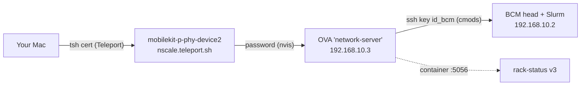

# Nscale TX (GB300 NVL72) — deployment, connection design, and findings

Reference for operators and AI agents working the **Nscale TX** engagement. Each cluster
we deploy to has its own way of being reached and operated; this records Nscale TX's,
plus the product changes it drove. Companion to
[`.cursor/rules/cluster-deployments.mdc`](../.cursor/rules/cluster-deployments.mdc)
(Mayo / Firmus / Boston map) — **announce the target cluster before acting, and never mix
clusters.**

| | |
|---|---|
| Customer / cluster | NscaleTX / `NscaleTX-GB300`, GB300 NVL72 |
| Rack Status deployment | container `nvis-rack-status-v3` on the OVA, port **5056** |
| Repo branch | `v3` (push to `origin/v3`) |
| Deployment tree | `/opt/observability/nvis-rack-status-v3` on the OVA |
| Jira | [NVRACKSTAT-45](https://jirasw.nvidia.com/browse/NVRACKSTAT-45) |
| Last verified | 2026-07-30 |

No credentials appear in this document. They live in `deploy-secrets/` and
`docker-compose.override.yml` on the OVA (both git-ignored).

---

## 1. Connection design (the part unique to this site)

Three hops, each with a different auth mechanism. This is the most common source of
confusion, so it is worth internalising:



| Hop | Target | Auth |
|---|---|---|
| 1 | `mobilekit-p-phy-device2.nscale.teleport.sh` as `rafael.koike.ct` | Teleport cert (`tsh login`), expires ~daily |
| 2 | `nvis@192.168.10.3` (alias `nscale-tx-ova`) | **password** — `PubkeyAuthentication no` |
| 3 | `cmods@192.168.10.2` (alias `nscale-tx-node`) | key `/home/nvis/.ssh/id_bcm`, from the OVA/container |

Because hop 2 is password-only, **nothing can open a fresh session non-interactively.**
An agent can only reuse an existing `ControlMaster` (`ControlMaster auto` +
`ControlPersist 10m` in `~/.ssh/config`). The standard division of labour: the human runs
`ssh nscale-tx-ova 'echo ok'` once to establish the master, after which an agent can do
everything else (including `ssh -O forward`) without a password.

### The device1 / device2 / device3 trap

There are three `mobilekit-p-phy-deviceN` appliances in Teleport. **They are NOT
interchangeable entry points, and must never be used as failovers for this cluster.**
Each appliance bridges its *own* local `192.168.10.0/2x` segment:

| Appliance | Its `br0` | What is behind it |
|---|---|---|
| device2 | `192.168.10.1/27` | **the Nscale TX kit** — OVA `.3`, BCM head `.2` |
| device3 | `192.168.10.2/29` | a different kit — empty segment, nothing at `.3`, no `cmsh` |

Verified 2026-07-30 by probing device3: `ip neigh` showed `192.168.10.3 dev br0 FAILED`
(ARP unanswered), no `cmsh`, no VMs, and a port scan of `.1–.6` found only itself.
Repointing `ProxyJump` at device3 therefore connects to an **empty** network and fails in
a confusing way. The `~/.ssh/config` entries carry a comment saying exactly this.

### Failure signatures

| Symptom | Real cause | Fix |
|---|---|---|
| `Connection closed by UNKNOWN port 65535` | Jumphost **offline in Teleport** (the proxy closes the stdio connection). *Not* a cert problem. | Wait for device2 to return; it recovered on its own within ~30 min on 2026-07-30 |
| `ERROR: failed connecting to host …: target host is offline or does not exist` | Same as above, one line earlier — this is the useful message | — |
| Password prompt / `Permission denied (publickey,password)` | Jump hop **succeeded**; only hop 2 remains | Human enters the password once |
| `tsh` profile shows `[EXPIRED]` | Cert lapsed (roughly daily) | `tsh login --proxy=nscale.teleport.sh` |

Fastest triage — distinguishes "jumphost down" from cert/password in ~2 s:

```bash
ssh -o BatchMode=yes -o ConnectTimeout=12 \
    -l rafael.koike.ct mobilekit-p-phy-device2.nscale.teleport.sh 'echo ONLINE'
```

### Reaching the dashboard

The container listens on the OVA at `0.0.0.0:5056`; you reach it over an SSH forward.
Use **local port 5156**, not 5056 — a stale Cursor Remote-SSH forward has repeatedly
squatted on local 5056 and produces a bound-but-dead port.

```bash
~/Documents/code/ns-tun.sh            # status, then bring the tunnel up
~/Documents/code/ns-tun.sh status     # report every layer, change nothing
~/Documents/code/ns-tun.sh restart
```

`ns-tun.sh` checks the layers in the order they actually break (cert -> jumphost ->
master -> forward -> HTTP) and names the culprit. Exit codes: `0` up, `1` down but
fixable, `2` upstream broken. Equivalent manual command:

```bash
ssh -N -L 5156:localhost:5056 -o ServerAliveInterval=60 -o ServerAliveCountMax=3 nscale-tx-ova
```

`~/Documents/code/mount-nscale-tx.sh` SSHFS-mounts the deployment tree locally for
editing (needs **fuse-t**, not macFUSE — fuse-t is userspace and needs no kernel
extension or reboot).

---

## 2. Cluster facts

| | |
|---|---|
| Nodes | ~864 in Slurm |
| Racks | `ink50-dh01-h01` … `h22` |
| Naming | `NVIS_RACK_ID=ink50-dh01-[a-z][\d+]`, `NVIS_CT_ID=ink50-dh01-[a-z][\d+]-[\d+]` |
| Trays per rack | **18, non-contiguous: `11-18` and `28-37`** |
| Slurm | 25.05 at `/cm/local/apps/slurm/25.05/bin` |
| `SLURM_CONF` | `/cm/shared-ubuntu2404-x86_64/apps/slurm/etc/slurm/slurm.conf` |
| BCM | `cmsh` at `/cm/local/apps/cmd/bin/cmsh` |

Two site-specific traps:

- **Tray numbering.** The built-in default `01-18` targets ten nodes that do not exist and
  misses ten that do. `RACK_VALIDATION_CT_RANGE=11-18,28-37` fixes it. This only bites when
  an action is launched *without* an explicit node selection.
- **Slurm binaries are not on a non-login PATH.** With `RACK_SLURM_SKIP_MODULE_LOAD=1`, every
  Slurm CLI must be pinned via `RACK_SLURM_*` (`SQUEUE`, `SINFO`, `SCONTROL`, `SCANCEL`, and
  `SACCT` — see finding F2). Bare `sinfo` over SSH fails with
  `resolve_ctls_from_dns_srv: res_nsearch error` unless `SLURM_CONF` is exported.
- **`cmsh` mode names.** On this BCM version the modes are `monitoring action` and
  `monitoring trigger` (singular). `monitoring setup; actions` does **not** exist and returns
  `Command not found: actions` while still printing a large unrelated listing — easy to
  misread as success.

---

## 3. Deployment model

The OVA holds **two trees. Only the v3 one is live:**

| Path | Branch | Role |
|---|---|---|
| `/opt/observability/nvis-rack-status-v3` | `v3` | **live** deployment (port 5056) |
| `/opt/observability/nvis-rack-status-main` | old `main` | legacy — leave alone |

The container runs the image `nvis-rack-status-v3-rack-status`
(`0.0.0.0:5056->5000`), gunicorn `--workers 1 --threads 24 --worker-class gthread
--timeout 600`. It is **not** a plain image deployment: selected backend files are
bind-mounted read-only from the tree, so editing the tree + restarting deploys backend
changes without rebuilding.

Bind-mounted from the tree: `backend/app.py`, `host_exec.py`, `native_status.py`,
`nvis_id_templates.py`, `platforms/base.py`, `transport/`, `catalog/`, `metrics_query.py`,
`lake_sink.py`, `results_history.py`, `universal_parser.py`, `grafana_embeds.py`,
plus `bin/scripts/checker.sh`, `deploy-secrets/*`, and the SPA `index.html` + kaizen CSS.

### The SPA override

The built SPA is baked into the image, but `/app/static/spa/index.html` is bind-mounted
from `deploy-secrets/index.html`.

**This override is now vestigial.** It existed because `frontend/index.html` used to pull
Kaizen `base.css`/`components.css` from `webassets.nvidia.com`, which an air-gapped OVA
cannot reach — so each deploy rewrote those two `<link>` tags to locally-mounted
`/assets/kaizen-base.css` and `/assets/kaizen-components.css`. That CDN dependency is gone
upstream: the Kaizen CSS is vendored at `frontend/src/styles/kaizen/` and imported by
`src/main.tsx`, so Vite bundles it into the hashed app CSS and the built `index.html` is
already air-gap clean (see `frontend/src/styles/kaizen/README.md`).

Since 2026-07-31 the bundle is a **bind mount** (`static/spa/assets` on the host →
`/app/static/spa/assets`), so shipping assets is a plain `rsync` with no `docker cp`:

```bash
TREE=/opt/observability/nvis-rack-status-v3
# 1. build   npx vite build                                    -> static/spa/, new hashed bundle
# 2. assets  rsync -a  static/spa/assets/ nscale-tx-ova:$TREE/static/spa/assets/   # NO --delete
# 3. index   ssh nscale-tx-ova "cat > $TREE/deploy-secrets/index.html" < static/spa/index.html
# 4. restart docker restart nvis-rack-status-v3                 # required; see below
```

Two rules here were learned the hard way on 2026-07-31, in the same ten minutes:

**Never `--delete` on step 2.** Additive is correct. Orphaned chunks from old builds are
harmless; a *missing* one is not. Anything still asking for the previous bundle — a browser
holding the old `index.html`, or the container itself between steps 2 and 3 — breaks the moment
you delete it. Prune old `index-*.js` deliberately when nobody is mid-session, not as part of a
deploy.

**`index.html` is a single-file bind mount, and rsync replaces files by rename.** A rename gives
the path a *new inode* while the container keeps the old one mounted, so the container serves the
pre-deploy `index.html` indefinitely and no amount of rewriting the path fixes it — writes land on
an inode nothing is reading. Hence `cat >` (truncate in place, same inode) on step 3, and hence
the restart, which re-resolves the mount and is the only reliable recovery once a rename has
already detached it. This applies to **every** single-file mount in the override, not just
`index.html`: `docker cp`-then-rename tooling has the same hazard.

Because the CSS is hashed into the bundle, `index.html` and `assets/` must always ship together.

### Two landmines (both resolved 2026-07-31)

1. **`restart` does not apply new bind mounts; only `compose up` (recreate) does.**
   *Closed 2026-07-31: a recreate has since activated every declared backend mount — verify
   with the `docker inspect` one-liner below rather than trusting this note.* The history is
   kept because the failure mode returns the instant someone adds a module without recreating.

   `cluster_snapshot.py`, `cluster_overview_live.py` and `bringup.py` were listed in
   `docker-compose.override.yml` but their mounts are **not active** in the running
   container — they currently exist only because they were `docker cp`'d into the
   writable layer. This is why the container crash-looped with
   `ModuleNotFoundError: No module named 'cluster_snapshot'` after the tree was checked
   out to `v3`: the new `app.py` imported modules the image did not have and that were
   not yet mounted. **When adding a backend module: `docker cp` it *and* add the mount.**
   Verified again on 2026-07-30 shipping `node_report.py`: `bringup.py` is *declared* in the
   override but still not an active mount, so the container was running a stale `docker cp`
   copy and the new `/api/bringup/fleet` returned `module 'bringup' has no attribute
   'fleet_summary'`. Check what is actually live before assuming an edit landed:

   ```bash
   docker inspect nvis-rack-status-v3 --format '{{range .Mounts}}{{.Destination}}
   {{end}}' | grep /app/backend/
   ```

   Two extras that bit on the same deploy: a **new dependency** must be installed in the
   container too (`docker exec … pip install jsonschema` — the OVA does reach PyPI), and a
   module that loads a **data file** needs the directory mounted as well, not just the `.py`
   (`backend/schemas/` alongside `node_report.py`). Both are soft-imported, so without them the
   feature degrades silently rather than failing loudly — which is worse to diagnose.

2. ~~**A full recreate (`compose down/up`) will break the SPA.**~~ **Fixed 2026-07-31.**
   This one detonated first: someone recreated the container at 14:59 UTC and the dashboard
   went blank. Deployed bundles lived in the *writable layer* (`docker cp`), which a recreate
   discards, while the mounted `index.html` survived on the host and kept asking for
   `index-CVxTww0o.js` — 404 on the app's own JS, white screen. Note the asymmetry that makes
   this bite: the half that survives is the half that names the missing file.

   `static/spa/assets` is now bind-mounted from the host tree, so the bundle survives
   recreates. The two `kaizen-*.css` mounts were dropped in the same change — they had zero
   references left in both `index.html` and the bundle once Kaizen was vendored, and nested
   mounts inside the new `assets/` mount would have been needless fragility. Mounting the
   whole of `static/spa` was rejected for the same reason: the `docs/*` mounts live under it.

   The price of the fix is that the host tree is now load-bearing for the frontend — see the
   `--delete` warning in the deploy recipe above.

3. ~~**The deployment tree drifts from git.**~~ **Resolved 2026-07-30.** The tree is now a
   real checkout at a known commit and `bin/prod-drift.sh` reports it clean. Keep it that way:
   sync with a `git bundle` (below), not by copying individual files. The OVA still has **no
   route to GitLab**, so `git fetch origin` will not work.

### Other people edit this deployment — check before you deploy

The most expensive lesson from this site. Fixes get made **directly on the live cluster**, in
two places git never sees, and a deploy overwrites both:

* the deployment tree's bind-mounted `backend/*.py`, and
* the head node's `bin/scripts` copy, which is what the connection actually executes.

On 2026-07-30 six real fixes existed only on the cluster (Undrain's sinfo probe, the llmb
double-ingest, `collect_sinfo_counts` returning `{}`, NCCL per-collective parsing,
`NVIS_NCCL_HCA_AUTO`, the NEMO `--export` set). Deploying would have destroyed all six.

**Always run this first, and harvest anything it reports:**

```bash
NVIS_DEPLOY_SSH=nscale-tx-ova \
NVIS_DEPLOY_PATH=/opt/observability/nvis-rack-status-v3 \
NVIS_HEAD_VIA=nscale-tx-ova RACK_SSH_HOST=192.168.10.2 RACK_SSH_USER=cmods \
RACK_SSH_KEY=/home/nvis/.ssh/id_bcm RACK_REMOTE_BASE_PATH=/home/cmods/nvis-rack-status \
  bin/prod-drift.sh --fetch /tmp/drift        # exit 1 = drift; harvest before deploying
```

It compares by content against the **deployment's own base commit**, which separates "we are
ahead and the deploy will deliver it" from "somebody edited prod". `--fetch` writes the remote
and git copies side by side for a `git merge-file` 3-way merge against that base.

**Not everything on the cluster is newer.** The head's `parser.sh` was a *pre-v4* copy that
never received the universal-ingest work and was then patched locally; taking it would have
reverted 600 lines. Before merging a drifted file, check whether it is a superset of ours or a
different lineage — line counts are a quick tell.

### Syncing code in (no route to GitLab)

```bash
git bundle create /tmp/v3.bundle <deployed-commit>..v3   # thin bundle; the tree has the base
scp /tmp/v3.bundle nscale-tx-ova:/tmp/
ssh nscale-tx-ova 'cd /opt/observability/nvis-rack-status-v3 \
  && git fetch -q /tmp/v3.bundle v3:refs/remotes/bundle/v3 \
  && git reset --hard refs/remotes/bundle/v3'
docker restart nvis-rack-status-v3      # re-resolves per-file bind mounts onto the new inodes
# then push scripts to the head node (from the OVA — the only route to it):
ssh nscale-tx-ova 'cd /opt/observability/nvis-rack-status-v3 && rsync -avc --exclude="*.bak*" \
  -e "ssh -i /home/nvis/.ssh/id_bcm" bin/scripts/ cmods@192.168.10.2:/home/cmods/nvis-rack-status/bin/scripts/'
```

`git reset --hard` replaces files rather than editing them, so the container must be
**restarted**: a per-file bind mount otherwise keeps pointing at the old inode.

### Auth

Token mode (`RACK_WEB_AUTH_MODE=token`). For scripted checks, log in for a session cookie:

```bash
curl -sS -c /tmp/ck.txt -X POST -H 'Content-Type: application/json' \
     -d '{"password":"<RACK_WEB_AUTH_TOKEN>"}' http://127.0.0.1:5056/api/login
curl -sS -b /tmp/ck.txt http://127.0.0.1:5056/api/bringup/config
```

A bare `GET /` returning **302** is healthy — it is the login redirect, not an error.

---

## 4. Environment configuration

Set in `docker-compose.override.yml` on the OVA. The ones that matter here:

| Variable | Why this site needs it |
|---|---|
| `RACK_STATUS_ALLOWED_PREFIXES` | Multi-root read allowlist. Operators' job StdOut lands **outside** `RACK_STATUS_LOG_DIR` (e.g. `/home/cmods/bringup/results`), and once this is set it is the *only* gate — every readable root must be listed |
| `RACK_STATUS_LOG_DIR` | `/home/cmods/benchmark/harish` (a head-node path, not a container path) |
| `RACK_SLURM_{SQUEUE,SINFO,SCONTROL,SCANCEL,SACCT}` | Absolute paths; required with `RACK_SLURM_SKIP_MODULE_LOAD=1` |
| `RACK_VALIDATION_CT_RANGE=11-18,28-37` | Non-contiguous trays |
| `RACK_BRINGUP_HOME` | Travis's tree, default `/home/cmods/bringup` (see §5) |
| `RACK_LAKE_*` | Parquet lake capture — first site to enable it, which exposed finding F5 |
| `RACK_GRAFANA_*` | Grafana reachable via `host.docker.internal:3001`, not `localhost` |

Full catalogue: [`docs/ENVIRONMENT.md`](ENVIRONMENT.md).

---

## 5. Travis's bring-up automation (the site's own system)

An independent framework at `/home/cmods/bringup/` continuously validates nodes. Rack
Status **integrates with it rather than competing with it.**

> Full integration contract — BCM registration objects, the `SETTINGS` keys that change what our
> UI shows, `RECOVER_REASONS`, how to verify the framework is actually *running*, and a map into
> his own 38-file docs tree — is in
> [`BRINGUP_AUTOMATION_INTEGRATION.md`](BRINGUP_AUTOMATION_INTEGRATION.md). Read that before
> debugging anything bring-up related; the summary below is orientation only.

BCM monitoring fires three actions while a node's `DeviceStatus == UP` (`duringactions`,
so they re-evaluate every cycle):

| Trigger | Action | Effect |
|---|---|---|
| `NodeHealthTrigger` | `node_health.sh` | 38 checks vs a `valid-config` baseline |
| `FileCopyTrigger` | `file_copy.sh` | rsync container images to node-local `/tmp` |
| `LaunchJobTrigger` | `launch_job.sh` | hourly sweep: submit the next missing/failing benchmark as `cmods` |

Artifacts, per node: `results/<node>/<job>.txt`, `.fail<N>.txt` archives,
`quick-view.txt`, `trigger.log`; fleet CSVs in `reports/`.

Key properties:

- **Verdicts are derived, never stored.** `parsers/nvl72/verdict.sh` re-judges every log on
  each read, so tightening a floor re-judges history. Floors: allreduce **683**, alltoall
  **623**, both `-nonvlink` **43** GB/s (largest-message out-of-place busbw).
- **A job can be live.** `sbatch --output` writes `results/<node>/<job>.txt` directly, so a
  `RUNNING` column is a file being appended to right now. Everything else is static.
- **Slurm is saturated by it** — ~137 running / ~45 pending `bringup-<node>` jobs, all
  `--exclusive`. Do not launch competing rack-wide validation; read his artifacts instead.
- Its own reporting CLIs are the integration surface: `daily-report.sh -c` (fleet CSV, cell
  is a metric *or* a status word) and `status-check.sh <node>` (per-job status + reason).
  Neither alone is sufficient: a numeric cell does not say pass/fail, so Rack Status merges
  metric-from-daily-report with status-from-status-check.

---

## 6. Findings (symptom -> cause -> fix)

| # | Symptom | Cause | Fix |
|---|---|---|---|
| F1 | Web terminal shows "WebSocket error" | Middleware only checked `werkzeug.socket`; gunicorn provides `gunicorn.socket`, so the upgrade fell through to auth and 401'd | Accept either key |
| F2 | Scheduler or Post-run view: `sacct: command not found` / `sinfo: command not found` | Some routes bypassed the platform provider and assumed Slurm was on a non-login PATH | Every backend call now uses the platform provider; Nscale pins all seven clients under `/cm/local/apps/slurm/25.05/bin` via `RACK_SLURM_{SBATCH,SRUN,SINFO,SQUEUE,SACCT,SCONTROL,SCANCEL}` and shell launchers use `RACK_SLURM_BIN` |
| F3 | Cannot open logs outside the log dir | `RACK_STATUS_ALLOWED_PREFIXES` unset | Set it to all four readable roots |
| F4 | `AttributeError: 'PurePosixPath' object has no attribute 'stat'` | Endpoints called `Path.stat()/read_bytes()` on a **remote** path | Route through `host_exec.stat/read_text/is_file`; stream downloads as base64 |
| F5 | Log viewer stuck on "Connecting…" forever | The analytics-lake `after_request` hook called `response.get_data()`, which **consumed the `tail -f` generator**. Its guard only skipped `direct_passthrough`, which is `False` for a generator-backed `Response` | Also skip `response.is_streamed`. Affected every streaming endpoint; only surfaced here because this is the first site with the lake enabled |
| F6 | Log view flickers, then reads `(stopped)` | An inline `payload={{...}}` object gave `TailLogDialog` a new reference on every parent poll (rack-locks ~5 s), so its effect aborted and restarted the stream | `useMemo` the payload |
| F7 | Multi-select filters overflow and break layout | KUI `Combobox` renders one tag per selection | `MultiSelectCombobox` wrapper using `multipleMode="count"`; MUI `Autocomplete` uses `limitTags` |
| F8 | Parser charts showed a partial (1N) run | A newer 1N sweep or a row `job_id` pointing at one out-ranked the full-rack log | `full_rack` mode in `pick_log_for_rack` (`-18N-`, `RACK_FULL_RACK_NODES`) + a "Full rack validation" checkbox |
| F9 | `-nonvlink` NCCL fails at ~2.3 GB/s vs a 43 floor | NCCL logs `NET/IB : No device found` and falls back to `NET/Socket` over `bond0` — the HCAs are not visible **inside the container**, though the host sees `mlx5_*` | Diagnose with `bringup/ib-visibility.sh <node>`, which separates the four cases (host / container / NCCL-init / TCP fallback) |
| F10 | A single-node NCCL log "looks like" it ran on `bond0` | It did — but only for **bootstrap**. With `nNodes 1` every channel is `via P2P/MNNVL`, and ~628 GB/s busbw proves NVLink. The Socket fallback only matters for multi-node and the `-nonvlink` pair | Read the channel lines, not the NET plugin lines |
| F11 | Container crash-loops after a tree checkout | New `app.py` imported modules absent from the image and not bind-mounted | See §3 landmine 1 |
| F12 | SSH dies overnight; `Connection closed by UNKNOWN port 65535` | Jumphost device2 went offline in Teleport | See §1 |
| F13 | Dashboard is a **white screen**; the app's JS 404s | Someone ran `compose up`; the recreate discarded the writable layer holding the `docker cp`'d bundle, while the host-mounted `index.html` kept requesting it | Bind-mount `static/spa/assets`. See §3 landmine 2 |
| F14 | Console: `Expected a JavaScript-or-Wasm module script but the server responded with a MIME type of "text/html"` | Two bugs at once: `rsync`'s rename detached the `index.html` single-file mount so the container served the pre-deploy copy, and `--delete` had removed the bundle that copy asks for. The SPA catch-all then answered the missing `.js` with `index.html` — HTML at status 200 | `cat >` + restart for `index.html`; drop `--delete`; `_serve_spa_asset` now 404s a missing `assets/*` instead of serving HTML |
| F15 | GPU OOB power clear/set over Redfish returns HTTP **500** / `SYS494` / `InternalError`; trays stuck at half TGP (e.g. 699 W slot-0) and look “unfixable” | Dell **iDRAC Datacenter** license gates HGX GPU power APIs on PowerEdge HGX (Enterprise ≠ enough). Unlicensed calls are mis-reported as InternalError instead of 402/403. **DGX does not have this BMC license ladder.** Separate issue: a bad OOB `SetPoint` may still exist; Datacenter only unlocks clear/set | Check `racadm license view` / `LicenseService` **first**; install tag-bound Datacenter XML; then `ClearOOBSetPoint` + `PATCH PowerLimitWatts`. Runbook: [`DELL_IDRAC_DATACENTER_LICENSE_HGX.md`](DELL_IDRAC_DATACENTER_LICENSE_HGX.md); incident: [`NSCALE_TX_GB300_SLOT0_POWER_CAP.md`](NSCALE_TX_GB300_SLOT0_POWER_CAP.md) |
| F16 | Hardware Deep Audit ends `inconclusive` with `execve(): 0`, or falsely says a healthy GB300 has zero GPUs | GNU getopt does not bind a space-separated value to Slurm's optional long arguments, so `0` became the executable; after that fix, a GPU-less allocation let the device cgroup hide all GPUs | Render `--kill-on-bad-exit=0 --immediate=60`; declare `fanout.gpus_per_node: 4` so the Slurm allocation carries `gres/gpu=4`. Live proof: hardware job 147865 and network job 147866 both passed on j21-11 with four allocated GPUs |

---

## 7. What this engagement contributed to the product

Everything below is **generic** — it shipped on `v3` for all clusters, not as Nscale-TX
special-casing.

| Contribution | Where | Reusable pattern |
|---|---|---|
| **Compute -> Nodes view** — paginated node inventory (18/page = one NVL72 rack), row/rack/name filters, per-node Validation/Hardware/Networking/Services | [`frontend/src/views/NodesView.tsx`](../frontend/src/views/NodesView.tsx) | Operate at node granularity when the fleet is busy; reuse the rack action tabs with a one-element node set instead of building a parallel UI |
| **Bring-up results adapter** — `/api/bringup/{config,node}` | [`backend/bringup.py`](../backend/bringup.py) | **Shell out to the site's own scripts** for verdicts rather than re-implementing their pass/fail logic, which drifts. Cache the expensive fleet-wide call; keep the per-node call scoped |
| **Parse an arbitrary allowlisted log** — `/api/parser-results?path=` | `api_parser_results` | Let a caller name an exact file, gated by `RACK_STATUS_ALLOWED_PREFIXES`, instead of widening the filename heuristic |
| **Full-rack log selection** — `full_rack` / `RACK_FULL_RACK_NODES` | `pick_log_for_rack` | Node-count-aware log picking so a partial re-run cannot masquerade as an acceptance result |
| **Adaptive log viewing** | [`JobLogContentDialog.tsx`](../frontend/src/components/JobLogContentDialog.tsx) + `TailLogDialog` | Whole file for a finished job, live `tail -f` only when the job is actually `RUNNING` — decided from status, not guessed |
| **`MultiSelectCombobox`** | [`frontend/src/components/MultiSelectCombobox.tsx`](../frontend/src/components/MultiSelectCombobox.tsx) | One wrapper so every multi-select filter behaves identically and cannot overflow |
| **Streaming-response guard** | `_lake_capture_request` | Any `after_request` hook must skip `is_streamed`, not just `direct_passthrough` |
| **Platform-routed Slurm commands** | [`backend/platforms/base.py`](../backend/platforms/base.py) | Every Slurm CLI gets an env override; callers never rediscover a binary or versioned BCM path |

Design principles this engagement reinforced:

1. **Integrate, don't duplicate.** The site already had authoritative validation; the win was
   surfacing it, not re-running it.
2. **Reuse before building.** The Nodes view is mostly existing components re-composed.
3. **Tests ship with the feature.** [`test_bringup.py`](../backend/tests/test_bringup.py),
   `test_pick_log_full_rack.py`, and four frontend specs, including a regression test for the
   F6 payload-identity bug.
4. **Derive, don't store, verdicts** — copied straight from `verdict.sh`, and the reason
   `/api/bringup/node` re-reads on every request.

---

## 8. Runbook

```bash
# BEFORE ANY DEPLOY — has anyone edited the live cluster? (see §3; exit 1 = harvest first)
bin/prod-drift.sh --fetch /tmp/drift              # env as in §3

# Tunnel / connectivity
~/Documents/code/ns-tun.sh status
ssh nscale-tx-ova 'echo ok'                       # human: establishes the ControlMaster

# Deployment health (on the OVA)
docker ps --filter name=nvis-rack-status-v3
docker logs --tail 40 nvis-rack-status-v3
docker restart nvis-rack-status-v3                # picks up mounted backend edits

# Cluster (from the OVA, via the head node)
ssh -i /home/nvis/.ssh/id_bcm cmods@192.168.10.2 \
  'export SLURM_CONF=/cm/shared-ubuntu2404-x86_64/apps/slurm/etc/slurm/slurm.conf; sinfo -h -o "%T %D"'

# Bring-up automation (on the head node, in /home/cmods/bringup)
bash status-check.sh <node>       # per-job status + reason
bash status-check.sh -s           # fleet roll-up by worst status
bash daily-report.sh -c           # fleet CSV with metrics
bash trigger-log.sh <node>        # why the sequencer did or did not submit
bash ib-visibility.sh <node>      # the F9 diagnosis
```

Commit conventions: work for this site lands on `v3` and is pushed to `origin/v3`
(Boston/Firmus use `mel01-validation`). Recent: `de204e3` (Nodes + bring-up),
`52ee717` (full-rack parser).
