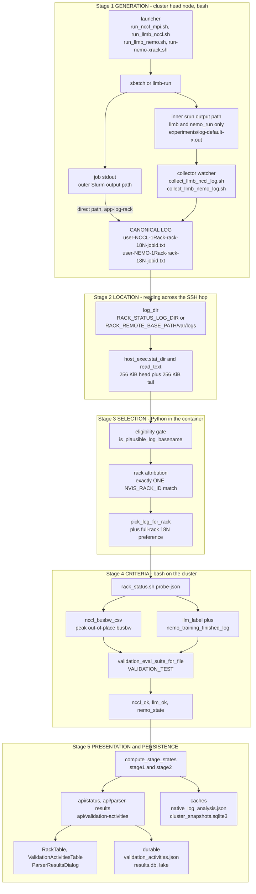
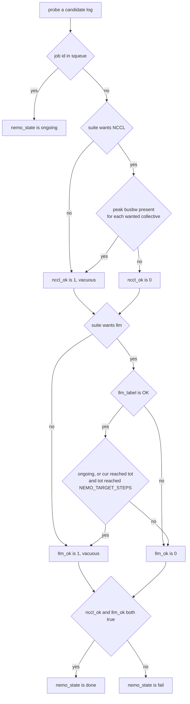

# NVIS Rack Status — Results Parsing Architecture

How a validation run becomes a green or red cell on the dashboard: which files get written, how
one of them is chosen, what makes it pass or fail, and where the verdict is shown and stored.

**Scope.** This document owns the *result interpretation* pipeline. Two companions own the
neighbouring concerns and are not repeated here:

- **[EXECUTION_ARCHITECTURE.md](EXECUTION_ARCHITECTURE.md)** — how commands and file reads reach
  the cluster (`host_exec`, roles, SSH profiles, `pdsh`).
- **[ENVIRONMENT.md](ENVIRONMENT.md)** — the exhaustive environment-variable reference.

**Why it needs a document.** The pipeline has five stages, each with its own failure mode, and the
stages fail *silently* and *independently*. A run can succeed on the cluster and still show as
"fail", or show as "collecting" forever, without a single error anywhere. §8 catalogues the traps
that have actually bitten us; §7 traces one real job end to end.

---

## Contents

1. [The pipeline at a glance](#1-the-pipeline-at-a-glance)
2. [Stage 1 — Generation: who writes the logs](#2-stage-1--generation-who-writes-the-logs)
3. [Stage 2 — Location: where logs live and how we read them](#3-stage-2--location-where-logs-live-and-how-we-read-them)
4. [Stage 3 — Selection: which file answers for a rack](#4-stage-3--selection-which-file-answers-for-a-rack)
5. [Stage 4 — Criteria: what makes a run pass](#5-stage-4--criteria-what-makes-a-run-pass)
6. [Stage 5 — Presentation and persistence](#6-stage-5--presentation-and-persistence)
7. [Worked example: job 127327 end to end](#7-worked-example-job-127327-end-to-end)
8. [Failure modes and how to recognise them](#8-failure-modes-and-how-to-recognise-them)
9. [Environment variables that change parsing behaviour](#9-environment-variables-that-change-parsing-behaviour)

---

## 1. The pipeline at a glance

Five stages, three languages, two hosts. The launcher and the criteria live in **bash on the
cluster**; selection, presentation and persistence live in **Python in the container**; rendering is
**TypeScript in the browser**.



Two independent tracks read the same files and can disagree, which is by design and a frequent
source of confusion:

| Track | Question it answers | Evidence it trusts |
|---|---|---|
| **Rack status** (`/api/status`) | Did this rack pass validation? | Log **content** — busbw numbers and iteration counts |
| **Validation activities** (`/api/validation-activities`) | What happened to the job I launched? | **Slurm** state plus the existence of a results file |

A job can be `done` in the activities table and `fail` in the rack header at the same time: the
first saw Slurm exit 0 and a file on disk, the second read the file and found no training in it.
That is exactly what §7 walks through.

---

## 2. Stage 1 — Generation: who writes the logs

### 2.1 The canonical filenames

Everything downstream keys off the basename. Two shapes carry rack validation state:

```text
<user>-NCCL-1Rack-<rack>-<N>N-<jobid>.txt      Stage 1 (NCCL benchmark)
<user>-NEMO-1Rack-<rack>-<N>N-<jobid>.txt      Stage 2 (NeMo / Nemotron training)
```

`<N>` is the node count, and it is load-bearing — see the full-rack preference in §4.3. `<jobid>` is
the Slurm job id, which is how a results log is matched back to a launched task.

Other shapes and what they mean:

| Pattern | Written by | Role |
|---|---|---|
| `<user>-NEMO-<rack1>+<rack2>-<N>N-<jobid>.txt` | `run-nemo-xrack.sh` | Multi-rack NeMo; **excluded** from single-rack attribution |
| `nccl-mpi_<label>_<jobid>.out` | `run_nccl_mpi.sh` (no `--app-log-rack`) | Cross-rack NCCL; not a single-rack result |
| `llmb-nccl_<label>_<jobid>.out` | `run_llmb_nccl.sh` via the sbatch shim | **Intermediate** — progress only, no result tables |
| `llmb-autocollect_<jobid>.log` | `run_llmb_nccl.sh` watcher | Collector's own log; never a result |
| `llmb-nemo-autocollect_<jobid>.log` | `run_llmb_nemo.sh` watcher | Collector's own log; never a result |
| `<user>-NEMO-LLAMA3_8B-1N-<host>-<jobid>.txt` | `run-llama.sh` | Per-node Llama smoke; explicitly excluded from Stage 2 |
| `<user>-MNUBERGEMM-<tag>-<jobid>.txt` | `run_mnubergemm_stress.sh` | Stress soak |
| `clusterkit/<user>-CK-<rack>-<jobid>.txt` | `run_clusterkit.sh` | ClusterKit |
| `nvloom/<user>-NVLOOM-<rack>-<jobid>.txt` | `run_nvloom_singlerack.sh` | NVLoom |

The two `.out` intermediates and the two `autocollect` logs are filtered out of the universal scan
by `_UNIVERSAL_SCAN_IGNORE_RE` in `backend/app.py`, default
`llmb-nccl_.+_\d+\.out|llmb(-nemo)?-?autocollect_\d+\.log`.

### 2.2 Two ways a canonical log gets written

**Direct path.** `run_nccl_mpi.sh --app-log-rack <rack>` sets Slurm's `--output` to the canonical
name, so the job writes it itself. Nothing else is needed.

**Collector path.** `llmb-run` hands off to `nemo_run`, whose *generated* batch script runs the real
work under its **own inner** `srun --output <experiments>/…/log-default-default…_%j_0.out`. Our
sbatch shim rewrites only the **outer** batch `--output`. The inner redirect is baked into generated
code we do not own, so the canonical file receives nothing but shell trace — roughly 6 KB and zero
iterations — while several megabytes of real output sit in the experiment directory.

That is why the collectors exist:

| | `collect_llmb_nccl_log.sh` | `collect_llmb_nemo_log.sh` |
|---|---|---|
| Reads | `…/microbenchmark_nccl/experiments/*_<jid>/LOG_*/*/rank0_*/stdout.txt` | `…/pretrain_nemotron-h/experiments/**/log-default-default*_<jid>_*.out` |
| Writes | Concatenates rank0 tables **over** the canonical NCCL log | **Appends** the inner log to the canonical NEMO log |
| Idempotent | No — rewrites on each run | Yes — marker `### NVIS: llmb inner log for job <jid> appended below ###` |
| Triggered by | watcher in `run_llmb_nccl.sh` | watcher in `run_llmb_nemo.sh` |

Both watchers are spawned as `setsid nohup bash -c …`, poll `squeue` until the job leaves the queue
(capped near eight hours), sleep 15 s for the last ranks to flush, then invoke the collector. Set
`NVIS_LLMB_AUTOCOLLECT=0` to suppress them and run the collector by hand.

> **Gate on readable, not executable.** Both watchers invoke the collector as `bash "$collect"`,
> which needs no execute bit, and deployed copies frequently land mode 644 because a
> base64/`cat` deploy does not carry the mode. A `-x` test therefore never passes on the head node
> and auto-collect is silently disabled. Both launchers now gate on `-r` and warn when the collector
> is missing, because a run with no aggregated log is indistinguishable from a run that never
> happened.

---

## 3. Stage 2 — Location: where logs live and how we read them

### 3.1 Resolving `log_dir`

Requests carry a `log_dir`, which `_resolve_log_dir()` validates with `host_exec.is_dir()` — on the
*execution* host — and optionally checks against `RACK_STATUS_ALLOWED_PREFIXES`. The default comes
from `RACK_STATUS_LOG_DIR`, falling back to `<RACK_REMOTE_BASE_PATH>/var/logs`.

Validation jobs are launched with **`cwd = log_dir`** on the execution host, so a relative
`--output` in a launcher lands there without any path juggling.

Subdirectories that are also scanned: `failed/` (multi-rack and archived logs), `sn-llama/`,
`clusterkit/`, `nvloom/`.

### 3.2 The reading contract

The log directory belongs to whichever host runs the jobs — normally the cluster head node, which in
a container deployment is an SSH hop away. **Every** filesystem access on that path must therefore go
through `host_exec`, never through `pathlib`:

| Need | Use | Never |
|---|---|---|
| List a directory | `host_exec.stat_dir(base, patterns=…, maxdepth=1)` | `Path.glob` / `Path.iterdir` |
| Check existence | `host_exec.is_dir` / `is_file` | `Path.exists` |
| Size and mtime | `host_exec.stat` → `FileStat(mtime, size)` | `Path.stat` |
| Read content | `host_exec.read_text` | `open()` |

`stat_dir` is one `find` round trip per directory, which matters because the dashboard polls.

Reads are **capped at both ends** — a validation log can be gigabytes and the parser only needs the
extremities. From `backend/transport/base.py`:

```python
DEFAULT_HEAD_BYTES = 256 * 1024
DEFAULT_TAIL_BYTES = 256 * 1024
```

The middle is replaced by an elision marker. Callers that need more raise the cap explicitly: the
universal parser reads 2 MiB head + 1 MiB tail, NVLoom heatmaps up to 80 MiB.

> **The SSH-mode trap.** A `Path.iterdir()` on a remote log directory does not error — it simply
> finds nothing, and the caller concludes "no results yet". This produced tasks stuck in
> `collecting` forever (§8). When you add a code path that looks for a log, ask which host is
> holding the file.

---

## 4. Stage 3 — Selection: which file answers for a rack

Three gates in series. A file must clear all three to be considered for a rack.

### 4.1 Is it plausibly a result log?

`nvis_id_templates.is_plausible_log_basename()` is deliberately **permissive** — the default
`NVIS_LOG_BASENAME_MODE=open` accepts any file that could be a result, and rejects only genuine
noise. Order of decisions:

1. Reject empty, `.`/`..`, anything with a trailing separator.
2. `NVIS_LOG_EXCLUDE_MARKERS` substring → reject (cannot be overridden).
3. `NVIS_EXTRA_LOG_MARKERS` substring → accept.
4. `is_log_noise_basename` → reject: dotfiles, editor swap/autosave, and any `.bak`/`.tmp`/`.lock`
   style component from `_LOG_NOISE_COMPONENTS`.
5. No extension left after stripping `.gz`/`.xz`/`.zst` wrappers → accept.
6. Extension in `_LOG_RESULT_EXTS` (`log out txt err json csv tsv …`) → accept.
7. Extension in `_LOG_BINARY_EXTS` (`sh py so tar png pdf …`) → reject.
8. Numeric extension (rotated log) → accept unless the preceding extension is binary.
9. Unknown extension → accept.

Setting `NVIS_LOG_BASENAME_MODE=strict` restores the legacy behaviour: a basename must contain a
known tool marker from `_LOG_TOOL_MARKERS` (`nccl`, `nemo`, `mnubergemm`, `clusterkit`, `nvloom`,
`hpl`, `dcgm`, …).

Widening this gate is safe because it cannot mis-attribute anything — attribution is a separate,
strict gate.

### 4.2 Which rack does it belong to?

`rack_id_from_log_basename()` enforces **exactly one** rack id:

1. Llama Slurm stdout (`nemo-llama3_8b-1n-`) → not a rack result.
2. `1Rack-<rack>` match via `nemo_1rack_filename_re()` → that rack.
3. Any name containing `nemo` → scan for rack ids, accept only if precisely one.
4. Must pass the eligibility gate from §4.1.
5. A multi-rack marker (`_MULTIRACK_N_RACK_RE` = `(?:[2-9]|[1-9]\d{1,3})rack`, so `4Rack`, `36Rack`)
   → refuse single-rack attribution even if only one rack id is spelled out.
6. Scan with the `NVIS_RACK_ID` template; return the rack **only if the set has size 1**.

The templates (`NVIS_RACK_ID`, `NVIS_CT_ID`) are the single source of naming truth and are compiled
into loose scan regexes, so `p5-r01` in a log matches the canonical `p05-r01`. See
`.cursor/rules/cluster-naming-conventions.mdc` for why rack id and compute hostname are not
interchangeable.

### 4.3 Which of several candidates wins?

`find_log_paths_for_rack()` lists `log_dir` and `log_dir/failed` through `host_exec`, keeps files
attributed to the rack, and sorts newest-first. Then `pick_log_for_rack()`:

```text
if full_rack:                      # need = full_rack_nodes or RACK_FULL_RACK_NODES (default 18)
    keep only candidates whose basename has -<need>N-
    none left  ->  None            # better no answer than a partial one
if job_id is numeric:
    exact match on  N-<job_id>.txt ->  that file
    no match and not full_rack     ->  newest candidate
    no match and full_rack         ->  newest FULL-RACK candidate (ignore the partial job)
otherwise                          ->  newest candidate
```

The full-rack preference exists because a 1-node smoke test and an 18-node acceptance run produce
the same filename shape. Without it, a newer `-1N-` log would silently override a passing `-18N-`
result. `backend/tests/test_pick_log_full_rack.py` pins this behaviour.

`pick_logs_for_rack()` is the stage-aware variant, returning `{"nccl": …, "nemo": …}` so Stage 1 and
Stage 2 are read from their own newest logs rather than one combined file.

### 4.4 Matching a results log to a launched job

The activities layer works from the other direction — it has a job id and needs the file.
`pick_results_log(names, job_id, label=…)` is pure selection over basenames: it requires the name to
end in `-<jobid>.txt` and to contain `nccl-1rack` or `nemo-1rack`, then prefers by label
(`nccl`/`stage1` versus `nemo`/`stage2`). The suffix includes the leading hyphen, so job `127326`
does not match a file ending `1127326.txt`.

The caller owns the listing, which is what lets it work remotely:
`_find_results_log_on_exec_host()` in `backend/app.py` lists via `host_exec.stat_dir` and falls back
to the local-filesystem `find_results_log_for_job()` for same-host deployments.

---

## 5. Stage 4 — Criteria: what makes a run pass

### 5.1 Who is authoritative

| Concern | Authority |
|---|---|
| Rack pass/fail (`nccl_ok`, `llm_ok`, `nemo_state`) | **`rack_status.sh --probe-json`** |
| Parser Results tables and `parser_flags` | **`parser.sh`** (shares the same includes) |
| History, AI summaries, generic metrics | `backend/universal_parser.py` — *not* authoritative for rack state |

`rack_status.sh` and `parser.sh` both source `nccl_parse.inc.sh` and `validation_test_env.sh`, so
peak-bandwidth extraction and the pass rule stay in lockstep between the table and the dialog.

### 5.2 The probe

The backend runs `rack_status.sh --probe-json <log>` per candidate log and receives:

```json
{"ok": true, "basename": "…", "jid": "127326", "ongoing": false,
 "nccl_ok": true, "llm_ok": true, "nemo_state": "done",
 "squeue_time": "", "validation_test": "nccl_all_reduce,llm"}
```

`nemo_state` is `ongoing` when the job id is in `squeue`; otherwise `done` when
`nccl_ok && llm_ok`; otherwise `fail`.

### 5.3 The suite: `VALIDATION_TEST`

Which measurements are *required* is configurable. Tokens (case-insensitive, comma-separated):

| Token (aliases) | Requires |
|---|---|
| `nccl_all_reduce` (`all_reduce`, `allreduce`) | a peak all-reduce busbw |
| `nccl_alltoall` (`alltoall`) | a peak alltoall busbw |
| `nccl_allgather` (`all_gather`, `allgather`) | a peak all-gather busbw |
| `llm` (`nemotron`) | NeMo training OK **and** finished-or-running |

Default when unset: `nccl_all_reduce,nccl_alltoall,nccl_allgather,llm`. The backend narrows this when
it invokes the probe itself: `nccl_all_reduce,llm` for single-rack, and `nccl_all_reduce` for
multi-rack (`RACK_MULTIRACK_VALIDATION_TEST`).

The evaluation, from `validation_test_env.sh`:

```bash
_OUT_NCCL_OK=1
((WANT_AR)) && { [[ -n "${ar_bw:-}" ]] || _OUT_NCCL_OK=0; }
((WANT_AA)) && { [[ -n "${aa_bw:-}" ]] || _OUT_NCCL_OK=0; }
((WANT_AG)) && { [[ -n "${ag_bw:-}" ]] || _OUT_NCCL_OK=0; }
_OUT_LLM_OK=1
if ((WANT_LLM)); then
  _OUT_LLM_OK=0
  if [[ "${llm_line%%$'\t'*}" == "OK" ]]; then
    if [[ "$ongoing" -eq 1 ]] || nemo_training_finished_log "$f"; then
      _OUT_LLM_OK=1
    fi
  fi
fi
```

Two consequences worth internalising:

- **Omitted tokens are vacuously true.** Both flags initialise to `1`; a stage not in the suite is
  never checked. `nccl_ok=true` on a NeMo-only log means "NCCL was not required here", not "NCCL
  passed". This is why `native_status.validation_wants()` consults the suite before rendering a
  stage, and reports `pending` rather than a vacuous `done`.
- **There is no bandwidth floor.** The NCCL test is *presence* of a peak number, not a minimum
  GB/s. A catastrophically slow but complete run passes `nccl_ok`. Regression detection is the job
  of the history/analytics layer, not the pass gate.

### 5.4 NCCL: peak out-of-place busbw

`nccl_busbw_csv()` in `nccl_parse.inc.sh` returns `ar,aa,ag` — the busbw at the **largest message
size** for each collective, taken from **column 8** (out-of-place):

```bash
/^# Collective test starting: all_reduce_perf(_mpi)?$/ { cur="ar"; seen=1; next }
/^# Collective test concluded:/                        { cur="";   next }
NF>=9 && $1 ~ /^[0-9]+$/ && $8 ~ /^[0-9]+(\.[0-9]+)?$/ {
  if (!seen && !hdr) next
  …
}
```

The `seen`/`hdr` arming is a real bug fix, not defensive noise. A NeMo log contains plenty of lines
with nine numeric fields; without arming, 36 NEMO logs on Nscale TX each yielded 6-18 *phantom*
all-reduce points that the dashboard charted as genuine, terrible results. Rows are accepted only
after the file proves it contains an nccl-tests table, via a `# Collective test starting:` marker or
the standard table header.

### 5.5 NeMo: finished, not merely progressing

```bash
nemo_training_finished_log() {
  local f=$1 ms="${NEMO_TARGET_STEPS:-2010}" last cur tot
  [[ "$ms" =~ ^[0-9]+$ ]] || ms=2010
  last=$(grep -oE 'iteration[[:space:]]+[0-9]+/[[:space:]]*[0-9]+' "$f" | tail -1)
  …
  (( cur >= tot && tot >= ms ))
}
```

Both halves matter, and they guard different things:

- `cur >= tot` — the run reached its own declared target, so a soak killed at step 50 of 2010 fails.
- `tot >= NEMO_TARGET_STEPS` — the declared target is itself long enough to count as acceptance.

`NEMO_TARGET_STEPS` defaults to **2010**, which is a soak. A 50-step llmb benchmark therefore fails
the default and needs `NEMO_TARGET_STEPS=50` for the site. Lowering it is safe: `cur >= tot` still
rejects truncated runs.

`llm_label()` decides the row status in priority order: parseable perf stats (window: iterations
70-89) → `OK`; else `nemo_training_finished_log` → `OK`; else `slurm_hard_fail`
(`srun:.*error:.*Exited|error:.*SIGNAL`) → `FAIL`; else `nemo_python_fatal_fail` (`Traceback`,
`CUDA out of memory`, `torch.cuda.OutOfMemoryError`) → `FAIL`; else `UNK`.

### 5.6 From flags to the two stage badges

`native_status.compute_stage_states()` maps the probe flags onto Stage 1 / Stage 2:

```python
def _stage_state(nemo_lower, ok, wanted):
    if not wanted or nemo_lower == "pending":
        return "pending"
    if nemo_lower.startswith("ongoing"):
        return "done" if ok is True else "ongoing"
    return "done" if ok is True else "fail"
```

`STAGE_LABELS = {"stage1": "NCCL", "stage2": "NeMo"}`. Each stage is `done | fail | ongoing |
pending`.

When a rack has separate `-NCCL-1Rack-` and `-NEMO-1Rack-` logs, the rack is `done` only if
`nccl_src.nccl_ok and nemo_src.llm_ok` — each flag from the newest log *of its own kind*. Live Slurm
state overrides a stale cached `ongoing`, and per-stage `ongoing` is re-derived from whether that
stage's job is currently in the queue.

`validation_status_hint()` produces the tooltip; the "training has not reached the target step
count, or the log still looks incomplete" text is the `llm_ok=false` branch.

Multi-rack status is deliberately different: one row **per log file** rather than per rack, no
stage badges, and physical rack ids extracted from the log's NODELIST line.



---

## 6. Stage 5 — Presentation and persistence

### 6.1 Endpoints

| Endpoint | Serves | Notes |
|---|---|---|
| `GET /api/status` | Rack table rows + summary | Served from the SQLite snapshot; `raw=1` forces a synchronous run, `refresh=1` forces a snapshot refresh |
| `GET /api/parser-results` | Per-rack parsed tables + Grafana embeds | Resolve by `rack`, `log_file` or `path`; `full_rack=1` applies the 18N filter |
| `GET /api/multirack-status` | One row per multi-rack log | No stage badges |
| `GET /api/validation-activities` | Launched-activity list with `tasks[]` | Lazily hydrates Slurm state per request |
| `POST /api/validation-activities/adopt` | Adopt an externally produced log | Infers tool/stage from the basename |
| `GET /api/rack-log-content` / `-download` | Raw log for the viewer | Inline cap `RACK_LOG_INLINE_MAX_BYTES` (10 MiB) |
| `GET /api/universal/inventory`, `POST /api/universal/scan` | Generic parse of anything in the tree | Feeds history; skips the intermediates from §2.1 |
| `GET /api/parser-export-excel`, `/api/export-logs-zip` | Exports | Disable with `RACK_PARSER_EXPORT_DISABLED` / `RACK_LOG_EXPORT_DISABLED` |

A rack row is exactly: `rack`, `nemo`, `stage1`, `stage2`, `last_job`, `sinfo`, `ct_down_unk`,
`nemo_hint`.

### 6.2 Caches

Four layers, all keyed so that a changed log invalidates itself.

| Cache | Keyed on | Invalidation | Disable |
|---|---|---|---|
| `var/cache/native_log_analysis.json` | log path → `{mtime_ns, size, probe}` | Fingerprint mismatch re-probes; dead paths pruned; version bump wipes | — |
| `var/cache/native_multirack_log_analysis.json` | same, multi-rack | same | — |
| `var/cache/log_analysis_cache.json` | log path → `{mtime_ns, size, nccl_ok, llm_ok}` | same; feeds the `rack_status.sh --tmp-status` shell path | `RACK_LOG_ANALYSIS_CACHE_DISABLED`, capped by `RACK_LOG_ANALYSIS_CACHE_MAX_FILES` (200) |
| `var/cache/cluster_snapshots.sqlite3` | SHA256 of cluster id + log root + configuration generation | `max_age` = `RACK_STATUS_BACKGROUND_INTERVAL_SEC` (30 s); refresh lease prevents duplicate work | `RACK_STATUS_BACKGROUND_DISABLED` |

In-memory, `NativeRackTableState` (and `MultirackTableState`) run background `ds` / `sinfo` / `logs`
workers per log dir, and live worker output is merged over the snapshot so `sinfo` and
`ct_down_unk` are never stuck at `?`.

A node's cluster-manager state (`status`: up / down / inst) comes from the provider's own records
when they carry one: on BCM, `nvis_bcm_query.py` reads every device's status in one pythoncm call
(`cmstatus.getStatusForDevices`), and the `ds` worker then skips `cmsh -c ds` altogether, with
`ct_down_unk` built from the same per-node states. `cmsh -c ds` text is the fallback only. That
text is ambiguous: a line's message can name another device
(`gpu93-su35 .. [ DOWN ] (failed to send jobs to gpu10-su23)`), which once marked a healthy node
down and kept its rack out of multi-rack selection. So the fallback reads only the device named
beside the bracket.

> **Expect a lag after repairing a log by hand.** The fingerprint caches invalidate correctly, but
> `/api/status` is served from the snapshot and re-probed by the background loop — not on demand.
> After running a collector, the rack header can take a refresh interval or more to flip. It is not
> broken; it has not looked yet.

### 6.3 Durable stores

| Store | Location | Holds |
|---|---|---|
| Validation activities | `var/cache/validation_activities.json` (`RACK_VALIDATION_ACTIVITIES_FILE`) | Every launch and adopted log, with `tasks[]`; JSON + `fcntl` locking, pruned to `MAX_ACTIVITIES = 500` |
| Validation activity archive | `var/history/validation_activities.sqlite3` (`RACK_VALIDATION_ACTIVITIES_ARCHIVE_DB`) | Append-preserving activity snapshots and monotonic completed-rack rollups; survives live-cache prune, dismissal, replacement, and restart |
| Results history | `var/history/results.db` (`RACK_RESULTS_DB`) | `runs` + `run_metrics`; `run_id` = SHA256 of (path, mtime, size); statuses `pass fail timeout unknown` |
| Cluster snapshots | `var/cache/cluster_snapshots.sqlite3` | `snapshot_meta`, `cluster_snapshots` (payload must carry `rows`, `summary`, `physical_rf0`) |
| Data lake | `POST {RACK_LAKE_URL}/v1/artifacts` | Parsed JSON + raw log as artifacts; disable with `RACK_LAKE_DISABLED` |

The activity record tracks the launch (`phase`, `stdout_tail`, `command_display`) and one child task
per Slurm job. Task lifecycle is an **evidence ladder**, not a guess:

```text
squeue  →  scontrol  →  sacct  →  results artefact  →  fail closed
```

`work_phase` is one of `pending submitted running collecting done failed unknown`. `collecting`
means Slurm is finished but no results log is bound yet — the collector-lag window. It is bounded by
`collecting_since` plus `RACK_VALIDATION_COLLECT_GRACE_SEC` (900 s), after which the task resolves
on the scheduler's verdict, because an unbounded wait shows a finished run as unfinished forever.
The activity rolls up by `_WORK_PHASE_RANK` — the *most open* task wins, so `running` beats
`collecting` beats `done`.

The JSON activity table is an operational cache, not the acceptance system of record. Open rows
are exempt from its cap until reconciliation makes them terminal. A sidecar-flocked background
round robin refreshes all open rows (not only rows returned by a browser-filtered GET), using
`RACK_VALIDATION_ACTIVITIES_REFRESH_BUDGET_SEC` and
`RACK_VALIDATION_ACTIVITIES_REFRESH_INTERVAL_SEC`. Completed acceptance is monotonic: the archive
and `results_history.latest_successful_runs_by_rack()` preserve a pass even if a later retry fails
or `native_log_analysis.json` is replaced.

### 6.4 Frontend

| Component | Reads | Renders |
|---|---|---|
| `components/RackTable.tsx` | `/api/status` (poll 15 s) | `row.nemo` pill + `stage1`/`stage2` badges; `done→green fail→red ongoing→yellow pending→blue`; `nemo_hint` as tooltip |
| `components/rack/ValidationActivitiesTable.tsx` | `/api/validation-activities` (poll 6 s) | Per-task chips; Wrapper / StdOut / Train / Results buttons bound to `stdout_path`, `training_log_path`, `results_log_path` |
| `components/ParserResultsDialog.tsx` | `/api/parser-results` | NCCL and NeMo tables, charts, Grafana iframes |
| `views/ClusterDashboardView.tsx`, `components/StatusSummary.tsx` | `summary.stage1` / `summary.stage2` | Fleet counters |

The activities table mirrors the backend rank order so a multi-task activity shows the same rolled-up
phase the API computed.

---

## 7. Worked example: job 127327 end to end

A real Stage 2 run on `ink50-dh01-h01`, 2026-08-05. It succeeded on the cluster and displayed as
**fail**. The trace shows where each stage contributed.

| Stage | What happened |
|---|---|
| ① Generate | `llmb-run` submitted the Nemotron recipe. The outer sbatch wrote `cmods-NEMO-1Rack-ink50-dh01-h01-18N-127327.txt` — **5,818 bytes of shell trace**. The real 3.97 MB went to `…/experiments/…/log-default-default…_127327_0.out` via the inner `srun --output`. |
| ① Collect | The watcher never ran: `run_llmb_nemo.sh` gated on `-x` and the deployed collector was mode 644. No warning was emitted, because that case fell through to no branch. |
| ② Read | Both files were readable; nothing failed. |
| ③ Select | `pick_logs_for_rack` correctly chose the canonical log for Stage 2 — it is well-named and attributed to the right rack. Nothing here noticed it was hollow. |
| ④ Judge | `iteration` never appears in shell trace, so `nemo_training_finished_log` returned false → `llm_ok=0` → `stage2=fail`, hint "training has not reached the target step count". **Correct reasoning over incomplete evidence.** |
| ⑤ Show | Rack header: Stage 2 — NeMo **fail**. Meanwhile the activities table showed the same job `done`, because it binds a results log *by name* and Slurm said `COMPLETED`. |

The repair, and what each step proves:

```bash
# 1. backfill the canonical log from the experiment dir
bash collect_llmb_nemo_log.sh 127327 ink50-dh01-h01
#    -> iters: 50, tflops: 1287.3MODEL_TFLOP/s/GPU, canon 4.0M

# 2. the probe now agrees
rack_status.sh --probe-json …-127327.txt
#    -> {"llm_ok": true, …}     (nccl_ok false is expected: a NeMo log has no busbw table)

# 3. the rack header flips on the next background refresh, not instantly
#    -> nemo: done, stage1: done, stage2: done
```

Note step 2's `nccl_ok: false`. On a NeMo-only log that is not a failure — Stage 1 is read from the
rack's own NCCL log. Reading a single probe's `nemo_state` in isolation is misleading, which is
precisely why `native_status` combines per-stage sources instead.

---

## 8. Failure modes and how to recognise them

| Symptom | Cause | Where to look |
|---|---|---|
| Run succeeded, dashboard says **fail**, canonical log ~6 KB | Collector never ran; only shell trace was captured | `grep -c 'elapsed time per iteration' <canonical log>` → 0. Fix: run the collector; check for `llmb-nemo-autocollect_<jid>.log` |
| Task stuck in **collecting** forever | Results-log discovery used a process-local scan while the log lives on the head node | `_find_results_log_on_exec_host` must be used, not `find_results_log_for_job`. Bounded by `RACK_VALIDATION_COLLECT_GRACE_SEC` |
| Auto-collect silently disabled | Launcher gated on `-x` but the deployed collector is mode 644 | Gate on `-r`; the launchers now warn instead of skipping quietly |
| NeMo run passes on one site, fails on another with identical output | `NEMO_TARGET_STEPS` (default 2010) exceeds the recipe's declared steps | Compare the log's `iteration cur/tot` against the env value |
| Phantom terrible all-reduce points charted from a NeMo log | Nine-numeric-field lines misread as an nccl-tests table | The `seen`/`hdr` arming in `nccl_busbw_csv` prevents it |
| A newer 1-node smoke overrides a passing 18-node run | Missing full-rack preference | `pick_log_for_rack(..., full_rack=True)`; `RACK_FULL_RACK_NODES` |
| Stage 2 shows **pending** on a rack that ran NeMo | `llm`/`nemotron` not in `VALIDATION_TEST`, so the stage is "not part of this run" | `validation_test` in the probe JSON; `validation_wants()` |
| A stage shows **done** but nothing ran | Vacuous truth — the omitted token was never checked | Same as above; check the suite, not just the flag |
| Header still stale minutes after fixing a log | `/api/status` is served from the snapshot, re-probed by the background loop | `RACK_STATUS_BACKGROUND_INTERVAL_SEC`; or call with `refresh=1` |
| Activities table and rack header disagree | By design: Slurm-and-file evidence versus log-content evidence | §1; usually means the log exists but is hollow |

---

## 9. Environment variables that change parsing behaviour

Full reference in [ENVIRONMENT.md](ENVIRONMENT.md); these are the ones that alter a verdict.

| Variable | Default | Effect |
|---|---|---|
| `VALIDATION_TEST` | `nccl_all_reduce,nccl_alltoall,nccl_allgather,llm` | Which measurements are required |
| `RACK_MULTIRACK_VALIDATION_TEST` | `nccl_all_reduce` | Suite for multi-rack probes |
| `NEMO_TARGET_STEPS` | `2010` | Minimum declared training steps for "finished" |
| `RACK_FULL_RACK_NODES` | `18` | Node count for the full-rack filter |
| `NVIS_RACK_ID`, `NVIS_CT_ID` | site templates | Rack attribution and node naming |
| `NVIS_LOG_BASENAME_MODE` | `open` | `strict` restores the tool-marker allowlist |
| `NVIS_EXTRA_LOG_MARKERS` / `NVIS_LOG_EXCLUDE_MARKERS` | unset | Force-accept / force-reject basenames |
| `RACK_STATUS_LOG_DIR` | `<RACK_REMOTE_BASE_PATH>/var/logs` | Where logs are looked for |
| `RACK_JOB_LOG_DIR` | per launch | Where a launcher writes |
| `NVIS_LLMB_AUTOCOLLECT` | `1` | `0` disables the collector watchers |
| `RACK_VALIDATION_COLLECT_GRACE_SEC` | `900` | How long a task may stay `collecting` |
| `RACK_STATUS_BACKGROUND_INTERVAL_SEC` | `30` | Snapshot refresh cadence and staleness bound |
| `RACK_LOG_ANALYSIS_CACHE_DISABLED` | unset | Bypass the shell-path fingerprint cache |
| `RACK_UNIVERSAL_SCAN_IGNORE_RE` | intermediates regex | What the universal scan skips |
| `RACK_STATUS_DEMO` | `0` | `1` returns synthetic results everywhere |

---

## Checklist: adding a new validation tool

1. **Name the log** so attribution works: exactly one rack id, a `-<N>N-` node count, and the Slurm
   job id last (`…-<jobid>.txt`).
2. **Write it into `log_dir`** — launch with `cwd = log_dir`, or set `--output` explicitly.
3. If the tool redirects output internally (`srun --output`, a container `tee`), **write a
   collector** and arm a watcher gated on `-r`, following `collect_llmb_nccl_log.sh`.
4. Decide whether it feeds a **stage badge** (then it needs a probe flag and a `VALIDATION_TEST`
   token) or is **auxiliary** (then the universal parser and history are enough).
5. Read every file through **`host_exec`**, never `pathlib`.
6. Add a marker to `_LOG_TOOL_MARKERS` if the tool should be recognisable in `strict` mode.
7. Add a test that pins the selection and the pass rule — see
   `backend/tests/test_pick_log_full_rack.py` and `backend/tests/test_validation_activities.py`.
