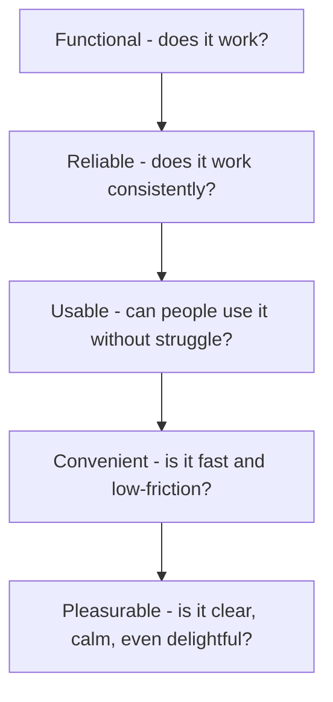
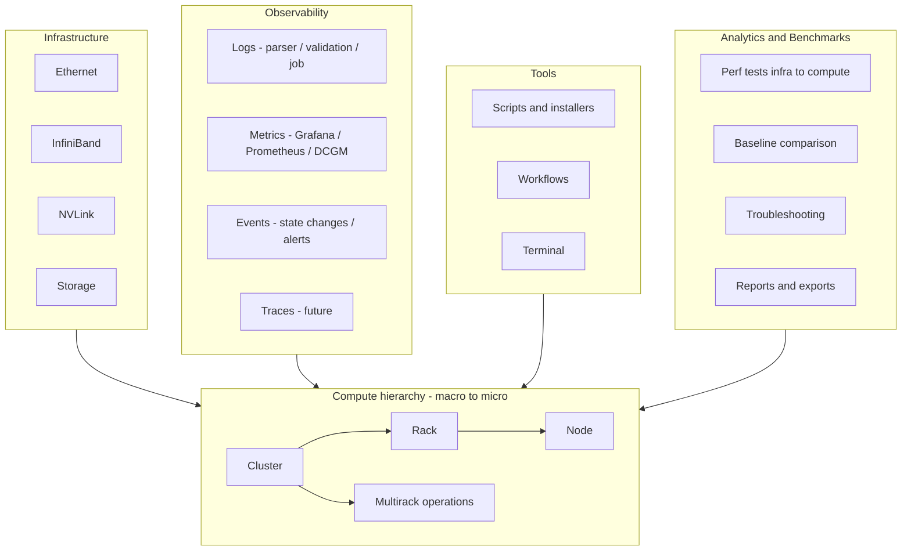
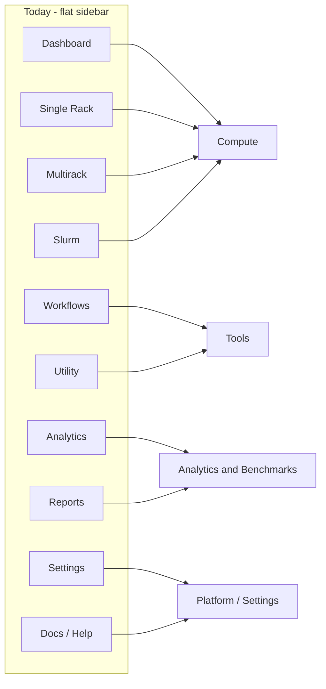
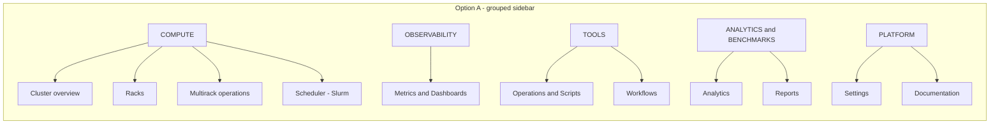
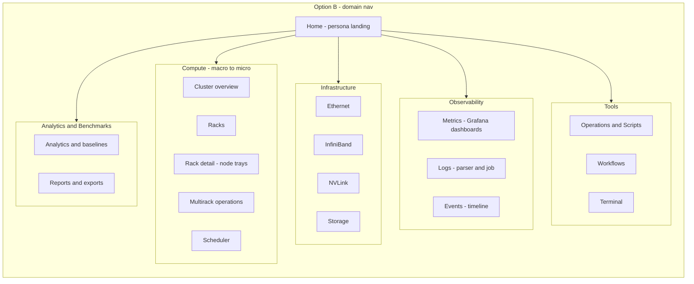
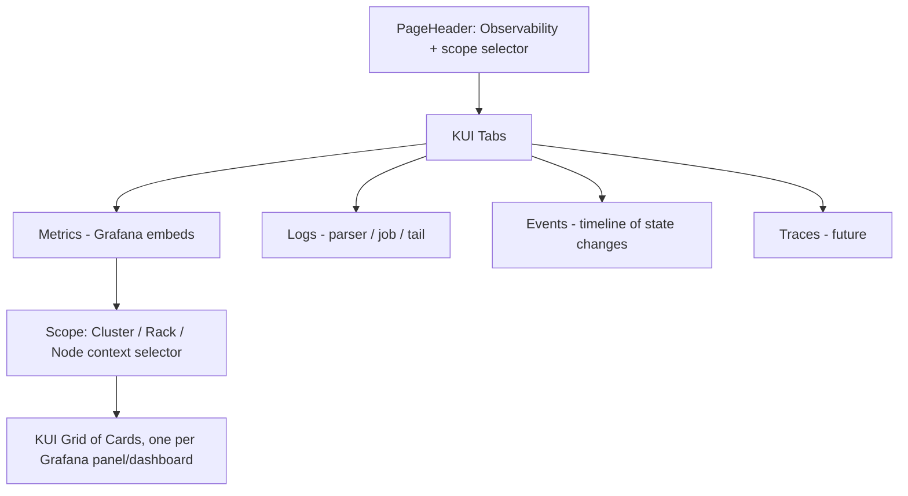
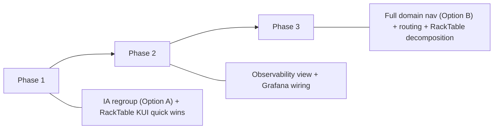

# NVIS Rack Status — UX & Information Architecture Framework

| | |
|---|---|
| **Title** | NVIS Rack Status — UX & Information Architecture Framework |
| **Team** | NVIS CBU & OVA (Observability, Validation, Automation) |
| **Author** | Rafael Marcelino Koike |
| **Year** | 2026 |
| **Revision** | v1.1 |
| **Status** | Approved baseline; implementation follows in phases (see Section 12). v1.1: Multirack moved into Compute as multi-rack operations (was under Analytics & Benchmarks). |
| **Audience** | Developers, designers, project managers, and AI agents working on the NVIS Rack Status tool |

> Copyright (c) 2026 NVIDIA Corporation. All rights reserved.
> NVIDIA Confidential — for internal use within NVIDIA and authorized partners only.

## 1. Overview — who should read this

This document is the shared reference for how NVIS Rack Status should *look*, *feel*, and be *organized*. It defines a domain-based mental model, the design principles behind it, an evaluation of today's UI, and a phased plan to improve it. It is written for four audiences, each of whom should be able to act on it:

| Reader | What to take from this document |
|---|---|
| **Developers** | The information architecture, the KUI-first component decisions, the Observability/RackTable implementation specs, and the phased roadmap. This is the contract for *where* features live and *which* components to build them with. |
| **Designers** | The design principles (Section 3), the persona model, and the three-click rule. Use these to critique flows and propose layouts that stay consistent with the system. |
| **Project / Program Managers** | The personas, the "what does great UX mean" framing, and the roadmap phases. Use these to understand scope, sequencing, and the user value each phase unlocks. |
| **AI assistants / agents** | The full framework as ground truth. When generating or modifying UI in this repo, follow the domain placement, the design principles, the three-click rule, and the KUI component guidance here rather than inventing new patterns. |

Read Sections 2 and 3 first — they are the *foundation*. Everything after (domains, IA, components) is an application of those principles and should be validated against them.

## 2. What is UX, and why it matters

**User Experience (UX)** is the total quality of a person's interaction with a product: how easily they understand it, how quickly they accomplish their goal, how confident they feel doing it, and how they feel afterward. It is broader than the visual interface (UI). UI is what you see; UX is the *outcome* of using it — the speed, clarity, trust, and lack of friction.

A useful way to frame UX is as a hierarchy of needs, from the bottom up:



A tool can be fully *functional* and still have poor UX if it is hard to navigate, inconsistent, or slow to get to the action you need. NVIS Rack Status is past "functional" and "reliable" — the next gains are in **usable, convenient, and pleasurable**.

### Why it matters for this tool

- **Time-to-first-token / time-to-revenue.** Every extra click, ambiguous label, or buried screen slows down a Solutions Architect validating a rack. UX directly affects how fast a cluster gets validated and handed off.
- **Trust at the edge.** Partners and customers may use this as their single pane of glass. A cluttered or confusing interface erodes confidence in the cluster *and* in NVIDIA's tooling.
- **Cognitive load is the enemy.** Operators work under pressure during deployments. A clear, predictable structure means less to remember and fewer mistakes on destructive actions.
- **It compounds.** Good structure makes the *next* feature easier to add and easier to find. Bad structure makes every addition a new special case (which is how we got a flat 10-item menu).

This is the foundation that justifies everything that follows. When we later choose where a feature lives or which component to use, the test is always: *does it make the experience more usable, more convenient, and clearer?*

## 3. Design principles

Great technical tools borrow from a long lineage of design and art. Steve Jobs traced Apple's typography to a calligraphy class he took at Reed; the Bauhaus taught that *form follows function*; Dieter Rams distilled industrial design to "less, but better." These are not decoration — they are a discipline for reducing what the user must think about. The principles below adapt that lineage to NVIS Rack Status, organized by the dimensions you named: **color, shape, proportion, and the senses.** Each is made actionable against Kaizen UI (KUI).

### 3.1 Color — meaning before decoration

Color is a *signal*, not ornament. In a status tool especially, color carries semantics and must be used with restraint so that when something is red, it *means* something.

- **Semantic, not arbitrary.** Use the KUI status palette consistently: green = healthy/done, red = fail/critical, yellow = warning/in-progress, blue/teal = informational, gray = neutral/idle. Never overload one color with multiple meanings.
- **Use design tokens, not raw hex.** Reach for KUI tokens (`--color-text-primary`, `--background-color-surface-sunken`, `border-base`) so light/dark themes and brand consistency are automatic. Avoid standard Tailwind colors and inline hex.
- **Restraint creates emphasis.** A mostly-neutral interface lets a single colored `Tag` or `StatusIndicator` draw the eye. If everything is colored, nothing stands out.
- **Accessibility is non-negotiable.** Maintain WCAG AA contrast; never rely on color alone — pair it with an icon, label, or shape (color-blind users, projector glare in data centers).

### 3.2 Shape — consistency and affordance

Shape is how users learn "what kind of thing is this and what can I do with it." Consistency in shape lowers the learning curve.

- **One vocabulary of components.** Prefer KUI components (`Button`, `Card`, `Tag`, `Modal`) over bespoke divs so corner radius, borders, and interaction states are uniform. Mixed MUI/KUI shapes are a current source of inconsistency (Section 10).
- **Affordance through familiar form.** Buttons look pressable, inputs look fillable, links look navigable. Don't make a `Tag` look clickable unless it is; don't hide a primary action inside a menu.
- **Iconography is a shape system.** Use Lucide React exclusively, at consistent sizes, as reinforcement for labels — not as the only signal. Icons should map predictably (a chart icon always opens charts).
- **Gestalt grouping.** Related controls share a container (`Card`, `Panel`, `Group`); unrelated ones are separated by whitespace or a `Divider`. Proximity and enclosure tell the eye what belongs together.

### 3.3 Proportion — hierarchy, spacing, and rhythm

Proportion is how the eye knows what is important and where to look next. Classical design leaned on the golden ratio and the rule of thirds; modern UI achieves the same through a consistent spacing scale and typographic hierarchy.

- **A single spacing scale.** Use the system's spacing utilities consistently (e.g. 4/8/16/24) rather than ad-hoc pixel values. Rhythm comes from repetition.
- **Typographic hierarchy.** Use KUI `Text` `kind` levels (`display`, `title`, `body`, `mono`) to express importance; do not fake hierarchy with arbitrary font sizes. Respect the 14px minimum body text (today's `StatusLine` at 12px violates this — Section 10).
- **Whitespace is a feature.** Generous negative space reduces perceived density and makes dense data (like RackTable) scannable. Don't fill every pixel.
- **Visual weight follows priority.** The most important action on a screen is the most prominent (primary `Button`); secondary actions recede (tertiary/`ghost`). One primary action per context.
- **Alignment and grid.** Lay out with `Grid`/`Flex` on a shared baseline so elements line up; misalignment reads as noise even when content is correct.

### 3.4 Senses — feedback, motion, and perceived performance

Beyond the static picture, experience is shaped by *response* — what the interface does when you touch it. Most of this is visual and motion-based (the tool is silent), and it must respect accessibility.

- **Immediate feedback.** Every action acknowledges itself: hover/focus states, a `Toast` on success, a `Spinner`/`ProgressBar` for long operations, a `Banner` for blocking conditions. Silence after a click breeds doubt and double-clicks.
- **Perceived performance.** Use `Skeleton` placeholders shaped like the eventual content so the app feels fast while data loads, instead of a blank screen or a lone spinner.
- **Motion with purpose.** Transitions should explain change (a panel sliding in, a row expanding), not decorate. Keep it subtle and brief.
- **Respect reduced motion and focus.** Honor `prefers-reduced-motion`, maintain visible focus rings, and ensure keyboard navigability — KUI's progressive-enhancement components help here.
- **Calm by default.** Reserve attention-grabbing motion/color for genuinely important events. A control plane that constantly blinks trains people to ignore it.

> Principle in one line, after Rams: **less, but better.** When in doubt, remove rather than add; clarify rather than embellish.

## 4. Purpose & product principles

NVIS Rack Status has grown from a single-rack validation table into a multi-domain control plane for AI factory deployments. As we add features (workflows, analytics, tools, multirack, Grafana), the navigation has stayed *flat and task-oriented*, which makes the tool harder to learn and slower to operate. This document defines a **domain-based mental model**, evaluates today's UI against it, and proposes a concrete path to a cleaner, faster experience for the people who actually use the tool.

### Guiding principles

1. **Three-click rule.** Any action a user wants to perform should be reachable within **three clicks from the main view**. This excludes per-action customization (extra parameters, target selection, confirmations) that legitimately belongs on the action's own screen. The three clicks get you *to the interface*; configuring the action is separate.
2. **Hierarchical domains.** The tool is organized around the way we actually build AI factories — the compute hierarchy from macro to micro (`cluster -> rack -> node`), the infrastructure that connects them, the observability that watches them, the tools that operate them, and the analytics/benchmarks that prove them.
3. **KUI-first.** New UI uses NVIDIA Kaizen UI (`@nvidia/foundations-react-core`); MUI is retained only where a mature widget has no easy migration. See `.cursor/rules/nvis-rack-status.mdc` and `.cursor/rules/kui-components.mdc`.
4. **Persona-aware.** The same data serves three very different users (Solutions Architects, Project/Program Managers, Partners/Customers). Each should find a fast path to the 2-3 things they care about.
5. **Progressive disclosure.** Surface health and status first; hide destructive and advanced operations one layer down, behind clear, confirmable controls.

## 5. Domain framework

We formalize the product around **five domains**. The compute hierarchy is the spine, organized from macro to micro (`cluster -> rack -> node`); everything else attaches to it.



### Domain definitions

| Domain | What it contains | The question it answers |
|---|---|---|
| **Compute** | `cluster -> rack -> node` (macro to micro), plus **multirack operations** — running scripts, tests, or commands against a selected group of racks at once. The unit of work we build, validate, and operate. | "Is the cluster (and each rack/node) healthy and validated, and how do I operate several racks at once?" |
| **Infrastructure** | Ethernet, InfiniBand, NVLink, and Storage, and how each connects to the compute fabric. | "Is the fabric and storage that connects compute healthy and correctly wired?" |
| **Observability** | The observability tripod — **Logs** (validation/parser output, job logs), **Metrics** (Grafana/Prometheus time-series, GPU thermal/power, DCGM), and **Events** (state changes, drains, job start/stop, alerts) — with **Traces** as a future fourth pillar. | "What is happening right now, what happened during the last run, and what changed?" |
| **Tools** | The scripts and programs we run today — installers (HPC-X, CUDA/NCCL, NEMO sqsh, nvloom, Grafana), workflows, the head-node/compute terminal. | "How do I run the operations and automation that act on the cluster?" |
| **Analytics & Benchmarks** | Performance tests from infrastructure through compute (NCCL, NEMO/Nemotron, sn-llama, ClusterKit, nvloom), baseline comparison, the deviation analysis that drives troubleshooting, and the report/export surface that shares those results. | "How does this cluster perform against a known-good baseline, where is the gap, and how do I report it?" |

### Note on navigation order: Tools leads

The domains above are listed in the order the product is *described* — the compute hierarchy is
the spine, and everything else attaches to it. **The sidebar does not use that order.** It puts
**Tools first**, ahead of Compute:

```text
Tools -> Compute -> Infrastructure -> Observability -> Analytics & Benchmarks
```

This came from the Nscale TX deployment, where it was arrived at in practice rather than on
paper, and was ported back here because it is simply better to use. The reasoning is that
describing a product and operating one want different orders: the conceptual hierarchy explains
what the thing *is*, but an operator mid-bring-up is not browsing a hierarchy — they are
reaching for a script, a workflow or a terminal, many times an hour. The rail is ordered by how
often it is reached, not by how the domains nest.

The domain *definitions* are unchanged; only the ordering of the nav differs. `Sidebar.tsx`
carries the same note at `navEntries`, so the deviation is visible from the code as well as
from here.

### Note on Benchmarks, Analytics, and Reports

The earlier draft listed "Benchmarks & Tests" as a separate domain. On reflection it belongs **under Analytics**, not Reports:

- **Analytics** already *is* the benchmark surface — it runs `parser.sh --json`, computes baselines/medians, and shows deviation tables (`AnalyticsView.tsx`). Benchmarks and tests produce exactly the data Analytics consumes, so merging them removes an artificial seam: you run a benchmark and analyze it in one domain.
- **Reports** is a different intent — it is the *export/delivery* of status and results (Excel/CSV/bug-report artifacts), primarily for PMs and customers. That is an output surface of Analytics & Benchmarks (and of cluster status), not a peer technical domain. We therefore place Reports *inside* Analytics & Benchmarks as the "share it" step rather than giving it its own domain.

### Note on Multirack

Multirack lives in **Compute**, not Analytics. It is an *operations* surface — a way to run scripts, tests, or commands against a selected group of racks at once (a cluster-level operation), rather than a benchmark report. It sits one level up the hierarchy from the single-rack view: cluster overview → multirack operations → a single rack → a node.

> **Future consideration.** Multirack's job may eventually be absorbed into the **Racks** table via multi-select — selecting several racks and running an action against that selection (the same way bulk actions already work per-row). If that interaction proves sufficient, the standalone Multirack view can be retired. Until then it remains a dedicated Compute destination.

This framework is the **shared vocabulary** for the rest of the document and for navigation labels.

## 6. Personas & jobs-to-be-done

| Persona | Who | Primary jobs | Lives in | "Great UX" means |
|---|---|---|---|---|
| **Solutions Architect** | NVIDIA CBU / OVA / NCP teams building and troubleshooting clusters | Validate one rack at a time, run NCCL/NEMO/stress, drain/undrain, power ops, read logs, compare to baseline, fix issues | Compute (rack/node detail), Tools, Analytics & Benchmarks, Observability | Fast drill-down to a rack/node, destructive ops ≤3 clicks with confirm, logs and metrics one click from where the problem is seen |
| **Project / Program Manager** | Delivery owners tracking deployment progress | See validation completion %, which racks are done/failing/pending, export a status report | Compute (cluster summary), Analytics & Benchmarks (Reports) | A landing summary that answers "how far along are we?" without operator detail; one-click export |
| **Partner / Customer** | External operators using this as a single pane of glass | Monitor cluster health, view dashboards, see live metrics | Observability, Compute (read-only summary) | A clean, read-only health overview and Grafana dashboards with no operator clutter or risk of destructive actions |

Design implication: the **landing experience must serve PM/partner "status & health" first**, while operators (SAs) get a fast path *into* operational depth. Today these are blurred across two competing "dashboard" views (see Section 7).

## 7. Current information architecture — evaluation

### 7.1 How navigation works today

Navigation is **state-based with no router**. `[frontend/src/App.tsx](frontend/src/App.tsx)` holds an `activeView` state switched by a flat 10-item MUI `Drawer` sidebar (`[frontend/src/components/Sidebar.tsx](frontend/src/components/Sidebar.tsx)`). Rack drill-down is a second layer of state (`selectedRack`) nested inside the Single Rack view. Global cluster actions live in the MUI `AppBar` toolbar (`[frontend/src/components/Toolbar.tsx](frontend/src/components/Toolbar.tsx)`). The only pathname-aware client route is `/terminal`, which bypasses auth and the shell.

Consequence: **views and rack selection are not deep-linkable** — a full reload loses context, so a PM or partner cannot bookmark "the cluster health page."

### 7.2 Mapping today's 10 views into the 5 domains



| Current view | File | Natural domain |
|---|---|---|
| Dashboard | `ClusterDashboardView.tsx` | Compute (cluster summary) |
| Single Rack | `SingleRackView.tsx` + `RackTable.tsx` | Compute (rack list -> rack/node detail) |
| Multirack | `MultirackView.tsx` | Compute (multirack operations — run actions across a group of racks) |
| Slurm | `SlurmView.tsx` | Compute (scheduler) — also duplicated in toolbar dialogs |
| Reports | `ReportsView.tsx` | Analytics & Benchmarks (export/share) |
| Workflows | `WorkflowsView.tsx` | Tools |
| Utility | `ToolsView.tsx` | Tools (mislabeled) |
| Analytics | `AnalyticsView.tsx` | Analytics & Benchmarks |
| Settings | `SettingsView.tsx` | Platform |
| Documentation / Help | external / placeholder | Platform |

### 7.3 Identified gaps

1. **Two competing "dashboards."** Sidebar "Dashboard" (`ClusterDashboardView`) is a cluster overview; "Single Rack" (`RackTable`) is the historical operational dashboard. Users don't know which is "home."
2. **Slurm duplicated.** A full Slurm view *and* toolbar squeue/sinfo dialogs render the same panels — redundant surface area.
3. **Tools is split and mislabeled.** Install scripting lives under "Utility"; day-2 rack ops live in the rack table and rack-detail tabs; workflows are separate. The "Tools" domain is fragmented.
4. **Observability is buried.** Grafana exists only as two iframes deep inside a parser dialog; there is no first-class place to "look at the cluster's live metrics."
5. **No infrastructure domain.** Ethernet/IB/NVLink/Storage health is implicit (inside rack-detail Networking tab) rather than a navigable concern.
6. **Not deep-linkable.** No router means PM/partner-friendly shareable URLs don't exist.
7. **Flat list doesn't scale.** Ten ungrouped items with more coming (Observability, Infrastructure) will become a long, unscannable list.
8. **Analytics and Reports are split** even though they are one user story (measure → analyze → share). Today Analytics and Reports are separate items. (Multirack was historically grouped here too, but it is an *operations* surface and now belongs in Compute — see the Note on Multirack in Section 5.)

### 7.4 Click-depth audit (representative actions, from app open)

| Action | Path today | Clicks |
|---|---|---|
| Open a rack's detail | Sidebar Single Rack -> rack link | 2 |
| Open parser/NCCL charts for a rack | Sidebar Single Rack -> chart icon on row | 2 |
| Drain nodes on a rack | Single Rack -> Sinfo menu -> Drain -> Confirm | 3 (+confirm) |
| Run bulk NEMO on 3 racks | Single Rack -> Select -> 3 checkboxes -> Run -> Run NEMO | 6 |
| View live GPU thermal/power (Grafana) | Single Rack -> chart icon -> NEMO+GPU tab | 3 |
| See validation completion % | Sidebar Dashboard (or Single Rack summary) | 1 |
| Export status report | Toolbar export, or Reports view -> download | 1-2 |

Most single-rack actions already satisfy the three-click rule. The failures are **bulk operations** (6 clicks) and **finding live metrics** (buried in a dialog, conceptually invisible).

## 8. Proposed information architecture — two options

Per direction, we present a **light-touch** option and a **full redesign**, then recommend a path.

### 8.1 Option A — Light-touch regroup (lowest risk)

Keep the existing state-based sidebar and views, but **group the flat list into the five domains** using KUI section headers and `Divider`s, rename for clarity, and remove duplication.



Changes:
- Merge the two dashboards' intent: "Cluster overview" = the PM/partner cluster summary; "Racks" = the operator table (which drills macro→micro into rack and node detail). Make Cluster overview the default landing.
- Rename "Utility" -> "Operations and Scripts" under a **Tools** group; place Workflows with it.
- Remove the standalone Slurm view *or* the toolbar dialogs (keep one); label the survivor "Scheduler".
- Group **Analytics and Reports** under one "Analytics & Benchmarks" heading (measure → analyze → share). Place **Multirack operations** under Compute, since it operates a group of racks rather than reporting on them.
- Add a single **Observability** item (new view, Section 9) — this is the one net-new entry.
- Group with KUI labels/dividers; no router required.

Pros: minimal code change, no routing migration, fast to ship. Cons: still not deep-linkable; drill-down hierarchy (`cluster -> rack -> node`) still implicit.

### 8.2 Option B — Full domain-grouped redesign

Replace the flat MUI drawer with a **KUI `VerticalNav` / `TreeNav`** domain navigation, add **breadcrumbs** for the compute hierarchy, a **persona-aware landing**, and **hash/path routing** for deep links.



Key additions:
- **Breadcrumbs** (`PageHeader` + KUI `Breadcrumbs`) render `Cluster > Rack 07 > Node ct03` so the macro→micro compute hierarchy is explicit and navigable upward.
- **Persona-aware landing**: a Home that defaults to a health/status summary (PM/partner) with a prominent "Operate" entry for SAs. Could be role-driven later; initially a single clean overview.
- **Routing**: introduce hash routes (e.g. `#/compute/racks/07`) so views/racks are deep-linkable and reload-safe. This is the largest lift.
- **Infrastructure** becomes first-class: today's rack-detail Networking content is promoted/aggregated into an Infrastructure domain (Ethernet/IB/NVLink/Storage health), even if v1 simply links into existing networking actions and Grafana fabric panels.

Pros: scales with new domains, deep-linkable, matches the mental model, cleanest for partners. Cons: routing + nav migration touches `App.tsx`, `Sidebar.tsx`, `Toolbar.tsx`, and every view's entry assumptions; higher test surface.

### 8.3 Recommendation

**Adopt Option A now (Phase 1), migrate to Option B incrementally (Phase 3).** Option A delivers the domain mental model and the new Observability entry with low risk and no routing rewrite. Option B's routing + breadcrumb + Infrastructure work is valuable but should land after the Observability view and the RackTable cleanup, because it depends on stable view boundaries. The migration path is additive: the domain groupings in A become the `VerticalNav` groups in B; the new Observability view is reused as-is.

### 8.4 Three-click verification (recommended IA)

| Persona top task | Path under recommended IA | Clicks |
|---|---|---|
| SA: open rack -> drain nodes | Racks -> rack -> Sinfo menu -> Drain (+confirm) | 3 |
| SA: bulk NEMO on selection | Racks -> Select -> Run -> Run NEMO (selection is parameterization) | 3* |
| SA: view live GPU metrics | Observability -> Metrics (-> scope to rack) | 2-3 |
| PM: validation completion % | Home / Cluster overview (landing) | 0-1 |
| PM: export status report | Analytics & Benchmarks -> Reports -> Export (or toolbar export) | 1-2 |
| Partner: cluster health | Home / Cluster overview | 0-1 |
| Partner: Grafana dashboards | Observability -> Metrics | 2 |

*Selecting which racks is parameterization of the bulk action, consistent with the principle's exclusion. Bulk Run improves from 6 clicks to within the rule by treating checkbox selection as parameter setup rather than navigation.

## 9. Observability component design

Today, observability is **validation-log-centric** (Chart.js in `[frontend/src/components/ParserResultsDialog.tsx](frontend/src/components/ParserResultsDialog.tsx)` and `[frontend/src/views/AnalyticsView.tsx](frontend/src/views/AnalyticsView.tsx)`), and **Grafana is hidden** — two `/d-solo/` iframes on the parser "NEMO + GPU" tab (`[frontend/src/components/ParserGrafanaEmbeds.tsx](frontend/src/components/ParserGrafanaEmbeds.tsx)`). A backend route `GET /api/rack-grafana-live-charts` exists in `[backend/app.py](backend/app.py)` but **has no frontend caller**, and `soloUrl()` ignores the log-aligned `from/to` window the backend computes.

### 9.1 The observability tripod

Industry practice models observability as three complementary signal types — the **tripod of logs, metrics, and events** — with **traces** as a fourth pillar in distributed systems. The Observability domain should expose all three (and leave room for traces), because each answers a different question and they are most powerful when correlated on a shared timeline and scope:

| Pillar | What it is | In NVIS Rack Status | Status |
|---|---|---|---|
| **Logs** | Discrete, timestamped text records of what happened | Validation/parser output, job logs, tail streams | Exists (parser dialog, tail log) |
| **Metrics** | Numeric time-series sampled over time | Grafana/Prometheus, GPU thermal/power, DCGM | Partial (Grafana embeds buried in parser dialog) |
| **Events** | Notable state changes and signals | Drain/undrain, job start/stop/fail, power ops, lock claims, alerts | Net-new (data exists; no unified timeline) |
| **Traces** | Causal spans across a request/workflow | Workflow-step / multi-host execution spans | Future |

The Observability view's job is to make these **scopeable (cluster → rack → node)** and **correlatable** so that, for example, a spike in GPU temperature (metric) lines up with a drain (event) and the relevant job log (log).

### 9.2 Goal

A dedicated, first-class **Observability** view that makes the tripod clean and ≤3 clicks away: live Grafana **metrics**, validation/job **logs**, and an **events** timeline — all sharing a single cluster/rack/node scope selector and time window, with **traces** reserved as a future tab.

### 9.3 Layout



- **Scope selector** (cluster / rack / node) using KUI `Combobox` or `SegmentedControl`, driving the Grafana `var-job_host_regex` (reuse backend regex builders in `backend/app.py`) and filtering logs/events. This mirrors the macro→micro compute hierarchy and is shared across all tripod tabs.
- **Metrics tab** — Grafana embeds laid out as KUI `Card`s in a `Grid` (GPU thermal, GPU power, and additional panels), not buried in a dialog. Each card is a `/d-solo/` iframe.
- **Logs tab** — surfaces parser/job/tail output for the selected scope (reuse `TailLogDialog`/parser data inline rather than only in a modal).
- **Events tab** — a chronological timeline of state changes (drains, job lifecycle, power ops, lock claims, alerts) rendered with KUI `List`/`Tag`/`StatusIndicator`; sourced from existing status/command/lock data.
- **Traces tab** — placeholder for future workflow/multi-host span correlation; out of scope for v1.
- **Shared time window** across tabs so metrics, logs, and events line up on the same range.
- States: KUI `Skeleton` while loading, `StatusMessage` for empty (e.g. no rack scope chosen), `Banner` (status `warning`/`info`) when embeds are disabled via `RACK_WEB_GRAFANA_EMBED_DISABLED`.

### 9.4 Backend wiring (net-new on the frontend)

1. **Wire `GET /api/rack-grafana-live-charts`** — call the existing route for live (rolling) embed metadata so the Metrics tab can render live cluster/rack panels without going through the parser flow.
2. **Fix `soloUrl()`** in `ParserGrafanaEmbeds.tsx` to honor the backend-computed `from_iso_utc`/`to_iso_utc` and `parserDisplayTimezone` for the **validation-results** context (today it hardcodes `now-6h` / `now` / `timezone=utc`, so log-aligned windows are ignored). The live Metrics tab keeps a rolling window.
3. **Centralize Grafana URL building** into a small helper (e.g. `frontend/src/lib/grafana.ts`) shared by the parser dialog and the new Observability view, so `resolveGrafanaBase()` / panel/var construction is not duplicated.
4. **Events feed** — assemble the Events timeline from existing data already in the app: rack/command state from `RackCommandsStoreContext`, lock claims from `RackLocksContext`, and Slurm/job lifecycle from status polling. No new backend required for v1; a dedicated `/api/events` feed is a possible later enhancement.

### 9.5 Configuration

Reuse existing env (documented in `[docs/ENVIRONMENT.md](docs/ENVIRONMENT.md)`): `RACK_WEB_GRAFANA_URI`, `RACK_WEB_GRAFANA_PORT`, `RACK_WEB_GRAFANA_DASH_UID`, `RACK_WEB_GRAFANA_DASH_SLUG`, `RACK_WEB_GRAFANA_EMBED_DISABLED`, `RACK_WEB_GRAFANA_TIMEZONE`, and the host-regex variables. No new config required for v1; optionally add Grafana defaults to `config/rackstatus.toml` for deployment convenience.

### 9.6 Signal boundary (where each pillar lives)

| Pillar | Source | Time model | Lives in | Primary persona |
|---|---|---|---|---|
| **Metrics** | Prometheus via Grafana `/d-solo/` | Rolling now / log-aligned window | Observability -> Metrics tab; per-rack quick link | Partner/customer health, SA triage |
| **Logs** | `parser.sh --json`, job logs, tail streams | Per-run, log-derived | Observability -> Logs tab; parser dialog; Analytics | SA validation, PM completion |
| **Events** | Command store, lock context, Slurm/job lifecycle | Chronological timeline | Observability -> Events tab | SA triage, PM progress |
| **Traces** | Workflow / multi-host spans | Causal spans (future) | Observability -> Traces tab (future) | SA deep troubleshooting |

## 10. Main dashboard (RackTable) — KUI optimization

`[frontend/src/components/RackTable.tsx](frontend/src/components/RackTable.tsx)` (~1,461 lines) is the operator console and is **mid-KUI-migration**: it already uses KUI `Tag`, `Combobox`, `Text`, and `Flex`, but MUI still owns the `Table`, five `Menu`s, `Dialog`s, the search `TextField`, `Snackbar`, and most primary `Button`s. The grid is focused (8 columns, 3 sortable, clear select mode), so the work is **consistency and decomposition**, not redesign — and it is exactly where the design principles in Section 3 (shape consistency, proportion/whitespace, sensory feedback) pay off.

### 10.1 Prioritized recommendations

**Quick wins (Phase 1):**
1. Search `TextField` + `InputAdornment` -> KUI `TextInput` (with leading search icon) for consistent input styling.
2. Primary actions (`Select`, `Run`, `Tail Log`, `Open Log`) MUI `Button` -> KUI `Button` (`size`, not `density`).
3. `Snackbar` + `Alert` -> KUI `Toast` for non-blocking feedback.
4. Fix sub-14px text: `StatusLine` uses `fontSize: 12`, below the 14px minimum in `.cursor/rules/frontend.mdc` (and the proportion principle in 3.3).
5. De-duplicate log actions: "Open Log"/"Tail Log" appear in both the Results column and the Job menu — keep one entry point (Results column) to reduce clutter.
6. Command blink dot (`RackTableCommandIndicator`) -> KUI `StatusIndicator` / `Spinner` instead of a custom MUI Box animation (calm-by-default, 3.4).

**Structural (Phase 1/3):**
7. The five MUI `Menu`s (4 row menus + 18-item bulk Run) -> KUI `Dropdown`; group the bulk Run menu into sections (Validation / Power / Network / Slurm) so it scales.
8. Comment + confirm `Dialog`s -> KUI `Modal`.
9. Decompose the monolith into `RackTableFilters`, `RackTableBulkToolbar`, `RackTableRowMenus`, and a pure `rackTableBulkActions.ts` (the ~18-case bulk switch). Add tests (none exist today).
10. Dense Nodes-status cell (UP/DN/INST/UNK tag segments) -> consider KUI `Collapsible` or a tooltip summary for large clusters.

**Larger follow-up (Phase 3):**
11. MUI `Table` -> KUI `Table`. Justified today by sticky header + sort + pagination + custom cells; do this only after the row menus/dialogs/buttons are KUI to avoid a mixed-state regression.

### 10.2 What not to change

The column set, the 3-column sort, the select-mode interaction lockout, and the validation-filter sync with the `StatusSummary` chips are good patterns — preserve them.

## 11. Persona UX checklist

| Check | SA | PM | Partner |
|---|---|---|---|
| Landing answers their first question | Operate entry visible | Completion % visible | Health visible |
| Top task within 3 clicks | Yes (Section 8.4) | Yes | Yes |
| Destructive actions gated/confirmed | Required | Hidden | Hidden / read-only |
| Live metrics reachable | Observability ≤3 | n/a | Observability ≤2 |
| Shareable/bookmarkable view | Phase 3 routing | Phase 3 routing | Phase 3 routing |
| No operator clutter in their primary view | n/a | Overview is clean | Overview/Observability clean |

Open consideration: a lightweight **role/persona switch** (or read-only mode for partners) that hides operator-only actions. Not required for Phase 1, but the IA above is structured so it can be added without rework.

## 12. Phased implementation roadmap



- **Phase 1 — IA regroup + RackTable quick wins.** Group the sidebar into the five domains with KUI labels/dividers (Option A), rename Utility, merge the dashboard intent, place Multirack operations under Compute, consolidate Analytics/Reports, remove Slurm duplication, and land RackTable quick wins (10.1 items 1-6). Low risk, no routing.
- **Phase 2 — Observability view.** Build the dedicated Observability view (Section 9): wire `/api/rack-grafana-live-charts`, fix `soloUrl()` time windows, centralize Grafana URL building, KUI `Tabs`/`Card`/`Grid` layout with scope selector.
- **Phase 3 — Full domain nav + decomposition.** Migrate to Option B (`VerticalNav`/`TreeNav`, breadcrumbs, hash routing, first-class Infrastructure), and complete the RackTable decomposition + MUI `Table` -> KUI `Table`.

Implementation will begin with Phase 1 after this document is approved.
