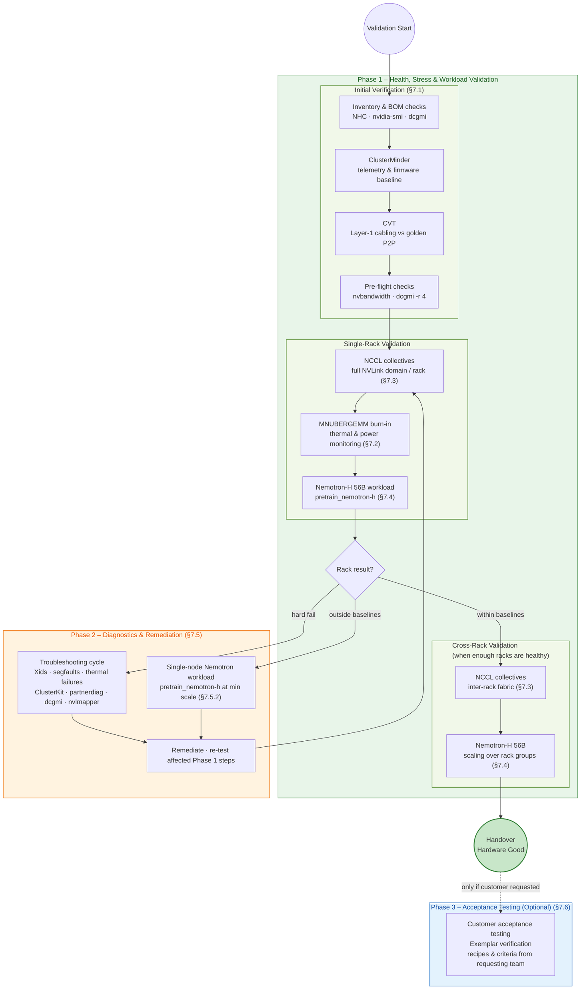

# VR200/GB300/GB200 NVL144/NVL72 Validation - FastTrack - MOP

## 1. Purpose

This Method of Procedure (MOP) defines a standardized, repeatable, and scalable systems-level validation process for **NVIDIA VR200/GB300/GB200 clusters**.

The validation strategy is organized into three phases:

- **Phase 1 – Health, Stress & Workload Validation:**  
  Establish that the hardware, fabric, and core workloads are healthy and stable under load.

- **Phase 2 – Diagnostics & Remediation:**  
  When Phase 1 reveals failures or high variance, isolate issues to the smallest affected unit and remediate using targeted diagnostics.

- **Phase 3 – Acceptance Testing (Capability, Optional):**  
  When requested by the customer, execute contractually defined acceptance tests or Exemplar benchmarks to demonstrate capability on a healthy system.

---

## 2. Scope

This procedure applies to **VR200/GB300/GB200 NVL144/NVL72 clusters**. It assumes a **FastTrack validation approach**: validate rack-by-rack, remediate as needed, then scale to cross-rack Nemotron tests before handover.

The diagram below summarizes the validation flow described in this section and maps it to the **three phases** defined in §1.



**How to read the diagram:**

| Phase | When | What happens |
| :--- | :--- | :--- |
| **Phase 1** | Always | Initial verification → per-rack NCCL, MNUBERGEMM, and Nemotron → cross-rack NCCL and Nemotron when enough racks pass |
| **Phase 2** | On rack failure or out-of-baseline performance | Troubleshooting cycle or single-node Nemotron → remediate → re-run affected Phase 1 tests |
| **End of Phase 1–2** | All racks validated | Cluster marked **Hardware Good** and handed over from an NVIS standpoint |
| **Phase 3** | Only when requested | Customer / Exemplar acceptance benchmarks using recipes and success criteria supplied by the requesting team |

Validation proceeds as follows:

- We start with **initial verification**:
  - BOM / inventory checks.
  - Software and firmware baseline alignment.
  - Health checks and telemetry (GPU, fabric, thermals, alerts).

- We then move to **Single Rack** verification which includes NCCL collective tests followed by a **burn-in test** and a **workload test** while we are passively monitoring **Thermal** and **Power** usage. The aim here is to test the inter-operability of the CTs part of the same NVL domain. From this stage we can have 3 possible outcomes:
  - the Rack performs within the baselines
  - the Rack fails (Xids, segfaults, thermal issues, etc.) -> Remediation: *Troubleshooting cycle*
  - the Rack operates outside baselines -> Remediation: *Single-node workload test*

- Troubleshooting Cycle: 
  - Isolate to the smallest affected unit (node, cable, link, NVLink domain).
  - Use targeted diagnostics (`ClusterKit`, `dcgmi diag`, `partnerdiag`, single-node Nemotron workload, `nvlmapper`, etc.) to identify root cause and remediate.

- Single-node workload test:
  - Run a single-node Nemotron workload (for example, `pretrain_nemotron-h` at minimum supported scale)
  - Compare the results, identify possible causes (NVLink, CPU, GPUs, PCIe, etc.)
  
- When a certain number of *Racks* are flagged as healthy we move to **Cross-Rack** validation.
  - Test inter-rack communication operability via NCCL collective tests
  - Test scaling efficiency via Nemotron workload tests scaling over groups of racks


From an engagement perspective:

- **Phase 1 and Phase 2** constitute the **standard NVIS hardware validation** for GB200/GB300/VR200:
  - Phase 1 focuses on **Health, Stress & Workload Validation**.
  - Phase 2 is **Diagnostics & Remediation** when issues or high variance are detected.
  - At the end of Phase 1 and Phase 2, the NVIS team has completed systems-level hardware validation for the GB200/GB300/VR200 cluster.
  - The system is considered **“Hardware Good”** and can be handed over to the customer as validated from an NVIS standpoint.

- **Phase 3 – Acceptance Testing (Optional):**
  - Phase 3 is executed **only when explicitly requested** by the customer or requesting team.
  - It covers:
    - **Customer Acceptance Testing** (e.g., DGX Cloud acceptance plans), and
    - **Exemplar Verification**, where the NVIS team runs Exemplar benchmarks to demonstrate capability.
  - For Phase 3, the **requesting team must provide the “how-to”**:
    - Specific acceptance / Exemplar recipes 
    - Clear success criteria or target metrics (Top500 runs, DGX Cloud requirements, Exemplar benchmarks from other orgs, etc.).


## 2.1 High-Level Test Summary (GB200/GB300/VR200)

The table below summarizes the core tests used in this MOP, grouped by category. It is intended as a quick map from **test category → tool → section**, and a place to record high‑level scale for each test family.

| Category | Test / Tool | Primary Purpose | Typical Scale (Example) | MOP Section / Reference |
| :--- | :--- | :--- | :--- | :--- |
| Diagnostics / Node Health | `nvidia-smi`, `dcgmi diag`, `nhc` | Node inventory, GPU presence, basic health and alert checks | All GB200/GB300/VR200 nodes, run individually | §7.1.1 |
| Telemetry / Cluster Health | **ClusterMinder** | Cluster-wide telemetry: power, thermals, alerts, health across racks and NVLink domains | All production nodes and racks covered by Redfish and HOST_DTS hostlists | §7.1.3 |
| Fabric Cabling (Layer 1) | **Cable Validation Tool (CVT)** | Verify physical cabling (hosts and switches) matches the golden P2P topology for the VR200/GB200/GB300 cluster | All hosts and switches participating in cluster validation | §7.1.4 |
| Stress – GPU / Power | **MNUBERGEMM** | High-intensity tensor core and power stress to validate GPU health and thermals at node and NVLink-domain / rack level | Single-node (N=1); full NVLink domain / rack (e.g., N = ______); optional cluster-wide | §7.2 |
| Fabric Performance | **NCCL** `all_reduce_perf_mpi` | Measure intra- and inter-node bandwidth and fabric health within and across NVLink domains / racks | 1-node loopback; 2-node sanity; mid-scale (4–8 nodes); full NVLink domain / rack; optional multi-rack | §7.3; NVIS HPC repo – NCCL Validation (Ref: NCCL-____) |
| Workload – LLM PreTrain | **Nemotron5h 56B** via DGX Cloud Benchmarking (`llmb-run`) | Validate distributed training orchestration, container stability, and derive TTFT (program-level KPI) and TT1T (performance metric) | Scaling Efficiency; full NVLink domain / rack | §7.4; DGXC repo `release/25.10`; NeMo‑LLM performance tracker (NV internal) |
| Remediation – Host / Memory / Scaling | **Single-node Nemotron workload** | Targeted diagnosis of host, memory, and compute-path issues using sustained TFLOPS/GPU during remediation | Single node on suspect hosts; optional small NVLink-domain subsets as indicated by Phase 1 results | §7.5.2; single-node benchmarking |
| Remediation – Fabric Analysis | **ClusterKit** | Bandwidth/latency heatmaps to identify slow links, failing nodes, or fabric anomalies | NVLink domains, racks, or subsets of nodes/racks as indicated by Phase 1 results | §7.5.1 |
| Supporting Tools | `NVIS Rack-Status`, `nvidia-imex-ctl`, `partnerdiag`, `nvlmapper`, `nhc`, `7AI`, `ClusterMinder`, `llpdq` | Topology validation, link-level diagnostics, and automation of health checks | Per-node, per-domain, or cluster-wide, depending on tool | §§7.1–7.5 |

This summary is intentionally compact; specific node counts, hostlists, and scaling plans should be captured in the program’s test plan and in the corresponding sections of this MOP, and where applicable in the NVIS HPC repository.

---

## 3. Pre-requisites

- **Physical**
  - All racks, nodes, and network equipment installed, powered, and accessible.
  - Fabric may not be fully installed during bring-up and single-rack validation.

- **Network**
  - OOB, BMC, and compute fabric configured and reachable from the management node.

- **Software**
  - BCM services active.
  - Slurm with Pyxis/Enroot configured and tested.
  - Docker running and accessible to the validation user.

- **Topology**
  - Point-to-point (P2P) topology / NVLink domain configuration files available and verified.
  - Inventory file, containing MAC addresses, Rack/CTs/NVSwitch IDs.

- **Documentation**
  - When Acceptance Testing (Phase 3) is in scope:  
    Phase 3 Acceptance Test / Exemplar recipes and success criteria are provided by the requesting team (e.g., DGX Cloud, program owner).

---

## 4. Roles and Responsibilities

| Role | Responsibilities |
| :--- | :--- |
| **NVIS Engineer** | Execute validation phases, monitor metrics and variance, perform triage, raise remediation tickets, and document results. |
| **Project Manager** | Track test execution and phase completion, coordinate with NVIS and customer teams, manage scope and handover dates. |
| **Customer / Requesting Team** | For Phase 3, provide acceptance / Exemplar recipes, expected targets, and acceptance criteria when Acceptance Testing is in scope; review and sign off on final results. |

---

## 5. Tools and Resources Required

- **Diagnostics & Telemetry**
  - `nvidia-smi`, `dcgmi`, `nhc`, `rack status`, `7AI`
  - `partnerdiag`, `nvlmapper`
  - `clusterminder` (deployed via Docker)

- **Stress / Performance Containers**
  - **MNUBERGEMM:** select the latest supported tag from `nvcr.io/0948245400141054/mnubergemm` matching platform architecture (ARM or x86_64)

- **Workload Containers**
  - **NeMo / Nemotron:** `nvcr.io/nvidia/nemo:<version>`

- **Remediation / Analysis**
  - `ClusterKit` bw/latency fabric test (later)

- **Supporting Infrastructure**
  - Slurm, Pyxis, Enroot, Docker and configuration.

---

## 7. Procedure Steps

> **Phase Mapping:**  
> - **Phase 1 – Health, Stress & Workload Validation:** Sections 7.1–7.4  
> - **Phase 2 – Diagnostics & Remediation:** Section 7.5  
> - **Phase 3 – Acceptance Testing (Optional):** Section 7.6  

---

### 7.1. Initial Health Check and Fabric Verification (Phase 1 – Entry)

**Objective:** Validate inventory, topology, telemetry, and firmware baselines before running stress or workload tests.

#### 7.1.1. Inventory and BOM Checks
```
Complete NHC example available here:
NHC GB300 ex. Config [https://gitlab-master.nvidia.com/nvis-row/nvis-nhc/-/blob/main/nhc.conf.DELLGB300?ref_type=heads]
```

1. GPU & NVLINK Checks
- **Scope**: Verify all GPUs are visible on the host with no errors or unknown states.
- **Artifacts**: *none*
- **Pass Criteria**: *no errors*
- **Tooling/command**: `nhc`

```bash
ex. GB300 - IB
 * || check_cmd_status -t 10 -r 0 /bin/bash -c "/usr/bin/nvidia-smi > /dev/null"
 * || check_cmd_output -t 10 -m '/4/' /bin/bash -c "nvidia-smi -L | wc -l"
 * || check_cmd_output -t 10 -m '/72/' /bin/bash -c "nvidia-smi nvlink -s|grep '5[0-9].* GB/s'|wc -l"
 * || check_cmd_output -t 10 -m '/4/' /bin/bash -c "nvidia-smi --format=csv --query-gpu gpu_bus_id,fabric.state,fabric.status|grep 'Completed.*Success'|wc -l"
 * || check_cmd_output -t 10 -m '/4/' /bin/bash -c "nvidia-smi topo -p2p n|grep GPU[0-9].*OK|grep -v NS|wc -l"
 * || check_cmd_output -t 10 -m '/4/' /bin/bash -c "nvidia-smi --format=csv,noheader,nounits --query-gpu pstate |uniq -c|awk '{ print $1 }'"
 * || check_cmd_output -t 10 -r 0 /bin/bash -c "[ $(ls -1 /dev/nvidia-caps-imex-channels/|wc -l) -ge 1 ]"
 * || check_cmd_output -t 10 -r 0 /bin/bash -c '[ "X$(nvidia-imex-ctl -q 2>/dev/null)" == "XREADY" ]'
```

2. CTs HW Checks
- **Scope**: Verify all CTs are running with same fw and correct configuration
- **Artifacts**: *none*
- **Pass Criteria**: *no errors*
- **Tooling/command**: `nhc`

```bash
ex. GB300 - IB
 * || check_dmi_data_match -h 0x0000 -t 0 "BIOS Information: BIOS Revision: 5.36"
 * || check_dmi_data_match -h 0x0001 -t 1 "System Information: Version: A.0"
 * || check_dmi_data_match -h 0x0002 -t 2 "Base Board Information: Version: -1"
 * || check_dmi_data_match -h 0x0004 -t 2 "Base Board Information: Version: A1"
 * || check_dmi_data_match -h 0x000B -t 45 "Firmware Inventory Information: Firmware Version: 1.13"
 * || check_dmi_data_match -h 0x000B -t 45 "Firmware Inventory Information: Lowest Supported Firmware Version: 1.13"
 * || check_dmi_data_match -h 0x000C -t 38 "IPMI Device Information: Specification Version: 2.0"
 * || check_dmi_data_match -h 0x000D -t 45 "Firmware Inventory Information: Firmware Version: 25.11"
 * || check_dmi_data_match -h 0x000D -t 45 "Firmware Inventory Information: Lowest Supported Firmware Version: Not Specified"
 * || check_dmi_data_match -h 0x000F -t 43 "TPM Device: Specification Version: 2.0"
 * || check_dmi_data_match -h 0x0010 -t 45 "Firmware Inventory Information: Firmware Version: F0017.450000"
 * || check_dmi_data_match -h 0x0010 -t 45 "Firmware Inventory Information: Lowest Supported Firmware Version: Not Specified"
 * || check_dmi_data_match -h 0x001A -t 4 "Processor Information: Version: Grace A02P"
 * || check_dmi_data_match -h 0x001A -t 4 "Processor Information: Max Speed: 4000 MHz"
 * || check_dmi_data_match -h 0x001A -t 4 "Processor Information: Current Speed: 3384 MHz"
 * || check_dmi_data_match -h 0x001B -t 4 "Processor Information: Version: Grace A02P"
 * || check_dmi_data_match -h 0x001B -t 4 "Processor Information: Max Speed: 4000 MHz"
 * || check_dmi_data_match -h 0x001B -t 4 "Processor Information: Current Speed: Unknown"
 * || check_dmi_data_match -h 0x0035 -t 17 "Memory Device: Speed: 6400 MT/s"
 * || check_dmi_data_match -h 0x0035 -t 17 "Memory Device: Configured Memory Speed: 6400 MT/s"
 * || check_dmi_data_match -h 0x0035 -t 17 "Memory Device: Firmware Version: Not Specified"
 * || check_dmi_data_match -h 0x0036 -t 17 "Memory Device: Speed: 6400 MT/s"
 * || check_dmi_data_match -h 0x0036 -t 17 "Memory Device: Configured Memory Speed: 6400 MT/s"
 * || check_dmi_data_match -h 0x0036 -t 17 "Memory Device: Firmware Version: Not Specified"
 * || check_hw_cpuinfo 144 144 144
 * || check_hw_physmem 1002776512kB 1002776512kB 3%
 * || check_cmd_output -t 10 -m '/4/' /bin/bash -c "/usr/bin/nvidia-smi --query-gpu=vbios_version,driver_version,inforom.img --format=csv | grep -c '97.10.4A.00.0C, 580.105.08, G548.0301.00.03'"
 * || check_cmd_output -t 10 -m '/4/' /bin/bash -c "/usr/bin/nvidia-smi --query-gpu=fabric.state,fabric.status --format=csv | grep -c 'Completed'"
 * || check_cmd_status -t 1 -r 0 /bin/bash -c "uname -r | grep -q 6.14.0-1013-nvidia-64k"
 * || check_ps_service -S -0 mst
 * || checkKernelModules
 * || checkSysconfig-slurmd
 * || checkTimeSync
 * || checkHCATemp
 * || hbmRemapGb200
 * || cpuperf 900000
 * || testSyntax
 * || check_cmd_status -t 1 -r 0 /bin/bash -c "(ofed_info -n| grep -q 25.10-1.7.1.408)"
```


3. NICs State
- **Scope**: Verify all the NICs are visible, Linkstate up and with correct FW
- **Artifacts**: *none*
- **Pass Criteria**: *no errors*
- **Tooling/command**: `nhc`
```bash
ex. GB300 - IB
 * || check_cmd_output -t 10 -m '/4/' /bin/bash -c "(egrep   "40.47.1088" /sys/class/infiniband/mlx5_{0,1,2,3}/fw_ver | wc -l)"
 * || check_cmd_output -t 10 -m '/1/' /bin/bash -c "(egrep   "32.46.3048" /sys/class/infiniband/mlx5_bond_0/fw_ver | wc -l)"
 * || BlueField-Bond
 * || check_hw_swap 0kB 0kB 3%
 * || check_hw_ib 800 mlx5_0:1
 * || check_hw_ib 800 mlx5_1:1
 * || check_hw_ib 800 mlx5_2:1
 * || check_hw_ib 800 mlx5_3:1
 * || check_hw_ib 400 mlx5_bond_0:1
 * || check_hw_eth lo
 * || check_hw_eth bond0
 * || check_hw_eth enP22s22f0np0
 * || check_hw_eth enP22s22f1np1
```


4. Drives & File System Tests
- **Scope**: Verify NVMe drives are present and PCIe link speeds are within expected ranges
- **Artifacts**: *none*
- **Pass Criteria**: *no errors*
- **Tooling/command**: `nhc`
```bash
* || check_cmd_output -t 10 -m '/4/' /bin/bash -c "(nvme  list | grep TB -c)"
* || check_cmd_output -t 10 -m '/1/' /bin/bash -c "(nvme  list | grep GB -c)"
* || check_cmd_output -t 10 -m '/1/' /bin/bash -c "(lspci -d ::0108 -vv  | egrep -c 'LnkSta:.*Speed 8GT/s.*Width x4')"
* || check_cmd_output -t 10 -m '/4/' /bin/bash -c "(lspci -d ::0108 -vv  | egrep -c 'LnkSta:.*Speed 32GT/s.*Width x4|LnkSta:.*Speed 16GT/s.*Width x4')"
...
```

5. Bandwidth test
- **Scope**: Verify GPU<->GPU, Host<->GPU, HBM local copy
- **Artifacts**: *none*
- **Pass Criteria**: *no errors*
- **Tooling/command**: `nvbandwidth`

```bash
nvbandwidth -t device_to_device_memcpy_read_ce 
nvbandwidth -t device_to_device_bidirectional_memcpy_read_ce 
nvbandwidth -t host_to_device_memcpy_ce 
nvbandwidth -t device_to_host_memcpy_ce 
nvbandwidth -t device_local_copy 
```

6. Baseline GPU Diagnostic, ECC (per-tray)
- **Scope**: GPU Diagnostic tool, verification
- **Artifacts**: *text-file-log*
- **Pass Criteria**: *no errors*
- **Tooling/command**: `dcgmi -r 4`

#### 7.1.2. Pre-Flight Health Checks

Items 5–6 above (`nvbandwidth`, `dcgmi diag`) plus the platform-specific NHC configuration in §7.1.1 constitute the pre-flight health baseline. All checks must pass before proceeding to ClusterMinder, CVT, and downstream stress tests.

#### 7.1.3. ClusterMinder

Installation and use of the ClusterMinder are provided in a separate Method of Procedure (MOP).

➡️ **Please refer to:**  
[ClusterMinder – Installation and Validation MOP](./ClusterMinder-MOP.md)

#### 7.1.4. Cable Validation Tool (CVT)

Installation and use of the Cable Validation Tool (CVT) are provided in a separate Method of Procedure (MOP).

➡️ **Please refer to:**  
[Cable Validation Tool (CVT) – Installation and Validation MOP](./Cable-Validation-Tool-MOP.md)


### 7.2. Stress Test (MNUBERGEMM) – Phase 1

**Purpose:** Apply high-intensity tensor core and power stress to validate GPU health and thermals at the node and rack/NVLink-domain level.

**Note:** MNUBERGEMM containers are published in the NVIDIA NGC registry (`nvcr.io/0948245400141054/mnubergemm`) with multiple tags across ARM and x86_64 architectures.  
Select the **latest supported tag matching your platform architecture** when running MNUBERGEMM-based validation.

Available container tags and architecture support can be verified using the NGC CLI:
```bash
ngc registry image info nvcr.io/0948245400141054/mnubergemm
```

1. **Prepare the SBATCH script (`mnubergemm.sbatch`):**

   ```bash
   #!/bin/bash
   #SBATCH --ntasks-per-node=4
   #SBATCH --cpus-per-task=36
   #SBATCH --gpus-per-node=4
   #SBATCH --exclusive

   CONT=/home/nvis/nvidian+nvis+mnubergemm-arm-xx.sqsh

   echo "#######################":
   echo "HOSTLIST: $(scontrol show hostname $SLURM_NODELIST | paste -s -d,)"
   echo "Image: ${CONT}"
   echo "#######################"

   export MELLANOX_VISIBLE_DEVICES=all

   export NCCL_NVLS_ENABLE=0
   export NCCL_DEBUG=INFO
   export NCCL_P2P_LEVEL=NVL
   export NCCL_CUMEM_ENABLE=1
   export NCCL_CUMEM_HOST_ENABLE=0
   export NCCL_IB_DISABLE=1
   export NCCL_MIN_CTAS=64
   export UCX_NET_DEVICES=bond0
   export UCX_TLS=tcp
   export NCCL_SOCKET_IFNAME=bond0 

   hosts=($(scontrol show hostnames $SLURM_JOB_NODELIST))
   ssh ${hosts[0]} nvidia-imex-ctl -N

   export NCCL_MNNVL_ENABLE=0
   [[ ${#hosts[@]} -gt 1 ]] && { export NCCL_MNNVL_ENABLE=1; }

   #setting up variables
   export STD="--dynamic_adj --MM_max_workload 65536 --max_workload 65536 --time_to_run 86400 --workload GNC"
   export MM="--MM_M 0 --MM_N 0 --MM_sm_count 112 --MM_type SX_SX_SSS --MM_force_cublas_algo SQAAABQAAAAiAAAAAQAAAAAAAAAAAAAAAAAAAAAACQAAAAAARdgBAAAAAAAAAAAAAAAAAE0AAAAAAAAAAAAAAA=="
   export NET="--NET_sm_count 32 --NET_link_order scatter_sum --NET_size 20480000"
   export CE="--CE_type H --CE_size 2048000"
   export FREQQ="--freq 400 --duty 0.9 --dual_mode --dual_freq 0.0013888889 --dual_duty 0.50"

   #executing the application
   srun --cpu-bind=none --mpi=pmix --container-image="$CONT" ./mnubergemm ${STD} ${FREQQ} ${MM} ${NET} ${CE}

   ```

2. **Execute Single-Node Stress:** 

   ```bash
   sbatch -N 1 mnubergemm.sbatch
   ```

3. **Execute Multi-Node Stress (Full NVLink Domain / Rack):** 

   ```bash
   sbatch -N <Total_Rack_Nodes> mnubergemm.sbatch
   ```

> **Success Criteria (Phase 1 – Stress):**  
> - No GPU Xid errors.  
> - No unexpected node failures or reboots.  
> - Temperature, power, and clocks remain within expected ranges (no sustained throttling).


**Test Scope & Scale (MNUBERGEMM Stress):**

- **Node-level:** `N = 1` (single-node stress).  
  - Run across all VR200/GB300/GB200 nodes (one node at a time or via a hostlist loop).
- **NVLink domain / rack-level:** `N = <Total_Rack_Nodes>`  
  - For example, `N = ______` for a full NVLink domain.
- **Optional cluster-wide stress (if requested):** `N = <Total_Cluster_Nodes>`  
  - For example, `N = ______` when stressing all cluster nodes concurrently.

---

### 7.3. NCCL Fabric Performance – Phase 1

**Purpose:** Verify intra- and inter-node bandwidth for NVLink domain and rack-level fabric.

This test will run all the NCCL collective tests:
- nccl_allreduce
- nccl_alltoall
- nccl_allgather
- reduce_scatter
- sendrecv

1. **Run against a Single-Rack:**

   ```bash
   llmb-run submit -w microbenchmark_nccl --scale 72 --nodelist p9-r[01]-ct[01-18]
   ```

   - `scale`:
     - **72** for GB200/GB300 (NVL72)
     - **144** for VR200 (NVL144)

2. **Run against Cross-Racks:**

   ```bash
   llmb-run submit -w microbenchmark_nccl --scale 144 --nodelist p9-r[01-02]-ct[01-18]
   ```

   - `scale`:
     - **72 × #Racks** for GB200/GB300
     - **144 × #Racks** for VR200

> **⚠️ DGXC `v25.10.01` — two changes from the commands above.** The `llmb-run` CLI dropped
> `submit --nodelist`; the mode is now `single`, which submits its own `sbatch` internally.
> Node pinning must be injected as a `sbatch --nodelist` CLI flag (⚠️ `SBATCH_NODELIST` is
> **ignored** by sbatch) — the NVIS wrapper does this via a transparent `sbatch` PATH shim.
> Also, `microbenchmark_nccl` ships **power-of-two scales
> only**, so the NVL72/NVL144 rack multiples (72/144 and their ×#Racks) are rejected until you
> add them to the recipe's `nccl/metadata.yaml`. Both are handled by the NVIS wrapper
> `bin/scripts/run_llmb_nccl.sh` and installer `install-dgxc-benchmarking-workspace.sh`
> (`NVIS_EXEMPLAR_GPU_TYPE` drives the scale patch). Full patch instructions for GBx00 and
> VRx00: **[`docs/DGXC_LLMB_NCCL_SCALE_PATCH.md`](DGXC_LLMB_NCCL_SCALE_PATCH.md)**.

3. **Analysis:**
   - Collect bus bandwidth results across all participating nodes.
   - Investigate any nodes or links with bandwidth **>x% below** the median.

> **Success Criteria (Phase 1 – Fabric):**
> - Rack / NVLink domain NCCL results within **±x% variance** of baseline.
> - No persistent outliers at node or link level.

---

### 7.4. Workload Testing (Nemotron5h 56B via DGX Cloud Benchmarking) – Phase 1

**Purpose:**
Validate distributed workload orchestration, container stability, and end-to-end training execution while calculating:

- **Time to First Train (TTFT)** – program-level KPI
- **Time to Train 1T Tokens (TT1T)** – performance metric

At this phase, the cluster has already passed health, stress, and fabric validation. The objective is to:

- Demonstrate that a **Nemotron5h 56B workload** can run end-to-end on the validated cluster.
- Derive **TTFT** and **TT1T** from the resulting Nemotron training run.

**DGX Cloud Benchmarking (DGXC) Reference:**

The Nemotron workloads in this MOP are based on the internal **LLM Benchmarking Collection** (DGXC) repository, validated against **release 25.10.01**:

- Repo (web): https://gitlab-master.nvidia.com/unified-cloud-benchmarking/llm-benchmarking-collection-internal/-/tree/v25.10.01?ref_type=tags
- Repo (git): `https://gitlab-master.nvidia.com/unified-cloud-benchmarking/llm-benchmarking-collection-internal.git`  (branch: `release/25.10.01`)

#### 7.4.1. Install and Configure DGX Cloud Benchmarking (`llmb-run`)

These steps are typically done **once per cluster** on a shared filesystem.

1. **Clone the DGX Cloud Benchmarking repository:**

   ```bash
   cd $HOME
   git clone --branch v25.10.01 https://github.com/NVIDIA/dgxc-benchmarking.git
   cd dgxc-benchmarking
   ```

2. **Run the installer:**

   ```bash
   ./install.sh
   ```

   The install scripts will:
   - Set up a Python 3.12 virtual environment (if needed)
   - Install essential tools (`llmb-run`, `llmb-install`)
   - Launch the main installer for benchmark configurations

   When prompted, use the following values (adjust only if your site policy differs):

   - Installation path: `/home/***/llmb`  *(choose a shared file system where workload results and tests will be run)*
   - SLURM account: `default`
   - GPU partition: `defq`
   - CPU partition: `defq`
   - GPU type: `VR200`, `GB300`, `GB200`
   - GPU Node – CPU Architecture: `x86_64` or `arm64`
   - Installation method: `SLURM`
   - Workload: `Custom` *(manually select specific recipes and choose `pretrain_nemotron-h` — select by entering spacebar)*
   - HuggingFace token: *(leave blank — Nemotron pre-training does not require an HF token)*

   Installation will take some time. It will download the NeMo container first (Submitting download via SLURM: `srun --account=root --partition=defq -t 35 --exclusive --pty --gpus-per-node=4 enroot import -o /home/dgxc-benchmarking/llmb/images/nvidia+nemo+xxx.sqsh -a x86_64 docker://nvcr.io#nvidia/nemo:xxx`).

   Sample output:

   ```bash
   Successfully downloaded /home/dgxc-benchmarking/llmb/images/nvidia+nemo+xxx.sqsh


   Downloading required tools.
  --------------------------------

  Required tools:
    - cuda_cupti_lib: 13.0.85


  Installing cuda_cupti_lib 13.0.85...
    Downloading from: https://developer.download.nvidia.com/compute/cuda/redist/cuda_cupti/linux-x86_64/cuda_cupti-linux-x86_64-13.0.85-archive.tar.xz
    Progress: 100%
    Extracting archive...
  ✓ Successfully installed cuda_cupti_lib 13.0.85

  Workload Installation Plan
  =========================

  Individual installations (1 workloads):
  Each workload will have its own virtual environment:
    • pretrain_nemotron-h
    • microbenchmark_nccl


  Installing Workloads
  ===================

  [Individual Installation - Unique Dependencies]
  Installing: pretrain_nemotron-h
  ------------------------------------------------------------

....
....


Installation complete! Workloads have been installed to: /home/dgxc-benchmarking/llmb
2026-01-21 12:50:48,984 - llmb_install.llmb_install.config.system - INFO - Saved system config to /root/.config/llmb/system_config.yaml
To run llmb-run from any directory, set the LLMB_INSTALL environment variable:
  export LLMB_INSTALL=/home/dgxc-benchmarking/llmb
Consider adding this to your shell profile (e.g., ~/.bashrc or ~/.bash_aliases) for permanent access.
2026-01-21 12:50:48,985 - llmb_install.llmb_install.config.system - INFO - Cleared install state: /root/.config/llmb/install_state.yaml
   ```

3. **Persist and verify `LLMB_INSTALL`:**

   ```bash
   echo "export LLMB_INSTALL=/home/${USER}/llmb" >> ~/.bashrc
   source ~/.bashrc
   echo $LLMB_INSTALL
   ```

---

#### 7.4.2. Launch the Nemotron5h Pre-Training Benchmark

Once installation is complete, use `llmb-run` to launch a pre-configured Nemotron-H pre-training benchmark.

1. **Navigate to your installed workload directory**

   ```bash
   cd $LLMB_INSTALL
   ```

2. **List available Nemotron workloads and scales:**

   ```bash
   llmb-run list
   ```

   Example output:

   ```text
   Available workloads:
   ==================================================

   pretrain_nemotron-h:
     56b:
       Data types: bf16, fp8
       Scales by dtype:
         bf16: 72, 1024
         fp8: 72, 512, 1024
   ```

3. **Run a single-rack Nemotron-H pre-training benchmark:**

   ```bash
   MAX_STEPS=2010 llmb-run submit -w pretrain_nemotron-h -s 56b --dtype fp8 --scale 72 --nodelist p5-r02-ct[01-18]
   ```

   - `-w pretrain_nemotron-h` – workload: Nemotron-H pre-training.
   - `-s 56b` – model size (56B).
   - `--dtype fp8` – FP8 pre-training.
   - `--scale 72` – total GPU count; with 4 GPUs per node this uses a single GB200/GB300 rack (use `--scale 144` for a single VR200 rack).

   To test at larger scales, change the `--scale` value (for example, `--scale 512`, `--scale 1024`) and ensure corresponding capacity is available.

   The last line of the output, **Workdir**, provides where the output will be written. Check the Nemotron training log (for example, `log-root-root.pretrain_nemotron_h_f...`) in that directory.

4. **Monitor job status:**

   ```bash
   squeue -u $USER
   ```

5. **Locate logs and metrics:**

   Benchmark logs and output are written under:

   ```bash
   $LLMB_INSTALL/workloads/pretrain_nemotron-h/experiments/
   ```

   Use these logs to:
   - Confirm that training steps are running.
   - Extract step times, TFLOPS, and other performance counters.

---

#### 7.4.3. Extracting Outputs and Timing Metrics

Parse training results from the default experiments directory:

```bash
$LLMB_REPO/common/parse_train_timing.sh
```

Specify a custom experiments directory:

```bash
$LLMB_REPO/common/parse_train_timing.sh /path/to/experiments
```

Output formats:

CSV:
```bash
$LLMB_REPO/common/parse_train_timing.sh --format=csv
```

JSON:
```bash
$LLMB_REPO/common/parse_train_timing.sh --format=json
```

Include full experiment names:

```bash
$LLMB_REPO/common/parse_train_timing.sh --full-names
```

All parsed outputs must be preserved as validation artifacts.

If the job starts training and produces per-step metrics (loss, step time, TFLOPS), the Nemotron workload portion of Phase 1 is considered **functionally validated**, and TTFT and variance can be evaluated against expected baselines.

#### 7.4.4. Test Scope & Scale (Workload Validation – Nemotron)

- **Baseline validation scale:**
  - Minimum GPUs: `________`  (for example, 16 GPUs)
  - Nodes (at 4 GPUs/node): `________`  (for example, 4 nodes)

- **Full NVLink domain / rack-level scale:**
  - GPUs: `________`
  - Nodes: `________`  (for example, full NVL72 or NVL144 domain)

- **Additional scales requested by customer / program:**
  - GPUs: `________`
  - Nodes: `________`

> **Note:** The effective scale for a given run is configured via the `--scale` argument to `llmb-run` (total GPU count).  
> Node count is derived from `--scale / GPUs_per_node`.

---

#### 7.4.5. Time To First Train (TTFT – Program-Level KPI)


For this MOP, **TTFT** is treated as a **program-level KPI**, not a single-job metric.

**Definition:**  
TTFT is the **wall-clock time from the start of the cluster validation process until the first successful end-to-end workload training job completes** on the cluster.

1. Record the following timestamps in the ClusterMODS journal or project tracker:
   - **T_validation_start** – the timestamp when NVIS formally starts VR200/GB200/GB300 validation
     (for example, the first logged Phase 1 Health Check entry or equivalent “validation start” marker).
   - **T_first_successful_workload** – the timestamp when the **first full Nemotron training job**
     (for example, `pretrain_nemotron-h` launched via `llmb-run`) **completes successfully** on the cluster.

2. Compute:

   ```text
   TTFT = T_first_successful_workload – T_validation_start
   ```

3. Reporting and interpretation:
   - Report **TTFT** in **days (and optionally hours)** as a program-level KPI:
     - Example: “TTFT = X.Y days from validation start to first successful training workload.”
   - TTFT answers:
     > “How long did it take, from the moment NVIS started validation on this VR200/GB200/GB300 cluster,
     > until we had a fully successful Nemotron training workload run?”

This KPI is used to characterize the **end-to-end readiness timeline** for the system, independent of any single Slurm job.

---

#### 7.4.6. Time to Train 1T Tokens (TT1T – Performance Metric)

**TT1T** is a **performance metric**, not a KPI. It estimates the time (in days) required for a given Nemotron configuration to train on **1 trillion tokens**, using measured step times from a successful run.

Given:
- **Seq_Len** – sequence length (tokens per sample),  
- **GBS** – global batch size (samples per training step across all GPUs),  
- **Step_Time_s** – average step time in seconds, measured from the Nemotron logs,  

we compute:

```text
Tokens_per_sec = (Seq_Len × GBS) / Step_Time_s

TT1T_days     = 1e12 / (Tokens_per_sec × 86400)
```

Where:
- `1e12` represents **1 trillion tokens**, and  
- `86400` is the number of seconds in a day.

**Example (32-node configuration):**
- Seq_Len = 4096  
- GBS = 256  
- Step_Time_s = 4.583  

Then:

```text
Tokens_per_sec ≈ 228,796.8580
TT1T_days      ≈ 50.6 days (cluster-level)
```

In this example:
- The cluster would train **1T tokens in ~50.6 days**.  
- If desired, a per-GPU TFLOPS figure (for example, `tflops_per_sec_per_gpu ≈ 1.02e3`) can be recorded from the Nemotron logs for deeper performance analysis.

> **Note:** TT1T is used for **performance characterization and capacity planning** (for example, “how long will a 1T-token Nemotron pretrain take on this VR200/GB200/GB300 cluster?”). It does **not** drive NVIS validation status, which is governed by Phases 1–3 and the TTFT program-level KPI above.

---

### 7.5. Phase 2: Diagnostics & Remediation (For VR200, GB200/GB300)

**Trigger:** Enter Phase 2 – Bottom-Up Diagnostics & Remediation if **any** Phase 1 tests show:

- **>x% variance** beyond acceptable thresholds for rack/NVLink domain.  
- **Persistent failures** (node, GPU, or link-level).  
- **Workload instability** (Nemotron unable to complete initialization or start training).

#### 7.5.1. Remediation Workflow

1. **Isolate the Failure (Bottom-Up):**

   - **Single-node GEMM microbenchmark fail (with acceptable MNUBERGEMM):** Likely CPU / memory / host configuration issue.  
   - **NCCL fail / low bandwidth:** Likely fabric, switch, or cable issue.  
   - **Workload fail (Nemotron):** Likely software / container / filesystem / tokenizer issue.

2. **Advanced Diagnostics (ClusterKit and Tools):**

   - Use ClusterKit to generate bandwidth/latency heatmaps and identify slow or failing links/nodes:

     ```bash
     ./clusterkit_execution_script.sh
     ```

   - Use `partnerdiag`, `nvidia-imex-ctl`, `nvlmapper`, and node-level diagnostics as needed.

3. **Remediation Actions:**

   - Re-seat or replace faulty cables / optics.  
   - Align firmware and driver versions across nodes.  
   - Isolate and repair/replace nodes with persistent hardware issues.  
   - Clean and re-populate container caches where required.  
   - Re-run targeted tests to confirm the issue is resolved before repeating full Phase 1 tests if necessary.

3. **Establish Reference and Compare Against Baseline**

   - Use a small set of **known-good nodes** of the same configuration to establish a **reference TFLOP/s range** for the cuBlasMatMul test.
   - Nodes whose single-node GEMM performance is **consistently below the reference band** should be investigated for:
     - CPU throttling or incorrect BIOS settings.
     - Memory configuration issues (channels, speed, or rank).
     - PCIe / NUMA misconfiguration.
     - Persistent GPU Xid or thermal issues.

> **Exit Criteria (Phase 2 – Diagnostics & Remediation):**  
> - All identified issues have documented root cause and remediation.  
> - Re-run of relevant Phase 1 tests confirms performance within acceptable variance.  
> - No open hardware- or fabric-related remediation tickets.

---


### 7.6. Phase 3: Acceptance Testing (Customer / Exemplar – Optional)

**Important:** Phase 3 is **optional** and is run **only if** the customer or requesting team explicitly asks for **Acceptance Testing** or **Exemplar Verification**.

- **Phases 1 and 2 (Hybrid validation + Diagnostics & Remediation)** are focused on:
  - Stressing the system design end-to-end.
  - Ensuring **consistent behavior** across racks / NVLink domains.
  - Confirming that the cluster is **“Hardware Good”** from an NVIS perspective.

- **Phase 3** shifts the focus from **validation** to **capability proof**:
  - It is about demonstrating that the validated system can meet specific, external **acceptance criteria** (numbers, targets, or behaviors) defined by the requesting team.

#### 7.6.1. Entry Criteria (When Phase 3 Is Requested)

Phase 3 may proceed **only when all of the following are true**:

- **Phase 1 – Health, Stress & Workload Validation**
  - MNUBERGEMM, NCCL, and Nemotron tests are healthy.
  - Variance between racks / NVLink domains is within the agreed range (typically **x%**); no large unexplained gaps (for example, **~30% variance**) remain.

- **Phase 2 – Diagnostics & Remediation (if triggered)**
  - All remediation items have a documented root cause and corrective action.
  - Re-runs of the relevant Phase 1 tests confirm performance is back within acceptable variance.

- **Customer / Requesting Team Ownership**
  - The **requesting team** (e.g., DGX Cloud, Mark’s org, program owner) has explicitly requested Acceptance Testing and provided:
    - One or more **acceptance / Exemplar recipes** (how to run the workload), and  
    - Clear **success criteria or target metrics** (for example: Top500 targets, DGX Cloud acceptance thresholds, Exemplar throughput/latency goals).

> NVIS does **not** define the acceptance numbers or test details for Phase 3.  
> The **requesting team owns the “what” and the “how”**; NVIS owns **executing** and **reporting** on a clean, validated system.

#### 7.6.2. Execution Principles

When Phase 3 is in scope:

1. **Use Provided Recipes As-Is**
   - Execute the acceptance or Exemplar recipes **exactly as provided** (Slurm scripts, CloudAI scenarios, TOML configs, etc.).
   - Any deviations (parameter changes, different node counts, time limits, etc.) must be agreed with the requesting team and documented.

2. **Leverage the Validated Baseline**
   - Phase 3 runs on the **same validated environment** from Phases 1 and 2:
     - Same firmware and driver baselines.
     - Same fabric / NVLink topology.
     - Same cluster configuration that passed stress and workload validation.
   - This ensures that any shortfall in acceptance criteria can be discussed separately from basic hardware health.

3. **Stress vs. Numbers**
   - Phase 3 is where **numbers may matter** (for example, hitting a Top500 score or a DGX Cloud target), but those numbers are:
     - **Supplied by the requesting team**, and  
     - Interpreted in the context of a system already proven healthy.

#### 7.6.3. Example Acceptance Scenarios

Typical Phase 3 requests may include:

- **Cluster-scale Exemplar or GEMM-based run** (as defined by the requesting team) to prove a specific performance capability.
- **Exemplar benchmarks** provided by another organization (for example, Mark’s org) to validate a reference workload.
- **DGX Cloud acceptance plans**, where DGX Cloud provides:
  - Concrete runbooks (CloudAI scenarios, model configs).
  - Required thresholds for throughput, latency, or TTFT.
  - Any additional operational criteria (e.g., ability to complete a full epoch, job reliability).

#### 7.6.4. Evaluation and Documentation

1. **Run and Measure**
   - Execute the acceptance / Exemplar workloads according to the provided instructions.
   - Capture the relevant metrics required by the acceptance plan:
     - Throughput, latency, scaling efficiency, Top500 Rmax, TTFT, convergence behavior, etc.

2. **Compare Against Acceptance Criteria**
   - Compare measured results directly to the **requesting team’s criteria**.
   - Where targets are not met:
     - Document the gap and any suspected contributing factors.
     - Confirm that underlying hardware validation (Phases 1–2) remains clean, or open new remediation if new anomalies appear.

3. **Report Back to Requesting Team**
   - Summarize:
     - Which acceptance tests were run.
     - Measured results versus requested targets.
     - Any deviations from the provided procedures.
   - Clearly distinguish between:
     - **Validation status** (Phases 1–2: Hardware Good / variance within range), and  
     - **Acceptance status** (Phase 3: whether external capability targets were met).

> When **Phase 3 is not requested**, NVIS still delivers a fully validated system at the end of Phases 1 and 2.  
> In that case, the customer or program may run their own acceptance tests directly on a system that NVIS has already marked as **“Hardware Good.”**

---

## 8. Rollback Plan

If the procedure needs to be aborted or rolled back:

1. **Software / Environment:**
   - Clear Enroot caches, temporary `venv`s, and intermediate container artifacts created during testing.
   - Revert any non-standard configuration changes applied for diagnostics or remediation (e.g., temporary Slurm or NCCL settings).

2. **Inventory / Nodes:**
   - If configuration drift is suspected, reset affected nodes to factory defaults via IPMI or BCM tooling, and re-apply the approved baseline image.

3. **Topology / Fabric:**
   - Restore fabric configuration to the last known good state based on P2P and NVLink domain files.

---

## 9. Validation

Validation is complete when all of the following are true:

- **Phase 1 – Health, Stress & Workload Validation**
  - Rack / NVLink domain variance **<x%** for MNUBERGEMM and NCCL.  
  - Nemotron workload launches and reaches first train step (TTFT) within expected range.

- **Phase 2 – Diagnostics & Remediation (if applicable)**
  - All remediation tickets closed or explicitly deferred with documented rationale.  
  - Re-run Phase 1 tests confirm that prior issues are resolved.

- **Phase 3 – Acceptance Testing (when requested)**
  - Exemplar or acceptance benchmarks executed successfully.  
  - Targets and success criteria defined by the requesting team are met or exceeded.

If **Phase 3 is not requested**, validation is considered complete once Phase 1 and Phase 2 criteria are met and the system is marked **“Hardware Good”**.

---

## 10. Post-Procedure Actions

1. **Log Collection & Archival**
   - Collect logs and outputs from:
     - `results/` folders (ClusterKit, CloudAI, etc.).
     - SLURM job logs.
     - `telemetry_snapshot.json` and/or exported ClusterMinder data.
   - Store logs in the program’s designated repository (e.g., per-cluster validation folder).

2. **Reporting**
   - Generate a **“Hand-Over Report”** summarizing:
     - Test matrix and execution history.  
     - Issues found, root causes, and remediation actions.  
     - Final metrics versus targets (Phase 1 and Phase 3, when applicable).  
     - Explicit statement of **“Hardware Good / Validation Complete”** status.

3. **Tagging for KPIs**
   - Tag all **nodes / NVLink domains** that have successfully completed the required phases (Phase 1–2, and Phase 3 if in scope) as **“Validation Complete”** in the tracking system (e.g., ClusterMODS journal, project tracker).  
   - Use these tags as the basis for KPIs such as:
     - Number of GPUs validated.  
     - Number of NVLink domains validated.  
     - Percentage of cluster capacity ready for production.

---

## 11. Acceptance Signoff

| Stakeholder | Name | Signature | Date |
| :--- | :--- | :--- | :--- |
| **NVIS Engineer** | | | |
| **Customer Lead** | | | |

---

## 12. References

- MNUBERGEMM Documentation  
- NCCL Benchmark Documentation  
- ClusterKit User Guide  
- DGX Cloud / Exemplar Benchmarking Playbooks  
- GB300/B300 Validation Strategy – internal design document: https://docs.google.com/document/d/12zm2jCr_uYYT2YFGBAZZWFIcXK9P_chsUh595HAgwDg/edit?tab=t.sb7alukwid6s
- NeMo‑LLM performance tracker (NV internal Google Sheet for LLM performance baselines)


---

## 13. Troubleshooting (Optional)

| Issue | Corrective Action |
| :--- | :--- |
| **MNUBERGEMM Hangs or Fails** | Check `nvsm show alerts` and system logs for "Xid" errors indicating GPU fallout. Verify clocks, power limits, and thermals via BMC and ClusterMinder. |
| **NCCL Bandwidth Drops / Outliers** | Use ClusterKit bandwidth/latency heatmaps to identify slow links or congested switch ports. Re-seat or replace suspect cables; validate NVLink mapping with `nvlmapper`. |
| **Slurm / Container Launch Failures** | Confirm Pyxis/Enroot configuration, container image paths, and node-level Slurm health. Re-run ClusterMODS pre-flight checks if required. |