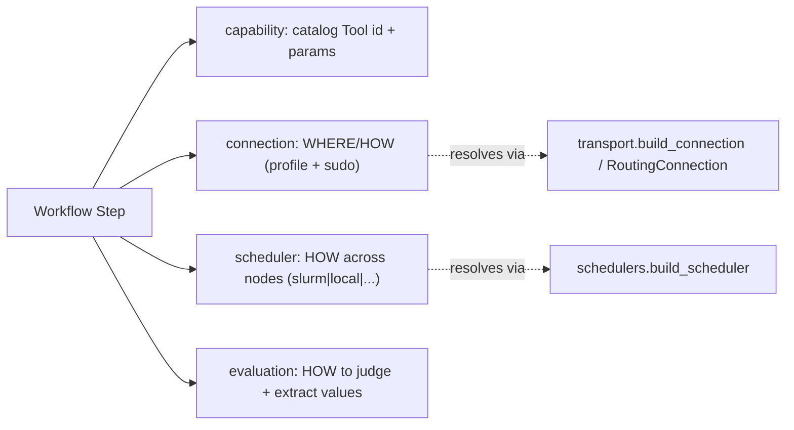

# Workflow Composition — connection / scheduler / evaluation / capability

Workflow steps are **composable "lego blocks."** Each step keeps its classic
behavior, but can now opt into three independent axes plus a capability shortcut.
Every block is **optional** — a step with none of them behaves exactly as before,
so all existing workflows (`var/workflows/gpu-health-check.yaml`) keep working.



The three axes reuse the layers we already built:

| Axis | Backend | Resolves to |
| --- | --- | --- |
| `connection` | `backend/transport/` | `RoutingConnection` (control/script) + `SudoConnection` |
| `scheduler` | `backend/schedulers/` | `SlurmScheduler` / `LocalScheduler` (+ run:AI/slinky/MaaS stubs) |
| `evaluation` | `backend/workflow_eval.py` | pass/fail + named outputs |
| `capability` | `backend/catalog/` | a registered Tool's command + typed params |

---

## `connection` — where/how a step runs

```yaml
- id: sysinfo
  type: automated
  command: RACK_SYSINFO_SCRIPT
  connection:
    profile: script      # control (default) | script (privileged route)
    sudo: true           # true -> run under sudo (implies the script route);
                         # false -> never sudo; absent -> global RACK_SCRIPT_SUDO
```

- `profile: control` (default) uses the app's normal head/login connection.
- `profile: script` uses the privileged route; combined with `sudo: true` the
  command runs under `sudo -n -E` (passwordless sudo on the node), which is how
  root-requiring tools (`sysinfo.sh`, hardware checks) run as an unprivileged
  login user (e.g. `cmods`).
- Omitting `connection` = today's behavior (global control connection).

## `scheduler` — how a step runs across nodes

```yaml
- id: nccl
  type: automated
  scheduler:
    kind: slurm                        # any catalog scheduler: slurm | pythoncm | local | runai | slinky | maas
    script: nccl_allreduce.sbatch      # resolved under bin/scripts (or absolute)
    nodelist: "${target}"              # ${param} substitution from the run
    ntasks_per_node: "${gpus_per_node}"
    output: "${log_dir}/nccl-mpi_%j.out"
  timeout: 1800
  evaluation:
    success_when: { exit_code: 0 }
    extract:
      - { name: busbw, regex: "1073741824 .* ([0-9.]+)\\s+[0-9]+\\s*$", type: float }
    assert: ["busbw >= 300"]
  on_success: done
  on_failure: review
```

- `SlurmScheduler` builds `sbatch --parsable -N <nodes> --nodelist=... --ntasks-per-node=... --output=... <script>`,
  parses the job id, polls `sacct`, and reads `StdOut` for evaluation. It makes the
  Slurm CLI usable over a bare SSH shell (Modules init + BCM modulefiles +
  `RACK_SLURM_BIN` fallback), so no login shell is required.
- Node count is taken from `nodes` or derived from the nodelist.
- `NVIS_SCRIPTS_DIR` + `GPUS_PER_NODE` are auto-forwarded via `sbatch --export` so
  batch scripts (e.g. `nccl_allreduce.sbatch`) find `lib/fabric.inc.sh`.
- `kind: local` runs the command/script directly (no batch system).
- `kind: pythoncm` submits through BCM's PythonCM on clusters without Slurm
  (`schedulers/pythoncm.py`).
- `runai`/`slinky`/`maas` are documented author-ahead stubs (raise a clear
  `NotImplementedError`); implement by subclassing `schedulers.base.Scheduler`.
- Default backend: the active cluster's `scheduler` (applied as `RACK_SCHEDULER`), else `slurm`.
- The accepted kinds are `catalog.models.SCHEDULERS`; the workflow validator reads that list
  rather than keeping its own.

## `evaluation` — how to judge + extract values

```yaml
evaluation:
  success_when:                # optional; default = exit_code 0
    exit_code: 0
    stdout_contains: "Out of bounds values : 0 OK"
    stdout_not_contains: "error"
    stdout_regex: "busbw"
  extract:                     # named values (first capture group), typed
    - { name: busbw, regex: "busbw\\s+([0-9.]+)", type: float }
  assert:                      # numeric comparisons on extracted values
    - "busbw >= 300"
  # Result context (optional). ${extracted} is substituted into any of these:
  message: "cross-rack all-reduce bandwidth check"   # generic context
  message_pass: "busbw ${busbw} GB/s ≥ 300 — healthy"
  message_fail: "busbw ${busbw} GB/s below the 300 floor"
  prompt: "If low, check NIC rail mapping / cabling and IMEX state."  # agent triage hint
```

- The result drives `on_success` / `on_failure` transitions.
- Extracted values are persisted on the run (`run.outputs`) and are available to
  later steps as `${name}` in commands or scheduler fields.
- Assertions are parsed (`name OP number`, `OP ∈ >= <= > < == !=`) — no `eval`.
- **Result context:** `message` (or outcome-specific `message_pass` / `message_fail`)
  explains *why* a step passed/failed; `prompt` (alias `comment`) is free-form content
  for an **AI agent** to explain or fix the step. Both support `${extracted}`
  substitution. They're appended to the step output **and** persisted on the run
  (`run.evaluations[step_id] = { result, message, prompt }` + on the history entry),
  so the UI and agents can surface/act on them.

## `capability` — run a registered Tool by id

```yaml
- id: sysinfo
  type: automated
  capability: sysinfo          # a catalog Tool id
  parameters: { rack: "${target}" }
```

Resolves the Tool from the catalog registry (`backend/catalog/`) to its
`env_key` (flows through the `RACK_*_SCRIPT` resolution) or a
`bash <scripts_dir>/<script>` fallback, applies the Tool's parameter defaults, and
validates required parameters (a missing one fails the step rather than
mis-running it).

---

## Designer UI

The Node Properties dialog (double-click a node) exposes **Connection**,
**Scheduler**, **Capability**, and **Evaluation (JSON)** sections. These are stored
in the mermaid frontmatter and emitted into the workflow `steps[]` on Save. The
loader hydrates the editor frontmatter from `steps[]` on open, so YAML-authored
fields (including `method`/`body`/`options`/`on_complete`) survive a save round-trip.

## Reference workflows

- `var/workflows/nccl-allreduce.yaml` — a `scheduler` (Slurm) step that submits the
  cross-rack NCCL test and gates on the measured bandwidth. Validated on Boston
  (54 nodes across 3 racks, ~557 GB/s at 1 GiB).
- `var/workflows/sysinfo-precheck.yaml` — a connection-only (`profile: script`)
  example that runs the node inventory as the privileged route.

## Tests & validity gates

- Backend: `backend/tests/test_workflow_composition.py`, `test_workflow_eval.py`,
  `test_schedulers.py`.
- Frontend: `frontend/src/components/workflow/editor/frontmatter.test.ts`.
- Gates per phase: `ruff check`, `tsc -b --noEmit`, `pytest backend/tests/`,
  `cd frontend && npm test`.
